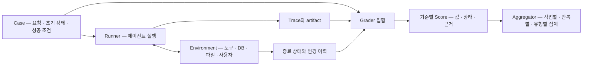

# 01 — 에이전트 평가의 개념과 데이터 모델

[스터디 인덱스](README.md) · [다음: 응답 품질과 Judge](02-response-and-judge.md)

## 1. 무엇이 어려운가?

단일 LLM 응답 평가에서는 질문과 답변을 비교하는 것으로 시작할 수 있다. 에이전트는 도구를 선택하고, 실행 결과를 읽고, 상태를 바꾸고, 필요하면 계획을 수정한다. 같은 요청에도 유효한 경로가 여러 개이고, 중간 실패를 회복한 실행이 정상 실행보다 더 길 수 있다.

따라서 평가 문제는 단순한 `grade(question, answer)`에서 다음으로 확장된다.

\[
G(x,\;\tau,\;a,\;s_0,\;s_T,\;c,\;r)
\]

- `x`: 사용자 요청과 입력 조건.
- `τ`: 관찰 가능한 실행 경로. 메시지, 도구 호출·응답, 위임·재시도 이벤트.
- `a`: 답변과 파일·코드·표 같은 산출물.
- `s₀`, `sT`: 초기 환경과 종료 환경.
- `c`: 도메인 규칙·권한·예산·금지 행동.
- `r`: 정답, 필수 결과, 허용 가능한 경로 같은 reference.

이 표기는 이 문서의 분석 모델이다. 에이전트 평가를 계획·도구·기억 같은 능력과 도메인별 작업으로 나누는 큰 연구 지형은 [Yehudai 등의 survey](https://arxiv.org/abs/2503.16416), 평가 목표와 평가 방법을 별도 축으로 다루는 관점은 [Mohammadi 등의 survey](https://arxiv.org/abs/2507.21504)를 참고할 수 있다.

## 2. 평가 대상의 여섯 층

| 층 | 질문 | 필요한 증거 | 대표 판정 방식 |
|---|---|---|---|
| 최종 응답 | 정확하고 관련 있으며 충분한가? | 요청, 답변, 정답·근거 문서 | 정규화 비교, claim 검증, rubric judge |
| 개별 행동 | 지금 이 도구와 인자가 적절한가? | 직전 관찰, 사용 가능 도구, 호출 인자 | schema·허용값 검사, reference match, 의미 판단 |
| 실행 경로 | 순서·의존성·회복·중단이 적절한가? | 연결된 이벤트 전체 | 시퀀스·부분 순서, 상태 머신, trajectory judge |
| 환경 결과 | 실제 목표 상태에 도달했는가? | DB·파일·앱 상태, 변경 이력 | 실행 가능한 predicate, 상태 비교 |
| 대화·협업 | 필요한 정보를 얻고 사용자를 제대로 안내했는가? | 여러 turn, 사용자·하위 에이전트 이벤트 | 목표별 채점, simulator, handoff 평가 |
| 자원·견고성 | 같은 일을 일관되고 합리적 자원으로 수행하는가? | 반복 실행, 토큰·시간·도구 비용 | 성공률 분포, 반복 신뢰도, 비용 조건부 비교 |

“행동을 평가한다”는 말은 숨겨진 chain-of-thought를 읽는다는 의미가 아니다. 공개된 계획이 있으면 계획의 일관성을 채점할 수 있지만, 기본 증거는 **실제로 관찰된 호출·결과·산출물**이다. 그럴듯한 설명이 원인에 대한 증거가 되지는 않는다.

## 3. 산출물과 결과를 구분하기

가상 요청: “내일 오후 3시에 4인 회의를 예약하고 참석자에게 알려줘.”

| 관찰 | 확인할 수 있는 것 | 이것만으로 확인할 수 없는 것 |
|---|---|---|
| “예약 완료” 답변 | 에이전트가 완료를 주장함 | 예약 레코드 생성 |
| `create_event(...)` 호출 | 예약 동작을 요청함 | 도구 실행 성공·commit |
| 도구의 `status=success` | 도구 계약상 성공 응답 | 외부 시스템 반영·중복 생성 여부 |
| 캘린더에서 조건에 맞는 event 확인 | 목표 상태의 일부 달성 | 잘못된 참석자에게 알림을 보냈는지 |
| 생성 event와 알림 이력·기존 event diff 확인 | 목표 결과와 일부 부작용 | 기록되지 않은 외부 부작용 |

**성공 조건과 불변 조건을 함께 정의**하면 결과가 더 명확해진다. 예를 들어 “정확한 시간·참석자의 event 1개가 생성됨”과 “기존 일정을 삭제하지 않음”은 별개 조건이다.

## 4. Eval system의 최소 아키텍처



각 구성요소를 섞지 않는 것이 확장성의 핵심이다.

- **Dataset/Case**는 무엇을 해내야 하는지 정의한다.
- **Runner/Harness**는 실행, 환경 초기화, 중단 조건, 기록을 담당한다.
- **Grader/Scorer**는 특정 기준을 특정 증거에 적용한다.
- **Metric/Aggregator**는 여러 판정을 집계한다.
- **Benchmark**는 문제 분포·환경·평가 규약을 묶는다.

용어는 프로젝트마다 다르다. Inspect의 `Scorer`는 sample을 판정하고 `Metric`은 점수를 집계하지만, DeepEval과 Ragas의 `Metric`은 개별 입력을 채점하는 객체이기도 하다. 같은 클래스 이름을 보고 동일한 추상화라고 판단하면 안 된다. [Inspect Scorer][in-scorer] · [Inspect Score][in-score] · [Ragas BaseMetric][rg-base]

## 5. 데이터 모델에서 보존할 정보

아래는 특정 OSS의 schema가 아니라 설계 예제다.

```json
{
  "case_id": "calendar-017",
  "trial_id": "calendar-017-run-2",
  "task": "회의 예약과 참석자 알림",
  "agent_version": "agent-config-v3",
  "environment_version": "calendar-snapshot-v2",
  "events": [
    {
      "event_id": "e4",
      "parent_id": "e2",
      "actor": "scheduler",
      "kind": "tool_result",
      "tool_call_id": "call-7",
      "status": "error",
      "payload": {"code": "SLOT_UNAVAILABLE"}
    }
  ],
  "artifact_refs": ["calendar-event.json"],
  "state_before_ref": "before.json",
  "state_after_ref": "after.json"
}
```

특히 다음 정보가 없으면 판정의 의미가 바뀐다.

| 정보 | 없을 때 생기는 문제 |
|---|---|
| `tool_call_id`, 인과 관계 | 어떤 도구 결과를 보고 다음 호출을 했는지 모름 |
| 해당 시점의 도구 목록·schema | 최선의 도구를 선택했는지 판단 불가 |
| 오류와 성공의 구분 | 요청한 행동과 수행된 행동 혼동 |
| 시간·retry·idempotency 관계 | 필요한 재시도와 중복 부작용 혼동 |
| 환경 revision·초기 상태 | 동일 입력이 다른 결과를 낸 원인 해석 불가 |
| actor와 handoff | 하위 에이전트 책임과 최종 통합 책임 혼동 |
| artifact·상태 증거 | 자기보고를 실제 결과로 오인 |

병렬 실행에서는 span tree만으로 충분하지 않을 수 있다. 부모가 같은 두 도구 호출이 독립 실행인지, 한 도구의 결과를 다른 도구가 사용했는지를 표시하려면 **명시적 의존 관계**도 필요하다.

## 6. 판정값과 적용 여부를 분리하기

점수 `0` 하나에 모든 상황을 넣으면 모델 실패와 측정 실패가 섞인다. 다음은 권장 결과 계약이다.

```json
{
  "criterion_id": "booking-created-once",
  "status": "unscorable",
  "score": null,
  "reason": "예약 DB의 종료 상태가 기록되지 않음",
  "evidence_ids": ["e4"],
  "grader_version": "booking-state-v1"
}
```

| 상태 | 의미 |
|---|---|
| `pass` / `fail` | 적용 대상이며 증거가 충분해 판정함 |
| `not_applicable` | 이 요청에는 해당 기준이 적용되지 않음 |
| `unscorable` | 적용 대상이지만 증거가 부족함 |
| `error` | 채점기 실행·파싱이 실패함 |

이는 공통 표준이 아니라 제안이다. Inspect에는 `grader_failed`와 `scoring_failed` 같은 원인 필드가 있고, Ragas Faithfulness는 판단할 statement가 없을 때 `NaN`을 반환한다. **라이브러리가 이미 제공하는 표현을 해석 없이 0이나 1로 바꾸지 않는 것**이 중요하다. [Inspect Score][in-score] · [Ragas Faithfulness][rg-faith]

## 7. 평균, 반복 신뢰도, 비용

### 7.1 서로 다른 세 질문

한 작업을 `n`회 실행해 `c`회 성공했고 `1 ≤ k ≤ n`이라고 하자.

\[
\widehat{p}=c/n
\]

\[
\widehat{pass@k}=1-\frac{\binom{n-c}{k}}{\binom{n}{k}}
\qquad
\widehat{pass^k}=\frac{\binom{c}{k}}{\binom{n}{k}}
\]

- `pass@k`: k번의 기회 중 **한 번이라도 성공**하는가?
- `pass^k`: 선택한 k번의 실행이 **모두 성공**하는가?
- `p`: 한 번 실행의 성공 비율은 얼마인가?

조합의 위 숫자가 아래 숫자보다 작으면 해당 조합값은 0으로 취급한다. 동일한 성공 확률 `p`를 가진 독립 시행이라는 가정 아래 모집단 값은 각각 `1-(1-p)^k`, `p^k`다. 실제 작업 난이도와 환경 조건이 다르면 이 가정을 그대로 적용하면 안 된다.

예를 들어 `p=0.8`, `k=4`라면 적어도 한 번 성공할 확률은 `0.9984`, 네 번 모두 성공할 확률은 `0.4096`이다. **재시도 기회를 많이 주는 제품과 한 번에 믿고 맡겨야 하는 제품은 다른 지표를 요구한다.** τ-bench의 `pass_hat_k()`는 위 `pass^k` 조합식을 실제 구현한다. [τ-bench 논문](https://arxiv.org/abs/2406.12045) · [집계 코드][tau-metrics]

### 7.2 집계 단위를 명확히 하기

가령 A 작업은 2회, B 작업은 20회 실행했다면 모든 trial을 한꺼번에 평균내는 것과 작업별 성공률의 평균은 다르다. 긴 trace에서 span 수만큼 가중한 평균도 긴 작업에 더 큰 비중을 준다.

권장 해석 단위는 **case별 trial 분포 → task 유형별 집계 → 전체 집계**다. 두 에이전트의 차이를 비교할 때 같은 case를 짝지어 보며, 신뢰구간을 계산한다면 task를 묶음 단위로 재표집하는 방법을 고려한다. 같은 case의 반복을 모두 독립적인 새 업무로 계산하지 않는다.

### 7.3 효율은 성공과 함께 읽기

단순히 호출 수가 적은 에이전트가 좋은 것은 아니다. 아무 일도 하지 않으면 호출 수는 0이다.

- 전체 실행의 평균 비용과 성공률을 함께 제시한다.
- 성공한 실행에 한정한 비용·지연도 별도로 본다.
- 실패 후 재시도를 포함한 **완료 1건당 총비용**을 구분한다.
- 병렬 도구의 호출 시간 합과 사용자에게 보이는 wall-clock latency를 구분한다.
- “최단 경로 대비 효율”은 최단 경로를 알고 있을 때만 정의한다.

## 8. 기록 재채점과 새 에이전트 실행은 다르다

기존 trace에 다른 judge를 적용하면 **채점 방법**을 비교할 수 있다. 새 에이전트가 기존 도구 응답을 그대로 받아보게 하는 replay는 **그 기록에 조건부인 행동**을 관찰한다. 새로운 행동으로 분기했다면 기존 기록은 그 행동의 결과를 제공하지 못한다.

따라서 전체 정책의 작업 성공을 비교하려면 새 행동에 맞게 상태가 전이하는 환경이 필요하다. 고정 trace 평가, recorded-response replay, 상태 기반 simulator, 실제 격리 환경은 서로 다른 실험이다. [05](05-harness-and-simulation.md)에서 이 차이를 코드 구조와 연결한다.

[in-score]: https://github.com/UKGovernmentBEIS/inspect_ai/blob/4acfd207ecca8e1c3b754a147c191f2f0f21ba71/src/inspect_ai/scorer/_metric.py#L118
[in-scorer]: https://github.com/UKGovernmentBEIS/inspect_ai/blob/4acfd207ecca8e1c3b754a147c191f2f0f21ba71/src/inspect_ai/scorer/_scorer.py#L35
[rg-base]: https://github.com/vibrantlabsai/ragas/blob/298b68274234c060deacab3cf5fb52aa3a20e885/src/ragas/metrics/collections/base.py#L13
[rg-faith]: https://github.com/vibrantlabsai/ragas/blob/298b68274234c060deacab3cf5fb52aa3a20e885/src/ragas/metrics/collections/faithfulness/metric.py#L22
[tau-metrics]: https://github.com/sierra-research/tau2-bench/blob/4ce7c0397c1eb65c9bbe59aeacfe1ca44a1cd699/src/tau2/metrics/agent_metrics.py#L113
