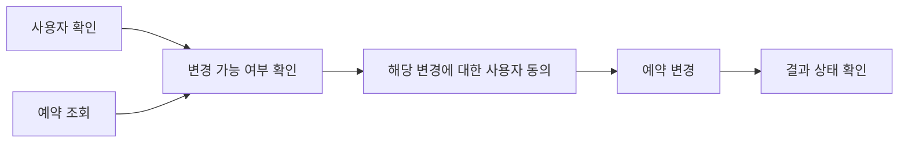

# 03 — 도구 선택, 인자, 실행 경로 평가

[스터디 인덱스](README.md) · [이전: Judge](02-response-and-judge.md) · [다음: 라이브러리 코드](04-evaluator-libraries.md)

## 1. 도구 사용을 일곱 단계로 나누기

“적절한 도구를 호출했는가?”는 여러 질문의 축약이다.

| 단계 | 평가할 것 | 실패 예 |
|---|---|---|
| 호출 필요성 | 지금 도구가 필요한가? | 충분한 정보가 있는데 검색을 반복하거나, 실시간 사실을 추측 |
| 후보 검색 | 적절한 도구가 모델의 후보 목록에 들어왔는가? | 카탈로그 검색이 예약 변경 도구를 누락 |
| 도구 선택 | 후보 중 작업에 맞는 기능을 골랐는가? | `search_booking` 대신 `cancel_booking` 선택 |
| 인자 구성 | 대상·시간·단위·타입·필수값이 맞는가? | 다른 사용자 ID, 잘못된 시간대, 존재하지 않는 enum |
| 호출 실행 | 실행이 수락되고 성공했는가? | HTTP 성공이지만 업무 상태는 rejected |
| 결과 해석 | 결과·오류를 다음 행동에 올바르게 반영했는가? | 빈 검색 결과를 “해당 항목 존재”로 해석 |
| 최종 효과 | 호출이 원하는 상태 변화로 이어졌는가? | 같은 예약을 두 번 생성 |

후보 검색 실패와 선택 실패를 구분하려면 해당 시점의 **사용 가능한 도구 목록**을 남겨야 한다. 도구가 주어지지도 않았는데 모델의 선택 실패로 분류할 수는 없다. 큰 카탈로그에서는 검색의 `recall@k`와 선택의 conditional accuracy를 따로 본다. [관련 Tool Search 분석](../tool-search-comparison/tool-search-landscape.md)

MCP의 연결·schema 교환이 성공했다는 사실도 위 단계 전체의 성공을 뜻하지 않는다. 프로토콜 적합성, 업무에 맞는 도구 선택, 도구 실행의 효과는 다른 기준이다.

## 2. 인자 평가의 네 수준

| 수준 | 예 | 구현 아이디어 |
|---|---|---|
| 구조·타입 | required field, enum, integer | JSON Schema/Pydantic 검증 |
| 값의 정합성 | 예약 ID, 금액·통화, 날짜 | 정확 비교·허용값·범위 |
| 의미적 동등성 | “서울”과 허용된 지역 식별자 | 업무별 정규화·동등성 함수 |
| 출처·제약 | 직전 검색 결과에 존재하는 ID인가? | tool result와 인자의 관계 검사 |

**문법적으로 유효한 JSON은 인자가 옳다는 뜻이 아니다.** 반대로 문자열이 다르다고 의미까지 틀린 것도 아니다. 정규화는 값의 의미에 따라 제한해야 한다. 검색어는 동의 표현을 허용할 수 있지만 계좌번호·주문 ID에 유사도 매칭을 적용하면 다른 대상을 통과시킬 수 있다.

공간·단위·시간대도 중요하다. `15:00`과 `06:00Z`가 같은 시각인지는 날짜와 시간대가 있어야 판단할 수 있다. 숫자 `1`과 문자열 `"1"`을 같게 볼지는 API 계약에 따라 다르다.

## 3. 단일 정답 경로의 문제

다음 업무를 생각해 보자.

1. 사용자와 예약을 조회한다.
2. 예약 변경 가능 여부를 확인한다.
3. 동의를 얻는다.
4. 예약을 변경한다.
5. 결과를 확인한다.

사용자 조회와 예약 조회는 동시에 수행할 수 있고, 캐시된 사용자 정보가 있으면 조회 하나를 생략할 수 있다. 서비스의 정상적인 일시 오류 때문에 재시도가 필요할 수도 있다. 따라서 **정답 예시 경로 하나**와 **업무상 반드시 지켜야 하는 제약**은 다르다.



이런 부분 순서(DAG)는 독립 호출의 순서를 고정하지 않으면서 선행 조건을 표현한다. 다만 그림은 설계 모델이며 아래 라이브러리들의 모든 matcher가 이런 DAG 제약을 직접 지원하는 것은 아니다.

## 4. 비교 알고리즘별 의미

| 방식 | 통과 조건 | 적합한 경우 | 놓치는 것 |
|---|---|---|---|
| Exact sequence | 호출과 순서가 전부 일치 | 단계가 고정된 좁은 작업 | 다른 유효 경로 |
| Unordered multiset | 순서는 무시하되 호출별 대응과 횟수 일치 | 독립·병렬 호출 | 의존 순서 |
| Expected subsequence | 필수 호출이 순서대로 포함 | 중간 탐색·재시도 허용 | 추가 호출의 유해성 |
| Actual subset | 실제 호출이 허용 목록 안에 포함 | 호출 허용 범위 | 아무것도 안 해도 통과 가능 |
| Actual superset | 실제 호출에 필수 목록 포함 | 최소 필수 행동 | 불필요·금지 호출 |
| Precision/Recall/F1 | 호출 매칭의 누락·추가 비율 | 여러 행동의 부분 달성 | 분모·중복 처리에 따라 의미가 달라짐 |
| State predicate | 마지막 환경이 조건을 만족 | 결과 중심 작업 | 중간 위반·나중에 되돌린 부작용 |
| Semantic trajectory judge | 주어진 맥락에서 경로가 타당 | 다양한 해법, 오류 회복 | judge의 오판과 증거 누락 |

이 표는 일반 개념이다. 같은 이름의 OSS 옵션이 모두 표의 엄밀한 정의를 따르는 것은 아니다.

### 4.1 호출별 precision과 recall을 직접 정의한다면

실제 호출 multiset `A`, 기대 호출 multiset `R`에서 일대일로 대응되는 호출 수를 `M`이라 하자.

\[
P=M/|A|,\quad R_c=M/|R|,\quad F1=2PR_c/(P+R_c)
\]

`M`은 업무별 동등성 관계로 정의한다. 유사도 매칭을 사용하면 최대 이분 매칭이 필요한 경우도 있다. 동일 호출 반복을 벌점에 포함할지, 재시도를 하나의 논리 동작으로 합칠지도 먼저 결정한다.

빈 집합 처리는 별도 계약이다. 기대 호출과 실제 호출이 모두 비어 있다면 “도구를 쓰지 않은 판단이 옳다”로 1을 줄 수 있다. 호출 품질 지표가 적용되지 않았다고 처리할 수도 있다. 다음 구현 비교에서 보듯 라이브러리마다 선택이 다르다.

## 5. 실제 OSS의 의미 차이

### 5.1 AgentEvals의 네 모드

`create_trajectory_match_evaluator()`는 `strict`, `unordered`, `subset`, `superset`에 따라 scorer를 선택한다. `tool_args_match_mode`는 별도 축이다. [factory][ae-match]

| 모드 | 실제 구현 |
|---|---|
| `strict` | 메시지 길이·role·tool-call 존재 여부·메시지별 호출 수를 비교. 같은 메시지의 호출은 소비 표시를 두고 순서 없이 이름·인자로 대응 |
| `unordered` | 양방향 superset 검사. 호출 횟수를 보존하며 전체 메시지 role·content는 비교 대상에서 빠짐 |
| `subset` | actual의 호출들이 reference에 포함되는지 확인 |
| `superset` | reference의 호출들이 actual에 포함되는지 확인 |

**`strict`는 최종 답변·tool response의 `content`를 비교하지 않는다.** 한 메시지의 병렬 tool call 배열 순서가 바뀌어도 통과할 수 있다. 일반 문장 품질과 상태 변화는 별도 scorer가 필요하다. [strict][ae-strict] · [호출 추출과 매칭][ae-utils]

인자에는 `exact`, `ignore`, `subset`, `superset`을 적용할 수 있고, 도구별 override로 특정 key 또는 callback을 지정할 수 있다. 예를 들어 검색어만 의미적으로 비교하면서 식별자·금액은 정확 비교할 수 있다.

주의할 코드 설계: superset helper는 **greedy 일대일 매칭**이다. exact equality에서는 자연스럽지만 사용자 정의 matcher가 여러 후보와 겹치게 매칭되면 순서에 따라 최대 매칭을 놓칠 수 있다. 또한 trajectory `subset`은 helper의 actual/reference를 뒤집어 호출한다. 비대칭 인자 matcher를 결합할 때는 callback의 두 인자를 원하는 방향으로 받는지 확인해야 한다. 이는 해당 구현에서 도출한 제약이다. [subset][ae-subset] · [helper][ae-utils]

### 5.2 Ragas — 같은 tool metric도 분모가 다르다

**collections `ToolCallAccuracy`**:

- AI 메시지의 tool call을 전부 펼친다.
- strict이면 도구 이름 sequence 전체를 비교하고, flexible이면 정렬한다.
- 이름 sequence가 다르면 최종 점수에 0을 곱한다. 길이 차이도 여기서 0이 된다.
- sequence가 같으면 기대 인자 key별 일치율을 계산한다.
- 인자 값은 `str()`로 비교하며, reference에 없는 추가 key는 점수 분모에 넣지 않는다.

따라서 이 스냅샷에서 `id=1`과 `id="1"`이 같게 처리될 수 있고, 기대 key를 전부 맞추면 추가 인자가 있어도 1이다. 함수 이름에 `exact_match_args`가 있다고 schema 전체의 exact equality로 이해하면 안 된다. [Accuracy][rg-accuracy] · [인자 비교][rg-args]

**collections `ToolCallF1`**:

- 호출 이름과 인자를 hashable 표현으로 만든다.
- actual과 expected를 **set**으로 변환한다.
- 교집합·차집합으로 F1을 계산한다.
- 동일한 호출 반복은 하나가 된다. 양쪽이 모두 빈 집합이면 0이다.

이 점수는 고유 호출의 구성에 대한 F1이다. 반복 호출의 비용·위험을 알고 싶으면 횟수나 환경 부작용을 별도로 봐야 한다. [F1][rg-f1] · [F1 helper][rg-f1-util]

### 5.3 DeepEval ToolCorrectness

기본 설정에서 `evaluation_params=[]`이고 exact/order 옵션도 false다. 이름·type이 맞는 기대 도구를 실제 호출에서 찾아 기대 도구 수로 정규화하는 경로를 탄다. 추가 호출 전체를 precision 분모로 벌점 주는 방식은 아니다. [구현][de-tool]

- 인자 평가: `ToolCallParams.INPUT_PARAMETERS`를 명시.
- 결과 비교: `ToolCallParams.OUTPUT`을 명시.
- 정확 경로: `should_exact_match=True`.
- 순서 부분 점수: `should_consider_ordering=True`, weighted LCS 사용.
- `available_tools`가 있으면 지원되는 경로에서 별도 selection judge를 실행하고 calling score와 selection score의 최솟값을 사용.

`ArgumentCorrectnessMetric`은 제공된 호출 인자의 적절성을 판단하지만 호출 목록이 비어 있으면 1을 반환한다. “필수 도구를 하나도 쓰지 않았는데도 인자 정확성 1”은 모순이 아니다. **호출 필요성**을 다른 지표로 측정해야 한다는 뜻이다. [ArgumentCorrectness][de-args]

### 5.4 ADK TrajectoryEvaluator

`EXACT`, `IN_ORDER`, `ANY_ORDER`는 각각 완전한 sequence, 기대 sequence의 포함, 순서 없는 기대 호출의 포함이다. 뒤의 두 모드는 추가 호출을 허용한다. `ANY_ORDER`는 actual 복사본에서 매칭 항목을 제거하므로 횟수를 보존한다. [구현][adk-traj]

이 평가는 **invocation마다 0 또는 1을 준 뒤 평균**한다. 10개 호출 중 9개가 맞았다고 항상 0.9가 되는 지표가 아니다. 또한 `IN_ORDER`·`ANY_ORDER`에서 기대 목록이 비면 true이므로 도구 사용 금지를 표현하려면 `EXACT`나 별도 금지 조건이 필요하다.

## 6. 로컬에서 재현한 경계 사례

2026-10-08에 고정 커밋의 실제 Python API를 호출했다. LLM 요청은 하지 않았다. 정확한 커밋과 설치 조건은 [sources](sources.md)에 기록했다.

| 입력 변경 | 지표 | 실행 결과 |
|---|---|---|
| 도구 이름·인자는 같고 tool 결과와 최종 답변만 변경 | AgentEvals strict | `true` |
| 한 메시지 안의 두 tool call 순서만 반전 | AgentEvals strict | `true` |
| 같은 호출을 한 번 더 반복 | AgentEvals unordered | `false` |
| actual이 비었고 reference에 호출이 있음 | AgentEvals subset | `true` |
| 도구 결과·최종 답변만 변경 | OpenEvals strict | `true` |
| 같은 호출을 한 번 더 반복 | Ragas ToolCallF1 | `1.0` |
| 양쪽 호출이 모두 없음 | Ragas ToolCallF1 | `0.0` |
| 양쪽 호출이 모두 없음 | Ragas ToolCallAccuracy | `1.0` |
| 기대 key는 같고 추가 key가 있음 | Ragas ToolCallAccuracy | `1.0` |
| reference 정수 1, actual 문자열 "1" | Ragas ToolCallAccuracy | `1.0` |
| 같은 호출을 한 번 더 반복 | Ragas ToolCallAccuracy | `0.0` |
| 두 기대 인자 중 하나만 일치 | Ragas ToolCallAccuracy | `0.5` |

이 결과는 서로 다른 측정 정의를 보여준다. 특정 도구가 전반적으로 더 정확하다는 성능 비교는 아니다.

### 재현 코드

프로젝트 루트에서 [sources의 설치 절차](sources.md)를 따른 뒤 아래 코드를 Python 파일로 실행할 수 있다. 코드의 trace는 채점기 입력만 설명하기 위한 합성 데이터이며 실제 예약 에이전트 실행 기록이 아니다.

```python
import os
os.environ['RAGAS_DO_NOT_TRACK'] = 'true'
os.environ['LANGSMITH_TRACING'] = 'false'
os.environ['LANGCHAIN_TRACING_V2'] = 'false'
import asyncio
import copy
import json
from agentevals.trajectory.match import create_trajectory_match_evaluator
from openevals.trajectory.match import create_trajectory_match_evaluator as oe_match
from ragas.messages import AIMessage, ToolCall
from ragas.metrics.collections import ToolCallAccuracy, ToolCallF1


def call(name, args):
    return {'function': {'name': name, 'arguments': json.dumps(args)}, 'type': 'function'}


def trace(calls, result='OK', final='done'):
    calls = [{**copy.deepcopy(c), 'id': f'call-{i}'}
             for i, c in enumerate(calls)]
    return [
        {'role': 'user', 'content': 'Reserve flight'},
        {'role': 'assistant', 'content': '', 'tool_calls': calls},
        *[{'role': 'tool', 'tool_call_id': c['id'], 'content': result}
          for c in calls],
        {'role': 'assistant', 'content': final},
    ]


def match(mode, actual, ref, factory=create_trajectory_match_evaluator):
    return factory(trajectory_match_mode=mode)(
        outputs=copy.deepcopy(actual), reference_outputs=copy.deepcopy(ref))['score']


async def main():
    c1 = call('lookup', {'id': 'A'})
    c2 = call('lookup', {'id': 'B'})
    ref = trace([c1, c2])
    rows = {}
    rows['agentevals_strict_changed_text'] = match('strict', trace([c1, c2], 'ERROR', 'failed'), ref)
    rows['agentevals_strict_parallel_reordered'] = match('strict', trace([c2, c1]), ref)
    rows['agentevals_unordered_duplicate'] = match('unordered', trace([c1, c1]), trace([c1]))
    rows['agentevals_subset_empty'] = match('subset', [], ref)
    rows['openevals_strict_changed_text'] = match('strict', trace([c1, c2], 'ERROR', 'failed'), ref, oe_match)
    r = ToolCall(name='lookup', args={'id': 'A'})
    async def score(metric, actual, expected):
        return (await metric.ascore(user_input=[AIMessage(content='', tool_calls=actual)], reference_tool_calls=expected)).value
    rows['ragas_f1_duplicate'] = await score(ToolCallF1(), [r,r], [r])
    rows['ragas_f1_empty'] = await score(ToolCallF1(), [], [])
    rows['ragas_accuracy_empty'] = await score(ToolCallAccuracy(), [], [])
    rows['ragas_accuracy_extra_arg'] = await score(ToolCallAccuracy(), [ToolCall(name='lookup', args={'id':'A','extra':True})], [r])
    rows['ragas_accuracy_string_int'] = await score(ToolCallAccuracy(), [ToolCall(name='lookup', args={'id':'1'})], [ToolCall(name='lookup', args={'id':1})])
    rows['ragas_accuracy_duplicate'] = await score(ToolCallAccuracy(), [r,r], [r])
    rows['ragas_accuracy_partial_args'] = await score(ToolCallAccuracy(), [ToolCall(name='lookup', args={'id':'A','region':'WRONG'})], [ToolCall(name='lookup', args={'id':'A','region':'KR'})])
    print(json.dumps(rows,indent=2))

asyncio.run(main())
```

## 7. 규칙 준수·오류 회복·중단을 평가하려면

Tool F1만으로는 다음 행동을 평가할 수 없다.

| 행동 | 유용한 판정 방법 |
|---|---|
| 동의 이전의 쓰기 금지 | write event보다 앞선 승인 event와 대상 ID 관계 |
| 읽기 오류 후 근거 없이 쓰지 않기 | 실패한 read → write로 가는 경로의 금지 조건 |
| 일시 오류 후 적절한 재시도 | 오류 유형, 재시도 간격·횟수, 최종 회복 여부 |
| 동일 쓰기 중복 방지 | 논리 작업 ID·idempotency key·실제 레코드 수 |
| 정보가 부족할 때 질문하기 | 가능한 행동 집합과 필수 입력의 충족 여부 |
| 작업 종료 후 과잉 행동 방지 | goal 달성 이후 불필요한 호출·상태 변경 |
| 적절한 위임·handoff | 하위 에이전트에 전달한 계약과 결과 통합 여부 |

여기서 “몇 번까지 재시도 허용” 같은 숫자는 업무·도구 계약으로 결정할 항목이다. 보편적인 최적값은 없다. 복구를 잘한 trace를 단순히 길다는 이유로 낮게 평가하면 에이전트가 실패를 숨기거나 빨리 포기하는 방향으로 유도될 수 있다.

## 8. 행동 평가와 결과 평가의 결합

가상의 최종 성공 조건을 다음처럼 정의할 수 있다.

\[
Success = GoalState \land RequiredBehavior \land NoForbiddenEffect
\]

이를 충족한 실행들 사이에서 응답 설명력·효율을 비교하면 “목표는 달성했지만 잘못된 사람의 데이터를 바꾼 실행”이 평균 점수로 가려지는 일을 줄일 수 있다. 반면 탐색·학습 목적의 분석에서는 부분 점수도 필요하므로 각 하위 판정은 그대로 보존한다.

이 결합식은 본 스터디의 설계 제안이다. 모든 라이브러리가 이런 방식으로 결과를 합산하는 것은 아니다. 실제 집계 방식은 [τ-bench의 reward_basis 분석](05-harness-and-simulation.md)에서 비교한다.

[adk-traj]: https://github.com/google/adk-python/blob/7d8c9502f924ed5e7a1ab00dc1f5a603e858abc3/src/google/adk/evaluation/trajectory_evaluator.py#L40
[ae-match]: https://github.com/langchain-ai/agentevals/blob/946ad15b9f2ce9bc9843edd2bb773bd07d78ca7e/python/agentevals/trajectory/match.py#L24
[ae-strict]: https://github.com/langchain-ai/agentevals/blob/946ad15b9f2ce9bc9843edd2bb773bd07d78ca7e/python/agentevals/trajectory/strict.py#L20
[ae-subset]: https://github.com/langchain-ai/agentevals/blob/946ad15b9f2ce9bc9843edd2bb773bd07d78ca7e/python/agentevals/trajectory/subset.py#L16
[ae-utils]: https://github.com/langchain-ai/agentevals/blob/946ad15b9f2ce9bc9843edd2bb773bd07d78ca7e/python/agentevals/trajectory/utils.py#L90
[de-args]: https://github.com/confident-ai/deepeval/blob/0fb05d028b5ded9e4c466140ab3f3af90b801944/deepeval/metrics/argument_correctness/argument_correctness.py#L41
[de-tool]: https://github.com/confident-ai/deepeval/blob/0fb05d028b5ded9e4c466140ab3f3af90b801944/deepeval/metrics/tool_correctness/tool_correctness.py#L43
[rg-accuracy]: https://github.com/vibrantlabsai/ragas/blob/298b68274234c060deacab3cf5fb52aa3a20e885/src/ragas/metrics/collections/tool_call_accuracy/metric.py#L17
[rg-args]: https://github.com/vibrantlabsai/ragas/blob/298b68274234c060deacab3cf5fb52aa3a20e885/src/ragas/metrics/collections/tool_call_accuracy/util.py#L24
[rg-f1]: https://github.com/vibrantlabsai/ragas/blob/298b68274234c060deacab3cf5fb52aa3a20e885/src/ragas/metrics/collections/tool_call_f1/metric.py#L15
[rg-f1-util]: https://github.com/vibrantlabsai/ragas/blob/298b68274234c060deacab3cf5fb52aa3a20e885/src/ragas/metrics/collections/tool_call_f1/util.py#L8
