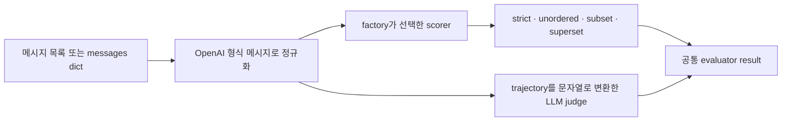
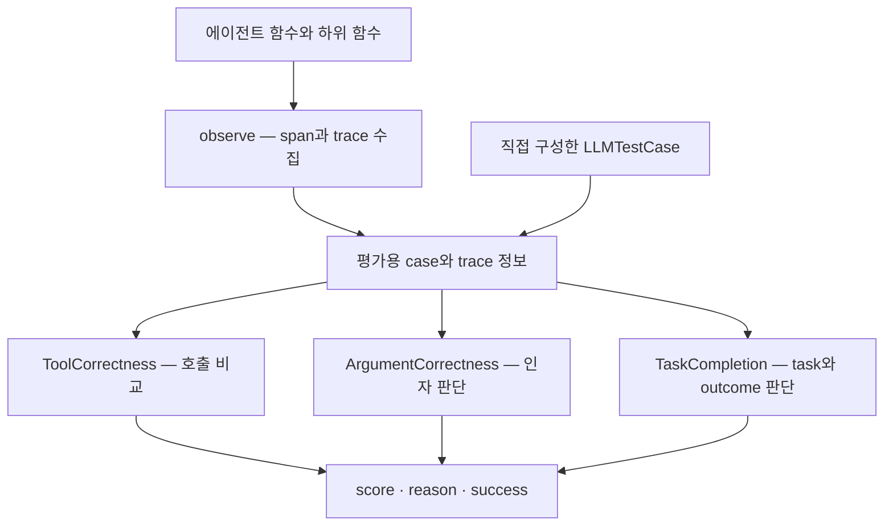

# 04 — 평가 라이브러리 소스코드 비교

[스터디 인덱스](README.md) · [이전: 도구와 경로](03-tool-and-trajectory.md) · [다음: 실행 하네스](05-harness-and-simulation.md)

> 코드 근거는 [sources.md](sources.md)의 고정 커밋이다. 이 문서는 Python 구현을 중심으로 읽었고, AgentEvals·OpenEvals의 TypeScript 구현에 모든 세부 동작이 동일하다고 가정하지 않는다.

## 1. 비교 대상과 해결하려는 문제

| 프로젝트 | 해결하려는 문제 | 중심 추상화 | 이 조사에서 읽은 핵심 |
|---|---|---|---|
| AgentEvals | 에이전트 경로를 어떻게 비교할 것인가 | trajectory → evaluator result | 메시지 정규화, 매칭 모드, graph trajectory |
| OpenEvals | 여러 평가기를 어떻게 작은 함수로 조합할 것인가 | evaluator factory | judge schema, prompt, 모델 adapter, trajectory |
| DeepEval | 응답·tool·span·전체 agent를 어떻게 연결해 평가할 것인가 | test case + metric + trace | ToolCorrectness, ArgumentCorrectness, TaskCompletion |
| Ragas | RAG와 에이전트 품질을 어떻게 지표로 분해할 것인가 | metric + structured input | tool accuracy/F1, goal accuracy, faithfulness |

네 프로젝트는 모두 채점 로직을 제공하지만, 그 자체만으로 모든 업무의 초기 상태·도구·시뮬레이터를 제공하지는 않는다. 평가할 trace를 어디서 얻을지, 실제 작업 결과를 어떻게 검증할지는 별도의 설계다.

## 2. AgentEvals — 작은 matcher와 trajectory judge

### 2.1 구조와 호출 흐름



| 경로 | 책임 |
|---|---|
| `python/agentevals/trajectory/match.py` | mode 검증, scorer 선택, evaluator 생성 |
| `trajectory/utils.py` | 메시지 정규화, 호출 추출, 인자 matcher, 포함 관계 |
| `trajectory/strict.py` | 메시지별 구조·도구 호출 비교 |
| `trajectory/llm.py` | trajectory를 prompt에 넣어 의미 평가 |
| `graph_trajectory/utils.py` | LangGraph snapshot에서 node 실행 단계 추출 |
| `graph_trajectory/strict.py` | 추출된 graph step의 정확 비교 |
| `utils.py` | OpenEvals의 evaluator 실행 wrapper로 위임 |

근거: [match][ae-match] · [utils][ae-utils] · [LLM judge][ae-llm] · [graph 추출][ae-graph] · [graph 비교][ae-graph-strict] · [wrapper][ae-wrapper]

메시지 trajectory는 도구 사용 흐름을 나타낸다. graph trajectory는 LangGraph의 어떤 node가 실행됐는지를 나타낸다. **같은 node를 거쳤다고 올바른 도구 인자·답변을 생성한 것은 아니다.** graph strict는 `steps`를 순서대로 비교하는 작은 함수이며 업무 결과 판정은 포함하지 않는다.

### 2.2 API와 확장

```python
from agentevals.trajectory.match import create_trajectory_match_evaluator

evaluator = create_trajectory_match_evaluator(
    trajectory_match_mode="superset",
    tool_args_match_mode="exact",
    tool_args_match_overrides={
        "search": ["query"],
        "reserve": ["customer_id", "slot_id"],
    },
)
# evaluator(outputs=actual_messages, reference_outputs=required_messages)
```

이 예제의 override는 지정한 key를 비교하는 것이며 `query`의 의미 유사도를 계산하지 않는다. 의미 동등성은 별도 callable로 작성해야 한다. 필수 key의 존재 여부와 schema 검증도 업무 계약에 따라 추가한다.

### 2.3 강점·제약·계산 특성

- **강점:** scorer의 코드가 작아서 실제 측정 정의를 파악하기 쉽다. 원래 에이전트 런타임이 LangGraph일 필요는 없고, 지원 메시지 형식으로 변환하면 된다.
- **제약:** reference의 품질과 정규화 방식에 의존한다. 도구 반환값·최종 답변·실제 상태의 정합성은 별도 평가가 필요하다.
- **확장점:** 도구별 인자 callback, 사용자 prompt, judge client, 공통 결과 wrapper.
- **성능:** 포함 관계 검사는 reference call마다 actual call을 순회하므로 기본적으로 `O(NM)` 매칭이다. 인자 비교비용은 별도다. strict는 각 메시지 안의 호출 수가 많으면 그 구간에서 이중 루프가 생긴다.

## 3. OpenEvals — Judge 실행과 결과 형식의 공통 레이어

### 3.1 구조

OpenEvals의 핵심은 평가 프레임워크 전체를 소유하기보다 **사용자가 자신의 pipeline에 evaluator를 끼워 넣도록 하는 factory**다. 주요 입력은 `inputs`, `outputs`, `reference_outputs`와 prompt가 요구하는 추가 필드다. [judge 구현][oe-llm]

`llm.py`에서 볼 핵심 흐름:

1. boolean·continuous·choices 중 원하는 점수 schema 구성.
2. prompt가 문자열·Runnable·callable인지에 따라 메시지 생성.
3. LangChain 모델 또는 지원 client 경로로 judge 호출.
4. structured output을 점수와 설명으로 변환.
5. evaluator wrapper에서 결과 key와 부가 정보를 정리.

답변 품질용 prompt 외에 trajectory와 tool-selection prompt도 있다. **이번 OpenEvals 스냅샷에는 `openevals.trajectory` matcher도 존재한다.** README의 “일반 평가는 OpenEvals, 에이전트는 AgentEvals” 소개만 보고 기능 경계를 배타적으로 나누면 현재 소스와 어긋난다. [OpenEvals strict][oe-strict] · [tool selection prompt][oe-selection]

### 3.2 AgentEvals와의 관계

AgentEvals는 OpenEvals를 dependency로 갖고 evaluator wrapper와 judge scorer를 가져온다. 두 저장소의 Python strict scorer 본문은 이 스냅샷에서 같은 매칭 구조를 사용한다. 이 조사에서 최종 텍스트만 바꾼 사례가 양쪽 모두 통과함을 확인했다.

이 사실은 AgentEvals가 공식적으로 폐기됐다는 뜻은 아니다. **소스상 기능 중복이 확인된다**는 범위의 결론이다. 프로젝트 상태에 관한 별도 공식 선언을 추정하지 않는다.

### 3.3 강점과 제약

- **강점:** 기존 framework의 출력에 평가 함수를 붙이기 쉽고 prompt·schema·judge를 바꾸기 편하다.
- **제약:** task, 환경, 반복 실행의 의미는 외부에서 정의해야 한다. 기본 prompt가 자신의 도메인 성공 조건을 대신하지 않는다.
- **확장점:** callable prompt, few-shot, custom output schema, 모델 객체 주입, 동기·비동기 evaluator.
- **성능:** 코드 matcher는 모델 호출이 없지만 LLM evaluator는 prompt 크기·judge의 응답 시간에 영향을 받는다. 이를 하나의 “라이브러리 속도”로 비교할 수는 없다.

## 4. DeepEval — Test case와 trace를 이어주는 평가 객체

### 4.1 데이터 모델과 아키텍처

DeepEval은 `LLMTestCase`, 대화형 case, tool call 등 평가 입력을 정의하고 metric 객체에 `measure()` 또는 `a_measure()`를 호출한다. `BaseMetric`은 score·reason·threshold·success 등 결과와 설정을 유지한다. [test case][de-case] · [BaseMetric][de-base]



`observe()`와 `Observer`는 span 수명 및 평가 연결의 진입점이다. 최종 답변만 보는 평가와 특정 tool·agent span을 대상으로 하는 평가를 같은 계열의 모델로 표현할 수 있다. [tracing 구현][de-trace]

### 4.2 ToolCorrectness의 코드 패턴

이 metric은 다음 세 알고리즘을 한 인터페이스에 묶는다. [구현][de-tool]

| 분기 | 알고리즘 | 의미 |
|---|---|---|
| exact | 길이와 각 위치의 name·type·설정된 필드를 비교 | 엄격한 sequence 판정 |
| ordering | weighted longest common subsequence | 기대 순서를 얼마나 보존했는지 부분 점수 |
| 기본 | 기대 도구마다 가장 잘 맞는 실제 호출 탐색 | 기대 호출 충족률 성격 |

인자 dict의 부분 점수는 공통 key의 일치와 전체 key 집합을 사용하며 중첩 dict에 재귀 적용한다. 따라서 Ragas의 `str()` 기반 기대 key 비교와도 의미가 다르다.

`available_tools`를 주면 도구 selection을 별도 판단하는 경로가 있다. 호출 일치 점수와 selection 점수를 평균하지 않고 **최솟값**으로 결합한다. 즉 reference를 충족했더라도 후보 목록에 비추어 부적절한 호출을 했다면 점수가 낮아질 수 있다. 이 경로가 있으므로 “ToolCorrectness는 항상 순수 코드 지표”라고 설명하면 부정확하다.

### 4.3 TaskCompletion의 설계

기본 LLM 경로는 task/outcome 추출과 alignment 판단을 분리한다. 이 구조는 긴 trace를 더 작은 판단 입력으로 바꾸지만, 첫 추출 단계에서 정보가 빠지면 다음 판정이 이를 복원하기 어렵다. task를 별도로 지정해도 outcome은 입력 증거에 의존한다. [구현][de-task]

스냅샷에는 trace가 없는 case를 읽는 fallback도 남아 있고 그 경로에 deprecate 예정 주석이 있다. 공식 문서는 tracing을 중심 사용법으로 안내한다. **소스에 있는 fallback과 장기적으로 권장되는 인터페이스를 구분**하는 것이 좋다.

### 4.4 강점·제약·확장·성능

- **강점:** 여러 granularity의 평가와 tool metadata를 표현하기 쉽다. score 외에 reason·threshold·success가 일관된 인터페이스로 노출된다.
- **제약:** metric 이름만으로 reference 여부나 LLM 호출 여부를 알기 어렵다. 옵션·eval mode에 따라 경로가 달라진다. task completion이라는 명칭이 환경 검증을 보장하지 않는다.
- **확장점:** BaseMetric 구현, custom LLM, metric별 evaluation template, observe/span 연결.
- **성능:** weighted LCS는 호출 길이 `N`, `M`에 대해 `O(NM)` 시간·DP 메모리를 사용한다. TaskCompletion의 기본 경로는 추출과 verdict의 순차 의존성이 있어 두 단계를 병렬화할 수 없다.

## 5. Ragas — 명시적인 지표 입력과 분해된 판단

### 5.1 Legacy와 collections를 구분

이 저장소에는 `metrics/_tool_call_accuracy.py` 같은 기존 구현과 `metrics/collections/...`의 새 구현이 함께 있다. 본문의 세부 점수 분석은 **collections 구현**을 기준으로 한다. 공식 문서도 이 API로의 이전을 안내한다. [공식 agent metrics](https://docs.ragas.io/en/stable/concepts/metrics/available_metrics/agents/)

새 metric은 `ascore(...) → MetricResult`를 제공한다. BaseMetric은 공통 숫자 validator와 현대적인 LLM·embedding component 검사, batch·async 편의 기능을 연결한다. 호출 입력은 metric마다 명시적인 함수 인자다. [BaseMetric][rg-base]

### 5.2 서로 다른 평가 모델

| Metric | 입력 | 핵심 채점 과정 | 실제 증거 수준 |
|---|---|---|---|
| ToolCallAccuracy | 메시지 + reference calls | 이름 sequence 정렬 여부 × 인자 부분 점수 | 제안된 호출 |
| ToolCallF1 | 메시지 + reference calls | 고유 호출 set의 precision·recall | 제안된 호출 집합 |
| AgentGoalAccuracyWithReference | 메시지 + reference outcome | 대화의 종료 상태 추론 → reference와 비교 | 기록에서 추론한 결과 |
| AgentGoalAccuracyWithoutReference | 메시지 | 목표·종료 상태 추론 → 비교 | 기록에서 추론한 목표와 결과 |
| Faithfulness | 질문 + 답변 + contexts | claim 추출 → 지지 여부 → 비율 | 주어진 context에 대한 근거성 |

근거: [Accuracy][rg-accuracy] · [F1][rg-f1] · [Goal][rg-goal] · [Faithfulness][rg-faith]

이 설계의 좋은 점은 metric의 입력이 필요한 증거를 드러낸다는 것이다. 동시에 `user_input`이 문자열인지 메시지 목록인지, `reference`가 문자열인지 tool-call 목록인지 확인해야 한다. 서로 다른 metric의 입력을 억지로 같은 형식으로 만들면 정보가 유실된다.

### 5.3 강점·제약·확장·성능

- **강점:** RAG의 context 품질·답변 근거성과 tool-use를 함께 분석할 때 유용하다. decomposition 기반 judge의 구조를 배우기 좋다.
- **제약:** 이름이 유사한 legacy/new metric의 결과를 섞기 쉽다. F1의 중복 제거와 Accuracy의 인자 비교는 업무 요구와 다를 수 있다.
- **확장점:** metric의 `ascore()`, 구조화 prompt, LLM·embedding adapter, backend entry point.
- **성능:** F1은 hashable 변환 후 집합 연산이 중심이고, Accuracy flexible mode는 정렬 비용이 추가된다. AgentGoalAccuracy와 Faithfulness는 기본적으로 두 단계 모델 판단이 있다. 실제 처리량은 모델 provider와 입력 길이에 크게 의존한다.

## 6. 기술 스택·라이선스·설치 경계

아래는 릴리스 추천이 아니라 분석한 저장소의 package metadata와 소스 구성이다.

| 프로젝트 | 언어·주요 기반 | Python 요구 | 빌드·패키지 | 라이선스 |
|---|---|---|---|---|
| AgentEvals | Python·TypeScript, OpenEvals·LangChain 메시지 | ≥3.10 | Python package / npm package | MIT |
| OpenEvals | Python·TypeScript, LangChain·LangSmith adapter | ≥3.10 | Python package / npm package | MIT |
| DeepEval | Python, Pydantic·Jinja2·OTel, 모델 adapter | ≥3.9, <4.0 | Poetry build backend | Apache-2.0 |
| Ragas | Python, Pydantic·Instructor·NumPy·datasets | ≥3.9 | setuptools, 동적 버전 | Apache-2.0 |

근거: [AgentEvals metadata][ae-package] · [OpenEvals metadata][oe-package] · [DeepEval metadata][de-package] · [Ragas metadata][rg-package]. 라이선스는 각 저장소 코드 기준이며 연결하는 모델·호스팅 서비스·데이터셋의 조건과 별개다.

일반 진입 명령은 `pip install agentevals openevals`, `pip install deepeval`, `pip install ragas`다. 순수 코드 metric에는 모델 추론이 필요 없지만 LLM judge는 해당 provider의 client·인증 설정이 필요하다. 이번 동작 재현은 일반 최신 설치가 아니라 clone한 커밋의 editable 설치를 사용했다.

Ragas 소스 스냅샷을 현재 의존성으로 설치했을 때 `langchain_community.chat_models.vertexai` import가 실패했다. 이번 환경에서는 `langchain-community==0.3.31`로 고정한 뒤 12개 사례를 실행했다. 이 결과는 특정 조합의 재현 기록이며 모든 환경의 설치 실패를 주장하는 것은 아니다. [재현 절차](sources.md)

## 7. 종합 비교

| 관점 | AgentEvals / OpenEvals | DeepEval | Ragas |
|---|---|---|---|
| 입문용 코드 가독성 | 작은 factory·scorer로 출발하기 좋음 | feature·mode별 분기가 많음 | metric별 입력·계산 흐름이 비교적 분리 |
| 경로 결정론적 비교 | 명시적 네 모드, 도구별 callback | exact·LCS·기대 충족률 | Accuracy와 set F1 |
| 의미 평가 | custom prompt·structured judge | 다양한 metric·template·mode | 구조화 prompt·claim 분해 |
| span 연결 | 별도 trace 시스템과 결합 | 자체 observe·trace 모델 | 메시지·context 중심, 외부 trace와 연결 가능 |
| 환경 상태 검증 | 사용자 scorer 필요 | 사용자 metric·증거 수집 필요 | 사용자 metric·증거 수집 필요 |
| 적합한 학습 질문 | evaluator를 어떻게 작게 설계하나 | trace와 평가를 어떻게 연결하나 | 품질을 어떤 계산 가능한 차원으로 나누나 |

**직접 설계한다면 재사용할 것은 metric의 이름보다 데이터 계약과 확장 지점이다.** 도구 이름·인자·순서·횟수·부작용 중 어느 항목을 평가해야 하는지 먼저 고른 뒤, 해당 구현의 분모와 기본값이 그 요구와 맞는지 확인한다.

[ae-graph]: https://github.com/langchain-ai/agentevals/blob/946ad15b9f2ce9bc9843edd2bb773bd07d78ca7e/python/agentevals/graph_trajectory/utils.py#L17
[ae-graph-strict]: https://github.com/langchain-ai/agentevals/blob/946ad15b9f2ce9bc9843edd2bb773bd07d78ca7e/python/agentevals/graph_trajectory/strict.py#L9
[ae-llm]: https://github.com/langchain-ai/agentevals/blob/946ad15b9f2ce9bc9843edd2bb773bd07d78ca7e/python/agentevals/trajectory/llm.py#L98
[ae-match]: https://github.com/langchain-ai/agentevals/blob/946ad15b9f2ce9bc9843edd2bb773bd07d78ca7e/python/agentevals/trajectory/match.py#L24
[ae-package]: https://github.com/langchain-ai/agentevals/blob/946ad15b9f2ce9bc9843edd2bb773bd07d78ca7e/python/pyproject.toml#L1
[ae-utils]: https://github.com/langchain-ai/agentevals/blob/946ad15b9f2ce9bc9843edd2bb773bd07d78ca7e/python/agentevals/trajectory/utils.py#L90
[ae-wrapper]: https://github.com/langchain-ai/agentevals/blob/946ad15b9f2ce9bc9843edd2bb773bd07d78ca7e/python/agentevals/utils.py#L12
[de-base]: https://github.com/confident-ai/deepeval/blob/0fb05d028b5ded9e4c466140ab3f3af90b801944/deepeval/metrics/base_metric.py#L111
[de-case]: https://github.com/confident-ai/deepeval/blob/0fb05d028b5ded9e4c466140ab3f3af90b801944/deepeval/test_case/llm_test_case.py#L249
[de-package]: https://github.com/confident-ai/deepeval/blob/0fb05d028b5ded9e4c466140ab3f3af90b801944/pyproject.toml#L1
[de-task]: https://github.com/confident-ai/deepeval/blob/0fb05d028b5ded9e4c466140ab3f3af90b801944/deepeval/metrics/task_completion/task_completion.py#L47
[de-tool]: https://github.com/confident-ai/deepeval/blob/0fb05d028b5ded9e4c466140ab3f3af90b801944/deepeval/metrics/tool_correctness/tool_correctness.py#L43
[de-trace]: https://github.com/confident-ai/deepeval/blob/0fb05d028b5ded9e4c466140ab3f3af90b801944/deepeval/tracing/tracing.py#L1408
[oe-llm]: https://github.com/langchain-ai/openevals/blob/bf12ad47d8520fad85f820f4245bcb0b8c9c4954/python/openevals/llm.py#L70
[oe-package]: https://github.com/langchain-ai/openevals/blob/bf12ad47d8520fad85f820f4245bcb0b8c9c4954/python/pyproject.toml#L1
[oe-selection]: https://github.com/langchain-ai/openevals/blob/bf12ad47d8520fad85f820f4245bcb0b8c9c4954/python/openevals/prompts/trajectory/tool_selection.py#L1
[oe-strict]: https://github.com/langchain-ai/openevals/blob/bf12ad47d8520fad85f820f4245bcb0b8c9c4954/python/openevals/trajectory/strict.py#L20
[rg-accuracy]: https://github.com/vibrantlabsai/ragas/blob/298b68274234c060deacab3cf5fb52aa3a20e885/src/ragas/metrics/collections/tool_call_accuracy/metric.py#L17
[rg-base]: https://github.com/vibrantlabsai/ragas/blob/298b68274234c060deacab3cf5fb52aa3a20e885/src/ragas/metrics/collections/base.py#L13
[rg-f1]: https://github.com/vibrantlabsai/ragas/blob/298b68274234c060deacab3cf5fb52aa3a20e885/src/ragas/metrics/collections/tool_call_f1/metric.py#L15
[rg-faith]: https://github.com/vibrantlabsai/ragas/blob/298b68274234c060deacab3cf5fb52aa3a20e885/src/ragas/metrics/collections/faithfulness/metric.py#L22
[rg-goal]: https://github.com/vibrantlabsai/ragas/blob/298b68274234c060deacab3cf5fb52aa3a20e885/src/ragas/metrics/collections/agent_goal_accuracy/metric.py#L23
[rg-package]: https://github.com/vibrantlabsai/ragas/blob/298b68274234c060deacab3cf5fb52aa3a20e885/pyproject.toml#L1
