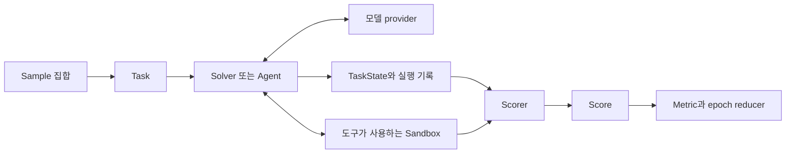
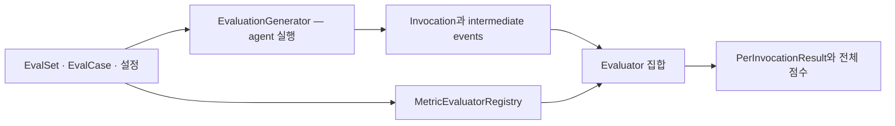
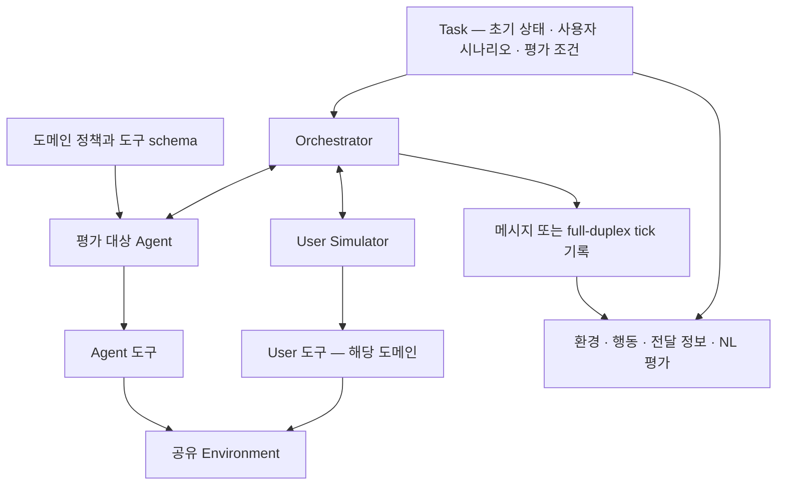

# 05 — 평가 실행 하네스와 사용자·환경 시뮬레이션

[스터디 인덱스](README.md) · [이전: 라이브러리](04-evaluator-libraries.md) · [다음: 벤치마크](06-benchmarks.md)

## 1. 채점기만으로 해결되지 않는 부분

평가 함수가 아무리 정교해도 에이전트를 어떤 초기 상태에서 실행했는지 모르면 점수를 해석하기 어렵다. 실행 하네스는 입력과 도구를 제공하고 에이전트의 행동을 실제 관찰·상태 변화로 이어준다.

| 실행 방식 | 제공하는 증거 | 적합한 질문 | 한계 |
|---|---|---|---|
| 저장 trace 재채점 | 이미 관찰된 행동·출력 | 새 judge가 기존 기록을 어떻게 판단하나 | 새 정책의 행동은 관찰하지 않음 |
| 고정 응답 replay | 기록된 도구 응답 | 같은 관찰에서 다음 선택이 바뀌나 | 새 분기로 가면 대응 응답이 없음 |
| 상태 기반 simulator | 행동에 따라 변화하는 가상 환경 | 여러 유효 경로로 목표 달성이 가능한가 | simulator 모델의 정확성에 의존 |
| 실행 가능한 격리 환경 | 파일·DB·앱의 실제 변화 | 실제 도구 사용과 산출물이 유효한가 | 실행 자원과 초기화 비용 |
| 사용자 simulator 결합 | 대화와 사용자 행동 | 질문·설명·협력이 작업 성공에 미치는 영향 | 사용자 모델의 오류·협조성에 영향받음 |

이는 제품 분류가 아니라 실행 방식의 구분이다. Inspect·ADK·τ-bench는 서로 다른 범위에서 여러 방식을 조합한다.

## 2. Inspect AI — 범용 평가 실행의 구성요소 분리

### 2.1 개요와 문제 정의

Inspect AI는 UK AI Security Institute의 평가 프레임워크다. 문제 데이터, 모델·agent 실행, 도구·sandbox, scorer, 집계를 분리해 다양한 종류의 평가를 구성할 수 있게 한다. 특정 고객센터 업무나 도구 정답을 내장한 벤치마크라기보다 **평가 프로그램을 작성하는 기반**이다. [Task][in-task] · [package metadata][in-package]

### 2.2 핵심 데이터 모델

| 개념 | 소스상 책임 |
|---|---|
| `Sample` | input, target, metadata, files, sandbox 등 개별 문제 |
| `Task` | dataset, solver/agent, scorer, sandbox, 반복·자원 제한의 결합 |
| `TaskState` | 메시지·도구·모델 출력·store·완료 상태 등 sample 실행 상태 |
| `Scorer` | `async (state, target) → Score 또는 None` |
| `Score` | 값, 추출 답, explanation, reason, metadata 등 |
| `Metric` / reducer | 여러 sample·epoch의 점수 집계 |

근거: [Sample][in-sample] · [Task][in-task] · [TaskState][in-state] · [Scorer][in-scorer] · [Score][in-score]



`Task.__init__()`는 solver에 `Solver | Agent | list[Solver]`를 허용한다. 내장 `react()`도 제공하지만 원하는 정책을 평가하기 위해 반드시 내장 ReAct agent로 바꿔야 한다는 뜻은 아니다. 기존 agent를 연결할 때는 자체 정책의 prompt·도구·메모리 동작이 adapter 때문에 달라지지 않는지 구분해야 한다. [Task][in-task] · [ReAct agent][in-react]

### 2.3 Scorer는 답변뿐 아니라 환경을 읽을 수 있다

Scorer의 핵심은 `TaskState`와 `Target`을 받아 결과를 만든다는 것이다. 필요하면 sandbox의 파일을 읽거나 별도 실행으로 결과를 확인할 수 있다. 예를 들어 “결과 JSON에 지정 레코드가 포함됨”을 실제 파일에서 확인하면 마지막 답변의 자기보고에 의존하지 않는다.

다음은 **구조 설명용 예제이며 전체 평가를 실행한 코드는 아니다.** `valid_output`은 업무별 predicate 자리다.

```python
import json
from inspect_ai.scorer import Score, accuracy, scorer
from inspect_ai.util import sandbox

@scorer(metrics=[accuracy()])
def artifact_validity():
    async def score(state, target):
        payload = json.loads(await sandbox().read_file("/workspace/result.json"))
        passed = valid_output(payload, target)  # 업무별로 구현
        return Score(
            value="C" if passed else "I",
            explanation="결과 파일의 요구 조건을 판정",
        )
    return score
```

### 2.4 Sandbox의 정확한 경계

**sandbox를 지정했다고 scorer·agent Python 코드 전체가 container로 이동하지 않는다.** 도구·agent·scorer 자체는 평가 프로세스에서 실행되고, `sandbox()` 인터페이스로 요청한 작업이 격리 환경에서 수행된다. Docker backend와 확장 인터페이스를 제공한다. [공식 sandbox 문서](https://inspect.aisi.org.uk/sandboxing.html) · [SandboxEnvironment][in-sandbox]

이 분리는 모델 adapter·채점기와 실제 명령 실행을 서로 다른 위치에 둘 수 있게 한다. 반대로 임의의 실행 코드를 그냥 host에서 호출하면 sandbox 설정만으로 격리되지는 않는다.

### 2.5 확장성·성능·적합성

- **확장:** 사용자 Task·Solver·Agent·Scorer·Tool, 모델 provider, sandbox backend.
- **기술 스택:** Python ≥3.10, Pydantic과 async 인터페이스, setuptools, MIT. [metadata][in-package]
- **설치·진입:** `pip install inspect-ai`, `inspect eval task.py --model provider/model`. 실행 도구가 필요하면 Docker 등 선택한 sandbox backend를 준비한다.
- **성능 변수:** 모델 동시 요청 제한, sample별 sandbox 초기화, 도구 실행 시간, trace 크기. 모델 없는 scorer 속도와 전체 benchmark 처리량은 별개다.
- **강점:** 업무별 환경 검증을 1급 구성요소로 만들기 좋다. score와 집계가 분리돼 있다.
- **제약:** 문제 분포와 성공 조건을 직접 설계해야 한다. 범용성이 높다는 것이 업무 eval이 자동 완성된다는 뜻은 아니다.

## 3. Google ADK evaluation — 런타임 이벤트에서 평가로

### 3.1 개요와 전체 흐름

ADK는 에이전트 런타임의 이벤트를 이미 알고 있기 때문에 사용자 turn, 하위 agent, tool call·response를 평가 데이터로 투영할 수 있다.

`LocalEvalService`는 inference 수행과 evaluation을 분리하고, `EvaluationGenerator`는 실행 결과를 생성한다. `MetricEvaluatorRegistry`가 metric 설정에 맞는 evaluator를 만든다. [LocalEvalService][adk-local] · [EvaluationGenerator][adk-generator] · [Registry][adk-registry]



### 3.2 Invocation 모델

`Invocation`에는 사용자 content, final response, intermediate data, rubric, duration 등이 있다. intermediate data는 tool-use 목록 형태 또는 author를 가진 invocation event 목록으로 표현된다. agent routing과 결과를 연결하는 데 유리하다. [데이터 모델][adk-case]

흥미로운 설계는 `duration`이다. 소스는 실제 inference 중 측정한 시간이 없으면 `None`으로 두며, 사후 event timestamp에서 임의 복원하지 않는다. 이벤트 생성 시각이 네트워크 요청 완료 시각과 같지 않기 때문이다. 관측되지 않은 자원 지표를 0으로 취급하지 않는 사례다.

### 3.3 내장 지표의 서로 다른 실행 경로

| 지표 계열 | 구현·해석 |
|---|---|
| `tool_trajectory_avg_score` | invocation별 도구 경로 0/1 → 평균 |
| `response_match_score` | ROUGE-1 경로. 의미적 정확성 전체를 나타내지 않음 |
| `final_response_match_v2` | reference와 응답의 의미적 일치 판단 |
| rubric 기반 response·tool·trajectory | 기준별 auto-rater 판단 |
| `multi_turn_task_success_v1` | Vertex 평가 facade로 위임 |
| `safety_v1` | Vertex 평가 facade로 위임 |
| 효율 지표 | 도구·추론 호출 수, 토큰, 실행 duration 등 기록 |

근거: [Trajectory][adk-traj] · [ResponseEvaluator][adk-response] · [Final response v2][adk-final] · [Rubric evaluator][adk-rubric] · [Task success][adk-success] · [Safety][adk-safety] · [효율 지표][adk-efficiency]

모든 evaluator가 같은 방식의 로컬 함수인 것은 아니다. 외부 서비스 위임인지, 직접 모델을 호출하는지, 코드만 사용하는지를 구분해야 한다. 특히 ROUGE-1은 어휘 중첩의 기준선으로는 쓸 수 있지만 부정·숫자·식별자가 바뀐 답의 정확성을 보장하지 않는다.

효율 지표의 전체 값도 주의해서 읽어야 한다. 이 구현은 invocation별 값을 **평균**하므로 전체 대화의 총 토큰·총 호출 수가 아니다. 대화 전체 비용을 보려면 turn별 값을 합산해야 한다. 이 지표들은 통과·실패를 결정하지 않는 informational 결과이며, 관측되지 않은 값은 0 대신 `None`으로 둔다. [효율 지표 구현][adk-efficiency]

### 3.4 사용자 시뮬레이션

고정된 사용자 발화 목록은 재현하기 쉽지만 agent의 질문 방식이 달라졌을 때 자연스러운 후속 응답을 제공하지 못한다. ADK에는 static 및 LLM 기반 user simulator가 있고 conversation scenario와 연결된다. 대신 reference turn·경로를 요구하는 일부 metric은 이런 자유로운 simulation과 함께 사용할 수 없다. [공식 평가 개요](https://github.com/google/adk-docs/blob/main/docs/evaluate/index.md)

이는 중요한 데이터 모델 제약이다. 대화가 자유롭게 분기하는데 예상 turn과 실제 turn을 위치로 zip해 비교하면 같은 의미의 단계를 비교하지 못할 수 있다. 이런 경우 요구사항 기반 대화 전체 판정이나 milestone 기반 결과 판정이 더 자연스럽다.

### 3.5 확장·기술·적합성

- **확장:** Evaluator 구현, metric registry, config에서 지정한 custom metric function, rubric·사용자 simulator.
- **스택:** Python ≥3.11, Google GenAI 타입, Pydantic, flit, Apache-2.0. eval extra에 Vertex 평가 SDK와 ROUGE 관련 의존성이 포함된다. [metadata][adk-package]
- **설치·진입:** `pip install 'google-adk[eval]'`, `adk eval agent_path evalset.json --config_file_path config.json` 형태. metric에 따라 모델·서비스 인증이 필요하다.
- **강점:** ADK event 모델을 재활용해 도구·하위 agent·대화 평가를 붙이기 좋다.
- **제약:** 기존 ADK 런타임과 결합이 강하고 외부 evaluator 서비스의 범위를 구분해야 한다.
- **성능:** 로컬 sequence 비교와 외부 judge 호출의 비용 차이가 크다. 여러 rubric·sampled judge를 쓰면 추론량이 늘어난다.

## 4. τ-bench — 사용자와 환경이 함께 있는 평가

### 4.1 버전부터 구분하기

원래 [τ-bench 논문](https://arxiv.org/abs/2406.12045)은 정책·API·사용자 simulator를 결합한 고객 서비스 환경과 반복 신뢰도 `pass^k`를 제시한다. [τ²-bench](https://arxiv.org/abs/2506.07982)는 telecom에서 사용자도 도구를 사용해 공유 환경을 바꾸는 dual-control을 강조한다.

이번에 clone한 저장소 이름은 여전히 `tau2-bench`지만 README는 **τ³-bench**를 안내한다. 소스 package version은 `1.0.1`이며 voice와 knowledge 확장이 포함된다. 과거 τ² 논문의 실험과 현재 저장소를 동일한 평가라고 가정하면 안 된다. [README][tau-readme] · [metadata][tau-package]

### 4.2 도메인 모델



registry는 domain constructor, task loader, agent factory, user 구현을 연결한다. 새로운 업무를 넣으려면 단순히 metric 하나를 추가하는 것보다 더 많은 모델링이 필요하다. 도구와 상태 전이, 사용자에게만 알려진 정보, 평가 조건이 일관돼야 한다. [Registry][tau-registry] · [Task 모델][tau-task]

### 4.3 EnvironmentEvaluator의 핵심 코드 흐름

`EnvironmentEvaluator.calculate_reward()`는 다음 작업을 한다. [구현][tau-env]

1. task에서 초기 데이터·초기 action·이전 메시지를 가져온다.
2. predicted environment를 생성하고 실제 trajectory를 replay해 상태를 복원한다.
3. 별도의 gold environment를 동일 초기 조건으로 구성한다.
4. reference action을 gold 환경에서 실행한다.
5. agent DB와 user DB의 hash를 각각 비교한다.
6. 종료 환경에 `env_assertions`를 실행한다.
7. task의 `reward_basis`에 해당하는 결과만 결합한다.

핵심은 **gold action이 정답 상태를 계산하는 방법일 수 있다는 점**이다. task의 reward basis에 ACTION이 없다면 그 action 목록 전체를 똑같이 호출하는 것 자체가 성공 조건은 아니다. 다른 경로가 동일한 채점 상태를 만들면 통과할 수 있다. 이 구분은 `Action` 데이터 모델의 설명에도 명시되어 있다. [Action 모델][tau-task]

DB hash 비교의 범위는 환경이 정의한 DB 표현이다. 현실의 모든 외부 부작용을 포괄한다는 뜻은 아니다. 잘못된 동작을 했다가 되돌렸다면 최종 상태만으로 그 과정을 알 수 없으므로 행동 제약도 필요하다.

### 4.4 평가 종류와 reward 합성

`evaluate_simulation()`은 종료 원인과 evaluation type을 확인한 다음 evaluator를 선택한다. 기본 `ALL` 계열은 ENV·ACTION·COMMUNICATE를 계산하고, task가 요구하거나 별도 mode로 요청한 경우 NL assertions도 평가한다. **최종 reward에는 reward_basis에 포함된 항목을 곱한다.** [종합 evaluator][tau-evaluator]

| 구성요소 | 실제 구현 | 한계 |
|---|---|---|
| ENV | DB hash·환경 assertion | 판정 상태에 없는 부작용은 놓침 |
| ACTION | 기대 action이 예측 호출 중 존재하는지 검색 | 전체 순서·추가 호출 금지를 자동 보장하지 않음 |
| COMMUNICATE | assistant 텍스트에서 기대 문자열의 대소문자 무시 포함 검사 | 부정문·의미적 동등성 전체를 이해하지 않음 |
| NL_ASSERTION | 자연어 조건에 대한 모델 판단 | 실험적 경로와 judge 오차 |

근거: [ActionEvaluator][tau-action] · [CommunicateEvaluator][tau-communicate] · [전체 선택·합성][tau-evaluator]

소스를 보면 “도메인 정책을 prompt에 제공함”과 “정책의 모든 조항을 자동 판정함”은 다르다. **정책 준수 점수라고 해석하려면 어떤 조항이 어떤 evaluator에 실제로 인코딩됐는지 확인**해야 한다.

또한 evaluation criteria가 없는 task는 해당 코드 경로에서 1을 반환한다. 이는 평가할 조건이 없다는 구현상 기본값이지 에이전트가 검증된 성공을 거뒀다는 증거는 아니다.

### 4.5 Replay가 가능한 이유와 한계

τ-bench의 환경은 도메인 도구 호출을 상태 전이로 재생할 수 있다. 이 때문에 과거 trajectory를 다시 채점할 수 있지만 도구 코드·초기 데이터가 바뀌면 재구성 결과도 달라질 수 있다. `strict_replay`는 기록된 tool output과 재생 출력의 차이를 다루는 데 사용된다. [환경 evaluator][tau-env]

gold action 실행의 예외를 warning으로 남기고 진행하는 코드도 있다. 따라서 “정답 상태 생성도 실행 코드”라는 점을 기억해야 한다. task가 불가능하거나 reference action이 깨져 있다면 에이전트 점수 이전에 기준 자체가 영향을 받는다.

실제로 README는 2026년 7월 `banking_knowledge` 채점 수정으로 `<1.0.1`과 `≥1.0.1` 점수를 직접 비교할 수 없다고 명시한다. 다른 domain까지 모두 비교 불가하다고 확장해서 해석하지 않는다. [공식 변경 안내][tau-readme]

### 4.6 설치·확장·성능 특성

- **스택:** Python ≥3.12,<3.14, Pydantic·LiteLLM, hatchling, MIT. optional voice·knowledge 구성. [metadata][tau-package]
- **설치:** clone 후 `uv sync`. `tau2 run --domain airline --agent-llm MODEL --user-llm MODEL` 형태로 실행하며 각 모델의 인증이 필요하다.
- **확장:** agent factory, user implementation, domain tools·DB, task loader와 reward criteria.
- **성능:** agent 호출 외에 사용자 simulator와 선택적 evaluator 추론도 든다. 도메인·대화 길이·반복 횟수에 따라 비용이 크게 달라진다.
- **강점:** 자연어 소통과 상태 변화가 하나의 실행 안에 연결된다. dual-control은 사용자 안내 실패를 분리해 연구하기 좋다.
- **제약:** 업무 도메인을 모델링하는 비용이 있고 사용자 simulator의 오류가 agent 평가에 섞일 수 있다.

## 5. 세 프로젝트의 선택 기준

| 요구 | Inspect AI | ADK evaluation | τ-bench |
|---|---|---|---|
| 임의 문제·도구·scorer를 조합 | 가장 직접적인 범용 추상화 | ADK event 모델에 맞춰 통합 | domain/task 모델에 맞춰 확장 |
| 기존 ADK agent 평가 | adapter 필요 | 자연스러운 선택 | agent factory 연결 필요 |
| 대화형 고객 서비스 벤치마크 | 문제·환경을 연결해야 함 | scenario·simulator 구성 | 기본 문제 설정과 도메인 제공 |
| 실제 파일·명령 결과 검증 | sandbox·scorer 조합 | 별도 artifact·custom evaluator 설계 | 해당 domain environment로 모델링 |
| DB 목표 상태 비교 학습 | custom scorer로 구현 | custom evaluator로 구현 | gold/predicted environment 구현이 좋은 예 |

연구용 실행 기반을 만들려면 Inspect의 추상화를 먼저 읽고, 업무 상태를 어떻게 정답과 연결할지는 τ-bench를 참고하는 조합이 좋다. ADK를 이미 쓰는 상황이라면 event 변환을 새로 만들기 전에 내장 evaluation 모델을 검토할 가치가 있다.

[adk-case]: https://github.com/google/adk-python/blob/7d8c9502f924ed5e7a1ab00dc1f5a603e858abc3/src/google/adk/evaluation/eval_case.py#L97
[adk-efficiency]: https://github.com/google/adk-python/blob/7d8c9502f924ed5e7a1ab00dc1f5a603e858abc3/src/google/adk/evaluation/_efficiency_evaluators.py#L1
[adk-final]: https://github.com/google/adk-python/blob/7d8c9502f924ed5e7a1ab00dc1f5a603e858abc3/src/google/adk/evaluation/final_response_match_v2.py#L1
[adk-generator]: https://github.com/google/adk-python/blob/7d8c9502f924ed5e7a1ab00dc1f5a603e858abc3/src/google/adk/evaluation/evaluation_generator.py#L543
[adk-local]: https://github.com/google/adk-python/blob/7d8c9502f924ed5e7a1ab00dc1f5a603e858abc3/src/google/adk/evaluation/local_eval_service.py#L131
[adk-package]: https://github.com/google/adk-python/blob/7d8c9502f924ed5e7a1ab00dc1f5a603e858abc3/pyproject.toml#L1
[adk-registry]: https://github.com/google/adk-python/blob/7d8c9502f924ed5e7a1ab00dc1f5a603e858abc3/src/google/adk/evaluation/metric_evaluator_registry.py#L76
[adk-response]: https://github.com/google/adk-python/blob/7d8c9502f924ed5e7a1ab00dc1f5a603e858abc3/src/google/adk/evaluation/response_evaluator.py#L32
[adk-rubric]: https://github.com/google/adk-python/blob/7d8c9502f924ed5e7a1ab00dc1f5a603e858abc3/src/google/adk/evaluation/rubric_based_evaluator.py#L1
[adk-safety]: https://github.com/google/adk-python/blob/7d8c9502f924ed5e7a1ab00dc1f5a603e858abc3/src/google/adk/evaluation/safety_evaluator.py#L1
[adk-success]: https://github.com/google/adk-python/blob/7d8c9502f924ed5e7a1ab00dc1f5a603e858abc3/src/google/adk/evaluation/multi_turn_task_success_evaluator.py#L1
[adk-traj]: https://github.com/google/adk-python/blob/7d8c9502f924ed5e7a1ab00dc1f5a603e858abc3/src/google/adk/evaluation/trajectory_evaluator.py#L40
[in-package]: https://github.com/UKGovernmentBEIS/inspect_ai/blob/4acfd207ecca8e1c3b754a147c191f2f0f21ba71/pyproject.toml#L1
[in-react]: https://github.com/UKGovernmentBEIS/inspect_ai/blob/4acfd207ecca8e1c3b754a147c191f2f0f21ba71/src/inspect_ai/agent/_react.py#L57
[in-sample]: https://github.com/UKGovernmentBEIS/inspect_ai/blob/4acfd207ecca8e1c3b754a147c191f2f0f21ba71/src/inspect_ai/dataset/_dataset.py#L29
[in-sandbox]: https://github.com/UKGovernmentBEIS/inspect_ai/blob/4acfd207ecca8e1c3b754a147c191f2f0f21ba71/src/inspect_ai/util/_sandbox/environment.py#L178
[in-score]: https://github.com/UKGovernmentBEIS/inspect_ai/blob/4acfd207ecca8e1c3b754a147c191f2f0f21ba71/src/inspect_ai/scorer/_metric.py#L118
[in-scorer]: https://github.com/UKGovernmentBEIS/inspect_ai/blob/4acfd207ecca8e1c3b754a147c191f2f0f21ba71/src/inspect_ai/scorer/_scorer.py#L35
[in-state]: https://github.com/UKGovernmentBEIS/inspect_ai/blob/4acfd207ecca8e1c3b754a147c191f2f0f21ba71/src/inspect_ai/solver/_task_state.py#L134
[in-task]: https://github.com/UKGovernmentBEIS/inspect_ai/blob/4acfd207ecca8e1c3b754a147c191f2f0f21ba71/src/inspect_ai/_eval/task/task.py#L81
[tau-action]: https://github.com/sierra-research/tau2-bench/blob/4ce7c0397c1eb65c9bbe59aeacfe1ca44a1cd699/src/tau2/evaluator/evaluator_action.py#L16
[tau-communicate]: https://github.com/sierra-research/tau2-bench/blob/4ce7c0397c1eb65c9bbe59aeacfe1ca44a1cd699/src/tau2/evaluator/evaluator_communicate.py#L7
[tau-env]: https://github.com/sierra-research/tau2-bench/blob/4ce7c0397c1eb65c9bbe59aeacfe1ca44a1cd699/src/tau2/evaluator/evaluator_env.py#L17
[tau-evaluator]: https://github.com/sierra-research/tau2-bench/blob/4ce7c0397c1eb65c9bbe59aeacfe1ca44a1cd699/src/tau2/evaluator/evaluator.py#L88
[tau-package]: https://github.com/sierra-research/tau2-bench/blob/4ce7c0397c1eb65c9bbe59aeacfe1ca44a1cd699/pyproject.toml#L1
[tau-readme]: https://github.com/sierra-research/tau2-bench/blob/4ce7c0397c1eb65c9bbe59aeacfe1ca44a1cd699/README.md#L1
[tau-registry]: https://github.com/sierra-research/tau2-bench/blob/4ce7c0397c1eb65c9bbe59aeacfe1ca44a1cd699/src/tau2/registry.py#L70
[tau-task]: https://github.com/sierra-research/tau2-bench/blob/4ce7c0397c1eb65c9bbe59aeacfe1ca44a1cd699/src/tau2/data_model/tasks.py#L116
