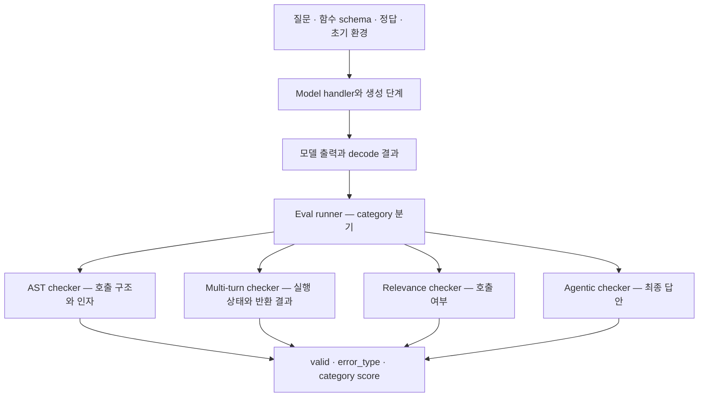

# 06 — 에이전트 벤치마크와 연구 지형

[스터디 인덱스](README.md) · [이전: 하네스](05-harness-and-simulation.md) · [다음: 설계와 스터디](07-design-and-study-guide.md)

> **분석 깊이:** BFCL과 τ-bench는 clone한 코드까지 분석했다. 나머지는 연구 지형을 이해하기 위한 논문·공식 자료 비교이며 구현 내부를 분석했다고 주장하지 않는다. 아래의 제약 열은 각 평가 정의에 대한 본 스터디의 해석이다.

## 1. 벤치마크마다 측정 대상이 다르다

| 벤치마크 | 핵심 질문 | 주된 증거·채점 | 해석상의 제약 | 1차 자료 |
|---|---|---|---|---|
| BFCL | 함수를 제대로 선택·호출하는가? | category별 AST, 실행 상태·응답, 정답 검사 | JSON 호출 능력과 업무 성공은 동일하지 않음 | [공식 개요][bf-readme] |
| τ-bench 계열 | 정책 아래 사용자와 소통하며 업무를 끝내는가? | 상태·action·전달 정보, 반복 신뢰도 | simulator와 domain·version 영향 | [τ 논문](https://arxiv.org/abs/2406.12045), [τ²](https://arxiv.org/abs/2506.07982) |
| ToolSandbox | 상태 의존·정보 부족을 포함한 tool use가 가능한가? | 사용자 simulator, 중간·최종 milestone | 상태와 milestone 정의에 의존 | [논문](https://arxiv.org/abs/2408.04682) |
| StableToolBench | 많은 API를 안정적으로 활용하는가? | 캐시·API simulator, 자동 평가 | 가상 API의 안정성과 실제 API 적합성은 별개 | [논문](https://arxiv.org/abs/2403.07714) |
| GAIA | 검색·추론·파일·멀티모달을 조합해 답하는가? | 최종 정답 | 정답에 도달한 과정의 적절성은 별도 | [논문](https://arxiv.org/abs/2311.12983) |
| AgentBench | 여러 환경의 agent 능력을 함께 볼 수 있는가? | 환경별 성공·reward | 통합 평균이 도메인별 실패를 가릴 수 있음 | [논문](https://arxiv.org/abs/2308.03688) |
| AgentBoard | 최종 성공 전의 진전을 설명할 수 있는가? | progress rate와 다각도 분석 | 진전이 최종 성공을 뜻하지 않음 | [논문](https://arxiv.org/abs/2401.13178) |
| WebArena | 실제적인 웹 업무를 수행하는가? | 기능적으로 동작하는 웹 환경의 작업 완료 | UI·웹 상태·도구 interface 영향 | [논문](https://arxiv.org/abs/2307.13854) |
| OSWorld | 실제 컴퓨터 앱을 이용해 결과를 만드는가? | 실행 가능한 task별 결과 확인 | 앱·OS·화면 조건과 도구 방식 영향 | [논문](https://arxiv.org/abs/2404.07972) |
| SWE-bench | repository의 이슈를 해결하는가? | patch 적용 후 실행 결과 | 검증 조건에 포함되지 않은 품질은 별도 | [논문](https://arxiv.org/abs/2310.06770) |
| Terminal-Bench | terminal에서 복합 작업을 완수하는가? | 환경 안에서 task별 완료 판정 | agent harness·자원·문제 revision 영향 | [논문](https://arxiv.org/abs/2601.11868), [공식 사이트](https://www.tbench.ai/benchmarks) |
| AgentDojo | 공격이 있는 도구 환경에서 본래 작업을 지키는가? | 업무 달성 및 prompt-injection 공격 결과 | 공격 분포와 방어 방식에 의존 | [논문](https://arxiv.org/abs/2406.13352) |

표의 벤치마크들은 동일한 점수의 다른 공급자가 아니다. 도구 schema 생성 능력을 알고 싶다면 BFCL이 직접적이고, 사용자가 정보를 불완전하게 제공하는 고객 서비스라면 τ-bench나 ToolSandbox의 문제 설정이 더 가깝다.

## 2. BFCL 소스 분석

### 2.1 개요와 세대별 확장

BFCL은 Gorilla 저장소의 `berkeley-function-call-leaderboard/` 아래에 있다. 함수 호출 형태·언어·단계가 다양한 모델 출력을 다루며, model handler와 평가 checker를 분리한다. [README][bf-readme] · [eval runner][bf-runner]

공식 자료의 확장은 다음처럼 읽을 수 있다.

- V1: single-turn 중심, simple·multiple·parallel 함수 호출.
- V2: 실제 사용 사례에서 수집한 live data 추가.
- V3: multi-turn·multi-step 상호작용.
- V4: agentic web search·memory·format sensitivity.

V4의 각 초점은 [web search](https://gorilla.cs.berkeley.edu/blogs/15_bfcl_v4_web_search.html), [memory](https://gorilla.cs.berkeley.edu/blogs/16_bfcl_v4_memory.html), [format sensitivity](https://gorilla.cs.berkeley.edu/blogs/17_bfcl_v4_prompt_variation.html) 공식 글에 분리되어 있다. “BFCL 점수”라고만 쓰기보다 category·집계 규약·데이터 revision을 확인해야 한다.

### 2.2 채점 아키텍처

이 설계에서 중요한 것은 **도구를 실행하는 능력과 생성된 호출 표현을 비교하는 능력이 분리되어 있다는 점**이다. 모든 category가 LLM judge를 사용하거나 모두 같은 exact match를 사용하는 것이 아니다. [runner][bf-runner]

### 2.3 AST checker

`ast_checker()`는 category에 `parallel`이 있으면 순서를 요구하지 않는 checker로, `multiple`이면 후보 함수 비교로, 그 외에는 단일 함수 검사로 분기한다. checker는 decode된 함수 구조, 함수 설명, 가능한 정답을 읽어 함수명·인자 타입·값을 검사한다. 문자열 정규화와 여러 허용 답안도 다룬다. [AST 구현][bf-ast]

장점은 자연어 judge 없이 일관된 채점과 오류 분류를 제공한다는 것이다. 한계는 **허용값과 정규화 규칙이 표현하지 못한 의미적으로 옳은 호출**을 낮게 평가할 수 있다는 점이다. 반대로 느슨한 정규화가 업무상 다른 값을 같게 만들 수도 있다.

또한 AST 일치는 그 도구가 현재 사용자 권한으로 실행 가능한지, 실행 결과가 업무 목표에 맞는지를 직접 입증하지 않는다.

### 2.4 Multi-turn checker

`multi_turn_checker()`는 각 turn의 모델 호출과 ground-truth 호출을 실행한다. 모델 측 객체와 정답 측 객체를 구분하고 다음을 확인한다. [구현][bf-multi]

1. 필요한 호출이 있는 turn에서 모델 응답이 비어 있는지.
2. 관련 객체들의 상태가 맞는지.
3. 그 turn의 ground-truth 실행 결과가 지금까지 모델이 얻은 결과에 포함되는지.

세 번째 검사에서 누적 결과를 쓰는 이유는 이전 turn에 얻은 정보를 재사용할 수 있기 때문이다. 응답 결과의 비교도 순서를 강제하지 않는 포함 검사다. 함수 안에 method invocation order checker가 존재하지만 이 실행 경로의 호출 부분은 주석 처리돼 있다. 따라서 “multi-turn BFCL은 gold tool sequence의 전체 순서를 항상 그대로 강제한다”는 해석은 맞지 않는다.

`state_checker()`가 보는 것은 해당 시뮬레이션 객체의 상태이며 `_compare_instances()`는 private attribute를 제외하는 등 자체 비교 규칙을 가진다. 실제 외부 서비스의 모든 상태를 비교하는 범용 시스템은 아니다.

### 2.5 호출하지 않아야 하는 경우

`multi_turn_irrelevance_checker()`와 relevance runner에는 정답상 도구를 호출하지 않아야 하는 경우를 별도로 다루는 로직이 있다. [multi-turn checker][bf-multi] · [runner][bf-runner]

이 문제 설정은 중요하다. 함수 호출 데이터만으로 평가하면 항상 도구를 호출하는 모델이 유리할 수 있다. 사용 가능한 함수로 해결할 수 없거나 정보가 부족할 때는 호출을 멈추거나 질문하는 능력도 평가 대상이다. 단, “도구 미호출” 자체와 “적절한 설명·추가 질문”까지 평가하는 것은 서로 다른 범위다.

### 2.6 Agentic checker의 한계

`agentic_checker()`는 최종 응답과 가능한 답안을 정규화하고 정규식으로 답안 포함 여부를 검사한다. 따라서 이 scorer의 `valid=True`는 답안 검사의 통과다. **웹 검색 과정의 근거성, 인용 품질, 모든 중간 도구 선택이 옳았다는 판정은 아니다.** [구현][bf-agentic]

이름에 agentic이 포함되어 있어도 어떤 증거를 읽고 어떤 판단을 내리는지 소스를 확인해야 한다는 좋은 사례다.

### 2.7 기술·인터페이스·확장·평가

| 항목 | 확인 내용 |
|---|---|
| 기술 기반 | Python ≥3.10, Pydantic, NumPy·pandas, tree-sitter 계열, 여러 모델 SDK |
| 패키지 | `bfcl-eval`, CLI 이름은 `bfcl` |
| 빌드·라이선스 | setuptools·동적 버전, Apache-2.0 |
| 설치 | `pip install bfcl-eval` 또는 BFCL 하위 디렉터리에서 editable 설치 |
| 실행 | `bfcl generate ...`와 `bfcl evaluate ...`로 생성·채점을 분리 |
| 확장 지점 | model handler·category data·checker·상태 기반 함수 구현 |
| 강점 | tool use의 다양한 오류를 명시적 코드로 분해 |
| 제약 | category별 정답 규약을 자신의 업무 metric으로 오해하기 쉬움 |

근거: [metadata][bf-package] · [실행 안내][bf-readme]. 모델·검색 API category를 실제 실행할 때의 인증·외부 의존성은 선택한 구성에 따라 다르다. 이 조사에서는 전체 BFCL 실행을 수행하지 않았다.

## 3. τ-bench에서 배울 평가 관점

상세 구현은 [05](05-harness-and-simulation.md)에 있다. BFCL과 비교해 중요한 차이는 **도구와 대화가 도메인 정책 및 사용자 목표에 묶여 있다는 점**이다.

| 관점 | BFCL에서 특히 잘 드러남 | τ-bench에서 특히 잘 드러남 |
|---|---|---|
| 선택·표현 | 여러 함수 schema에서 적절한 호출 생성 | 도메인 정책 아래의 업무 action |
| 상태 | multi-turn 객체 상태·실행 결과 | agent/user DB와 도메인 assertion |
| 사용자 | category의 정해진 입력·turn 구조 | simulator와 동적 상호작용 |
| 일관성 | category별 능력 분해 | 동일 업무의 반복 성공 `pass^k` |
| 진화 방향 | 검색·기억·형식 민감도 | dual-control·knowledge·voice |

현재 τ³에는 비정형 지식을 대상으로 한 [τ-Knowledge](https://arxiv.org/abs/2603.04370)와 full-duplex 상호작용을 다루는 [τ-Voice](https://arxiv.org/abs/2603.13686)가 연결되어 있다. 음성에서는 텍스트 최종 답의 품질 외에도 끼어들기·응답 타이밍·동시 행동이 평가 문제에 포함된다. 본 스터디의 τ-bench 코드 분석은 주로 텍스트 및 공통 reward 경로에 집중했다.

## 4. 중간 진전과 상태 의존성

[AgentBoard](https://arxiv.org/abs/2401.13178)는 최종 성공률만으로 설명되지 않는 중간 진전을 progress rate로 분석한다. 이런 관점은 긴 작업에서 “아무것도 못 했는가”와 “마지막 단계에서만 실패했는가”를 구분하는 데 유용하다.

[ToolSandbox](https://arxiv.org/abs/2408.04682)는 상태를 가진 도구, 암묵적인 상태 의존성, 사용자 simulator, 중간·최종 milestone을 결합한다. 단일 reference sequence보다 여러 경로의 진행 상황을 다루려는 문제의식이 강하다.

여기서 얻는 설계 교훈은 **부분 성공을 진단용으로 보존하되 최종 목표와 혼동하지 않는 것**이다. 로그인·예약 조회·조건 확인을 모두 잘했어도 실제 예약 변경이 없으면 작업은 끝나지 않았다. 반대로 최종 상태만 보면 “어느 단계부터 실패했는지”가 사라진다.

## 5. 실행 기반 벤치마크의 성능 해석

WebArena·OSWorld·SWE-bench·Terminal-Bench는 작업 완료의 실행 가능한 증거를 중시한다. 최종 문장 비교보다 실제 사용에 가까운 측면이 있지만, 다음 조건을 함께 읽어야 한다.

| 비교 조건 | 이유 |
|---|---|
| model뿐 아니라 agent harness | prompt·도구 interface·계획·메모리 관리가 성능에 영향 |
| 시간·토큰·재시도 budget | 더 많은 탐색 기회가 성공률을 바꿈 |
| 환경 image·network·resource | 설치·빌드·도구 결과가 달라질 수 있음 |
| dataset split·revision | 문제 난이도와 채점 오류 수정이 평균을 바꿈 |
| 평균에 포함한 실패 종류 | infrastructure error 제외 여부가 분모를 바꿈 |
| 실행 횟수와 불확실성 | 작은 차이가 실행 변동일 수 있음 |

[Anthropic의 infrastructure noise 분석](https://www.anthropic.com/engineering/infrastructure-noise)은 자원 설정을 agent 평가의 실험 변수로 다뤄야 한다고 설명한다. 이는 운영 절차의 문제가 아니라 **모델 성능과 실행 조건의 효과를 혼동하지 않기 위한 해석 문제**다.

실제 버전 변화의 사례도 있다. [Terminal-Bench 2.1 공식 안내](https://www.tbench.ai/news/terminal-bench-2-1)는 2.0의 89개 task 중 28개를 수정했다고 밝히며 외부 의존성, 자원 불일치, 문제 명세의 불일치를 이유로 든다. τ-bench 역시 `banking_knowledge` grading 수정에 대한 비교 제한을 안내한다. 동일 이름의 benchmark라도 revision이 다르면 점수 변화를 모델 발전으로 단정할 수 없다.

## 6. 안전한 행동도 별도 평가 축이다

[AgentDojo](https://arxiv.org/abs/2406.13352)는 도구 결과 등 외부 데이터에 prompt injection이 포함된 agent 환경을 다룬다. 학습할 핵심은 **업무 달성과 공격자의 목표 달성 여부를 함께 관찰**한다는 점이다.

모든 행동을 거부하면 일부 공격을 막을 수 있지만 사용자의 업무도 못 한다. 반대로 높은 작업 성공률을 얻더라도 특정 조건에서 외부 지시를 따르는지는 별도 축이다. 따라서 작업 utility, 금지 행동, 공격 성공의 분모를 구분한다. 안전 행동 평가를 단순히 최종 답변의 유해 표현 감지로 대체할 수 없다.

## 7. 벤치마크를 선택하는 방법

목적별로 적은 수의 평가를 조합하는 편이 해석하기 쉽다.

- **도구 호출 모델 연구:** BFCL의 호출 필요성·schema·인자·multi-turn category를 먼저 본다.
- **고객 서비스 agent:** τ-bench와 ToolSandbox의 사용자·상태 의존성 모델을 읽는다.
- **리서치 agent:** GAIA의 정답형 과제와 별도의 근거·인용·완전성 rubric을 결합한다.
- **브라우저·컴퓨터 agent:** WebArena·OSWorld처럼 환경 상태를 확인하는 방식을 참고한다.
- **코딩·terminal agent:** SWE-bench·Terminal-Bench에서 artifact 실행과 harness 효과를 구분한다.
- **긴 작업의 실패 원인:** AgentBoard의 진전 분석을 참고한다.
- **외부 데이터의 공격에 대한 행동:** AgentDojo의 utility·attack 분리를 참고한다.

이 선택은 논문과 채점 구조를 토대로 한 제안이다. 특정 제품에서의 모델 순위를 예측하는 추천은 아니다. 자신의 업무 분포와 권한·도구 계약을 반영한 평가가 공개 벤치마크 옆에 있어야 한다.

[bf-agentic]: https://github.com/ShishirPatil/gorilla/blob/6ea57973c7a6097fd7c5915698c54c17c5b1b6c8/berkeley-function-call-leaderboard/bfcl_eval/eval_checker/agentic_eval/agentic_checker.py#L6
[bf-ast]: https://github.com/ShishirPatil/gorilla/blob/6ea57973c7a6097fd7c5915698c54c17c5b1b6c8/berkeley-function-call-leaderboard/bfcl_eval/eval_checker/ast_eval/ast_checker.py#L33
[bf-multi]: https://github.com/ShishirPatil/gorilla/blob/6ea57973c7a6097fd7c5915698c54c17c5b1b6c8/berkeley-function-call-leaderboard/bfcl_eval/eval_checker/multi_turn_eval/multi_turn_checker.py#L9
[bf-package]: https://github.com/ShishirPatil/gorilla/blob/6ea57973c7a6097fd7c5915698c54c17c5b1b6c8/berkeley-function-call-leaderboard/pyproject.toml#L1
[bf-readme]: https://github.com/ShishirPatil/gorilla/blob/6ea57973c7a6097fd7c5915698c54c17c5b1b6c8/berkeley-function-call-leaderboard/README.md#L1
[bf-runner]: https://github.com/ShishirPatil/gorilla/blob/6ea57973c7a6097fd7c5915698c54c17c5b1b6c8/berkeley-function-call-leaderboard/bfcl_eval/eval_checker/eval_runner.py#L1
