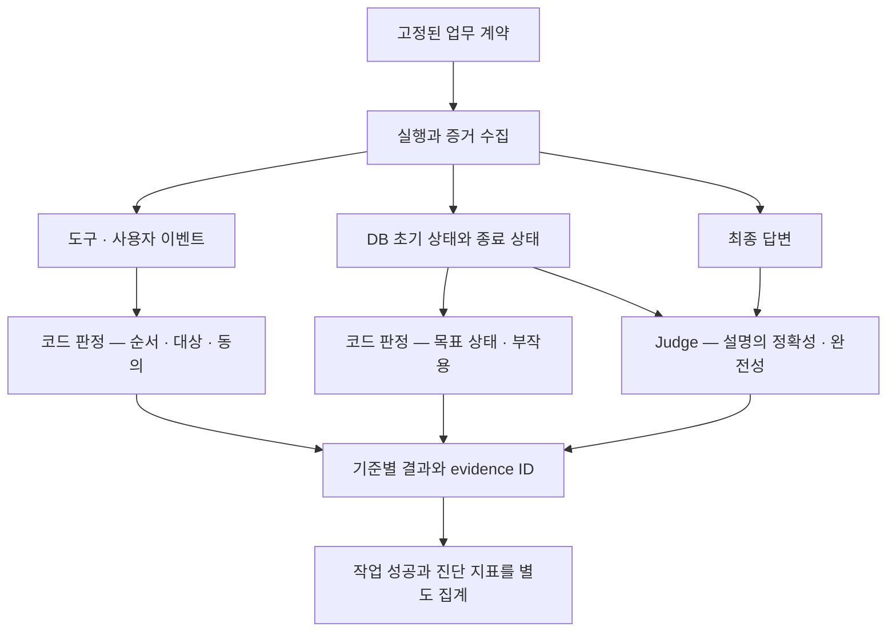

# 07 — 평가 설계 예제와 스터디 가이드

[스터디 인덱스](README.md) · [이전: 벤치마크](06-benchmarks.md) · [조사 근거](sources.md)

> 이 문서의 schema·정책·점수 조합은 **학습용 설계 제안**이다. 특정 OSS가 이 모든 기능을 그대로 제공하거나 실제 구현·실행된 시스템이라는 의미는 아니다.

## 1. 하나의 업무를 평가 계약으로 바꾸기

가상 업무: 사용자가 예약 B17의 취소를 요청한다. 에이전트는 취소 가능 여부와 수수료를 확인하고, 해당 조건에 대한 사용자 동의가 있으면 취소한다. 다른 예약은 변경하면 안 된다.

### 1.1 입력과 정답의 분리

| 입력 계층 | 제공할 내용 | 노출 대상 |
|---|---|---|
| Agent 입력 | 사용자 요청, 도메인 규칙, 사용할 도구 | 평가 대상 agent |
| 환경 초기 상태 | 예약 B17, 관련 요금·상태, 다른 예약 | 도구를 통해 필요한 범위 제공 |
| User simulator 입력 | 사용자 목표, 알고 있는 정보, 허용 의사 | 사용자 simulator |
| Grader 전용 정보 | 필수 결과·금지 효과·참조 predicate | scorer |

정답 action 목록을 agent에게 주면 “어떤 도구가 필요한지 선택하는 능력”을 제대로 평가하기 어렵다. 반면 도구 schema와 업무 규칙을 주는 것은 문제의 일부다. 어떤 정보를 숨기고 어떤 정보를 공개하는지가 평가하려는 능력을 결정한다.

### 1.2 평가할 기준

| 기준 | 판정 방법 | 증거 |
|---|---|---|
| 대상 식별 | `booking_id == B17` | 조회·취소 인자 |
| 정보 확보 | 취소 전에 조건 조회 또는 유효한 조건 정보가 존재 | tool result·정보의 revision |
| 동의 준수 | 취소 직전까지 그 예약·수수료에 대한 승인 있음 | 사용자 event와 관련 booking ID |
| 실제 완료 | B17 상태가 cancelled로 변경됨 | 종료 DB |
| 부작용 없음 | 다른 예약 상태·내용이 동일함 | 초기/종료 diff |
| 완료 설명 | 답변의 성공 여부·수수료가 실제 결과와 일치 | 최종 답변 + 검증된 결과 |
| 효율 | 중복 읽기·쓰기, 전체 소요 시간 | 이벤트·resource usage |

조회 도구 A를 반드시 정확히 한 번 호출하라는 규칙 대신 **취소 시점에 유효한 조건 정보를 확보해야 한다**고 정의하면, 동등한 정보를 제공하는 도구 B나 유효한 캐시도 허용할 수 있다. 반대로 “외부 정보는 항상 새로 조회”가 업무 규칙이라면 freshness를 별도 조건으로 넣어야 한다.

## 2. 같은 완료 답변, 다른 평가 결과

세 실행이 모두 “취소 완료”라고 답했다고 하자.

| 실행 | 행동·환경 | 도구 이름 중심 점수 | 실제 완료 | 동의 준수 | 종합 해석 |
|---|---|---|---|---|---|
| A | 조회 → 승인 → 취소 성공, B17만 변경 | 높음 | 통과 | 통과 | 정상 완료 |
| B | 조회 → 취소 성공 → 뒤늦게 승인 요청 | 높을 수 있음 | 통과 | 실패 | 결과는 맞아도 행동 위반 |
| C | 조회 → 승인 → 취소 실패, 상태 유지 | 높을 수 있음 | 실패 | 통과 | 경로는 비슷하지만 미완료·잘못된 보고 |

이 예제는 각 지표의 관계를 보여주기 위한 가상 사례다. 표의 “높을 수 있음”은 실제 특정 package 실행 점수가 아니다.

여기에 D라는 실행을 추가해 볼 수 있다. 다른 조회 API를 쓰고, 일시 오류를 한 번 재시도한 뒤 정상 완료했다면 reference exact sequence에서는 실패할 수 있지만 업무 요구사항은 모두 충족할 수 있다. 어떤 판정을 우선할지는 **정답 경로 재현이 목적이었는지, 업무 수행이 목적이었는지**에 달려 있다.

## 3. Grader를 증거에 맞춰 배치하기



추천 책임 분할:

- **결정론적 scorer:** schema·ID·순서·상태 diff·명확한 금지 규칙.
- **의미 judge:** 자연어 동의의 의미, 설명의 충분함, 여러 표현 사이의 동등성.
- **환경 verifier:** 실제 예약 상태와 부작용.
- **사람의 판단:** 애매한 정책·선호·기준 자체의 적합성.

자연어 동의를 judge로 판정한다면 그 verdict를 쓰기 이벤트와 연결하는 부분은 코드로 처리할 수 있다. 하나의 LLM에게 긴 trace를 주고 모든 판정과 최종 집계까지 맡길 필요는 없다.

## 4. Canonical trace와 adapter 설계

여러 프레임워크를 비교하고 싶다면 원본 trace를 보존하고 공통 event 모델을 **추가 투영**하는 방식을 고려할 수 있다.

| 공통 필드 | 목적 |
|---|---|
| `event_id`, `parent_id`, `depends_on` | 근거 참조와 인과·병렬 관계 |
| `actor`, `role`, `turn_id` | 사용자·agent·subagent 구분 |
| `tool_name`, `schema_version`, `call_id` | 도구 identity와 입력 계약 |
| `arguments`, `result`, `execution_status` | 요청·결과·실패 구분 |
| `available_tools_ref` | 해당 시점의 선택 가능 집합 |
| `state_revision`, `artifact_refs` | 실행 결과와 외부 상태 연결 |
| `usage`, `started_at`, `ended_at` | 비용·지연 해석 |

원본 framework의 정보를 공통 구조로 변환하면서 버린 정보가 무엇인지 기록해야 한다. 예를 들어 모든 tool call을 하나의 평평한 목록으로 바꾸면 AgentEvals strict가 원래 이용하는 메시지 경계가 사라진다. Ragas의 `AIMessage` 입력으로 변환하면서 tool execution 오류를 누락하면 호출 적합성과 결과 해석을 연결할 수 없다.

## 5. 결과 저장은 점수보다 근거 중심으로

```json
{
  "case_id": "cancel-B17",
  "trial_id": "trial-03",
  "criteria": [
    {
      "id": "cancelled-with-consent",
      "status": "fail",
      "score": 0,
      "evidence_ids": ["cancel-call-4", "consent-event-7"],
      "reason": "취소 실행 이후에 동의가 기록됨"
    },
    {
      "id": "target-state",
      "status": "pass",
      "score": 1,
      "evidence_ids": ["state-after-B17"],
      "reason": "B17이 취소 상태임"
    }
  ],
  "task_success": false
}
```

두 기준의 평균인 0.5보다 **목표 상태는 성공, 동의는 실패**라는 분해가 더 유용하다. task_success는 사전에 고정한 필수 조건의 논리식으로 계산하고, 표현 품질과 자원 지표는 별도 필드로 보존한다.

기준마다 다른 judge model·prompt·code revision을 사용했다면 결과에 그 identity도 연결한다. 모델이 같아도 rubric이나 tool schema가 바뀌면 다른 측정일 수 있다.

## 6. 실패 원인을 어떻게 읽을 것인가?

| 실패 분류 | 식별할 신호 | 연결되는 개선 대상 |
|---|---|---|
| 도구 검색 누락 | 정답 기능이 후보 목록에 없음 | catalog 검색·검색어·권한 filter |
| 선택 실패 | 후보에 있었지만 다른 기능 선택 | tool description·정책·모델 |
| 인자 실패 | 대상·타입·단위·필수값 오류 | schema·정보 전달·정규화 |
| 실행 실패 | 호출은 맞지만 업무 오류·timeout | tool 계약·환경·회복 정책 |
| 관찰 해석 실패 | 실패·빈 결과를 무시 | agent loop·result 표현 |
| 순서·제약 실패 | 승인·확인 이전의 쓰기 | orchestration·행동 규칙 |
| 결과 미완료 | 최종 상태가 목표를 만족하지 않음 | 앞 단계들의 실패 전파 |
| 보고 실패 | 실제 결과와 답변 불일치 | 최종 응답 생성·근거 연결 |
| 측정 실패 | 증거 누락, judge parse 오류 | telemetry·grader 계약 |

하나의 실행에 여러 실패가 붙을 수 있다. 처음 잘못된 ID가 뒤의 DB 불일치와 잘못된 완료 보고를 만들었다면 세 개의 독립적 원인으로 세면 안 된다. **관찰된 결함과 추정 원인을 구분**해야 한다. “이 도구 호출을 제거하면 성공했을 것”이라는 반사실적 주장에는 상태를 고정한 재실행 같은 추가 근거가 필요하다.

## 7. 스터디 진행안 — 6회

각 회차는 문서를 읽고 실제 scorer의 입력·분모·반례를 설명하는 데 초점을 둔다.

| 회차 | 읽을 것 | 코드 읽기 | 토론 질문·정리 결과 |
|---|---|---|---|
| 1. 평가의 대상 | [01](01-evaluation-model.md), 두 survey | Inspect `Task`, `Score` | 답변·행동·결과의 차이를 자신의 업무 하나로 설명 |
| 2. 응답과 Judge | [02](02-response-and-judge.md), G-Eval·MT-Bench | OpenEvals `llm.py`, Ragas Faithfulness | 정답성·근거성·완전성을 서로 다르게 채점하는 rubric 작성 |
| 3. 도구와 경로 | [03](03-tool-and-trajectory.md) | AgentEvals strict/utils, Ragas tool metrics | 같은 trace가 지표마다 다르게 채점되는 이유 설명 |
| 4. 프레임워크 구조 | [04](04-evaluator-libraries.md), [05](05-harness-and-simulation.md) | DeepEval ToolCorrectness, ADK TrajectoryEvaluator | factory·객체 metric·runtime 내장 evaluator의 장단점 비교 |
| 5. 상태와 상호작용 | τ·τ², ToolSandbox, [06](06-benchmarks.md) | τ EnvironmentEvaluator와 reward_basis, BFCL multi-turn | reference action과 필수 action의 차이, simulator 오류의 영향 설명 |
| 6. 자신의 평가 모델 | 이 문서 | 필요한 확장 지점만 선택 | 실제 관심 업무의 증거 모델·성공 predicate·judge rubric 설계 |

### 먼저 읽을 자료 5개

1. [Survey on Evaluation of LLM-based Agents](https://arxiv.org/abs/2503.16416): 능력·도메인·프레임워크를 보는 전체 지도.
2. [Anthropic — Demystifying evals for AI agents](https://www.anthropic.com/engineering/demystifying-evals-for-ai-agents): transcript·outcome·grader의 구분을 이해할 입문 자료. 이 스터디에서는 개념 부분을 중심으로 참고한다.
3. [AgentEvals strict scorer][ae-strict]: “경로가 같다”의 구현상 정의를 확인하는 가장 작은 예.
4. [τ-bench EnvironmentEvaluator][tau-env]: 정답 상태를 생성하고 실제 상태와 비교하는 예.
5. [Judging LLM-as-a-Judge](https://arxiv.org/abs/2306.05685): judge를 신뢰할 때 필요한 한계 인식.

## 8. 추천 학습 실험

이 항목은 운영·QA 계획이 아니라 **측정 정의를 이해하기 위한 작은 실험 주제**다. 1번 일부는 이번 조사에서 실행했고, 나머지는 후속 학습 제안이다.

| 실험 | 바꿀 변수 | 예상 학습 포인트 |
|---|---|---|
| 같은 호출, 다른 결과 | tool result·최종 답변만 변경 | trajectory matcher가 실제로 읽는 증거 |
| 반복과 순서 | 중복·병렬 순서·단계 간 순서 변경 | set·multiset·sequence의 차이 |
| 동등한 해법 | 다른 조회 도구·유효한 캐시 사용 | reference imitation과 goal satisfaction의 차이 |
| Judge 입력 범위 | 최종 답만 제공 / trace 포함 / 상태 포함 | 증거가 추가될 때 완료 판정이 어떻게 달라지는가 |
| 사용자 반응 | 동일 목표에서 협조적·모호한 사용자 | 모델 능력과 상호작용 능력의 분리 |
| 지표의 분모 | task 평균 / trial 평균 / 고유 호출 평균 | 같은 결과를 다르게 요약하는 방식 |

## 9. 기술 선택 제안

### 작은 코드부터 배우고 싶다면

AgentEvals의 matcher와 OpenEvals의 judge factory로 시작한다. 지원 메시지 형식, reference, return schema를 이해하기 쉽다. 그다음 Ragas의 tool metric과 비교해 이름이 같은 점수의 의미가 어떻게 갈라지는지 확인한다.

### 자신의 agent를 실행해 연구하고 싶다면

Inspect AI의 Task·Agent/Solver·Scorer를 중심에 두고, 필요한 코드·의미 scorer를 연결하는 구조를 고려한다. 목표가 ADK agent라면 ADK evaluation을 먼저 읽는 것이 event adapter를 만드는 부담을 줄일 수 있다.

### 상태를 바꾸는 대화형 업무가 관심사라면

τ-bench의 domain, initial state, user scenario, reference action, reward_basis를 먼저 읽는다. 단일 최종 답변을 평가하는 설계에서 어디까지 더 모델링해야 하는지 가장 잘 드러난다.

### 기존 trace 플랫폼이 있다면

플랫폼의 trace를 평가 evidence로 사용하되, 필요한 상태·tool schema·실행 오류가 실제 기록되는지 먼저 확인한다. 저장·시각화의 편리함과 scorer의 타당성은 별개다. 관련 플랫폼의 기능 비교는 [기존 관측 자료](../../ai-infrastructure/llm-observability/README.md)에 분리되어 있다.

## 10. 남아 있는 연구 질문

- 고정된 golden trajectory 없이 여러 유효 해법을 어떻게 표현할 것인가?
- 특정 행동의 “필요성”을 결과를 아는 hindsight 없이 어떻게 판단할 것인가?
- 장기 메모리의 유용성을 retrieval 정확도와 실제 업무 성과로 어떻게 분리할 것인가?
- multi-agent 실행의 성공을 각 하위 agent에게 어떻게 귀속할 것인가?
- 긴 trace를 줄이면서 실패 증거를 보존하는 기준은 무엇인가?
- 자연어 정책을 실행 가능한 predicate로 옮길 때 어떤 의미가 손실되는가?
- judge의 판단 불확실성과 에이전트 자체의 실행 불확실성을 어떻게 따로 추정할 것인가?

이 질문들은 특정 도구의 기능 목록으로 해결되기 어렵다. 평가 시스템의 핵심은 **관찰 가능한 증거와 원하는 능력 사이의 관계를 명확하게 만드는 것**이다.

[ae-strict]: https://github.com/langchain-ai/agentevals/blob/946ad15b9f2ce9bc9843edd2bb773bd07d78ca7e/python/agentevals/trajectory/strict.py#L20
[tau-env]: https://github.com/sierra-research/tau2-bench/blob/4ce7c0397c1eb65c9bbe59aeacfe1ca44a1cd699/src/tau2/evaluator/evaluator_env.py#L17
