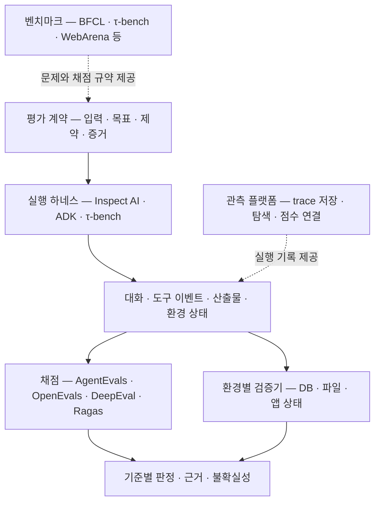

# 에이전트 평가 시스템 스터디

> 조사일: **2026-10-08**. 공식 문서·논문과 **8개 저장소의 고정 커밋**을 함께 읽었다. 핵심 관심사는 응답 품질, 도구 선택·인자, 실행 경로, 실제 작업 성과를 어떻게 모델링하고 채점하는가이다.

에이전트 평가의 출발점은 **최종 답변, 관찰된 행동, 실제 환경의 결과를 별개의 증거로 다루는 것**이다. “예약했습니다”라는 답변, `book()` 호출 기록, 예약 DB의 새 레코드는 서로 다른 사실이다. 좋은 평가 시스템은 이들을 연결하되 하나의 신호로 다른 것을 대신하지 않는다.

## 읽는 순서

| 문서 | 중심 질문 |
|---|---|
| [01 — 평가의 개념과 데이터 모델](01-evaluation-model.md) | 무엇을 평가 대상으로 삼고 어떤 증거를 수집하는가? |
| [02 — 응답 품질과 Judge](02-response-and-judge.md) | 정답성·근거성·완전성을 어떻게 구분하고 LLM judge를 믿을 수 있는가? |
| [03 — 도구 선택과 실행 경로](03-tool-and-trajectory.md) | 도구 이름, 인자, 순서, 반복, 부작용을 어떻게 채점하는가? |
| [04 — 평가 라이브러리 코드 분석](04-evaluator-libraries.md) | AgentEvals·OpenEvals·DeepEval·Ragas의 내부 구조와 실제 차이는? |
| [05 — 실행 하네스와 시뮬레이션](05-harness-and-simulation.md) | Inspect AI·Google ADK·τ-bench는 실행과 채점을 어떻게 연결하는가? |
| [06 — 벤치마크와 연구 지형](06-benchmarks.md) | BFCL·τ-bench·WebArena·OSWorld·SWE-bench 등의 점수는 무엇을 뜻하는가? |
| [07 — 설계 예제와 스터디 가이드](07-design-and-study-guide.md) | 하나의 사례를 실제 평가 계약으로 바꾸려면 어떤 설계가 필요한가? |
| [조사 근거·커밋·자료 목록](sources.md) | 어떤 코드와 문서를 확인했으며 어디까지 직접 검증했는가? |

먼저 01 → 03 → 04를 읽으면 도구 사용 평가의 실제 구현을 이해할 수 있다. 응답 품질에 관심이 크면 02, 환경을 변경하는 에이전트에 관심이 크면 05 → 06이 다음 순서다.

## 먼저 알아둘 결론

1. **평가 라이브러리, 실행 하네스, 벤치마크, 관측 플랫폼은 서로 다른 계층이다.** Ragas와 τ-bench를 대체재로 비교하면 설계 목적을 놓친다.
2. **“Tool correctness”라는 이름이 채점 정의를 보장하지 않는다.** 어떤 구현은 호출 횟수를 보존하고, 어떤 구현은 집합으로 중복 제거한다. 인자 비교도 기본 활성화 여부가 다르다.
3. **경로 일치와 작업 성공은 독립적이다.** 다른 경로로 성공할 수 있고, 정답 경로를 따라가도 도구 실행 실패로 목표를 달성하지 못할 수 있다.
4. **LLM이 추론한 완료와 환경에서 확인한 완료를 구분해야 한다.** DeepEval TaskCompletion과 Ragas AgentGoalAccuracy는 기본적으로 제공된 기록을 판단한다. τ-bench의 DB 평가는 시뮬레이션 상태를 재구성해 비교한다. [DeepEval][de-task] · [Ragas][rg-goal] · [τ-bench][tau-env]
5. **평균 성공률에 반복 실행의 일관성을 추가해야 한다.** `pass@k`와 `pass^k`는 반대 방향의 질문이다. 상세 수식은 [01](01-evaluation-model.md)에 있다.

## 코드에서 확인한 중요한 차이

| 발견 | 평가 결과를 읽을 때의 의미 | 근거 |
|---|---|---|
| AgentEvals `strict`는 메시지 역할·구조·도구 호출을 비교하며 일반 `content`를 비교하지 않음 | 최종 답변이 틀리거나 tool 응답이 달라져도 경로 점수는 통과할 수 있음 | [strict scorer][ae-strict] |
| AgentEvals `strict`도 한 메시지 안의 여러 tool call은 순서 없이 매칭 | “strict = 모든 호출의 전역 순서가 동일”이라는 해석은 틀림 | [strict scorer][ae-strict] |
| Ragas collections `ToolCallF1`은 호출을 `set`으로 변환 | 같은 호출 반복을 이 점수 하나로 검출할 수 없음 | [F1 구현][rg-f1] |
| Ragas collections `ToolCallAccuracy`는 기대 인자별 부분 점수 | 추가 인자나 일부 타입 차이를 엄격한 schema 위반으로 보지 않음 | [인자 비교][rg-args] |
| DeepEval ToolCorrectness의 `evaluation_params` 기본값은 빈 목록 | 인자까지 평가하려면 명시적 설정 필요 | [ToolCorrectness][de-tool] |
| ADK `ANY_ORDER`는 기대 호출을 모두 포함하면 추가 호출 허용 | AgentEvals `unordered`와 같은 의미가 아님 | [ADK trajectory][adk-traj] |
| τ-bench의 reference `actions`는 gold DB 생성용으로도 사용 | reference action 목록이 항상 강제 경로를 뜻하지 않음 | [Task Action 모델][tau-task] |

AgentEvals·OpenEvals·Ragas의 일부 항목은 실제 Python API로 재현했다. 나머지는 소스 분석 결과다. 모델을 호출하는 judge나 전체 벤치마크를 실행해 성능 순위를 측정한 자료는 아니다.

## 어떤 오픈소스부터 읽을까?

다음은 기능 수 순위가 아니라 **학습 목적에 따른 선택**이다.

| 학습 목적 | 먼저 읽을 코드 | 이유·한계 |
|---|---|---|
| 평가 함수를 작게 직접 조합 | OpenEvals + AgentEvals | evaluator factory와 matcher가 간결함. 시뮬레이션 환경은 직접 연결 |
| RAG 응답과 tool-use 지표를 한 모델로 이해 | Ragas | claim 평가와 tool metric의 차이가 명확함. collections와 legacy 구현 구분 필요 |
| span 수준까지 에이전트를 평가 | DeepEval | trace·test case·metric 연결이 풍부함. 각 metric의 기본 옵션과 judge 경로를 확인해야 함 |
| 임의 에이전트를 실행하고 파일·환경 결과 채점 | Inspect AI | Task·Agent/Solver·Scorer·Sandbox가 분리됨. 업무별 성공 조건은 직접 정의 |
| ADK 에이전트의 대화·도구 경로·사용자 시뮬레이션 | Google ADK evaluation | 런타임 이벤트와 자연스럽게 연결. 일부 지표는 외부 Vertex 평가 서비스 사용 |
| 사용자와 상호작용하며 DB를 바꾸는 작업 | τ-bench | 사용자 시뮬레이터·도메인 정책·상태 채점 결합. 범용 drop-in metric 라이브러리는 아님 |
| 함수 호출 모델과 채점 알고리즘 연구 | BFCL | AST·실행 상태·응답 검사 분리. 특정 제품 업무의 성공률로 직접 환산 불가 |

**스터디의 중심 코드로는 AgentEvals와 τ-bench를 짝지어 읽는 것을 권한다.** 전자는 “관찰된 경로를 비교한다”, 후자는 “환경에서 목표 달성을 확인한다”는 서로 다른 평가 관점을 선명하게 보여준다. Judge 구현은 OpenEvals·Ragas를 이어서 읽으면 된다.

## 생태계에서의 위치

한 프로젝트가 여러 계층을 함께 제공할 수 있다. 위 그림은 제품 경계를 고정한 분류가 아니라 책임을 분리하기 위한 모델이다.

관련 기존 자료:

- [Agent Behavior 코드 분석](../agentbehavior/README.md): 관찰 가능한 행동 명세와 적용 조건을 다루는 인접 주제.
- [Tool Search 비교](../tool-search-comparison/tool-search-landscape.md): 도구 검색 실패와 선택 실패를 구분할 때 참고.
- [LLM Observability 지형도](../../ai-infrastructure/llm-observability/README.md): trace 저장·탐색 플랫폼의 별도 분석. 해당 문서의 조사 시점은 이번 자료와 다르다.

## 범위와 해석

문서의 **코드 사실**은 연결된 커밋을 기준으로 한다. **설계 제안**과 가상 예제는 여러 구현을 바탕으로 작성한 종합 의견이며 특정 라이브러리의 기본 동작이 아니다. 논문에서 소개하는 실험 결과를 현재 모델의 성능으로 옮겨 적지 않았다. 테스트 운영·QA 절차·CI 구성은 이 스터디의 범위에서 제외했다.

[adk-traj]: https://github.com/google/adk-python/blob/7d8c9502f924ed5e7a1ab00dc1f5a603e858abc3/src/google/adk/evaluation/trajectory_evaluator.py#L40
[ae-strict]: https://github.com/langchain-ai/agentevals/blob/946ad15b9f2ce9bc9843edd2bb773bd07d78ca7e/python/agentevals/trajectory/strict.py#L20
[de-task]: https://github.com/confident-ai/deepeval/blob/0fb05d028b5ded9e4c466140ab3f3af90b801944/deepeval/metrics/task_completion/task_completion.py#L47
[de-tool]: https://github.com/confident-ai/deepeval/blob/0fb05d028b5ded9e4c466140ab3f3af90b801944/deepeval/metrics/tool_correctness/tool_correctness.py#L43
[rg-args]: https://github.com/vibrantlabsai/ragas/blob/298b68274234c060deacab3cf5fb52aa3a20e885/src/ragas/metrics/collections/tool_call_accuracy/util.py#L24
[rg-f1]: https://github.com/vibrantlabsai/ragas/blob/298b68274234c060deacab3cf5fb52aa3a20e885/src/ragas/metrics/collections/tool_call_f1/metric.py#L15
[rg-goal]: https://github.com/vibrantlabsai/ragas/blob/298b68274234c060deacab3cf5fb52aa3a20e885/src/ragas/metrics/collections/agent_goal_accuracy/metric.py#L23
[tau-env]: https://github.com/sierra-research/tau2-bench/blob/4ce7c0397c1eb65c9bbe59aeacfe1ca44a1cd699/src/tau2/evaluator/evaluator_env.py#L17
[tau-task]: https://github.com/sierra-research/tau2-bench/blob/4ce7c0397c1eb65c9bbe59aeacfe1ca44a1cd699/src/tau2/data_model/tasks.py#L116
