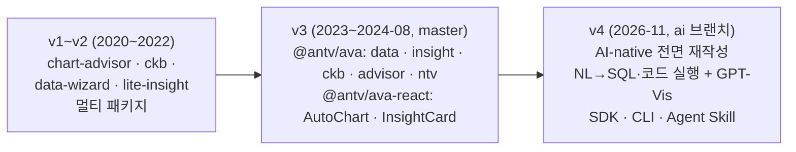
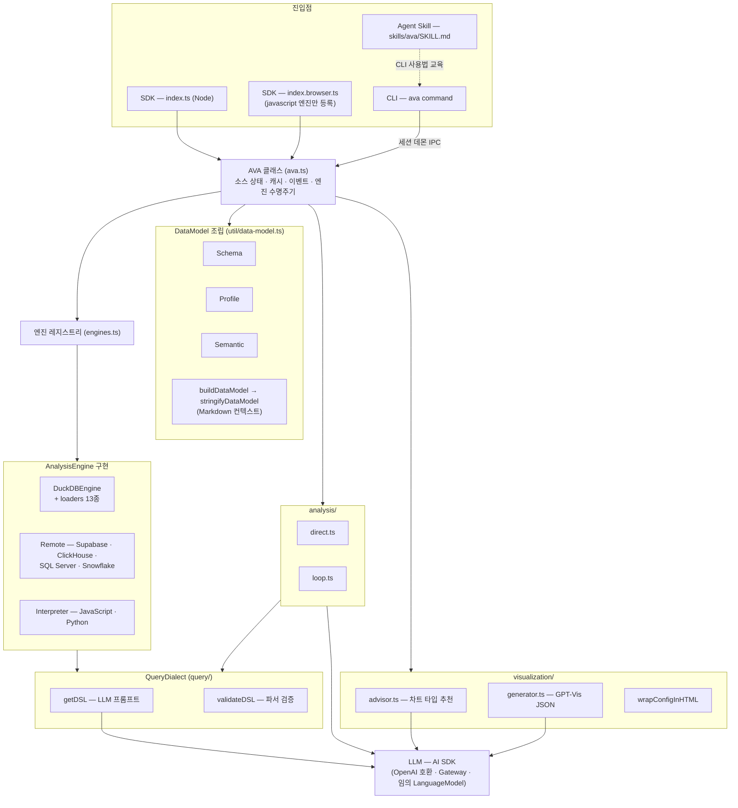
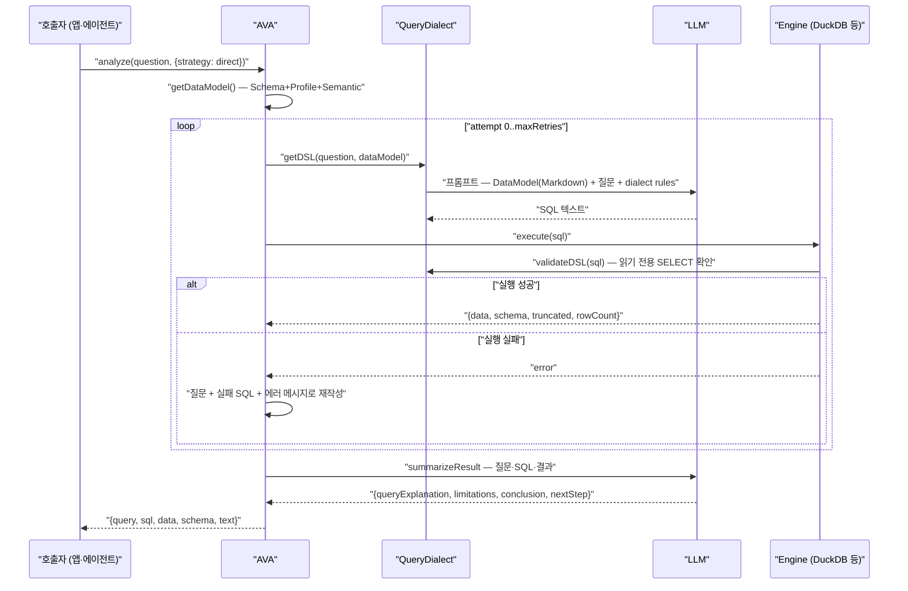
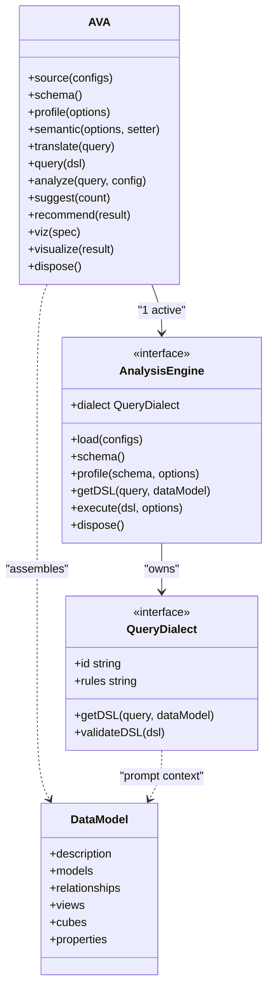
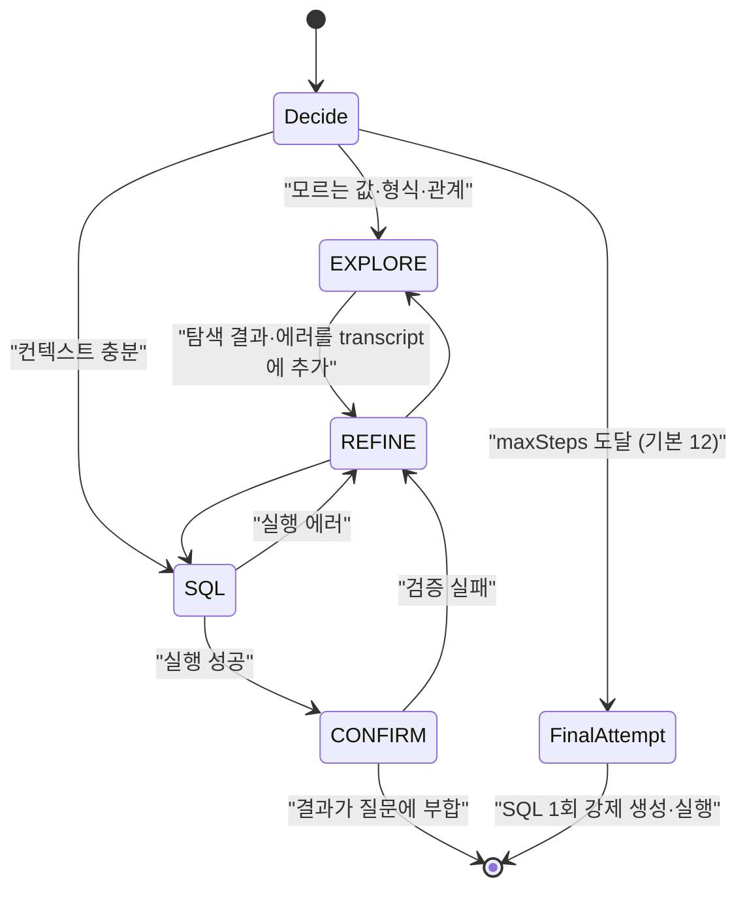

# AntV AVA 4.x: 코드 레벨 분석

> **분석 대상**: [antvis/AVA](https://github.com/antvis/AVA) (MIT) · 기본 브랜치 `ai` · **v4.0.3** (2026-11-13) · 커밋 `507ab59`
> **한 줄 정의**: 파일과 DB 데이터를 불러와 자연어 질문을 **SQL(또는 pandas·JavaScript 코드)로 바꿔 실행**하고, 결과를 GPT-Vis 차트로 그리는 TypeScript 데이터 분석 프레임워크입니다. 공식 문서는 스스로를 *"PandasAI for JavaScript"*라고 소개합니다. SDK, CLI, Agent Skill 형태로 함께 배포됩니다.
> **분석 방법**: 저장소를 clone해 `src/`(163개 파일, 약 12.9k LOC), `skills/ava/`(Agent Skill), `site/ai/`(브라우저 에이전트 데모), `site/content/`(공식 문서·블로그), `evals/`(벤치마크 하네스)를 소스 단위로 읽었습니다. v3(`master` 브랜치)는 비교를 위해 구조만 확인했습니다.
> **같이 볼 문서**: [에이전트 활용 방식 심층](agent-integration.md) · [Wren AI](../wren-ai/analysis.md) · [DB-GPT](../db-gpt/analysis.md) · [Flint (MS)](../flint-chart/flint-chart-analysis.md)

---

## TL;DR: 질문에 대한 답

| 질문 | 답 |
|---|---|
| **시각화만 하는가, 분석(Text-to-SQL)도 하는가?** | **분석도 합니다. v4에서는 분석이 코어입니다.** `analyze()`가 자연어를 SQL로 바꾸고(LLM), 검증한 뒤 실행하고, 결과를 요약하는 파이프라인을 담당합니다. `visualize()`는 그 결과를 받아 그리는 후단입니다. 단, v3까지(2024년 `master`)는 차트 추천·자동 인사이트 전용이었고 Text-to-SQL이 **없었습니다**. 버전에 따라 답이 다릅니다. |
| **"SQL"만 생성하는가?** | 엔진마다 쓰는 쿼리 언어(dialect)가 다릅니다. DuckDB·PostgreSQL(Supabase)·ClickHouse·T-SQL(SQL Server)·Snowflake는 **SQL**을, Python 엔진은 **pandas 코드**를, JavaScript 엔진은 **JS 코드**를 생성합니다. 정확히는 *Text-to-DSL*입니다. |
| **에이전트는 어떻게 쓰는가?** | 세 가지 방식이 있습니다. ① **Agent Skill + CLI**: 에이전트가 SQL을 직접 쓰고 AVA는 실행·렌더링만 맡습니다. AVA용 API 키가 필요 없습니다. ② **SDK를 도구로 래핑**: 외부 에이전트가 `analyze`·`visualize`를 도구로 호출하고, AVA 내부 LLM이 NL→SQL을 수행합니다. ③ **AVA 내장 루프**(`strategy: 'loop'`): AVA 자체가 EXPLORE·REFINE·SQL·CONFIRM을 반복하는 미니 에이전트로 동작합니다. 자세한 내용은 [agent-integration.md](agent-integration.md)에 있습니다. |
| **정확도는?** | 공식 벤치마크(GLM-5.1)에서 Spider2-Lite(SQLite)는 컨텍스트가 원시 데이터뿐일 때 **25.9%**, Schema+Profile을 더하면 **33.3%**, Semantic까지 더하면 **80.7%**였습니다. BIRD New Dev는 **63~68%**입니다. 전략(direct·loop) 차이는 ±2pp에 그치고, **비즈니스 정의(Semantic)의 효과가 압도적**입니다. |

---

## 목차

0. [Text-to-SQL 기능 검증 (소스 근거)](#0-text-to-sql-기능-검증-소스-근거)
1. [프로젝트 개요](#1-프로젝트-개요)
2. [핵심 특징 및 차별점](#2-핵심-특징-및-차별점)
3. [아키텍처 분석](#3-아키텍처-분석)
4. [기술 스택](#4-기술-스택)
5. [핵심 코드 분석](#5-핵심-코드-분석)
6. [API 및 인터페이스](#6-api-및-인터페이스)
7. [확장성 및 플러그인](#7-확장성-및-플러그인)
8. [성능 특성](#8-성능-특성)
9. [배포 및 운영](#9-배포-및-운영)
10. [경쟁·비교 분석](#10-경쟁비교-분석)
11. [종합 평가](#11-종합-평가)

---

## 0. Text-to-SQL 기능 검증 (소스 근거)

### 0.1 결론

AVA 4.x의 메인 클래스 주석부터가 *"natural-language queries are turned into SQL via LLM and executed by the configured engine"*입니다(`src/ava.ts`). 공개 메서드 12개 중 데이터·분석 계열이 8개(`source`·`schema`·`profile`·`semantic`·`translate`·`query`·`analyze`·`suggest`)이고, 시각화 계열은 3개(`recommend`·`viz`·`visualize`), 나머지 하나는 `dispose`입니다. **"시각화 라이브러리에 분석이 붙은 것"이 아니라 "분석 프레임워크에 시각화가 붙은 것"**으로 보는 편이 정확합니다.

### 0.2 기능별 근거

| 기능 | 공개 API | 구현 위치 | 동작 |
|---|---|---|---|
| NL → SQL 생성만 | `ava.translate(q)` | `src/query/*.ts` → `QueryDialect.getDSL()` | 데이터 모델(Markdown) + 질문 + dialect 규칙을 넣은 프롬프트로 SQL 1개를 생성합니다 |
| SQL 실행만 | `ava.query(dsl)` | `engine.execute()` → `dialect.validateDSL()` | 파서로 **읽기 전용 단일 SELECT**인지 검증한 뒤 실행합니다. 결과는 200행·1 MiB로 제한됩니다 |
| 원스텝 분석 | `ava.analyze(q, {strategy})` | `src/analysis/direct.ts`, `loop.ts` | 생성 → 실행 → (실패 시 에러를 피드백해 재생성) → 요약 |
| 결과 요약 | `analyze()` 내부 | `summarizeResult()` | `queryExplanation`·`limitations`·`conclusion`·`nextStep`을 JSON으로 받습니다 |
| 추천 질문 | `ava.suggest(n)` | `src/suggest/index.ts` | 데이터 모델을 보고 점수와 이유가 붙은 분석 질문 n개를 만듭니다 |
| 데이터 이해 | `schema()`·`profile()`·`semantic()` | `duckdb/profile.ts`, `util/data-model.ts` | 스키마 + 통계 + 비즈니스 정의를 합쳐 **DataModel**을 만들고 프롬프트 컨텍스트로 씁니다 |

### 0.3 지원 쿼리 언어(Dialect)와 검증 방식

| Dialect id | 엔진 | 생성 대상 | 실행 전 검증 방법 |
|---|---|---|---|
| `duckdb-sql` | DuckDB (기본값) | SQL | 데이터가 없는 별도 DuckDB 인스턴스에서 `json_serialize_sql()`로 파싱합니다. SELECT 1개만 통과합니다 |
| `postgresql` | Supabase | SQL | `@supabase/pg-parser`(WASM, PG17)로 AST를 순회하며 `Insert`·`Update`·`Delete`·`Merge`·`INTO`·row lock을 거부합니다 |
| `clickhouse-sql` | ClickHouse | SQL | `@clickhouse/parser`를 사용하며 `FORMAT`·`SETTINGS`·`INTO OUTFILE`을 금지합니다 |
| `tsql` | SQL Server | SQL | ANTLR T-SQL 문법으로 `select_statement_standalone` + EOF를 확인하고 `INTO`·`OPENQUERY`·`OPENROWSET`을 거부합니다 |
| `snowflake` | Snowflake | SQL | `SYSTEM$` 함수·프로시저·`IDENTIFIER()` 동적 호출을 거부합니다 |
| `python` | Python | pandas 코드 | `compile()`로 문법만 확인합니다. **로컬 실행은 샌드박스가 아닙니다** |
| `javascript` | JavaScript (브라우저 기본) | JS 코드 | 비어 있는지만 확인합니다. 브라우저에서는 sandbox iframe + CSP, Node에서는 `vm`(보안 경계 아님)에서 실행합니다 |

### 0.4 무엇이 *아닌가*: 전문 NL2SQL 시스템과의 차이

소스를 보면 AVA의 Text-to-SQL은 **"좋은 컨텍스트를 한 번에 넣는 프롬프트 + 실행 피드백"** 구조로 상당히 단순합니다. 아래 기능은 **없습니다**.

- **스키마 링킹·검색 없음**: 데이터 모델 전체를 Markdown으로 직렬화해 매번 프롬프트에 넣습니다. `stringifyDataModel()`에는 `// TODO: Above 30,000 characters, retrieve question-relevant context with embeddings`라는 주석이 남아 있습니다. 테이블이 수백 개인 웨어하우스에는 그대로 쓰기 어렵습니다.
- **Q-SQL 쌍 학습·few-shot 메모리 없음**: Vanna처럼 질문-SQL 예제를 쌓아 검색하는 구조가 없습니다.
- **시맨틱 레이어가 실행되지 않음**: `Semantic`(models·relationships·views·cubes)은 **프롬프트용 설명**일 뿐입니다. Wren Engine처럼 MDL을 SQL로 컴파일·재작성하지 않습니다. Skill 문서에도 *"Semantic does not execute them. Apply definitions explicitly in SQL"*라고 명시돼 있습니다.
- **대화 메모리 없음**: `analyze()`는 단발 호출입니다. 후속 질문 맥락은 바깥 에이전트가 *self-contained* 질문으로 다시 써서 넘겨야 합니다.
- **후보 SQL 다수결·self-consistency 없음**: direct는 1개 생성 + 실행 실패 시 재생성, loop는 순차 탐색입니다.

---

## 1. 프로젝트 개요

### 1.1 해결하려는 문제

AVA 4.0 릴리스 블로그의 문제 정의는 다음과 같습니다.

> "AI가 SQL을 쓰거나 차트를 만드는 건 더 이상 어려운 부분이 아니다. 실제 비즈니스 질문에서는 **데이터가 여러 시스템에 흩어져 있고, 지표 정의가 서로 다르며, 결론이 검증을 견뎌야 한다**."

이에 대한 AVA의 답은 세 가지입니다.

1. **신뢰할 수 있는 데이터 컨텍스트**: Schema + Profile + Semantic으로 구성된 `DataModel`
2. **신뢰할 수 있는 계산**: *"모델은 조사를 이끌고, 코드는 계산한다"*. 원본 테이블을 LLM 컨텍스트에 넣지 않고, 생성된 SQL을 엔진에서 실행합니다.
3. **검증 가능한 결과**: 모든 답에 실행한 SQL, 결과 행, 결과 스키마, truncation 여부, 단계별 이벤트가 붙습니다.

### 1.2 탄생 배경과 버전 진화



- **v1~v3**: Ant Group AntV 팀의 *자동 시각화* 라이브러리입니다. 규칙과 통계 기반의 차트 추천(ChartAdvisor + 차트 지식베이스 CKB), 자동 인사이트(이상치·추세 탐지), 서술형 텍스트 시각화(NTV)로 구성됐습니다. **LLM과 Text-to-SQL은 없었습니다.** 관련 논문은 *Visual Informatics* 2024에 실린 "AVA: An automated and AI-driven intelligent visual analytics framework"입니다.
- **v4**: 기본 브랜치를 `ai`로 바꾸고 코드를 **전면 재작성**했습니다. v3의 유산은 차트 지식(`visualization/vis.ts`의 차트별 기능·적용 시나리오·데이터 요구·제약)이 LLM 프롬프트 형태로 남은 정도입니다. 2026-11-04에 v4.0.0 GA가 나왔고, 열흘 안에 v4.0.3까지 패치가 이어졌습니다. AVA 기반 분석 앱 [Sive](https://sive.antv.antgroup.com/)가 함께 공개됐습니다.
- 커뮤니티 규모: GitHub 스타 약 1.6k, MIT 라이선스.

---

## 2. 핵심 특징 및 차별점

| 특징 | 내용 | 차별점 |
|---|---|---|
| **3계층 DataModel** | Schema(구조) + Profile(실측 통계) + Semantic(비즈니스 정의)을 하나의 모델로 합칩니다 | 벤치마크로 *"Semantic이 정확도의 핵심"*임을 수치로 보여줍니다(+54.8pp) |
| **플러그블 엔진 × Dialect** | 7개 엔진이 각자 `QueryDialect`(생성 규칙 + 검증기)를 소유합니다 | 같은 `analyze()` API로 SQL, pandas, JS를 모두 다룹니다 |
| **이기종 소스 조인** | DuckDB가 CSV·Excel·Parquet·SQLite·MySQL·PostgreSQL·MongoDB·Feishu·Tencent Docs·GitHub를 각각 별도 스키마로 등록합니다 | `sales.data JOIN crm.customers` 같은 **크로스 소스 SQL 한 줄**이 가능합니다 |
| **두 가지 분석 전략** | `direct`(생성-실행-재시도)와 `loop`(EXPLORE·REFINE·SQL·CONFIRM) | 전략을 호출 단위로 고를 수 있습니다 |
| **에이전트 퍼스트 배포** | `skills/ava/SKILL.md` + JSON 출력 CLI + 세션 데몬 | MCP 서버 없이 **CLI + Skill**만으로 Claude Code·Codex 등에 붙습니다 |
| **LLM 생성 SQL 하드닝** | DuckDB 확장 차단, `allowed_paths`, 외부 접근 차단, `lock_configuration`, 메모리·스레드·타임아웃 제한 | "LLM이 만든 쿼리는 신뢰하지 않는다"는 전제로 설계했습니다 |
| **공개 벤치마크 하네스** | DataBench·BIRD·Spider2-Lite × SDK·Agent Skill 비교 | 통합 방식에 따른 비용(토큰 10배) 차이까지 공개합니다 |

---

## 3. 아키텍처 분석

### 3.1 전체 구성



### 3.2 `analyze()` 데이터 흐름 (direct 전략)



### 3.3 핵심 개념 모델



설계 포인트는 다음과 같습니다.

- **엔진은 메타데이터를 캐시하지 않습니다**: `load()`는 아무것도 반환하지 않고, `schema()`·`profile()` 결과 캐시는 `AVA` 클래스가 소유합니다. 엔진은 데이터와 커넥션만 들고 있습니다.
- **`dialect`는 엔진의 필수 속성입니다**: "어떤 언어로 생성하고 어떻게 검증하는가"를 엔진과 분리해, 같은 dialect를 여러 엔진이 공유할 수 있게 했습니다. 예를 들어 `loop` 전략은 `engine.dialect.rules`를 프롬프트에 그대로 꽂아 넣습니다.
- **브라우저 번들 분리**: `ava.ts`는 엔진 구현을 직접 import하지 않습니다. 진입점(`index.ts`/`index.browser.ts`)이 `registerEngine()`으로 등록하므로 DuckDB 같은 Node 전용 의존성이 브라우저 번들에 섞이지 않습니다.

---

## 4. 기술 스택

| 영역 | 사용 기술 |
|---|---|
| 언어·런타임 | TypeScript 5.9, **Node.js ≥ 22.13** (브라우저 빌드 별도) |
| LLM 추상화 | **Vercel AI SDK v7** (`ai`, `@ai-sdk/openai`). OpenAI 호환 Chat Completions, AI Gateway, 또는 임의의 `LanguageModel` 인스턴스를 받습니다 |
| 스키마·계약 | **Zod v4**. 모든 API 입출력을 Zod 스키마로 정의하고 타입은 `z.infer`로 파생합니다 |
| 로컬 분석 엔진 | **DuckDB** (`@duckdb/node-api`). `mysql`·`postgres` 확장으로 ATTACH합니다 |
| 원격 엔진 | `@clickhouse/client`, `mssql`, `snowflake-sdk`, Supabase Management API |
| SQL 파서 | DuckDB `json_serialize_sql`, `@supabase/pg-parser`(WASM), `@clickhouse/parser`, `antlr4ts-sql`(T-SQL) |
| 파일 파싱 | `csv-parse`, `adm-zip` + `saxes`(xlsx XML), `jsonrepair` |
| 네트워크 | `ssh2`(DB SSH 터널, 호스트 키 검증) |
| 시각화 | **AntV GPT-Vis 1.3.1** (UMD를 npmmirror CDN에서 로드) |
| 빌드·테스트 | `tsc`(CJS) + Vite(ESM), Vitest |

---

## 5. 핵심 코드 분석

### 5.1 디렉터리 구조

```
src/
├── ava.ts              # 공개 API · 수명주기 · 캐시 · 이벤트 (401줄)
├── engines.ts          # 엔진 레지스트리
├── types.ts            # 공개 타입 (Zod 스키마에서 추론)
├── contracts/          # API 입출력 Zod 스키마, 소스 타입별 파일
├── analysis/           # direct.ts (167줄) · loop.ts (390줄)
├── query/              # dialect 7종: 프롬프트 + 검증기
├── duckdb/             # 엔진 · 프로파일 · loaders/ (csv~github, text)
├── remote/             # supabase · clickhouse · sqlserver · snowflake
├── interpreter/        # javascript (sandbox · stat 헬퍼) · python (pandas)
├── visualization/      # advisor · generator · vis(차트 지식)
├── suggest/            # 추천 질문
├── event/              # Lifecycle·Analysis 이벤트
├── cli/                # 명령 12개 + session/ (데몬 · IPC)
└── util/               # data-model 직렬화 · result 제한 · sql 이스케이프 …
```

### 5.2 DataModel 조립과 직렬화: "컨텍스트가 곧 정확도"

`buildDataModel()`은 Schema 위에 Profile의 `metrics`/`properties`를 컬럼 단위로 덮고, Semantic 정의를 모델·컬럼 이름 기준으로 병합합니다. 알 수 없는 모델이나 컬럼을 참조하면 **조용히 무시하지 않고 예외를 던집니다**.

```ts
// util/data-model.ts (요약)
for (const observation of profile?.models ?? []) {
  const model = models.get(observation.name);
  if (!model) throw new Error(`Unknown profile model: ${observation.name}`);
  ...
}
for (const definition of semantic?.models ?? []) {
  const model = { ...current, ...definition };
  if (definition.refSql !== undefined || definition.baseObject !== undefined) delete model.tableReference;
  ...
}
```

Semantic 스키마는 **Wren AI의 MDL과 필드 이름이 거의 같습니다**. `refSql` / `baseObject` / `tableReference`(셋 중 정확히 하나), `isCalculated` + `expression`, `relationship`, `joinType: ONE_TO_MANY…`, `condition` 등이 그렇습니다. 여기에 `cubes`(measures·dimensions·timeDimensions·hierarchies)가 더해져 Cube.dev 스타일 지표 정의까지 표현합니다. 차이는 앞서 말한 대로 **실행 엔진 없이 프롬프트 컨텍스트로만 쓴다**는 점입니다.

`stringifyDataModel()`은 이 모델을 **Markdown 표**로 바꿉니다. JSON 그대로가 아니라 `# Data Model → ## Models → ### Model: orders → #### Columns → - net_revenue (DECIMAL) [calculated: paid_amount - COALESCE(refund_amount,0)]` 형태라서, LLM이 읽기 쉬운 문서 구조를 의도한 것으로 보입니다.

### 5.3 QueryDialect: 프롬프트는 단순하게, 검증은 엄격하게

생성 프롬프트는 dialect마다 거의 같은 템플릿입니다.

```ts
// query/duckdb-sql.ts
const prompt = `You are a DuckDB SQL expert. Given the following data model and user query, generate a SQL query to answer the question.
    Dataset Context:
    ${stringifyDataModel(dataModel)}
    User Query: ${query}
    ${this.rules}
    Generate exactly one query. Return only SQL text, without explanation or Markdown.`;
```

반면 **검증은 dialect별 실제 파서**를 씁니다. DuckDB 검증기는 특히 흥미롭습니다.

```ts
// 데이터가 없는 별도 인스턴스(64MB, 외부 접근 off)에서 AST 직렬화만 수행
const reader = await connection.runAndReadAll(
  'SELECT json_serialize_sql(CAST(? AS VARCHAR)) AS ast', [sql]);   // SQL은 바인딩 값
...
if (ast.error !== false || ast.statements?.length !== 1) throw ...
// "AST를 재출력하면 float 리터럴·암묵 컬럼명이 바뀔 수 있으니 원본 SQL을 실행"
return sql;
```

- `json_serialize_sql`은 SELECT만 직렬화할 수 있으므로 **"SELECT 1개" 검증을 DuckDB 공식 기능에 위임**합니다.
- 검증용 인스턴스는 데이터가 없고 외부 접근도 꺼져 있어서, 검증 단계 자체가 공격 표면이 되지 않습니다.
- PostgreSQL 검증기는 AST를 재귀적으로 돌며 **데이터 변경 CTE**(`WITH x AS (DELETE …) SELECT …`)와 `SELECT … INTO`, `FOR UPDATE`까지 잡아냅니다.

### 5.4 DuckDB 엔진: LLM 생성 SQL을 위한 샌드박싱

```ts
// duckdb/engine.ts: restrictAccess()
SET memory_limit = '512MB'; SET threads = 1;
SET allowed_paths = [<로드한 소스 파일들>];
SET temp_directory = <전용 mkdtemp>;
SET enable_external_access = false;
SET lock_configuration = true;        // 마지막에 잠가서 이후 SQL로 되돌릴 수 없게
```

- 인스턴스를 만들 때 `autoinstall/autoload_known_extensions=false`, `allow_unsigned_extensions=false`로 설정해 **확장 설치를 막습니다**. MySQL과 PostgreSQL은 정적 링크된 내장 확장이라 동작합니다.
- 실행은 `SELECT * FROM query('<원본 SQL>') LIMIT maxRows+1` 형태로 감쌉니다. `+1`은 truncation 여부를 판단하기 위한 행입니다.
- 타임아웃(기본 30초)이 지나면 `conn.interrupt()`를 호출하고, **네이티브 쿼리가 실제로 끝날 때까지 기다린 뒤** 에러를 던집니다. dispose와 경합해 메모리가 해제되는 문제를 막으려는 처리입니다.
- 다중 소스일 때는 소스마다 `CREATE SCHEMA <name>`으로 네임스페이스를 만들고, 각 로더가 그 안에 뷰를 등록합니다. `main`, `information_schema`, `pg_catalog` 등은 예약어로 막아 둡니다.

로더는 두 종류입니다.

- **파일 계열**(CSV·JSON·Parquet·Excel·Text): 단일 `data` 뷰를 만듭니다. `text` 로더는 비정형 텍스트를 **LLM으로 JSON 배열로 추출**해 임시 파일로 쓴 뒤 읽습니다.
- **DB 계열**(MySQL·PostgreSQL·SQLite·MongoDB): DuckDB `ATTACH`를 쓰고, 테이블마다 뷰를 하나씩 등록합니다. PostgreSQL 로더는 `pg_catalog`에서 **PK·유니크 인덱스·FK**를 읽어 Schema의 `relationships`까지 채웁니다. 계산은 DuckDB에서 일어나고, 원격 DB는 스캔 대상이 됩니다(연합 쿼리).

원격 엔진(Supabase·ClickHouse·SQL Server·Snowflake)은 반대로 **SQL을 원격 DB에 그대로 푸시다운**합니다. 대신 소스를 **정확히 1개**만 받습니다.

### 5.5 Direct 전략: 실행 에러 기반 자기 수정

```ts
// analysis/direct.ts
const maxRetries = Math.max(config.strategy?.type === 'direct' ? config.strategy.maxRetries ?? 2 : 10, 0);
for (let attempt = 0; ; attempt++) {
  ({ dsl } = await engine.getDSL(translationQuery, dataModel));
  try { result = await engine.execute(dsl, config); }
  catch (error) {
    if (attempt >= maxRetries) throw error;
    translationQuery = `${query}\n The previous DSL failed to execute. ...Previous DSL:\n${dsl}\nExecution error:\n${error.message}`;
    continue;
  }
  break;
}
```

- **재시도 대상은 "실행 실패"뿐입니다.** SQL 생성이나 요약 단계의 LLM 실패는 즉시 전파됩니다.
- 함정이 하나 있습니다. **`strategy`를 생략하면 재시도가 10회**이고, `{type:'direct'}`를 명시하면 기본 2회입니다. 공식 문서도 *"예측 가능한 예산을 원하면 명시하라"*고 경고합니다.
- 요약 단계는 `Output.object(zod)` + `extractJsonMiddleware` + `jsonrepair` 조합을 씁니다. OpenAI 호환 엔드포인트 중 `response_format`을 거부하는 곳이 있어서 `responseFormat: text`로 강제하고 **로컬에서 Zod로 검증**합니다.

### 5.6 Loop 전략: 텍스트 프로토콜 기반 미니 에이전트

Function calling을 쓰지 않습니다. **응답 첫 글자가 `[`인 태그 프로토콜**을 사용합니다.



- `[EXPLORE]`는 코드 블록 1개 이상, `[SQL]`은 정확히 1개, `[REFINE]`·`[CONFIRM]`은 0개입니다. 형식을 어기면 **즉시 에러**로 처리하고 재시도하지 않습니다.
- 매 스텝마다 **시스템 프롬프트 + 데이터 모델 + 질문 + 전체 transcript**를 다시 보냅니다. 상태 없는(stateless) 단일 `generateText` 호출입니다. 단순한 대신 스텝이 늘수록 토큰이 2차적으로 불어납니다(BIRD 기준 direct 대비 5배).
- `[SQL]` 태그는 엔진이 Python이나 JS여도 호환성을 위해 그대로 씁니다.
- 스텝 한도에 도달했을 때 성공한 SQL이 있으면 CONFIRM 없이 반환하고, 없으면 **"FINAL ATTEMPT"** 프롬프트로 SQL 1회를 강제합니다.

### 5.7 시각화 파이프라인: 2단 LLM 호출

1. **`adviseChartType()`**: 차트 지식 19종(기능·적용 시나리오·데이터 요구·부적합 시나리오)과 4단계 결정 규칙을 담은 **중국어 프롬프트**입니다. "시각화 의도 판별 → 필드 타입·행 수 분석 → 의도별 매칭(추세는 line/area/dual-axes, 비교는 column/bar 등) → 제약 검사" 순서이며, 의도가 없으면 `none`을 반환해 차트를 만들지 않습니다. v3의 CKB 규칙 엔진이 **프롬프트 속 휴리스틱으로 옮겨 온 형태**입니다.
2. **`generateVisualizationConfig()`**: 해당 차트 타입의 Zod 스키마를 `z.toJSONSchema()`로 바꿔 프롬프트에 넣고, GPT-Vis JSON 설정을 생성하게 합니다. 그다음 `vizInputSchema.parse()`로 다시 검증합니다.
3. **`wrapConfigInHTML()`**: LLM에게 HTML을 쓰게 하지 않습니다. JSON만 받아 **로컬 템플릿에 주입**합니다. `<`·`
`·`
` 이스케이프로 스크립트 인젝션을 막습니다.

주의할 점: 2단계에서 **결과 데이터 전체를 `JSON.stringify(data)`로 프롬프트에 넣습니다.** "원본 데이터를 LLM에 넣지 않는다"는 원칙의 예외로, 결과 행이 많을수록 비용이 늘어납니다. 기본 200행 제한이 사실상 이 비용의 상한 역할을 합니다.

### 5.8 Profile: 엔진 독립 지표 레지스트리

`Metric = { id, expression, enable(target, logicalType), options }` 구조입니다. 같은 지표 ID(`row_count`, `null_count`, `distinct_count`, `top_values`, `min`, `max`, `mean`, `median`, `stddev`…)를 **엔진마다 다른 표현식**으로 구현합니다. DuckDB는 SQL 조각, Python은 pandas 코드, JS는 함수입니다. 기본값은 7개 지표입니다. `top_values`는 `limit`·`maxDistinctRatio` 옵션으로 고카디널리티 컬럼을 거릅니다.

### 5.9 이벤트: 추적 가능성의 기반

`AVA extends EventEmitter`이며, 모든 API가 `*start`/`*end` 이벤트 쌍을 발생시킵니다. `analyze()` 내부에서는 `stepstart → translatestart/end → querystart/end → summarizestart/end → stepend`가 `stepId`, `parentStepIds`, `eventId`와 함께 나갑니다. loop에서는 `parentStepIds`가 이전 스텝을 가리켜 **추론 그래프(reasoning graph)**를 다시 구성할 수 있습니다. 블로그에 나온 "인터랙티브 추론 그래프" UI가 이 이벤트를 소비합니다. `translateend`에는 `usage`(토큰)가 담겨 비용 추적에도 쓸 수 있습니다.

---

## 6. API 및 인터페이스

### 6.1 SDK

```ts
import { AVA } from '@antv/ava';            // 브라우저: '@antv/ava/browser'
const ava = new AVA({
  llm: { model: 'gpt-4o-mini', apiKey, baseURL },     // 또는 model: anthropic('claude-…') 같은 AI SDK 인스턴스
  engine: { type: 'duckdb', memoryLimit: '1GB', queryTimeoutMs: 60_000 },
});
await ava.source([
  { type: 'csv-file', name: 'sales', options: { path: './sales.csv' } },
  { type: 'postgresql', name: 'crm', options: { host, database, user, password } },
]);
await ava.profile();
await ava.semantic(undefined, () => mySemantic);
const r = await ava.analyze('지역별 순매출 상위 5개', { strategy: { type: 'loop', maxSteps: 6 } });
// r = { query, sql, data, schema, truncated?, rowCount?, text }
const chart = await ava.visualize(r);        // { chartType, config, html } | null
```

| 계열 | 메서드 | LLM 호출 |
|---|---|---|
| 데이터 | `source` · `schema` · `profile` · `semantic` · `dispose` | 없음 (`text` 소스는 예외) |
| 분석 | `translate`(NL→DSL) · `query`(DSL 실행) · `analyze`(통합) · `suggest` | `query`만 없음 |
| 시각화 | `recommend`(타입 + config) · `viz`(spec→HTML) · `visualize`(둘의 합성) | `viz`만 없음 |

모든 입출력 Zod 스키마(`analyzeInputSchema`, `vizInputSchema` 등)를 export합니다. 공식 API 문서는 *"MCP 등 JSON Schema 도구에는 `z.toJSONSchema(inputSchema, {io:'input'})`를 쓰라"*고 안내합니다. **내장 MCP 서버는 없고**, 스키마만 제공해 통합하는 쪽이 직접 만들게 하는 방식입니다.

### 6.2 CLI

| 명령 | 역할 | 모델 키 필요 |
|---|---|---|
| `ava source <path…>` | 세션 데몬 기동 후 `datasetId` 반환 | (text 소스만) |
| `ava schema <id>` | 구조 + `language` + dialect `instructions` | ✗ |
| `ava profile <id> --metrics …` | 통계 | ✗ |
| `ava semantic <id> --file x.json` | 정의 로드·조회 | ✗ |
| `ava query <id> --dsl @q.sql` | DSL 실행 | ✗ |
| `ava viz --spec @chart.json --output c.html` | spec 검증 + HTML 생성 | ✗ |
| `ava analyze` · `translate` · `suggest` · `recommend` · `visualize` | LLM 기반 기능 | ✓ (`OPENAI_API_KEY`) |
| `ava dispose <id>` | 세션 종료 | ✗ |

**키 없이 쓸 수 있는 명령(schema·query·viz)만으로 에이전트 워크플로가 완결**되도록 나눈 점이 Agent Skill 설계의 핵심입니다. 자세한 내용은 [agent-integration.md](agent-integration.md)의 2장에 있습니다.

---

## 7. 확장성 및 플러그인

| 확장 포인트 | 방법 | 비고 |
|---|---|---|
| **커스텀 엔진** | `registerEngine('sales', SalesEngine)` 후 `engine: {type:'sales'}` | `AnalysisEngine` 인터페이스 7개 멤버를 구현합니다. **SDK 전용**이며 CLI는 내장 엔진만 씁니다 |
| **커스텀 dialect** | 엔진의 `dialect` 속성으로 `QueryDialect` 구현체를 연결합니다 | 사내 DSL(예: 지표 API)로 생성·검증 가능 |
| **LLM 교체** | `llm.model`에 AI SDK `LanguageModel` 인스턴스를 넘깁니다 | Anthropic, Bedrock, 로컬 모델 등 AI SDK 프로바이더면 모두 가능 |
| **Python 실행 환경** | `engine: {type:'python', execute: async code => …}` | 원격 샌드박스(E2B·컨테이너)로 위임 가능 |
| **Schema 주입** | `ava.schema(undefined, () => mySchema)` | 디스커버리를 건너뛰고 큐레이션한 스키마를 사용 |
| **리포트 템플릿** | Skill의 `assets/report.html`을 복사해 `--template`으로 지정 | `<!-- ARTIFACT_DATA -->` 슬롯 유지 |

한계도 있습니다.

- `AnalysisStrategy` **타입은 export하지만**, `analysis/index.ts`가 `direct`/`loop` switch로 하드코딩돼 있어 **커스텀 전략을 등록할 수 없습니다**.
- **데이터 소스 로더에는 플러그인 레지스트리가 없습니다.** 새 소스를 넣으려면 소스 코드에 PR을 보내거나, 커스텀 엔진을 통째로 구현해야 합니다.
- 프롬프트(차트 추천 규칙, 요약 형식 등)를 **외부에서 오버라이드할 수 없습니다**.

---

## 8. 성능 특성

### 8.1 공식 벤치마크 (GLM-5.1 기준, `evals/`)

| 실험 축 | 조건 | 정확도 | 토큰/문항 |
|---|---|---|---|
| **컨텍스트** · DataBench (1,789문항) | 원시 데이터(헤더 + 3행) | 83.51% | 991 |
| | + Schema + Profile | 84.18% | 1,990 |
| | + **Semantic** | **93.01%** | 3,288 |
| **컨텍스트** · Spider2-Lite SQLite (135문항) | 원시 데이터 | 25.93% | 4,057 |
| | + Schema + Profile | 33.33% | 20,945 |
| | + **Semantic** | **80.74%** | 23,705 |
| **전략** · BIRD New Dev (1,534문항) | GLM-5.1 direct / loop | 63.10% / **65.84%** | 6,780 / 35,272 |
| | GLM-5.3 direct / loop | **68.12%** / 66.23% | ≥9,529 / ≥32,976 |
| **실행 엔진** · DataBench | DuckDB SQL / Python pandas | **86.64%** / 85.41% | 2,315 / 2,002 |
| **통합 방식** · DataBench | SDK(direct) / Agent Skill | **86.64%** / 84.46% | 2,315 / **23,384** |

해석할 때 주의할 점:

- **Semantic 효과가 압도적입니다.** 단, Spider2-Lite의 "With Semantic"은 벤치마크가 제공하는 *external knowledge* 문서를 Semantic으로 넣은 결과입니다. 실제 서비스에서는 이 정의를 **사람이 작성하고 유지보수**해야 하므로, 이 수치는 "정의가 잘 갖춰졌을 때의 상한"으로 읽어야 합니다.
- **Loop가 항상 이기지는 않습니다.** 약한 모델에서는 +2.7pp지만 강한 모델(GLM-5.3, Kimi)에서는 오히려 direct가 앞서고, 토큰은 5배 듭니다. "좋은 컨텍스트 + 강한 모델 + direct"가 비용 대비 효율이 가장 좋습니다.
- **Agent Skill은 SDK 대비 토큰 10배, 시간 2배**입니다. 에이전트가 스키마 읽기, SQL 작성, 결과 검토를 모두 자기 컨텍스트에서 하기 때문입니다. 정확도 손실은 2pp입니다.
- 벤치마크는 **정답 여부만** 측정합니다. 시각화 품질은 측정하지 않습니다.

### 8.2 런타임 제약

| 항목 | 기본값 | 비고 |
|---|---|---|
| 결과 행 | 200 (최대 10,000 CLI / 1,000,000 SDK) | 넘으면 `truncated: true` + `truncatedBy` |
| 결과 바이트 | 1 MiB | 필드당 1 MiB 상한 |
| DuckDB 메모리·스레드·타임아웃 | 512MB · 1 · 30초 | 보안을 위한 보수적 기본값이라 대용량 분석에는 조정이 필요합니다 |
| CLI IPC | 요청 1 MiB, 응답 16 MiB, 120초 | `--dsl` 최대 512 KiB |
| 세션 수명 | 유휴 30분 | 만료되면 재로드해야 합니다 |
| 프롬프트 컨텍스트 | DataModel **전체** | 검색 없음. 테이블이 많으면 토큰이 선형으로 늘어납니다 |
| 블로그 주장 | DuckDB로 약 6억 행 파일 쿼리 | 공식 블로그 수치이며 별도 검증은 하지 않았습니다 |

---

## 9. 배포 및 운영

- **설치**: `npm install @antv/ava` (SDK) / `npm install -g @antv/ava` (CLI) / `npx skills add antvis/AVA --skill ava` (Agent Skill)
- **환경 변수(CLI)**: `OPENAI_API_KEY`, `OPENAI_MODEL`(기본 `gpt-4o-mini`), `OPENAI_BASE_URL`. 세션 데몬은 `ava source` 시점의 환경을 쓰므로 **키는 source 전에 설정해야 합니다**.
- **브라우저**: `@antv/ava/browser`는 JavaScript 엔진만 지원합니다. 데이터는 메모리 배열로 다루고, 코드는 `sandbox="allow-scripts"` iframe과 CSP(`connect-src 'none'`) 안에서 실행합니다.
- **운영 시 체크포인트**
  - 차트 HTML은 **GPT-Vis를 `registry.npmmirror.com` CDN에서 로드**합니다. 폐쇄망이나 엄격한 CSP 환경에서는 템플릿을 바꾸거나 자체 호스팅해야 합니다.
  - Python 엔진의 로컬 실행은 **샌드박스가 아닙니다**. 신뢰할 수 없는 사용자 질문을 받는 서비스라면 `execute` 옵션으로 격리 환경에 위임해야 합니다.
  - Node의 JavaScript 엔진은 `vm` 모듈을 쓰므로 **보안 경계가 아닙니다**.
  - DB 접속 정보를 CLI에서 쓸 때는 `ava source @conn.json` 형태로 넘깁니다. SSH 터널은 호스트 키 검증 뒤에만 자격 증명을 보냅니다(#1088).
  - CLI 세션은 Unix 소켓(`$TMPDIR/ava-ds_*/ipc`, 디렉터리 권한 0700)을 씁니다. **같은 사용자, 같은 임시 디렉터리**에서만 접근할 수 있어서, 컨테이너나 샌드박스가 소켓을 막으면 동작하지 않습니다.

---

## 10. 경쟁·비교 분석

| 항목 | **AVA 4.x** | PandasAI v3 | Vanna | Wren AI | DB-GPT | Flint (MS) |
|---|---|---|---|---|---|---|
| 언어·생태계 | **TypeScript** (Node·브라우저) | Python | Python | Python + Rust 엔진 | Python | TypeScript·Python |
| 핵심 정체성 | 분석 + 시각화 프레임워크 & 에이전트 도구 | DataFrame 대화형 분석 | RAG 기반 Text-to-SQL | 시맨틱 레이어 기반 GenBI | 데이터 앱·멀티 에이전트 플랫폼 | 에이전트용 시각화 중간 언어 |
| Text-to-SQL | ✅ (7 dialect, SQL·pandas·JS) | ✅ (SQL·Python 코드) | ✅ (주력) | ✅ (주력) | ✅ | ❌ |
| 시맨틱 레이어 | 프롬프트 컨텍스트 (MDL 유사 스키마, **실행 안 함**) | YAML 시맨틱 레이어 (beta) | 없음 (DDL·문서·Q-SQL "학습") | **MDL → SQL 재작성 엔진** | 지식베이스·RAG | 없음 |
| 스키마·예제 검색 | ❌ (전체 주입, TODO) | — | ✅ 벡터 검색 | ✅ MDL 검색 | ✅ RAG | 해당 없음 |
| 다중 소스 조인 | ✅ DuckDB 네임스페이스 (SQL 한 줄) | — | ❌ (단일 연결) | 데이터소스 단위 | — | 해당 없음 |
| 시각화 | GPT-Vis 19종 (LLM 추천 + config 생성) | matplotlib 등 | Plotly | 차트 생성 | GPT-Vis 기반 | **VL·ECharts·Chart.js 컴파일** |
| 에이전트 통합 | **Agent Skill + CLI**, SDK 도구 | 에이전트 API | 에이전트 프레임워크 | MCP·API | 자체 에이전트 | **MCP 서버** + Skill |
| 공개 벤치마크 | ✅ DataBench·BIRD·Spider2 | ❌ | ❌ | ❌ | Spider 계열 | ❌ |

(경쟁 제품 칸은 각 프로젝트의 공개 문서를 바탕으로 요약했고, 소스 단위로 검증하지는 않았습니다. `—`는 이번 분석에서 확인하지 않은 항목입니다.)

**포지셔닝 요약**

- **vs PandasAI**: 콘셉트는 거의 같습니다(AVA가 스스로 "PandasAI for JS"라고 합니다). 차이는 언어 생태계, DuckDB 중심 연합 쿼리, 엔진별 SQL 검증기, 공개 벤치마크입니다.
- **vs Wren AI**: 시맨틱 스키마 모양은 비슷하지만 Wren은 **정의를 엔진이 강제**하고 AVA는 **LLM에게 설명만** 합니다. 지표 일관성을 보장해야 하는 엔터프라이즈 BI라면 Wren 쪽이, 가볍게 임베딩할 분석 도구라면 AVA 쪽이 맞습니다.
- **vs Vanna**: Vanna는 "과거 질문-SQL 쌍의 검색"으로 정확도를 올리고, AVA는 "현재 데이터의 실측 통계 + 정의"로 올립니다. 둘은 상호 보완적입니다.
- **vs Flint·GPT-Vis Skills**: 시각화 전용 도구입니다. AVA의 시각화 레이어는 GPT-Vis를 그대로 쓰므로 렌더러 자체는 같고, AVA는 그 앞단(데이터 → SQL → 결과)을 붙인 형태입니다.

---

## 11. 종합 평가

### 11.1 강점

1. **"모델은 계획, 코드는 계산" 원칙이 일관됩니다.** 원본 데이터는 프롬프트에 넣지 않습니다(시각화 config 생성만 예외). 결과에는 항상 SQL과 결과 스키마가 붙습니다.
2. **보안 엔지니어링 수준이 높습니다.** dialect별 실제 파서로 읽기 전용을 강제하고, DuckDB 설정을 잠그고, 타임아웃 후 네이티브 쿼리 드레인, SSH 호스트 키 검증, 리다이렉트 시 자격 증명 유출 방지, 에러 메시지의 민감 정보 제거까지 합니다. 최근 커밋 로그 상당수가 보안 수정입니다.
3. **에이전트 퍼스트 패키징을 잘 했습니다.** 키 없이 동작하는 실행 명령, JSON 출력, 세션 데몬, 꼼꼼한 SKILL.md(시맨틱 확인 프로토콜, 증거 해시 기반 리포트)를 갖췄습니다. MCP 없이 CLI + Skill만으로 Claude Code·Codex에 바로 붙습니다.
4. **정량 근거를 공개합니다.** 컨텍스트, 전략, 실행 엔진, 통합 방식별 정확도와 비용을 공개하는 오픈소스 분석 도구는 드뭅니다.
5. **JS 생태계에서는 사실상 유일한 선택지입니다.** 브라우저에서도 동작하므로 프런트엔드 내장형 "데이터와 대화" 기능에 바로 쓸 수 있습니다.

### 11.2 약점·리스크

1. **NL2SQL 엔진으로서는 단순합니다.** 스키마 검색, few-shot, 후보 다중 생성이 없습니다. 테이블 수십~수백 개 규모에서는 토큰이 폭증하고 정확도가 떨어질 것으로 예상됩니다(코드에 TODO가 있습니다).
2. **시맨틱이 "권고"에 그칩니다.** 정의를 LLM이 따른다는 보장이 없습니다. 지표 일관성은 LLM의 성실함에 달려 있습니다.
3. **v4는 2026-11에 GA된 직후입니다.** v3와 API 호환성이 없고, 문서·블로그에 사내 이미지 링크(`intranetproxy.alipay.com`)가 섞여 있는 등 아직 다듬는 중입니다. 기여자 대부분이 AntV 팀이고, 커밋에 Codex·Copilot 브랜치가 다수 보입니다.
4. **프롬프트가 하드코딩돼 있습니다.** 차트 추천과 config 생성 프롬프트는 중국어입니다(응답 언어 지시는 없지만 차트 제목이 중국어로 나올 수 있습니다). 오버라이드 훅이 없습니다.
5. **기본 LLM 경로가 OpenAI 호환 Chat Completions입니다.** CLI에서 Anthropic 같은 비호환 프로바이더를 쓰려면 호환 게이트웨이가 필요합니다. SDK에서는 인스턴스를 직접 넘기면 됩니다.
6. **CDN 의존성**: 차트 렌더링이 npmmirror CDN에 의존합니다.

### 11.3 적합·부적합 사례

| 적합 | 부적합 |
|---|---|
| Claude Code·Codex 같은 코딩 에이전트에 "CSV·Excel·DB 분석 + 차트" 능력을 붙이기 | 테이블 수백 개 이상의 엔터프라이즈 DW에서 NL2SQL (검색 레이어 부재) |
| JS·TS 웹앱 안에 "데이터와 대화" 기능 내장 (브라우저 엔진) | 지표 정의를 **강제**해야 하는 거버넌스 BI (Wren·Cube·dbt 쪽 권장) |
| 파일과 DB를 섞어 조인하는 애드혹 분석 (DuckDB 연합) | 쓰기·ETL 작업 (읽기 전용 설계) |
| 결과의 재현성과 근거(SQL·증거 파일)가 중요한 리포트 자동화 | 폐쇄망, 엄격한 CSP 환경 (CDN·OpenAI 호환 전제) |
| 사내 데이터 에이전트 프로토타입 (53줄 Mini Data Agent) | Python 중심 데이터팀 (PandasAI·Vanna가 자연스러움) |

### 11.4 엔지니어 관점 인사이트

- **"라이브러리의 LLM 기능을 끄는 것이 최선의 에이전트 통합"이라는 역설.** Agent Skill 모드에서 AVA는 자기 LLM 기능(analyze·recommend)을 쓰지 않고 **실행기와 렌더러 역할만** 합니다. 에이전트가 이미 강한 LLM이라면 도구 안에 LLM을 한 번 더 두는 것(LLM-in-LLM)은 비용, 키 관리, 디버깅만 늘립니다. AVA는 두 모드를 모두 지원하면서 각각의 정확도와 비용을 공개해, 이 선택지를 데이터로 보여 줍니다. 자세한 내용은 [agent-integration.md](agent-integration.md)를 보세요.
- **정확도 레버의 우선순위**는 벤치마크가 분명히 보여 줍니다. **비즈니스 정의(+54.8pp) ≫ 스키마·통계(+7pp) ≫ 에이전트 루프(±2pp)**. 데이터 에이전트를 만든다면 루프 설계보다 **시맨틱 큐레이션 워크플로**(Skill의 "제안 → 사용자 확인 → `.ava/semantics/`에 저장" 프로토콜)에 먼저 투자하는 편이 낫습니다.
- **"검증은 공식 파서에 위임"하는 패턴**은 재사용할 가치가 큽니다. 정규식으로 `DROP`이나 `DELETE`를 찾는 대신 DuckDB의 `json_serialize_sql`, `pg-parser` AST, ANTLR 문법으로 "SELECT 1개"를 구조적으로 확인하고, 실행은 **원본 SQL**로 합니다(AST를 다시 출력하면 의미가 바뀔 수 있기 때문).
- **MCP 대신 CLI + Skill + 세션 데몬**이라는 선택은 2026년 에이전트 도구 배포의 한 흐름을 보여 줍니다. 상태(로드된 데이터셋)가 있는 도구를 "스테이트리스 CLI 호출 + 백그라운드 데몬 + datasetId"로 풀어, 어떤 셸 기반 에이전트에서도 같은 방식으로 동작합니다.

---

## 참고 자료

- 저장소: https://github.com/antvis/AVA (기본 브랜치 `ai`, v3는 `master`)
- 공식 문서: https://ava.antv.vision/documentation/
- Agent Skill: https://ava.antv.vision/documentation/agent-skill/ · [`skills/ava/SKILL.md`](https://github.com/antvis/AVA/blob/ai/skills/ava/SKILL.md)
- 벤치마크: https://ava.antv.vision/documentation/reference/benchmarks/
- AVA 4.0 릴리스 블로그, Mini Data Agent 튜토리얼 (`site/content/blog/en/`)
- GPT-Vis: https://gpt-vis.antv.vision/
- PandasAI v3 시맨틱 레이어: https://docs.pandas-ai.com/v3/semantic-layer
- 논문: *AVA: An automated and AI-driven intelligent visual analytics framework*, Visual Informatics (2024)
