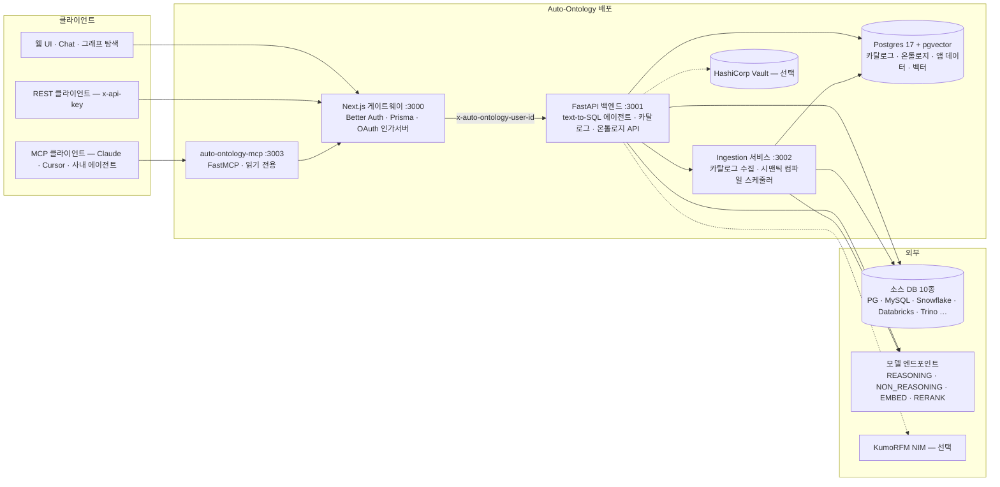
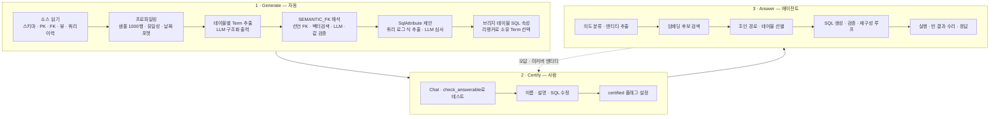
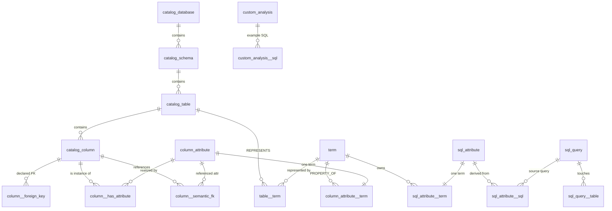
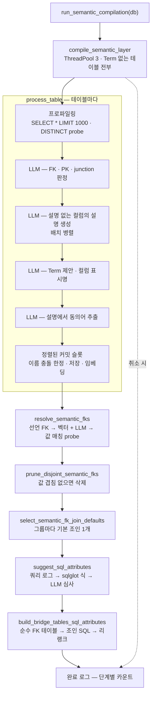
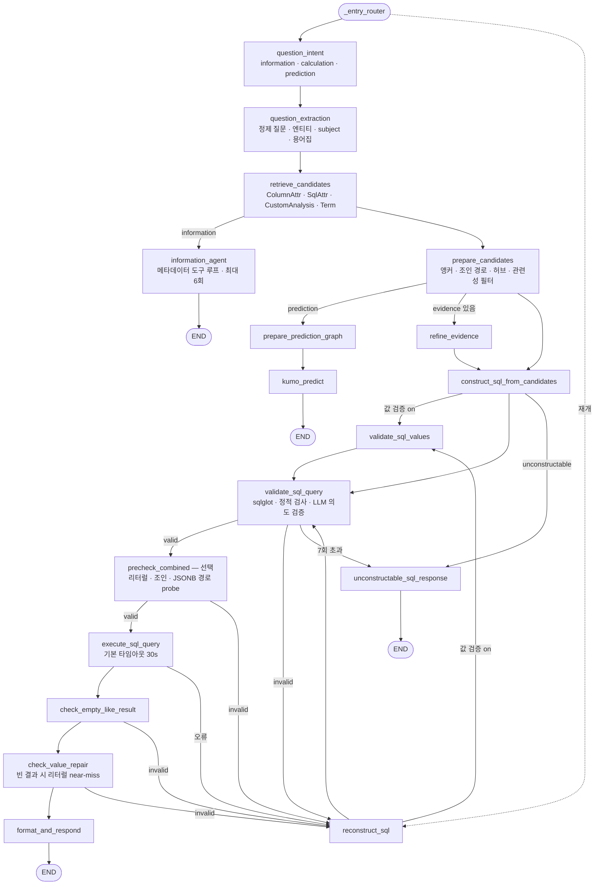
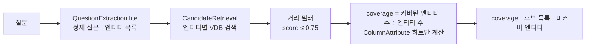

# NVIDIA Auto-Ontology 코드 레벨 분석

작성일: 2026-11-04 · 분석 대상: [NVIDIA/auto-ontology](https://github.com/NVIDIA/auto-ontology) `main` @ `caced11` (2026-11-03), 패키지 버전 1.1.0 · 라이선스 Apache-2.0
동반 저장소: [NVIDIA/auto-ontology-eval](https://github.com/NVIDIA/auto-ontology-eval) · 활용 가이드: [use-cases.md](use-cases.md)

## 결론 요약

- **정체**: 소스 DB의 메타데이터, 샘플 값, 쿼리 로그를 LLM으로 "컴파일"해서 **비즈니스 용어(Term)↔물리 컬럼, 검토된 SQL 식(SqlAttribute), 테이블 간 조인 관계(SEMANTIC_FK)** 를 Postgres에 저장한다. 이 결과를 **MCP·REST·Agent Skills**로 에이전트에 노출하고, LangGraph 기반 text-to-SQL 에이전트를 직접 내장한 **"에이전트용 컨텍스트 레이어"** 다.
- **계보**: 이스라엘 스타트업 illumex의 **GSF(Generative Semantic Fabric)** 를 NVIDIA가 2026년 2월 인수했다. 2026년 10월 Auto-Ontology로 개명했고 저장 엔진도 Neo4j에서 Postgres로 옮겼다. 코드 곳곳에 `illumex`, `Frontegg`, `Neo4j-to-Postgres port` 흔적이 남아 있다.
- **실체**: 이름은 온톨로지지만 실제로는 **자동 생성되는 시맨틱 레이어와 조인 그래프**에 가깝다. 클래스 계층(IS_A·PART_OF)은 상수로만 정의돼 있고, Term 추출 프롬프트가 이를 명시적으로 금지한다. Term도 사실상 테이블과 1:1이다.
- **차별점**: ① 메타데이터만으로 초안을 만들고 사람이 인증(certify)하는 워크플로 ② 질문 전에 돌리는 **답변 가능성 검사(`check_answerable`)** ③ "LLM이 제안하고 실제 데이터가 검증하는" 패턴. FK 추론 후 값 겹침 검사로 가짜 조인을 지우고, 리터럴 오타는 live probe로 고친다. ④ OpenAPI에서 자동 생성하되 allow-list로 좁힌 **읽기 전용 MCP** ⑤ Apache Ossie로 시맨틱 모델 import·export.
- **약점**:
  - 공개된 정확도 수치가 없다.
  - 스택이 무겁다. 서비스 4개에 Postgres가 붙는다.
  - 답변 하나에 수십 초가 걸린다.
  - 거버넌스가 얕다. 역할은 2개뿐이고 RLS가 없으며, 사용자 권한 위임(OBO)은 Databricks만 된다.
  - Vault 없이 쓰면 자격증명이 평문으로 저장된다.
  - 쿼리 이력 활용이 약하다. 사용 빈도 랭킹은 0점으로 고정된 버그를 일부러 남겨 뒀고, 실제로 이력을 돌려주는 커넥터는 Snowflake와 ClickHouse 정도다.
  - 외부 PR을 받지 않는다.
- **잘 맞는 곳**: 문서화가 안 된 레거시·이기종 DB에서 시맨틱 모델 초안을 빠르게 뽑을 때, 사내 에이전트에 붙일 MCP 컨텍스트 서버가 필요할 때. 이미 dbt·Cube·Snowflake 시맨틱 모델이 잘 정비돼 있다면 대체재가 아니라 **보조 도구**(초안 생성·Ossie 변환)로 보는 편이 맞다.

---

## 1. 프로젝트 개요

### 1.1 핵심 정의

README의 첫 문장은 "An open context layer that helps agents give fewer wrong answers on enterprise data"다. 에이전트가 쿼리를 쓰기 전에 알아야 할 것을 미리 컴파일해 두는 서비스다. 데이터가 어디 있는지, 무슨 의미인지, 어떤 테이블을 어떻게 조인하는지, 지표를 어떻게 계산하는지가 그 대상이다.

온톨로지에 담기는 정의는 세 종류다.

| 정의 | 내용 | 저장 위치 |
|---|---|---|
| **Term** | *Customer*, *Invoice Line* 같은 비즈니스 개념. 설명·동의어를 갖고 컬럼(ColumnAttribute)에 매핑된다 | `term`, `column_attribute`, `table__term` |
| **SqlAttribute** | 마진·롤링 합계 같은 **검토된 SQL 식**. 에이전트가 같은 지표를 같은 방식으로 계산하게 만든다 | `sql_attribute`, `sql_attribute__term` |
| **Relationship** | 테이블 조인. 선언된 FK와 추론된 FK, 브리지 테이블을 포함한다 | `column__semantic_fk`, `column__foreign_key` |

### 1.2 해결하려는 문제

흔한 지름길은 스키마 전체를 에이전트 컨텍스트에 붙여 넣는 것이다. README는 이것과 자신을 이렇게 비교한다.

| | 스키마를 컨텍스트에 | Auto-Ontology 도구 |
|---|---|---|
| 토큰 | 테이블·컬럼 수에 비례해 증가 | 질문이 건드리는 Term·테이블만 |
| 의미 | 컬럼명만 보고 에이전트가 추론 | 비즈니스 용어가 컬럼·SQL에 매핑됨 |
| 조인·지표 | 질문마다 즉흥적으로 작성 | 해석된 관계와 검토된 SQL 식 재사용 |
| 답할 수 없는 질문 | 자신 있게, 그리고 자주 틀리게 답함 | 답변 가능성을 먼저 검사하고 되묻기 |

엔지니어 관점에서 요약하면 이렇다. text-to-SQL의 오답은 대부분 SQL 문법 문제가 아니다. **스키마 링크(어느 컬럼인가)·조인 경로·지표 정의·필터 값 표기**에서 생긴다. 이 넷을 오프라인에서 미리 해결하고 사람이 인증하게 하자는 것이 이 프로젝트의 핵심 주장이다.

### 1.3 탄생 배경: illumex GSF에서 NVIDIA Auto-Ontology로

| 시점 | 사건 | 근거 |
|---|---|---|
| 2021 | illumex 창업 (이스라엘, Inna Tokarev Sela). 제품명 **Generative Semantic Fabric(GSF)** | [Atlan 요약](https://atlan.com/know/ai-agent/illumex-business-context-ai/) |
| 2025-03 | illumex, GSF에 NVIDIA NeMo Retriever·NIM 통합 발표 | [PR Newswire](https://www.prnewswire.com/il/news-releases/illumex-accelerates-digital-transformation-for-erp-systems-with-nvidia-ai-software-302404643.html) |
| 2026-02 | **NVIDIA가 illumex 인수**. 금액 비공개, 언론 추정 약 6천만~7천5백만 달러 | [Calcalist](https://www.calcalistech.com/ctechnews/article/hkrcgl5dbx) |
| 2026-04-27 | `NVIDIA/GSF` 저장소 생성 (현재 `NVIDIA/auto-ontology`로 리다이렉트) | GitHub API |
| 2026-06 | NVIDIA, Kumo AI 인수 보도 (KumoRFM 개발사). NVIDIA는 논평 거부 | [Fortune](https://fortune.com/2026/06/03/nvidia-snaps-up-kumo-ai-in-latest-acquisition/) |
| 2026-07-22 | Apache Ossie에 GSF 컨버터 PR. "GSF keeps its active semantic layer in Neo4j" | [ossie#247](https://github.com/apache/ossie/pull/247) |
| 2026-10-02 | 컨버터 개명 PR: "NVIDIA renamed GSF to **Auto Ontology** … now runs on Postgres" | [ossie#499](https://github.com/apache/ossie/pull/499) |
| 2026-10-21 | GTC Berlin에서 **NVIDIA Agent Toolkit**의 "Agent Knowledge Foundation" 구성요소로 공식 소개 | [NVIDIA 블로그](https://blogs.nvidia.com/blog/enterprise-platforms-agent-toolkit/) |
| 2026-11-03 | HN 상위 노출. 이 문서 작성 시점 기준 스타 약 3.2k, 포크 268 | [HN](https://news.ycombinator.com/item?id=50348962) |

코드에서도 계보를 확인할 수 있다.

- `auto_ontology/server/users/permissions.py`: "Illumex asks Frontegg which permissions each of a group's roles grants … There is no Frontegg here."
- `auto_ontology/dal/session.py`: "the same range illumex used for the equivalent Neo4j writes"
- `auto_ontology/dal/datasources.py`: "until the Neo4j-to-Postgres port silently dropped it from this query's rewrite (the Neo4j Cypher version had it)"
- `frontend/lib/answerMessages.ts`: 답변을 두 개의 말풍선으로 나누는 "illumex-style" UI

NVIDIA는 이 저장소를 Agent Toolkit 안에서 Nemotron Retriever, Kumo 모델 계열, cuDF·cuGraph 등과 함께 **"기업 데이터에 에이전트를 grounding하는 라이브러리"** 로 묶는다. 개발자 페이지는 "NVIDIA 자체 테스트에서 온톨로지 생성 시간 90% 단축"이라고 주장하지만 측정 방법은 공개하지 않았다 ([Agent Knowledge Foundation](https://developer.nvidia.com/topic/ai/agent-knowledge-foundation)).

---

## 2. 핵심 특징 및 차별점

### 2.1 다섯 가지 기능 축

| 축 | README 설명 | 실제 구현 |
|---|---|---|
| **Discover** | 메타데이터로 온톨로지 생성, 기존 시맨틱 모델 import, 그래프 탐색 | `semantic/` 컴파일 파이프라인, `server/model_interchange/` (Ossie), 프론트엔드 sigma.js 그래프 |
| **Ground** | 비즈니스 개념당 하나의 정의 | Term·ColumnAttribute·SqlAttribute와 pgvector 임베딩 |
| **Certify** | UI·API로 정의 검토·수정·인증 | `name_certified`, `description_certified`, `certified` 플래그와 수정 이력(`modified_by`) |
| **Validate** | 질문 전 답변 가능성 검사, 답과 함께 SQL·단계 반환 | `retrieval/entity_coverage/`, SSE `step`·`sql`·`result` 이벤트 |
| **Expose** | MCP, Agent Skills, REST | `mcp/` (별도 배포판), `skills/` 3종, `/api/chat/completions` |

### 2.2 기존 대안 대비 차별점

1. **"작성"이 아니라 "초안 생성 + 인증"**: dbt MetricFlow·Cube·LookML은 사람이 모델을 직접 쓴다. Auto-Ontology는 LLM이 테이블마다 Term과 컬럼 표시명을 제안하고, FK를 추론하고, 쿼리 로그에서 SQL 식을 뽑는다. 사람은 이 초안을 검토만 한다.
2. **추론은 LLM, 확정은 데이터**: FK를 추론한 뒤에는 실제 값이 겹치는지 SQL로 확인하고, 겹치지 않으면 지운다. 결과가 비어 있으면 필터 리터럴이 실제 값과 근소하게 다른지(대소문자, 철자) DB에 probe한다. LLM이 만든 메타데이터를 그대로 믿지 않는다는 원칙이 코드 전반에 일관된다.
3. **답변 가능성 사전 검사**: 답할 수 없는 질문을 비싼 에이전트 실행 전에 거른다. 계산은 결정론적인 커버리지 점수다(§5.4).
4. **MCP를 일급으로 취급**: OpenAPI에서 도구를 생성하되 9개만 allow-list로 노출한다. Auto-Ontology 자체가 OAuth 인가 서버가 되어 MCP 서버는 비밀을 하나도 보관하지 않는다.
5. **표준 상호운용**: Apache Ossie 컨버터로 dbt·Snowflake·Databricks·Cube 등의 시맨틱 모델과 주고받는다.

---

## 3. 아키텍처 분석

### 3.1 서비스 구성



| 컴포넌트 | 기술 | 역할 | 포트 |
|---|---|---|---|
| Frontend | Next.js 16, React 19, Better Auth 1.7, Prisma 7 | 웹 UI, 인증·SSO·API 토큰, **공개 API 게이트웨이**, MCP용 OAuth 인가 서버 | 3000 |
| Backend | FastAPI (Python 3.12–3.13), LangChain·LangGraph | text-to-SQL 에이전트, 카탈로그·온톨로지 CRUD | 3001 |
| Ingestion | FastAPI | 주기적 카탈로그 수집(기본 24시간), 시맨틱 컴파일 실행·취소 | 3002 |
| MCP | FastMCP 3.x (별도 배포판, 의존성 4개) | 공개 API 위의 읽기 전용 에이전트 도구 | 3003 |
| Store | PostgreSQL 17 + pgvector | 카탈로그, 온톨로지, 대화, 벡터(langchain-postgres `PGVectorStore`) | 5432 |

**신뢰 경계**: FastAPI는 Next.js가 넣어 주는 `x-auto-ontology-user-id` 헤더를 검증 없이 믿는다. Ingestion 서비스의 ingest·delete·reset·compile 엔드포인트에는 인증이 아예 없다. 따라서 3001과 3002는 반드시 사설망에 두고, 모든 클라이언트는 3000을 거쳐야 한다(README 명시).

### 3.2 라이프사이클: Generate, Certify, Answer



### 3.3 데이터 모델

`auto_ontology/dal/schema.py`가 스키마의 유일한 진실 원천이다. ORM 없이 SQLAlchemy Core를 쓰고, 마이그레이션은 Alembic autogenerate로 만든다. 핵심 테이블은 아래와 같다.



`schema.py` 모듈 docstring은 설계 결정 네 가지를 밝힌다. 모두 Neo4j 그래프 모델을 관계형으로 옮기면서 내린 결정이다.

1. **포함 관계는 엣지 테이블이 아니라 부모 FK로 표현한다.** database → schema → table → column이 `ON DELETE CASCADE`로 이어져 있어서, DB 하나를 삭제하는 데 SQL 문 하나면 된다.
2. **ID는 `text` 타입 UUID다.** `uuid` 타입을 쓰면 URL로 들어온 잘못된 ID가 `22P02` 에러(500)를 일으킨다. `text`면 빈 결과로 끝난다. 벡터스토어 키, 프론트엔드 파라미터, interchange의 `imported_id OR id` 매칭도 모두 ID를 불투명 문자열로 다룬다.
3. **카탈로그 계층에는 `catalog_` 접두사를 붙인다.** `table`·`column`이 예약어이고 `schema`가 `information_schema`와 충돌하는 문제를 규칙 하나로 피한다.
4. **연관 테이블 이름에는 `__`가 정확히 한 번 들어가고, 엔티티 테이블 이름에는 들어가지 않는다.** 예를 들어 `column_attribute__term`이 `column_attribute`+`term`인지 `column`+`attribute_term`인지 헷갈리지 않게 한다.

이 밖에도 눈여겨볼 제약이 있다.

- `column__has_attribute`("이 컬럼은 이 속성의 인스턴스다")와 `column__semantic_fk`("이 컬럼은 다른 테이블의 이 속성을 참조한다")는 끝점이 같지만 **별도 테이블**이다. 카디널리티가 다르기 때문이다. 판별자 컬럼 하나로 합치면 한쪽에만 적용되는 제약을 표현할 수 없다.
- `column_attribute__term`의 `UNIQUE(attribute_id)`가 "속성 하나는 Term 하나에만 속한다"는 규칙을 DB 수준에서 강제한다.
- `imported_id`는 Ossie·YAML 재수입을 멱등하게 만든다. YAML의 `id`를 `imported_id OR id`와 매칭하기 때문이다.
- `column__semantic_fk.use_in_join_paths`와 join default 플래그는 같은 대상을 참조하는 FK가 여러 개일 때 기본 조인을 하나 고르는 데 쓴다.
- 이름·설명 검색용으로 `pg_trgm` GIN 인덱스가 있다. `ILIKE '%mount%'`로 `total_amount`를 찾기 위해서다.

### 3.4 "온톨로지"의 실제 범위

| 있는 것 | 없는 것 |
|---|---|
| Term (설명·동의어·소유자·인증 플래그) | 클래스 계층. `REL_IS_A`·`REL_PART_OF`·`REL_ROLE`은 상수뿐이고 Term 추출 프롬프트 규칙 4번이 *"Do not propose IS_A, PART_OF, or ROLE relationships"* 로 금지한다 |
| ColumnAttribute (Term→컬럼 매핑, 표시명) | OWL·RDF 공리, 추론기, SPARQL |
| SqlAttribute (검토된 SQL 식) | Palantir식 Action(쓰기·워크플로) |
| SEMANTIC_FK (테이블 간 조인 그래프) | 행 수준 보안, 객체 단위 권한 |
| CustomAnalysis·PqlAnalysis (예제 SQL·PQL) | 여러 테이블에 걸친 개념의 자동 통합 |

컴파일러는 테이블마다 "Strongly prefer ONE Term per table"로 Term을 만들고, 이름이 겹치면 `db.schema.table`로 한정한다(`dal/terms.py`의 `upsert_table_term`). 그래서 README가 말하는 "여러 테이블·DB에 걸친 개념당 하나의 정의"는 **자동으로 생기지 않는다.** 사람이 큐레이션하거나 import해야 한다. `table__term`은 다대다로 설계돼 있어서 수동으로 연결하는 것은 가능하다. HN에서 나온 "온톨로지라는 건 스키마와 비즈니스 용어집에 붙인 거창한 이름"이라는 비판도 이 지점을 겨눈다. 반면 Ossie export 쪽에서는 `ontology.yaml`·`mapping.yaml`을 생성해서(2026-10 ossie#590) 표준 온톨로지 계층으로 내보내는 길을 열어 두었다.

---

## 4. 기술 스택

| 영역 | 스택 |
|---|---|
| 언어·빌드 | Python 3.12–3.13, `uv`(hatchling), TypeScript |
| 백엔드 | FastAPI, Uvicorn, Pydantic v2, SQLAlchemy Core 2 + Alembic, psycopg 3 + psycopg-pool |
| 에이전트 | LangGraph 1.2, LangChain Core 1.6, `langchain-nvidia-ai-endpoints`(ChatNVIDIA), `langchain-openai`, OpenAI SDK(임베딩) |
| SQL 처리 | **sqlglot**(파싱·qualify·방언 변환·식 추출) |
| 벡터 | `langchain-postgres` `PGVectorStore`(pgvector, `halfvec(2048)` + HNSW cosine), Nemotron Embed·Rerank |
| 커넥터 | snowflake-connector, databricks-sql-connector[pyarrow], mysql-connector, trino, pyhive(Kyuubi), ClickHouse, pyheavydb, duckdb, sqlite |
| 상호운용 | `apache-ossie-nvidia-auto-ontology` (Ossie 저장소의 특정 커밋에 git 핀) |
| 예측 | `kumo-relational-client`·`kumo_relational_engine` (벤더링된 wheel) |
| 보안 | hvac(Vault), cryptography, Databricks OAuth 토큰 교환 |
| 프론트엔드 | Next.js 16, React 19, Better Auth 1.7, Prisma 7, sigma.js + d3-force(그래프), 자체 ResultChart |
| MCP | FastMCP ≥3.2.4, httpx |
| 배포 | Docker Compose, Helm chart, Postgres `pgvector/pgvector:pg17` |

규모(테스트 제외 라인 수, `caced11` 기준):

| 모듈 | LOC | 비고 |
|---|---|---|
| `auto_ontology/` 전체 | 약 78.8k | 테스트 약 43.7k 별도 |
| ├ `retrieval/text_to_sql/` | 약 18.3k | 에이전트 노드 24개, DB probe |
| ├ `dal/` | 약 17.0k | SQLAlchemy Core 쿼리 |
| ├ `connectors/` | 약 6.8k | 10개 엔진 |
| ├ `semantic/` | 약 4.8k | 컴파일 파이프라인 |
| ├ `retrieval/interactive/` | 약 4.5k | BIRD-Interact 코디네이터 |
| └ `retrieval/kumo/` | 약 4.1k | text→PQL |
| `mcp/auto_ontology_mcp/` | 약 1.4k | |
| `frontend/` (ts·tsx) | 약 43.5k | |

주석 밀도가 매우 높다는 점도 특징이다. 함수 docstring이 "왜 이렇게 했는지"와 "과거에 어떤 버그가 있었는지"를 길게 적는다. 사실상 설계 문서를 코드 안에 둔 셈이다.

---

## 5. 핵심 코드 분석

### 5.1 모듈 구조

```
auto_ontology/
├── catalog/            # 소스 DB 메타데이터 추출·정규화·diff, sqlglot 쿼리 파서
├── connectors/         # SQLDatabase ABC + 10개 엔진, Vault, Databricks OAuth
├── dal/                # Postgres 저장소 (schema.py = 진실 원천), 조인 경로 BFS
├── semantic/           # ★ 시맨틱 컴파일: 프로파일링 → Term → FK → SqlAttribute → 브리지
├── retrieval/
│   ├── text_to_sql/    # ★ LangGraph 에이전트, 프롬프트, db_probe
│   ├── entity_coverage/# ★ check_answerable
│   ├── interactive/    # BIRD-Interact 다중 턴 코디네이터
│   ├── kumo/           # KumoRFM text→PQL
│   └── data_access/    # 시맨틱 검색, relevant tables
├── ingestion_service/  # 스케줄러 (수집·컴파일), 컴파일 이력
├── server/             # FastAPI 라우터 (terms, sql-attributes, chat, model_interchange, zones, tags …)
├── pii_detection/      # 규칙 우선 + LLM 폴백 PII 판정
├── vdb/                # pgvector 래퍼
└── utils/              # llm_invoke (구조화 출력·동시성 제한), embedding, rerank
mcp/                    # 별도 배포판 auto-ontology-mcp
skills/                 # nvidia-ontology-{setup,management,query}
```

### 5.2 시맨틱 컴파일 파이프라인

진입점은 `semantic/compile.py`의 `run_semantic_compilation`이다. 네 단계로 이루어지고, 전체가 LLM 동시 요청 상한(`SEMANTIC_LLM_MAX_INFLIGHT`, 기본 6) 안에서 돈다. 이 상한을 따로 둔 이유는 주석에 나온다. 테이블 병렬과 테이블 내부 fan-out이 곱해지면 엔드포인트가 HTTP 503 ResourceExhausted를 냈다.



#### 5.2.1 프로파일링 (`visit_enter.calculate_columns_profiling`)

- 테이블마다 `SELECT * … LIMIT 1000`을 한 번 실행한다. 컬럼별로 `is_unique`, 최빈값 top-5, 날짜 포맷(strptime 후보로 전수 검증)을 계산한다.
- **저카디널리티 텍스트 컬럼**은 샘플에서 top-5를 다 채우지 못했을 때만 `SELECT DISTINCT … LIMIT 26`을 추가로 실행해 값을 25개까지 가져온다. 'Banned' 같은 드문 enum 값이 임베딩 텍스트에 들어가게 하려는 것이다. 설정에서 "Distinct Value Scanning"으로 끌 수 있다.
- **JSONB 컬럼**은 키 경로(`k.nested_k`)를 뽑는다. `unit`·`currency` 같은 형제 키가 있으면 `[unit: k.unit]`을 붙여서, SQL 생성기가 단위가 다른 값을 비교하지 않게 한다.
- 한 텍스트 컬럼 안에서 날짜 형태가 섞여 있으면(`YYYY-MM-DD`와 `YYYY/MM/DD`) `[WARNING mixed date formats observed]`를 샘플 값 옆에 덧붙인다. top-5가 아니라 1000행 전체를 기준으로 판정한다.
- **서킷 브레이커**: 타임아웃이나 연결 실패가 연속 3회 나면 해당 DB의 샘플링을 그 실행 동안 끈다. 주석에 따르면 "86 tables × 120s ≈ 3시간"을 실제로 겪은 뒤 넣은 장치다. 권한 오류나 타입 디코딩 오류는 횟수에 넣지 않는다.
- 문자열 샘플은 30자를 넘으면 저장하지 않는다. date·time·uuid 타입은 샘플을 저장하지 않는다.

#### 5.2.2 FK·PK·junction 판정 (`fk_suggester.py`)

LLM 호출 한 번으로 세 가지를 동시에 받는다(`FkAndPkResult`).

- `fk_suggestions`: 선언되지 않은 FK 후보
- `pk_column_names`: 선언되지 않은 자기 PK
- `is_junction_table`: 행이 "둘 이상의 엔티티 역할 간 연관"인지

프롬프트에는 프로파일링으로 얻은 `is_unique`를 증거로 넣는다. "is_unique: false인 컬럼은 PK가 될 수 없다." 그 위에 결정론적 보정이 붙는다. `uuid` 타입이면서 PK로 추론되지 않았고 비유일이면 LLM이 놓쳐도 FK로 추가한다. junction 판정은 "컬럼 3개 이상 + LLM이 junction이라고 판단 + FK 역할 2개 이상"을 모두 만족할 때만 저장한다.

#### 5.2.3 컬럼 설명 생성과 Term 추출 (`deterministic.py`, `term_extractor.py`)

FK로 판정된 컬럼을 뺀 나머지가 ColumnAttribute 후보가 된다. 이 중 **소스 DB에 설명(comment)이 없는 컬럼만** 작은 배치로 나눠 LLM에 비즈니스 설명을 요청한다(`_generate_column_descriptions`). 넓은 테이블 하나를 한 번에 구조화 출력으로 받으면 타임아웃이 나기 때문에 배치를 병렬로 돌린다. 생성된 설명에는 날짜 포맷 절이 덧붙고, 이 설명이 Term 추출 프롬프트와 임베딩 텍스트에 함께 들어간다.

Term 추출 시스템 프롬프트 규칙은 다섯 개다.

1. 테이블당 Term 하나를 강하게 선호한다. 두 번째 Term은 서로 무관한 두 엔티티 사이의 진짜 junction일 때만 만든다.
2. 이름은 띄어쓰기가 있는 사용자 친화형으로 짓는다(`Purchase Order`).
3. 모든 후보 컬럼을 정확히 하나의 Term에 배정하고 표시명을 붙인다.
4. **IS_A·PART_OF·ROLE은 제안하지 않는다.**
5. `_ARC`·`_HIST`·`STAGING` 같은 변형 테이블이면 모든 표시명 앞에 "Archived", "Historical" 같은 접두어를 붙인다.

LLM 출력은 `_sanitize_result`가 정리한다. 후보 집합 밖의 컬럼과 중복 배정은 버리고, 라벨 정규식(`^[A-Z][A-Za-z0-9]*( …)*$`)에 맞지 않으면 폴백 이름을 쓴다. 배정되지 않은 컬럼은 첫 번째 Term에 붙인다. LLM 호출이 실패하면 테이블명으로 Term을 만든다. **동의어는 별도 LLM 호출**로 얻는데, 테이블 설명에 명시적으로 적힌 약어·별칭만 뽑고 추론은 금지한다.

#### 5.2.4 정렬된 커밋 큐: 병렬 LLM과 결정론적 이름 소유권

LLM 작업은 병렬로 돌리되, 이름 충돌 시 어느 테이블이 한정 없는 이름(`Customer`)을 가져갈지는 **정렬된 테이블 순서**로 결정한다. 그래야 실행할 때마다 결과가 같다.

```python
# semantic/pipeline.py (요약)
tables = sorted(fetch_all_tables_without_term(db), key=_table_commit_key)  # casefold(db, schema, name)
commit_queue = _OrderedCommitQueue()

def _process(table, position, ...):
    commit_slot = _OrderedCommitSlot(commit_queue, position)
    try:
        ...  # 프로파일링 · LLM 호출은 병렬
        return process_table(..., commit_slot=commit_slot)  # with commit_slot: 저장 + 임베딩
    finally:
        commit_slot.skip_if_unused()   # 실패·취소 시 자기 차례를 비차단으로 포기
```

`skip()`은 앞 순번을 기다리지 않고 포기를 기록만 하고, 차례가 오면 연속된 skip을 한 번에 소비한다. 컴파일을 취소하면 대기 중인 테이블 전부가 동시에 skip하는데, 이때 3개뿐인 워커가 붙잡혀 있지 않도록 한 설계다.

#### 5.2.5 SEMANTIC_FK 해석과 가짜 조인 제거 (`semantic_fk.py`)

1. **선언 FK 빠른 경로**: `column__foreign_key`가 있으면 대상 컬럼의 ColumnAttribute로 바로 연결한다. 같은 테이블을 가리키는 자기 참조는 거부한다.
2. **벡터와 LLM 폴백**:
   - 질의 두 개(이름+설명+샘플, 이름만)로 각각 top-3를 가져와 합친다.
   - 메타데이터 필터는 `label=ColumnAttribute`, `database_name`, **`is_unique=True`** 다.
   - 같은 테이블의 후보는 제외한다.
   - LLM은 `column_id`를 고르거나 null을 반환한다("Do NOT guess").
   - null이면 **같은 이름의 후보 컬럼에 FK 샘플 값이 모두 실제로 존재하는지** 읽기 전용 probe로 확인한다(`ProbeExecutor`).
3. **프루닝**: 생성된 모든 SEMANTIC_FK에 대해 `source IN (SELECT target …) LIMIT 1`을 실행해 값이 **하나도 겹치지 않거나** 소스 컬럼이 전부 NULL이면 엣지를 지운다(PR #401). 주석의 예시는 7자리 학교 코드를 바로 옆의 14자리 CDS 코드로 착각한 경우다.
4. **기본 조인 선택**: 같은 (소스 테이블, 대상 속성) 쌍에 FK 컬럼이 여럿이면 LLM이 "한정 없는 조인"에 가장 자연스러운 컬럼을 고른다. 예를 들어 `ship_to_customer_id`와 `bill_to_customer_id` 중 하나다. LLM이 실패하면 컬럼명 사전순으로 결정한다.

#### 5.2.6 SqlAttribute 제안 (`sql_attribute_suggester.py`)

- 커넥터의 `get_queries(hours=24)`로 수집한 쿼리 로그를 sqlglot으로 파싱한다. 이력을 실제로 돌려주는 엔진이 몇 개뿐이라는 점은 §8.3 참조. 추출 대상은 WHERE 비교, 집계·함수·CASE, HAVING, JOIN ON, UNION·INTERSECT·EXCEPT 각 분기다. 컬럼끼리의 등식(순수 FK 조인)과 bare column은 제외한다.
- Term마다 상위 10개 식을 LLM이 심사한다. 규칙 요지는 이렇다. 리터럴과 비교하는 식은 항상 채택하되 PK처럼 보이는 정수 리터럴은 제외한다. 같은 테이블 컬럼끼리 리터럴 없이 비교하는 식은 거부한다. `id IS NULL` 같은 LEFT JOIN 부재 검사도 거부한다. 서로 다른 조인 경로로 같은 엔티티에 도달하는 UNION은 "Task Participants" 같은 집합 개념으로 승격한다.
- 채택된 식은 원 쿼리의 FROM·JOIN을 잘라내 `SELECT * FROM … WHERE <식>` 또는 `SELECT <집계> FROM …` 형태의 실행 가능한 SQL로 다시 만든 뒤 `create_sql_attribute`로 검증·저장·임베딩한다.
- **의도적으로 남겨 둔 버그**: `_usage_score`는 항상 `0.0`을 반환한다. 원래는 최근 3개월 실행 횟수로 순위를 매기려 했다. 그런데 쓰는 쪽은 `count_8_2026` 형식으로, 읽는 쪽 정규식은 `count_monthly_YYYY_MM` 형식으로 구현돼 이름이 한 번도 일치한 적이 없다. docstring은 "Known bug, preserved on purpose. Do not 'fix' this in passing"이라고 적고, 수정 방안(`total_counter` 사용)과 함께 **고치지 않는 이유**를 밝힌다. Neo4j→Postgres 포팅 중에는 제품 동작을 바꾸지 않겠다는 것이다. 그 결과 "상위 10개"는 실제로는 dict 삽입 순서상의 앞쪽 10개다.

#### 5.2.7 브리지 테이블 (`bridge_tables.py`)

컬럼이 전부 FK인 순수 junction 테이블에는 Term을 새로 만들지 않는다. 대신 LLM이 구조적 조인 SQL을 만들고, FK가 가리키는 대상 Term 중 SqlAttribute 설명과 더 잘 맞는 쪽을 **Nemotron Rerank**로 골라 그 Term에 SqlAttribute(`source='bridgeTable'`)로 붙인다. 네 가지 모델 역할 중 RERANK가 쓰이는 곳은 사실상 여기뿐이다.

### 5.3 Text-to-SQL 에이전트 (LangGraph)

`retrieval/text_to_sql/text_to_sql_graph.py`의 `create_graph()`가 그래프를 만든다. 노드는 14개이고, 기능 플래그를 켜면 최대 17개가 된다.



#### 5.3.1 의도 분류 (`question_intent.py`)

최상위 유형은 `information`(메타데이터 질문), `calculation`, `prediction` 세 가지다. calculation은 다시 9개 하위 유형으로 나뉜다. 각 하위 유형에는 `calculation_subtypes.json`의 **SQL 템플릿**이 붙어 있어 SQL 생성 프롬프트에 "구조 참고용"으로만 주입된다. 테이블명과 리터럴은 복사하지 말라는 지시가 함께 들어간다.

| 하위 유형 | 의미 |
|---|---|
| `match_based` | 명시된 값·조건과 일치하는 행 |
| `ranking` | top·bottom N, 지표 기준 정렬 |
| `comparison` | 값·임계값·조건 비교 |
| `counting` | 조건을 만족하는 행·고유값 수 |
| `aggregation` | sum·avg·min·max |
| `domain_knowledge` | 도메인 규칙·특수 임계값 적용 |
| `numeric_computation` | 산술·비율·백분율 |
| `synonym` | 질문의 별칭을 저장된 개념·값으로 매핑 |
| `value_illustration` | 예시·묘사로 저장 값 식별 |

질문에 DB 이름이 들어 있으면 `difflib` 유사도 0.8 이상으로 오타까지 허용해 대상 DB를 고른다.

#### 5.3.2 후보 검색 (`candidates_retrieval.py`)

추출된 엔티티마다 시맨틱 VDB에서 ColumnAttribute·SqlAttribute·CustomAnalysis를 검색하고, `subject`로 Term 하나를 검색한다. evidence 텍스트가 있으면 그것으로도 따로 검색한다. 결과는 엔티티별로 LLM 의도 필터를 한 번 거친다. 필터에는 엔티티가 아니라 질문 전체를 준다. 그다음 ID 기준으로 중복을 제거하는데, 같은 ID를 여러 엔티티가 가져온 경우 `query_entities`에 모두 누적해서 엔티티별 커버리지를 보존한다. DB가 여러 개 연결돼 있으면 **가장 많은 엔티티를 커버하는 DB**를 고른다.

#### 5.3.3 후보 준비와 조인 경로 (`candidates_preparation.py`, `dal/attributes.py`)

1. ColumnAttribute 후보를 실제 컬럼·테이블 컨텍스트로 보강하고 Term 동의어를 붙인다.
2. LLM이 **앵커 속성**(질문의 주 대상)을 고른다.
3. 앵커 테이블에서 나머지 각 속성의 테이블까지 `find_join_path`로 **BFS**를 돈다. 커넥션 풀이 10개뿐이라 워커 수를 제한한다.
4. 앵커와 허브를 공유하는 형제 테이블, 연결된 junction 테이블, 쌍별 브리지는 별도 함수로 찾아서 관련성 필터 결과와 무관하게 다시 포함시킨다(`forced_table_ids`).
5. 질문 기반 추가 테이블 검색은 앵커 LLM 호출과 **병렬**로 돌린다.
6. LLM 관련성 필터로 노이즈 테이블을 걸러낸다.

조인 경로 BFS의 핵심은 **방향 규율**이다.

```python
# dal/attributes.py::_find_table_join_hops (요약)
for row in semantic_table_edges(database_id):
    adjacency[row.fk_table].append((row.owner_table, row.fk_col, row.owner_col))      # FK → owner: 항상
    if row.owner_is_pk:
        adjacency[row.owner_table].append((row.fk_table, row.owner_col, row.fk_col))  # owner → FK: owner가 진짜 PK일 때만
max_hops = (MAX_PATH_DEPTH + 2) // 4   # = 8
# 표준 BFS, 부모 포인터로 홉 복원
```

FK 컬럼 두 개가 PK가 아닌 같은 속성(예: 공용 상태코드 컬럼)을 참조할 때, 역방향 탐색을 허용하면 두 FK 컬럼이 서로 조인 가능한 것처럼 보인다. **존재하지 않는 조인을 만들어 내지 않으려는** 규칙이다. 두 FK가 같은 PK 허브로 모이는 경우는 `find_shared_hub_bridge`가 같은 PK-only 규칙으로 따로 처리한다. `schema.py`의 `join_path_edge` 뷰는 이전 탐색 방식의 잔재로, 지금은 읽히지 않지만 삭제는 마이그레이션에서 결정할 일이라며 남겨 두었다.

#### 5.3.4 SQL 생성 프롬프트 (`prompts.py::create_sql_from_candidates_prompt`)

프롬프트는 "You MUST always produce a SQL query"로 시작한다. 주요 구성은 다음과 같다.

- **테이블명 규칙**: `target_db`가 아니라 **방언**에 따라 정한다. SQLite·DuckDB는 bare 이름, Postgres·Snowflake는 `schema.table`.
- **SEMANTIC HINT**: 시맨틱 모델에서 나온 시작 테이블과 조인 경로. "강한 힌트지만 질문에 안 맞으면 강제하지 말 것."
- **SUGGESTED JOIN PATHS**: 검증된 컬럼 단위 조인 조건. "경로를 선택하면 중간·브리지 테이블과 모든 홉이 필수."
- **SQL 속성·Custom Analysis**: 재사용할 식과 예제 SQL. alias는 복사하지 말 것.
- **Reference Query Patterns**(eval에서만 주입): 다른 DB의 질문·SQL 쌍을 "종류(kind)가 같은 요청의 구성법"으로만 쓰라는 6단계 지침. 순서가 적합도 순이 아니라는 점, SELECT 컬럼 수·LIMIT·조인 수는 따라 하지 말라는 점까지 명시한다. BIRD 같은 벤치마크에서 few-shot이 만드는 전형적인 실패(식별자와 리터럴을 그대로 차용하는 것)를 겨냥한 문구다.

#### 5.3.5 검증과 재구성 루프

| 장치 | 값 | 위치 |
|---|---|---|
| 재구성 최대 횟수 | 7 | `MAX_RECONSTRUCTION_ATTEMPTS` |
| soft check(precheck·empty-LIKE·value-repair) 차단 해제 | 재구성 5회 이후 | `INTENT_VALIDATION_SKIPPED_AFTER` |
| 전체 파이프라인 재시도 | 2회 | `main.py::_MAX_FULL_PIPELINE_ATTEMPTS` |
| LangGraph recursion limit | 45 | `main.py` |
| SQL 실행 타임아웃 | 30s (UI에서 변경) | `chat_sql.execute_chat_sql` |
| 인프라 오류(연결 불가) | 재구성하지 않고 즉시 unconstructable | `sql_execution.py` |

`validate_sql_query`는 결정론적 검사와 LLM 검사를 함께 한다.

- **파싱**: sqlglot으로 파싱해 카탈로그에 있는 테이블을 하나라도 참조하는지 확인한다.
- **퇴화 SQL 탐지**: `SELECT NULL`, 항상 거짓인 WHERE, `LIMIT 0`.
- **vacuous GROUP BY**: 유일 컬럼으로 GROUP BY해서 그룹이 무의미해지는 경우.
- **집계 누락**: 1:N fan-out 조인 뒤 집계가 빠진 경우.
- **LLM 의도 검증**: SQL이 질문 의도와 맞는지 판단한다. live 조인 경로 검사가 켜져 있으면 조인 존재 여부는 다시 판정하지 않는다.

#### 5.3.6 Live DB probe (`db_probe/`)

모든 probe는 `ProbeExecutor`를 지나도록 단일 관문화돼 있다.

- 단일 `SELECT`·`WITH`만 허용한다. `insert|update|delete|drop|…|into` 정규식에 걸리면 거부한다.
- LIMIT이 없으면 자동으로 붙인다.
- 질문당 호출 예산이 있다.

`literal_check.py`의 원칙은 **입력 DB에 대해 아무것도 가정하지 않는다**는 것이다. 선언된 타입조차 믿지 않고, `SELECT DISTINCT`로 값 집합이 작은지 직접 확인해서 범주형 여부를 판정한다. 리터럴은 실제 값과 근소하게 다를 때만(대소문자·철자·공백) 고친다. 빈 결과가 정답일 수도 있기 때문이다. 수치 비교에서 리터럴이 MIN·MAX 범위 밖이지만 ×100이나 ÷100을 하면 범위 안에 들어오는 경우는 "60% vs 0.6" 스케일 불일치로 보고, 자동 수정 없이 증거로만 재구성 단계에 넘긴다.

### 5.4 답변 가능성 검사 (`check_answerable`)

README의 모델 표는 REASONING 모델이 "grades answerability"를 맡는다고 적는다. 실제 코드(`entity_coverage/agents/coverage.py`)에서 채점은 **결정론적**이고, LLM은 엔티티 추출에만 쓰인다.



- 기본 `max_distance = 0.75`이고 값이 작을수록 가깝다. 요청마다 `max_distance`로 바꿀 수 있다. 벡터 인덱스는 `halfvec(2048)` HNSW cosine인데, API 스키마 설명은 이 값을 "L2 distance"로 적고 있다. 그래프의 recursion limit은 10이다.
- **ColumnAttribute 히트만 커버리지에 반영된다.** SqlAttribute와 CustomAnalysis 히트는 후보 목록에만 들어간다.
- README의 데모 결과("coverage 0.5; no term covers 'ad spend'")가 정확히 이 계산이다. 엔티티 2개(revenue, ad spend) 중 1개만 커버된 것이다.

**함의**: 비용이 싸고 예측 가능하다. 대신 임베딩 거리 임계값에 의존하기 때문에 "의미는 비슷하지만 다른 컬럼"(예: ad spend와 marketing cost)이 있으면 실제로는 답할 수 없는데 커버된 것으로 나오는 위양성이 생길 수 있다. 커버리지는 "답할 수 있다"의 증명이 아니라 **"답할 수 없다"를 걸러내는 1차 필터**로 쓰는 것이 맞다.

### 5.5 BIRD-Interact 대화형 코디네이터 (`retrieval/interactive/`)

`coordinator.step(session, turn_type=INITIAL|DEBUG|FOLLOW_UP)`은 `AskUserAction`(되묻기) 또는 `SubmitSQLAction`(제출)을 반환하는 **오케스트레이터 중립** 상태 기계다.

- 출력 유형이 모호하면(스칼라냐 테이블이냐) 정규식만으로 판단해 첫 턴에 먼저 묻는다.
- 해결되지 않는 엔티티를 찾아 명확화 질문을 만든다(`clarify.py`, `entity_resolution.py`).
- DEBUG 턴에서는 실행 오류 텍스트를 받아 재생성한다.
- 2라운드에서는 후속 질문을 기존 질문과 병합한다.

메인 Chat 경로가 아니라 multi-turn 벤치마크와 eval 하네스를 위한 모듈이지만, 4.5k LOC 규모라 사내 "되묻는 에이전트"를 설계할 때 참고 구현으로 쓸 만하다.

### 5.6 KumoRFM 예측 분기 (`retrieval/kumo/`)

- `question_type == prediction`이면 `prepare_prediction_graph`가 관련 테이블로 Kumo 그래프를 만들고(기본 최대 20개 테이블), `kumo_predict`가 질문을 PQL로 생성한 뒤 검증(cheap parse), 예측, 수리를 거친다. 과거 PQL 질문·답 쌍(`PqlAnalysis`)을 few-shot으로 쓴다.
- **문서와 코드의 불일치**: README와 `.env.example`은 "`KUMO_RFM_API_KEY`를 설정하면 켜진다"고 적는다. 코드(`_prediction_enabled`)는 **`KUMO_RFM_API_URL`** 유무로 그래프에 노드를 넣는다. URL은 "`kumo-relational` 모델을 서빙하는 Universal TFM NIM"이어야 하고, NIM은 원래 인증이 없으므로 키는 게이트웨이를 쓸 때만 필요하다. 즉 **셀프호스팅 NIM으로 데이터를 외부에 보내지 않는 구성이 가능하다.**
- 호스팅 서비스를 쓰면 연결된 테이블을 업로드한다(`KUMO_MAX_TABLES`, `KUMO_MAX_ROWS_PER_TABLE`). 활성화하기 전에 데이터 반출 검토가 필요하다.

### 5.7 코드 레벨 설계 결정 모음

| 결정 | 이유(코드 주석 요지) |
|---|---|
| 컴파일 LLM 동시성 상한을 공용 invoke가 아니라 컴파일 범위에 둠 | 테이블×fan-out으로 요청 수가 곱해져 503이 났다. 공용 위치에 두면 이미 자체 제한하는 호출자까지 막힌다 |
| 프로파일링 실패 집계에서 권한·타입 오류 제외 | 테이블 하나의 문제로 나머지 85개 테이블의 샘플링을 끄면 안 된다 |
| 샘플 값을 원래 타입으로 저장 | `["10","20"]`가 아니라 `[10,20]`. 문자열화는 표시가 필요한 쪽에서만 한다 |
| 비유일 컬럼을 FK 대상 후보에서 VDB 쿼리 단계에서 제외 | 비유일 컬럼은 참조 키가 될 수 없다 |
| MCP에 물리 스키마 탐색 도구를 두지 않음 | 에이전트가 시맨틱 레이어를 우회해 원시 테이블로 추론하게 된다 |
| MCP 서버를 별도 배포판으로 분리 | 백엔드를 설치하면 약 450개 패키지, 1GB 이상. MCP는 의존성 4개라 `uvx`로 몇 초 만에 뜬다 |
| 컴파일 산출물을 바꾸는 버그 수정은 별도 변경으로 | 포팅 리팩터가 제품 동작을 바꾸면 안 된다(`_usage_score`) |
| ruff 룰셋을 명시 고정 | 0.16에서 기본 룰이 20여 계열로 늘어 541건이 발생한 적이 있다. 의도적인 `except Exception` 패턴과 충돌한다 |

---

## 6. API 및 인터페이스

### 6.1 REST: Conversation API

공개 API는 Next.js 게이트웨이(:3000) 기준 80여 개 경로이고, `docs/openapi/auto-ontology-api.json`에 정의돼 있다. 질문은 `POST /api/chat/completions`로 보내고, 응답은 SSE로 온다.

| 이벤트 `type` | 내용 |
|---|---|
| `step` | 에이전트 단계 시작·종료(`node`, `phase`, 종료 시 `thought`) |
| `sql` | 검증을 통과해 곧 실행될 쿼리 |
| `result` | 최종 `answer`: `response`(산문), `sql_code`, `sql_response_from_db`(행), `thoughts` |
| `charts` | 결과 차트·표 (`conversation_id`가 있을 때) |
| `error` | 실패 사유 |
| `data: [DONE]` | 스트림 종료 (JSON 아님) |

- `conversation_id`를 주면 최근 완료 턴 5개(최대 12,000자)를 바탕으로 "8월은?" 같은 후속 질문을 독립 질문으로 다시 쓴다. 다시 쓸 때 들어가는 것은 질문, 답, SQL뿐이다. 생각 로그와 결과 행은 넣지 않는다.
- 같은 대화에 요청이 겹치면 `409 Conversation in progress`를 반환한다.
- `step` 이벤트는 LangGraph `get_stream_writer()`로 **노드 시작 시점**에 보낸다. `app.stream()`은 노드가 끝나야 업데이트를 내보내기 때문에, 이렇게 하지 않으면 20초짜리 재구성 노드가 도는 동안 UI에 이전 단계 라벨이 그대로 남는다.

### 6.2 MCP 서버

| 작업 | 도구 | 구현 |
|---|---|---|
| 준비 상태 | `check_readiness` | 수작업 구현. 카탈로그 수집, 라이브 연결, 컴파일 완료 세 가지를 하나의 판정으로 합친다 |
| 용어 | `search_terms`, `get_term`, `get_term_columns`, `get_term_sql_attributes`, `get_sql_attribute`, `describe_table` | OpenAPI에서 자동 생성 |
| 답변 가능성 | `check_answerable` | OpenAPI (`/api/question-entity-coverage`) |
| 질문 | `ask_question` | 수작업 구현. SSE를 소비해서 answer·SQL·행(최대 100행)을 필드별로 반환 |

설계 포인트는 다음과 같다(`mcp/auto_ontology_mcp/tools.py`, `server.py`).

- **allow-list와 catch-all EXCLUDE 조합**: 87개 operation 중 7개만 `RouteMap`으로 포함하고, 나머지는 끝에 둔 EXCLUDE 규칙으로 막는다. 스펙에 새 엔드포인트가 추가돼도 여기서 명시하기 전까지는 에이전트에게 보이지 않는다.
- **이름과 설명은 덮어쓰고 파라미터는 스펙에서 가져온다.** 자동 생성 ID(`get_api_terms_term_id_`)는 모델에게 아무 정보도 주지 않는다. 도구 설명은 사실상 프롬프트라서 "언제 이 도구를 쓰는지"를 호출자 관점에서 다시 쓴다.
- **스펙과의 불일치는 기동 실패로 만든다**(`missing_from_spec`). 조용히 도구가 빠진 채로 뜨는 것을 막는다.
- **서버 `INSTRUCTIONS`가 사용 순서를 지시한다**: `search_terms` → (불확실하면) `check_answerable` → `ask_question`. 첫 질문 전이나 답이 비었을 때는 `check_readiness`. 모델이 비싼 도구로 바로 달려가는 경향을 프롬프트로 교정한다.
- **인증**: Auto-Ontology(Better Auth OAuth Provider)가 인가 서버를 맡는다. 클라이언트는 Dynamic Client Registration으로 스스로 등록하므로 MCP 서버에는 client secret도, redirect URI도 없다. 토큰은 불투명 토큰이라 매 호출 UserInfo 왕복으로 검증하고, 역할 변경이나 철회는 다음 호출부터 반영된다. 서버 자체 토큰을 설정하는 방법은 **일부러** 막았다. 그렇게 하면 모든 호출자가 토큰 소유자 권한으로 동작하게 되기 때문이다.
- 쓰기 도구는 없다. 쓰기는 Next.js `/api/...`로만 하고, 그 절차는 management 스킬이 안내한다.

### 6.3 Agent Skills

| 스킬 | 범위 |
|---|---|
| `nvidia-ontology-setup` | Helm(공식)·Compose 설치, 소스 연결, 컴파일, 준비 상태 증명, 트러블슈팅 |
| `nvidia-ontology-management` | 조회, 모델링, 인증, import·export, **거버넌스된 게시(publication)와 롤백** |
| `nvidia-ontology-query` | MCP 우선, REST 폴백. SQL·행·답변 검증 |

각 스킬에는 `SKILL.md`, `skill-card.md`, `evals/evals.json`, `assets/runtime-contract.yaml`이 들어 있다. NVSkills CI가 서명한 `BENCHMARK.md`와 `skill.oms.sig`를 붙여 [nvidia/skills](https://github.com/nvidia/skills) 카탈로그로 동기화한다(`npx skills add nvidia/skills`). management 스킬의 publication 문서는 엄격한 절차를 요구한다. export한 YAML과 SHA-256을 롤백 산출물로 보관하고, 격리 환경에 먼저 적용하고, 다시 export해서 ID·구조를 정확히 비교한다. "채팅 응답이나 성공한 요청은 게시가 아니다"라는 원칙도 명시한다.

### 6.4 Apache Ossie import·export

- Settings → Import / Export 화면, 또는 `POST /api/model/import`·`/api/model/export`로 쓴다.
- 포맷은 두 가지다. 하나는 네이티브 YAML이고, 다른 하나는 Ossie(`semantic_model.yaml`, `ontology.yaml`, `mapping.yaml`)다.
- import 전체가 **트랜잭션 하나**로 묶인다. 실패하면 아무것도 남지 않는다. `imported_id`로 매칭하기 때문에 같은 문서를 다시 import해도 변화가 없고, 기존 카탈로그 위에 import하면 새로 만들지 않고 기존 객체를 채택한다.
- 컨버터는 2026-10-21 `apache/ossie-converters`로 이전됐다. 이 저장소는 그 이전 시점의 `apache/ossie` 커밋(`ef91cb6`)에 핀돼 있다. Ossie 스펙 자체에 대한 분석은 [Apache Ossie 코드 레벨 분석](../../data-platforms/ossie/apache-ossie-code-analysis.md) 참조. 그 문서의 "NVIDIA GSF" 컨버터가 바로 이 프로젝트다.

---

## 7. 확장성 및 플러그인

| 확장 지점 | 방법 |
|---|---|
| **커넥터** | `connectors/base.py`의 `SQLDatabase` ABC 구현: `execute`, `get_tables`, `get_columns`, `get_queries(hours)`, `get_views`, `get_pks`, `get_fks`, `dialect`, `database_name`, `close`. `qualify()`는 구체 메서드라 카탈로그 3단계 엔진만 재정의한다. `supports_statement_timeout`을 광고하면 타임아웃이 적용된다. `registry.py`가 URL 스킴으로 커넥터를 고른다 |
| **모델** | 역할 4개(`REASONING`, `NON_REASONING`, `EMBED`, `RERANK`)마다 `<ROLE>_ENDPOINT·_API_KEY·_MODEL`. OpenAI 호환이면 어디든 되고, 빈 필드는 `DEFAULT_MODELS_*`로 채운다. 구조화 출력 지원은 필수 |
| **도메인 지식 주입** | 용어집(Glossary·acronyms), Custom Analysis(이름 붙인 예제 SQL. 검색되어 few-shot과 도메인 규칙으로 쓰임), Custom Prompt, 수동 SqlAttribute |
| **시맨틱 모델 반입** | Ossie YAML. dbt MetricFlow·Snowflake·Databricks Metric View·Cube 등은 각 Ossie 컨버터를 거쳐 들어온다 |
| **동작 플래그** | `DB_PROBE_PROACTIVE`, `DB_PROBE_JOIN_PATH_CHECK`, `DB_PROBE_JSONB_PATH_CHECK`, `INTENT_VALIDATION_JOINS_VALIDATED_ELSEWHERE`, Distinct Value Scanning, SQL 타임아웃 |
| **에이전트 연동** | MCP, Skills, REST(SSE) |
| **스코핑** | 연결마다 스키마 allowlist와 `table_allow_regex`·`table_deny_regex`(deny 우선), Zone(DB·스키마·테이블 묶음), Tag·Rule(저장된 검색에 태그 자동 적용), Owner |

제약도 있다. 이 저장소는 **외부 PR을 받지 않는다**(CONTRIBUTING). 통합 요청과 버그는 이슈로만 받는다. 커넥터를 추가하려면 포크하거나 업스트림에 요청해야 한다.

---

## 8. 성능 특성

### 8.1 벤치마크 현황

- **공개된 정확도 수치가 없다.** auto-ontology-eval README, 데이터셋 문서, 커밋된 파일 어디에도 결과표가 없다. 외부 리뷰들도 모두 이 점을 지적한다.
- 평가 설계는 탄탄하다.
  - 같은 모델로 Control(스키마 덤프를 프롬프트에 넣음)과 Treatment(Auto-Ontology 에이전트)를 비교한다.
  - NeMo Gym에서 실행하고, 실행 결과 일치(BIRD EX, BEAVER `ex_acc`)로 **결정론적**으로 채점한다. LLM 심판은 쓰지 않는다.
  - 질문 단위로 "온톨로지가 고친 것과 망친 것"을 보고한다.
  - 응답 없는 질문이 5%를 넘으면 헤드라인 수치를 내지 않는다(health gating).
- 데이터셋: BIRD Dev 1,534와 Mini-Dev 500(SQLite), BEAVER `dw` 100(MySQL), FDABench-Lite 169(SQLite), Wide World Importers 41(Postgres), BIRD-Interact(Postgres, Treatment만).
- 주의할 점: BIRD용 SQL exemplar와 value anchor는 Treatment에만 들어가는 옵션이라 켜면 비교가 비대칭이 된다(README도 명시). 메인테이너는 내부적으로 양쪽 모두 `claude-opus-5-5`로 테스트한다고 밝혔다.
- "온톨로지 생성 시간 90% 단축"은 NVIDIA의 주장이고 측정 방법은 공개되지 않았다.

### 8.2 지연·비용을 결정하는 요인

**질문 하나**: 정상 경로에서도 의도 분류, 추출, 후보 의도 필터, 앵커 선택, 테이블 관련성 필터, SQL 생성, 의도 검증으로 **LLM 호출이 대략 7회 이상**이다. 응답 문장은 SQL 생성 때 함께 만들어지므로 따로 호출하지 않는다. 재구성 루프가 돌면 회당 2~3회씩 늘어난다. 문서는 "typically takes tens of seconds"라고 적는다. 클라이언트 타임아웃 예시는 900초다.

**컴파일**: 테이블 하나에 LLM 3회 이상과 프로파일링 쿼리 1회 이상이 든다. LLM 호출은 FK·PK 판정, 설명 없는 컬럼의 설명 생성(배치 수만큼), Term 제안, 동의어(설명이 있을 때)다. 이후 FK 해석(미해결 FK당 임베딩 2회와 LLM 1회), 프루닝(SEMANTIC_FK당 SQL 1회), SqlAttribute 심사(Term당 1회), 브리지 처리가 이어진다. 주석에 따르면 "FK resolution alone has run past 300s on one database".

| 동시성 설정 | 기본값 |
|---|---|
| 테이블 병렬 워커 | 3 |
| 컴파일 LLM in-flight | 6 (`SEMANTIC_LLM_MAX_INFLIGHT`) |
| 질의 LLM in-flight | 6 (`LLM_MAX_INFLIGHT`) |
| SEMANTIC_FK LLM 워커 | 2 |
| SqlAttribute Term 워커 | 4 |
| Postgres 커넥션 풀 | 10 (조인 경로 fan-out 제한의 근거) |

### 8.3 알려진 제약

1. **쿼리 이력이 약하다.** 사용 빈도 랭킹이 꺼져 있고(§5.2.6), 커넥터 10개 중 이력을 실제로 돌려주는 것이 소수다. 이력이 없으면 SqlAttribute 자동 제안이 거의 비어 버린다. 이때는 Custom Analysis(예제 SQL)를 직접 넣거나 Ossie로 기존 지표를 import해서 보충해야 한다.

   | 엔진 | `get_queries` 소스 | 실효성 |
   |---|---|---|
   | Snowflake | `INFORMATION_SCHEMA.QUERY_HISTORY` (성공 쿼리, 최대 1만 건) | ✅ |
   | ClickHouse | `system.query_log` | ✅ |
   | PostgreSQL | `pg_stat_activity`. 백엔드마다 현재 쿼리나 마지막 쿼리 하나만 남고 `pg_stat_statements`는 쓰지 않는다 | △ 거의 없음 |
   | DuckDB | 샘플 쿼리 CSV 로드 | △ 수동 |
   | Databricks | 비활성. `system.query.history` 스캔이 분 단위로 걸려서 빈 결과를 반환한다 | ❌ |
   | MySQL·Trino·Kyuubi·HeavyDB·SQLite | 빈 결과 (Performance Schema 미사용, SQL로 이력 접근 불가 등) | ❌ |
2. **넓은 테이블**: Term 추출 프롬프트에는 후보 컬럼 앞쪽 40개만 들어간다(`specs[:40]`). 나머지 컬럼은 배정 단계에서 첫 Term으로 몰린다.
3. **대화당 스트림은 하나**다. 대화에 걸리지 않은 무상태 요청도 LLM in-flight 상한을 공유한다.
4. **임베딩 모델을 바꾸면 재임베딩이 필요하다.** 수집과 질의에 같은 모델을 써야 한다.
5. **다국어 경로가 없다.** `route_translation` 라우터는 정의돼 있지만 그래프에 연결돼 있지 않다. 생성되는 Term·설명은 영어다. 한국어 질문은 임베딩 모델의 교차언어 능력과 용어집에 기댈 수밖에 없다. Term `synonyms`는 API로 수정할 수 없고 컴파일 때 테이블 설명에서만 추출된다([use-cases.md](use-cases.md#62-한국어-환경) 참조).

---

## 9. 배포 및 운영

### 9.1 설치 방식

| 방식 | 용도 |
|---|---|
| **Helm** (`helm/auto-ontology`, 공식) | backend, frontend, ingestion, postgres, pgadmin, 마이그레이션 Job 2개, secret |
| **Docker Compose** | 로컬·PoC. `postgres`(pgvector pg17), `pgadmin`, `auto-ontology`(:3001), `ingestion-service`(:3002), `auto-ontology-migrate`(Alembic), `frontend-migrate`(Prisma), `auto-ontology-frontend`(:3000). **MCP는 Compose에 없으므로 `uvx`로 따로 실행한다** |
| `dev_tools/setup_env.sh` | 개발자용 `--dev`·`--ds` |

Quickstart의 흐름은 다음과 같다. `.env`를 만들고 Postgres를 띄운 뒤, auto-ontology-eval의 시드 스크립트로 Wide World Importers를 적재한다. 이어서 `docker compose up -d --build`를 실행하고, UI의 Settings → Semantic Compilation에서 컴파일을 켠 다음 Chat에서 질문한다.

### 9.2 설정 핵심

- **모델**: `nvapi-` 키 하나면 build.nvidia.com의 Nemotron 3.5 계열이 기본값으로 쓰인다(`nemotron-3.5-lightning-30b-a3b`, `-embed-1b`, `-rerank-8b`). 셀프호스팅 NIM이나 다른 OpenAI 호환 엔드포인트는 역할별로 덮어쓴다.
- **연결**: UI 연결과 `CONNECTION_STRINGS` 중 **하나만** 쓰는 것이 좋다. 질의 경로는 UI 연결을 우선하고, 수집 경로는 `CONNECTION_STRINGS`를 우선해서 우선순위가 서로 반대다.
- **수집 주기**: 기동 시 1회, 이후 `INGEST_INTERVAL_HOURS`(기본 24)마다.

### 9.3 운영·보안 체크포인트

| 항목 | 현황 | 권장 |
|---|---|---|
| 자격증명 저장 | Vault 미설정 시 비밀번호를 포함한 연결 객체가 **평문 JSON**으로 Postgres에 저장된다 | Vault 4개 변수 모두 설정 (일부만 설정하면 경고 후 평문으로 폴백) |
| 내부 포트 | 3001은 헤더를 신뢰하고, 3002는 인증이 없다 | NetworkPolicy·사설망. 3000만 노출 |
| 소스 DB 권한 | 질의 경로에서 실행 전 SELECT 전용 검사를 확인한 범위에서는 찾지 못했다(probe 경로에는 있음) | **읽기 전용 계정·레플리카**로 연결 |
| 사용자별 데이터 권한 | Databricks만 SSO 토큰 교환으로 사용자 본인의 UC 권한을 쓴다. 나머지 엔진은 고정 자격증명 | 민감 스키마는 연결 스코핑과 Zone으로 분리하거나 별도 배포 |
| RBAC | admin·viewer 2역할, 그룹 | 세밀한 권한이 필요하면 상위 게이트웨이에서 보완 |
| 데이터 반출 | 컬럼 설명과 샘플 값(top-5, 30자 이하)이 LLM 프롬프트와 임베딩 텍스트에 들어간다 | 호스팅 API 대신 셀프호스팅 NIM, PII 태그 검토 |
| 예측 | 호스팅 KumoRFM을 쓰면 테이블을 업로드한다 | 셀프호스팅 NIM URL로 사용, 사전 데이터 리뷰 |
| 관측 | 단계 로그, `[n/N] Processing table`, SQL 로그(4,000자 절단), pgvector SQL 문장별 시간 | 컴파일 이력 테이블(`semantic_compilation_history`) 모니터링 |
| 롤백 | export YAML이 사실상 스냅샷 | 게시 전후 export 비교(management 스킬 절차) |

---

## 10. 경쟁·비교 분석

### 10.1 포지셔닝 표

| 제품 | 모델 작성 | 핵심 단위 | 내장 Q&A 에이전트 | MCP | OSS | 비고 |
|---|---|---|---|---|---|---|
| **NVIDIA Auto-Ontology** | **LLM 자동 초안 + 인증** | Term·ColumnAttr·SqlAttr·SEMANTIC_FK | ✅ LangGraph text-to-SQL | ✅ 읽기 전용 9도구 | ✅ Apache-2.0 | 10개 엔진, Ossie 양방향 |
| [Wren AI](../wren-ai/analysis.md) | 수동 MDL (UI 보조) | Model·Relationship·Metric | ✅ | ✅ | ✅ AGPL | 시맨틱 엔진 내장 |
| dbt Semantic Layer / MetricFlow | 수동 YAML | semantic model·metric | ❌ (외부 연동) | ✅ (dbt MCP) | MetricFlow Apache-2.0 (2025-10) | 지표 컴파일러로서는 표준에 가까움 |
| Cube | 수동 (코드) | cube·measure·dimension | Cloud에서 Agentic Analytics | ✅ | Core OSS | 캐시·API 계층 강점 |
| Palantir Ontology / AIP | 수동 + 파이프라인 | Object·Link·**Action** | ✅ AIP | 일부 | ❌ | 쓰기·워크플로까지 포함하는 운영 온톨로지 |
| Snowflake Semantic Views + Cortex | 수동 (SQL·YAML) | semantic view | ✅ Cortex Agents | ✅ | ❌ | Snowflake 내부 전용 |
| Databricks Metric Views + Genie | 수동 + Genie Ontology | metric view | ✅ Genie | ✅ | ❌ | UC 권한과 통합 |
| Microsoft Fabric IQ Ontology | 수동 (UI) | entity·relationship | ✅ Data agent | 미확인 | ❌ | Fabric 생태계 |
| DataHub | 수집 기반 카탈로그 | dataset·lineage·query log | ❌ | ✅ | ✅ | 쿼리 로그 컨텍스트를 MCP로 제공 |
| Vanna | 학습 데이터(DDL·문서·SQL) RAG | 임베딩 청크 | ✅ | — | ✅ | 시맨틱 모델 없음 |

### 10.2 아키텍처 관점 비교

- **vs Wren AI**: 둘 다 OSS로 "시맨틱 레이어와 text-to-SQL 에이전트"를 제공한다. Wren은 사람이 MDL을 정의하면 엔진이 SQL로 정확히 변환하는 **선언형 컴파일러** 접근이다. Auto-Ontology는 모델을 **자동으로 만들고** SQL은 LLM이 후보 컨텍스트를 보고 생성한다. 지표 정의의 엄밀성은 Wren(MDL의 Metric)이, 초기 구축 비용은 Auto-Ontology가 유리하다.
- **vs dbt·Cube**: dbt와 Cube는 "revenue가 얼마인가"를 결정론적으로 계산하는 **지표 엔진**이다. Auto-Ontology의 SqlAttribute는 재사용 가능한 SQL 조각일 뿐이고, 그레인·조인 팬아웃을 자동으로 처리하는 지표 컴파일러가 아니다. 그래서 대체재보다는 **보조재**다. 레거시 DB에서 초안을 뽑아 Ossie로 dbt·Cube 쪽에 넘기는 조합이 자연스럽다.
- **vs Palantir**: Palantir는 Object와 Action으로 쓰기·의사결정까지 닫는다. Auto-Ontology는 **읽기 전용 질의 계층**이다. NVIDIA 블로그도 "complements existing ontology platforms"라고 표현하고, 자사 공급망 팀은 Palantir를 쓴다고 밝혔다.
- **vs 웨어하우스 네이티브**(Snowflake, Databricks, Fabric): 네이티브 쪽은 권한·거버넌스 통합이 강점이다. Auto-Ontology는 **이기종 엔진을 가로지르는 중립 계층**이라는 점이 강점이다. 다만 사용자 권한 위임은 Databricks에서만 된다.
- **vs Graph RAG 계열**([GraphRAG 비교](../graphrag-comparison/README.md), [Graph RAG·온톨로지](../graph-rag-ontology/README.md)): 문서에서 엔티티·관계를 추출하는 비정형 KG와 달리, Auto-Ontology는 **정형 DB 스키마와 데이터 자체**를 소스로 삼는다. "LLM이 추출하고 원천이 검증한다"는 점은 같지만, 검증 수단이 SQL로 값을 확인하는 것이라 훨씬 결정론적이다.
- **vs [Google OKF](../knowledge-catalog/okf-analysis.md)**: OKF는 메타데이터를 코드로 관리하는 **포맷**에 가깝다. Auto-Ontology는 **런타임 서비스**다. 교환 표준으로는 Ossie를 택했다.

---

## 11. 종합 평가

### 11.1 강점

1. **초안 자동화의 실용성**: 스키마, 프로파일링, 쿼리 로그만으로 Term·컬럼 매핑·조인 그래프 초안을 만든다. 레거시 DW나 ERP처럼 문서가 없는 곳에서 비용을 가장 많이 줄여 준다.
2. **데이터로 검증하는 습관**: FK 값 겹침 프루닝, 리터럴 near-miss probe, 스케일 불일치 탐지, PK-only 역방향 조인 규칙. LLM의 그럴듯한 오류를 원천 데이터로 걸러내는 장치가 시스템 곳곳에 있다.
3. **에이전트 인터페이스 설계 완성도**: allow-list MCP, 도구 설명 재작성, 사용 순서를 지시하는 서버 instructions, 준비 상태 판정 도구, 비밀을 보관하지 않는 OAuth. MCP 서버를 설계할 때 참고할 만한 사례다.
4. **운영 경험이 녹은 코드**: 서킷 브레이커, 취소 시 비차단 skip, 커넥션 풀 고갈 방지, 스펙 drift를 기동 실패로 만드는 장치. 실제 장애를 겪고 넣은 방어 코드가 많고 이유가 주석에 남아 있다.
5. **표준 상호운용**: Ossie 양방향 지원으로 벤더 종속을 줄였다.
6. **평가 하네스**: control과 treatment를 같은 모델로 비교하고, 결정론적으로 채점하고, health gating을 건다. 사내 text-to-SQL을 평가할 때 그대로 차용할 수 있다.

### 11.2 약점·리스크

1. **검증되지 않은 효과**: 정확도 개선 폭이 공개되지 않았다. 도입하려면 자체 골든셋으로 직접 측정해야 한다.
2. **"온톨로지"의 과장**: 클래스 계층·공리가 없고 Term이 테이블에 묶여 있다. 개념 통합은 사람이 해야 한다.
3. **지연과 비용**: 질문당 LLM 호출이 7회 이상, 응답이 수십 초다. 대화형 BI의 체감 속도로는 무겁고, 토큰 비용도 질문 수에 비례한다.
4. **거버넌스 공백**: 역할 2개, RLS 없음, 평문 자격증명 기본값, 내부 포트 무인증, 질의 SQL의 읽기 전용 강제 미확인. 운영 배포 전에 보완 설계가 필요하다.
5. **쿼리 로그 활용 미완성**: 랭킹 버그가 남아 있다. 이력을 쓸 수 있는 엔진은 Snowflake와 ClickHouse 정도이고, Postgres는 빈약하며, Databricks·MySQL·Trino 등은 비어 있다. "쿼리 이력에서 지표를 제안한다"는 기능의 실효성이 엔진에 따라 크게 갈린다.
6. **문서와 코드의 드리프트**: Kumo 활성화 변수, answerability 채점 주체. 빠르게 리팩터되는 중인 코드베이스라는 신호다.
7. **커뮤니티 구조**: 외부 PR을 받지 않는 NVIDIA 주도 프로젝트이고, 기본값이 NVIDIA 호스팅 모델이다. 확장이 필요하면 포크를 유지해야 한다.

### 11.3 적합한 사례와 부적합한 사례

| 적합 | 부적합 |
|---|---|
| 문서 없는 레거시·이기종 DB 수십~수백 개 테이블의 시맨틱 모델 초안 | 이미 dbt·Cube 지표가 정비돼 있고 결정론적 지표 계산이 핵심인 조직 (Ossie로 import해서 보조로만 쓰기) |
| 사내 코딩·분석 에이전트(Claude Code, Cursor, 사내 에이전트)에 **읽기 전용 DB 컨텍스트**를 MCP로 공급 | 행 수준 권한이 엄격한 규제 데이터 (Databricks 외 엔진) |
| text-to-SQL 앞단의 **스코프 가드**(답변 가능성 1차 필터) | 1~2초 내 응답이 필요한 대시보드형 질의 |
| text-to-SQL 정확도 개선 실험·사내 벤치마크 구축 | 쓰기·워크플로까지 필요한 운영 온톨로지 (Palantir 영역) |
| NVIDIA NIM·Nemotron 스택을 이미 쓰는 조직 | 데이터 반출이 불가능한데 셀프호스팅 모델 인프라도 없는 환경 |

### 11.4 엔지니어 관점 인사이트

- **"LLM proposes, data disposes"**: 이 코드베이스의 가장 가치 있는 패턴은 LLM이 만든 모든 구조적 주장(FK, 리터럴, 스케일)을 **값 수준 SQL probe로 반증 가능하게** 만든 것이다. 자체 text-to-SQL이나 KG 파이프라인에 그대로 이식할 만하다.
- **병렬 처리와 결정론의 분리**: LLM 작업은 병렬로, 이름 소유권 같은 전역 결정은 정렬된 커밋 큐로. LLM 배치 파이프라인에서 재현성을 확보하는 간단하고 일반적인 기법이다.
- **조인 그래프의 방향 규율**: FK→owner는 항상, owner→FK는 owner가 PK일 때만 허용한다. 스키마 그래프 탐색에서 생기는 "공유 참조 = 조인 가능" 오류를 구조적으로 막는다.
- **MCP는 API 전체가 아니라 큐레이션된 의미 계층으로**: 도구 수를 줄이고 물리 스키마 탐색을 막는 것이 정확도 장치라는 관점은 다른 MCP 설계에도 그대로 통한다.
- **알려진 버그를 문서화해서 보존하는 규율**: 리팩터 중 동작 변경을 막기 위해 버그를 상수로 고정하고 수정 계획을 주석으로 남긴 사례다. 대규모 포팅에서 참고할 만하다.
- **답변 가능성은 정확도가 아니라 재현율 문제로 다뤄라**: 결정론적 커버리지는 "모른다"를 잘 잡지만 "안다"를 보장하지 않는다. 게이트 임계값은 위양성 비용을 기준으로 조정해야 한다.

---

## 참고 자료

- 저장소: [NVIDIA/auto-ontology](https://github.com/NVIDIA/auto-ontology) · [NVIDIA/auto-ontology-eval](https://github.com/NVIDIA/auto-ontology-eval) · [nvidia/skills](https://github.com/nvidia/skills)
- NVIDIA: [Agent Toolkit 확장 발표 (GTC Berlin, 2026-10-21)](https://blogs.nvidia.com/blog/enterprise-platforms-agent-toolkit/) · [Agent Knowledge Foundation](https://developer.nvidia.com/topic/ai/agent-knowledge-foundation)
- 계보: [Calcalist — NVIDIA의 illumex 인수](https://www.calcalistech.com/ctechnews/article/hkrcgl5dbx) · [apache/ossie#247 GSF 컨버터](https://github.com/apache/ossie/pull/247) · [apache/ossie#499 Auto Ontology 개명](https://github.com/apache/ossie/pull/499) · [apache/ossie-converters](https://github.com/apache/ossie-converters)
- Kumo: [KumoRFM](https://kumo.ai/company/news/kumo-relational-foundation-model/) · [Fortune — NVIDIA의 Kumo AI 인수 보도](https://fortune.com/2026/06/03/nvidia-snaps-up-kumo-ai-in-latest-acquisition/)
- 외부 리뷰: [HN 토론 (2026-11-03)](https://news.ycombinator.com/item?id=50348962) · [DEV Community 감사](https://dev.to/frankchu/0-contributions-nvidias-2036-star-ontology-audit-3ofl) · [ExplainX](https://explainx.ai/blog/nvidia-auto-ontology-open-source-context-layer-agents-mcp-text-to-sql-2026)
- 맥락: [a16z — Your Data Agents Need Context](https://www.a16z.news/p/your-data-agents-need-context) · [Apache Ossie 발표 (dbt)](https://www.getdbt.com/blog/osi-is-now-apache-ossie)
- 이 저장소 관련 문서: [Apache Ossie 분석](../../data-platforms/ossie/apache-ossie-code-analysis.md) · [Wren AI](../wren-ai/analysis.md) · [DB-GPT](../db-gpt/analysis.md) · [Agentic Ontology](../graph-rag-ontology/agentic-ontology.md) · [전사 데이터 스택 지형도](../../data-platforms/enterprise-data-stack/landscape.md)
