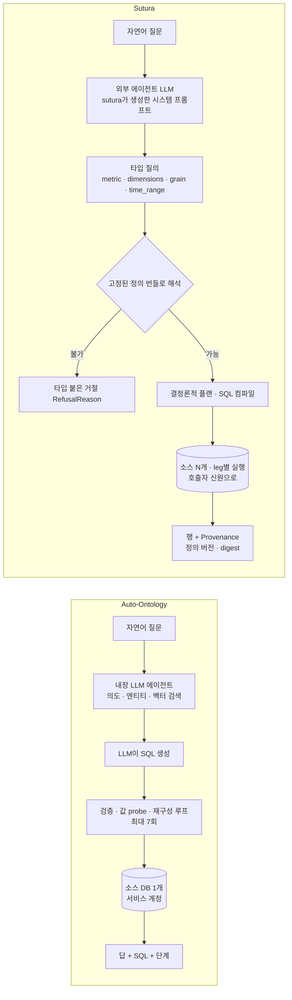
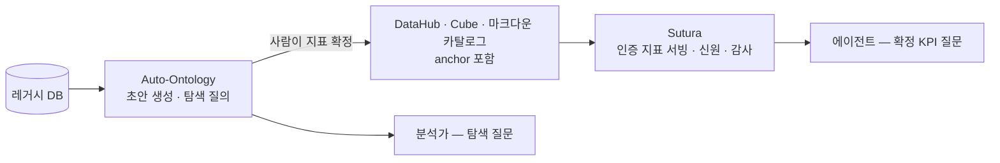

# Auto-Ontology vs Sutura: LLM이 의미를 만드는 쪽과 인증된 의미만 실행하는 쪽

작성일: 2026-11-05 · 비교 대상: [NVIDIA/auto-ontology](https://github.com/NVIDIA/auto-ontology) `caced11` (v1.1.0) vs [telekom/sutura](https://github.com/telekom/sutura) `fa799f9` (v0.11.0, 2026-11-04)
Auto-Ontology 상세: [auto-ontology-analysis.md](auto-ontology-analysis.md)

## 결론 요약

두 프로젝트는 같은 문제를 겨냥한다. **에이전트가 기업 데이터에서 틀린 숫자를 내지 않게 하는 것**이다. 하지만 해법은 정반대다.

- **Auto-Ontology(NVIDIA)**: 의미를 **LLM이 만들고**, SQL도 **LLM이 쓴다**. DB 메타데이터에서 시맨틱 모델 초안을 자동 생성하고, 자연어 질문을 내장 LangGraph 에이전트가 임의의 SQL로 바꾼다. 실수는 값 검증 probe, 재구성 루프, 사람의 인증으로 줄인다. 목표는 **커버리지**, 즉 웬만한 질문에 답하는 것이다.
- **Sutura(Deutsche Telekom)**: 내부에 **LLM이 없다.** 외부 카탈로그(DataHub, Cube, OpenMetadata, 마크다운 등)에서 **이미 인증된 지표 정의**만 받는다. 질문은 "지표 + 차원 + 그레인 + 기간"이라는 타입으로만 표현할 수 있고, SQL은 결정론적으로 컴파일된다. SQL을 넣을 필드가 아예 없으므로 정의 밖의 질문은 **표현 자체가 불가능**하다. 목표는 **검증 가능성과 신원 보존**이다.

한 줄로 줄이면 Auto-Ontology는 "무엇이든 답해 보되 근거를 보여 준다", Sutura는 "인증된 것만 답하고 나머지는 타입이 붙은 거절로 돌려준다"다. 둘은 경쟁이라기보다 **같은 스택의 다른 층**에 가깝다. 탐색적 질의와 초안 생성은 Auto-Ontology, 확정 KPI 서빙과 권한·감사는 Sutura가 맡는 조합이 자연스럽다.

---

## 1. 기본 정보

| | Auto-Ontology | Sutura |
|---|---|---|
| 주체 | NVIDIA (2026-02 인수한 illumex GSF의 후신) | Deutsche Telekom |
| 자기 정의 | "An open context layer that helps agents give fewer wrong answers on enterprise data" | "Identity-aware semantic data runtime … Security is the product, not a layer" |
| 언어·구성 | Python(FastAPI, LangGraph) + Next.js. 서비스 4개 + Postgres·pgvector | **Rust 단일 바이너리**. 크레이트 34개, 헥사고날 구조 |
| 실행 엔진 | 소스 DB에 LLM이 만든 SQL을 직접 실행 | Apache DataFusion, Arrow, ADBC. 방언별 SQL 렌더링은 polyglot-sql |
| 생성일·규모 | 2026-04 생성, 2026-10 공개. 스타 약 3.2k | 2026-08 생성. 스타 22 |
| 성숙도 | v1.1.0. Helm·Compose·웹 UI 완비 | v0.11.0. AGENTS.md가 "Early stage — the plan is settled, the code is not"이라고 명시 |
| 라이선스 | Apache-2.0 | Apache-2.0 |
| 외부 기여 | 외부 PR 받지 않음 | CONTRIBUTING 있음, 외부 PR 가능 |

## 2. 질문이 처리되는 경로



핵심 차이는 **LLM이 어디에 있는가**다. Auto-Ontology에서는 LLM이 시스템 **안**에서 SQL을 쓴다. Sutura에서는 LLM이 시스템 **밖**(Claude, Open WebUI 등)에 있고, 할 수 있는 일은 자연어를 `ask_metric`의 인자로 옮기는 것뿐이다. Sutura의 채팅 데모도 Open WebUI에 사용자가 고른 모델을 붙이고, Sutura는 OpenAPI 도구 서버로만 등록된다.

## 3. 항목별 비교

### 3.1 시맨틱 모델: 누가 만들고 무엇을 담나

| | Auto-Ontology | Sutura |
|---|---|---|
| 모델 출처 | **LLM 자동 생성**(프로파일링 → Term → FK 추론 → 쿼리 로그 기반 SqlAttribute), 또는 Ossie·YAML import | **외부 카탈로그만**: markdown, DataHub, Cube, OpenMetadata, OKF, Open Data Contract, RDBMS 딕셔너리. Wren MDL은 import 명령으로 마크다운 변환 후 검토 |
| 정의 편집 | UI·API로 편집하고 certify | **불가**. "Editing one forks the definition from the number it certifies." 정의는 상류 카탈로그에서 작성 |
| 지표 표현 | SqlAttribute = **SQL 문자열**(LLM 제안 또는 수동) | **닫힌 어휘**: `Measure` enum(2형태) × `Term` enum, `RequiredFilter` enum(연산자 4개). 모든 깊이에 `deny_unknown_fields`. `authored_sql:`은 텍스트로만 받고, 기본 제공 어댑터는 이를 실행하지 않으므로 **기동 시 거부**된다 |
| 인증의 의미 | 사람이 `certified` 플래그를 켬 | **anchor**: 지표마다 "이 기간의 값은 59" 같은 기지값을 선언한다. 기동할 때 실제 데이터로 다시 실행해 일치해야만 `Validated` 타입이 만들어지고, 이 타입이 없으면 질의 경로에 도달할 수 없다 |
| 버전 관리 | export YAML을 수동으로 관리 | **고정 스냅샷(pinned bundle)과 digest**. 모든 답에 정의 버전과 digest가 붙어 숫자를 정의 텍스트까지 추적할 수 있다 |
| 지표 없는 카탈로그 | 테이블·컬럼만 있어도 LLM이 SQL로 답을 시도 | OKF, RDBMS, OpenMetadata처럼 지표가 없는 카탈로그는 **인증된 질문에 하나도 답하지 않는다**. 설명만 가능 |

Sutura 마크다운 카탈로그의 지표 정의 예(`examples/single-player/catalog/metrics/active_subscriptions.md`)는 다음과 같다.

```yaml
kind: metric
name: active_subscriptions
model: subscriptions
measure:
  simple: { aggregate: count_distinct, column: subscription_key }
required_filters:
  - equals: { column: status, value: active }   # 지표 의미의 일부. 호출자가 제거할 수 없음
grains: [month]
dimensions:
  - name: region
    column: region
    via: subscription_customer                   # 선언된 조인
    values: [central, east, north, south, west]  # 허용 값 allowlist
anchor:
  range: { start: 2026-06-01, end: 2026-07-01 }
  value: 59                                       # 기동 시 재실행으로 검증
```

Auto-Ontology의 SqlAttribute가 "재사용할 SQL 조각"이라면, Sutura의 metric은 **"질문할 수 있는 범위 자체를 정의하는 계약"** 이다.

### 3.2 질문 표면과 거절

| | Auto-Ontology | Sutura |
|---|---|---|
| 입력 | 자연어 문자열 하나 | `metric`, 차원(최대 4개), `grain`, **양끝이 있는 기간**(최대 3,653일), 필터(최대 16개, 선언된 값만), 결과 최대 1만 행 |
| SQL 입력 | 내장 에이전트가 임의 SQL 생성 | 필드 자체가 없다. `run_sql`은 기본 꺼짐이고, 켜도 "ungoverned"로 표시된다 |
| 범위 밖 질문 | `check_answerable`: 임베딩 거리 기반 커버리지 점수(휴리스틱). `ask_question`은 "unconstructable" 응답 | **표현 불가능** 또는 타입 붙은 거절(`RefusalReason`). 거절은 에러가 아니라 결과의 한 variant라서 재시도 루프를 막는다. 거절된 값은 되풀이해 보여 주지 않는다(프롬프트 인젝션 반사 방지) |
| 에이전트 안내 | MCP 서버 `INSTRUCTIONS`(수작업 텍스트), Agent Skills 3종 | `sutura prompt`가 **정의 번들과 노출된 도구에서 시스템 프롬프트를 생성**한다. 거절 사유 전체, 한도, 지표 목록, 용어집, 예제 질문이 들어가고 손으로 쓴 부분이 없다 |
| 출처 표시 | 답과 함께 SQL과 단계 | 행 옆에 별도 필드로 `Provenance`(정의 버전·digest). 행은 텍스트 덩어리가 아니라 타입이 붙은 `RowSet` |

### 3.3 신원·권한·보안

| | Auto-Ontology | Sutura |
|---|---|---|
| 호출자 인증 | Next.js·Better Auth, OAuth 인가 서버(MCP용) | OIDC 토큰 검증(`security.inbound`, "Leg 1") |
| 질의 실행 신원 | **Databricks만** 사용자 토큰 교환. 나머지는 연결별 서비스 계정 | **BigQuery·ClickHouse는 호출자 신원으로 실행**("Leg 2", 워크로드 ID 토큰 교환과 `EXECUTE AS`). Postgres·Oracle·DuckDB·파일은 공유 계정이지만, 운영자가 `acknowledged_because`로 사유를 적지 않으면 multi-user 배포가 **기동하지 않는다** |
| 서비스 계정 폴백 | 기본이 서비스 계정 | **금지**. 신원이 없으면 `credential_unavailable`로 거절 |
| 권한 사본 | 역할 2개(admin, viewer), Zone·태그 | **권한 사본을 두지 않는다.** 행 정책과 마스킹은 소스 DB에 맡긴다 |
| 결과 캐시 | 대화 이력 저장 | **결과 캐시 없음**. 질문 키 캐시는 RLS 환경에서 사용자 간 누출이 되기 때문 |
| 감사 | 로그 | 모든 결과와 거절을 `AuditSink`에 기록하고, principal chain과 leg별 실행 신원을 남긴다 |
| 공급망·빌드 | uv, Docker | nix 허메틱 빌드, REUSE, OpenSSF Scorecard, zizmor, cargo-deny, fuzz |

Sutura는 스스로 한계도 문서화한다. AGENTS.md는 "Leg 2는 BigQuery 어댑터에서 관측됐을 뿐 실제 사람 호출자로 서빙한 환경에서는 아니다", "Oracle 신원 위임은 구현됐지만 검증되지 않았다"고 적는다.

### 3.4 데이터 소스와 연합 질의

| | Auto-Ontology | Sutura |
|---|---|---|
| 소스 | 10종: PostgreSQL, MySQL, Databricks, Snowflake, ClickHouse, Trino, Kyuubi, HeavyDB, DuckDB, SQLite | 7종: 파일(DataFusion), DuckDB, BigQuery, PostgreSQL, ClickHouse, Oracle, Cube |
| 여러 DB에 걸친 질문 | **불가**. 질문당 DB 하나를 고르고, 조인 경로와 SEMANTIC_FK가 DB 간 연결을 거부한다 | **가능**. 플랜을 소스별 leg로 나눠 각 소스에서 실행하고 DataFusion이 결합한다. lookup leg 최대 3개, 소스 최대 4개. 노드 간 원격 leg(`run_remote_leg`)도 있다 |
| 계산 위치 | 소스 DB(LLM이 만든 SQL) | 가능한 한 소스로 푸시다운, 결합만 로컬 |
| Cube 연동 | 없음(Ossie 경유 간접) | 카탈로그이자 데이터 시스템으로 직접 연동. Cube에 호출자 토큰 전달 가능 |

### 3.5 운영 형태

| | Auto-Ontology | Sutura |
|---|---|---|
| 상태 | Postgres(카탈로그, 온톨로지, 대화, 벡터) | 상태가 거의 없다. 카탈로그를 주기적으로 다시 읽고(`refresh_seconds`, 기본 900) 결과는 보관하지 않는다 |
| UI | 웹 UI(그래프 탐색, Chat, 인증 화면, 설정) | **없음**. HTTP와 MCP만 제공한다(Arrow Flight는 노드 간 원격 leg 전송용). 데모는 Open WebUI |
| LLM 비용 | 컴파일과 질의 모두 LLM 호출(질문당 7회 이상) | 0. 비용은 외부 에이전트 쪽에만 생긴다 |
| 응답 지연 | 수십 초 | 컴파일된 SQL 실행 시간 수준 |
| 배포 | Helm, Compose | 단일 바이너리, 컨테이너, Helm(`charts/`), K8s 오퍼레이터 크레이트 |

## 4. 무엇을 언제 쓰나

| 상황 | 선택 |
|---|---|
| 문서 없는 레거시 DB에서 **빨리 아무 질문이나** 답해 보고 싶다 | Auto-Ontology |
| 시맨틱 모델이 아직 없어서 **초안부터 만들어야** 한다 | Auto-Ontology (Sutura는 모델을 만들지 않는다) |
| 재무·KPI·규제 보고처럼 **숫자가 곧 책임**이고 정의 버전 추적이 필요하다 | Sutura |
| 사용자별 행 권한이 엄격하고, **호출자 신원으로 실행**해야 한다(BigQuery·ClickHouse) | Sutura |
| 지표가 이미 **DataHub·Cube에 정의**돼 있다 | Sutura (Auto-Ontology는 Ossie import 경유) |
| 여러 DB에 걸친 지표 하나 | Sutura (Auto-Ontology는 단일 DB) |
| 분석가가 탐색적으로 묻고 SQL을 받아 검토한다 | Auto-Ontology |
| 비영어권 사용자, UI 필요 | Auto-Ontology(UI 있음, 단 한국어 경로 약함). Sutura는 외부 에이전트가 언어를 처리 |

**조합 시나리오** (이론상 경로이며 실제로 검증하지는 않았다):



직접 연결된 파이프는 없다. Auto-Ontology의 출력은 Ossie·네이티브 YAML이고, Sutura가 읽는 카탈로그 종류는 markdown, DataHub, Cube, OpenMetadata, OKF, ODCS, RDBMS(+Wren import)다. 그래서 Ossie → Cube 컨버터 → Cube 카탈로그를 거치거나, 확정한 지표를 Sutura 마크다운 카탈로그로 옮겨 적고 anchor를 붙여야 한다.

## 5. 엔지니어 관점 인사이트

- **신뢰를 만드는 방식이 다르다.** Auto-Ontology는 사후 교정이다. LLM이 쓴 SQL을 데이터 probe와 재구성으로 고친다. Sutura는 사전 봉쇄다. 틀릴 수 있는 입력을 **타입 시스템에서 표현 불가능하게** 만든다. 앞쪽은 커버리지를 얻고 정확도 보장을 잃고, 뒤쪽은 그 반대다.
- **"인증"의 무게가 다르다.** Auto-Ontology의 certified는 사람이 켜는 불리언 플래그다. Sutura의 anchor는 기동할 때마다 **데이터로 재검증되는 기지값**이고, 이를 통과해야만 만들어지는 `Validated` 타입이 질의 경로의 전제 조건이다. 지표 회귀 테스트가 런타임에 내장된 셈이다. Auto-Ontology의 SqlAttribute에도 이식할 만한 아이디어다.
- **거절을 결과로 다루는 설계**(typed refusal, 값을 되풀이하지 않음, 재시도 루프 방지)와 **정의 번들에서 생성하는 에이전트 프롬프트**는 MCP 서버를 설계할 때 일반적으로 쓸 수 있는 패턴이다. Auto-Ontology의 수작업 `INSTRUCTIONS`와 대비된다.
- **Sutura의 비용은 표현력이다.** "지난달 매출이 가장 많이 늘어난 지역의 상위 고객"처럼 정의된 지표 하나와 차원으로 표현되지 않는 질문은 답할 수 없다. `run_sql`을 켜면 그 순간 Sutura가 보장하는 성질이 사라진다. 실무에서는 "인증 질문은 Sutura, 나머지는 text-to-SQL 계열"로 라우팅하는 이중 구조가 될 가능성이 높다.
- **성숙도 차이**: Auto-Ontology는 UI와 커넥터 폭이 넓지만 공개 정확도 수치가 없다. Sutura는 검증 규율(테스트 인과성 게이트, 신원 주장마다 근거 링크 요구)이 매우 엄격하지만 v0.11이고 커뮤니티가 아주 작다.

## 참고

- [telekom/sutura](https://github.com/telekom/sutura) · [문서 사이트](https://telekom.github.io/sutura/latest/) · 저장소 내 `docs/concepts.md`, `docs/architecture.md`, `docs/agent-prompt.md`, `docs/integrations.md`
- 이 저장소: [Auto-Ontology 코드 레벨 분석](auto-ontology-analysis.md) · [활용 가이드](use-cases.md) · [Wren AI](../wren-ai/analysis.md) · [Google OKF](../knowledge-catalog/okf-analysis.md) · [Apache Ossie](../../data-platforms/ossie/apache-ossie-code-analysis.md)
