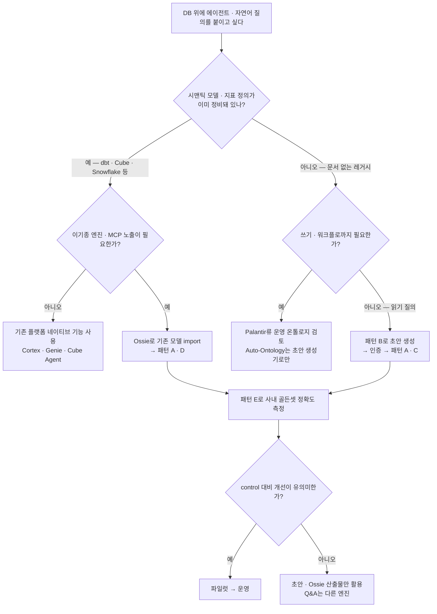
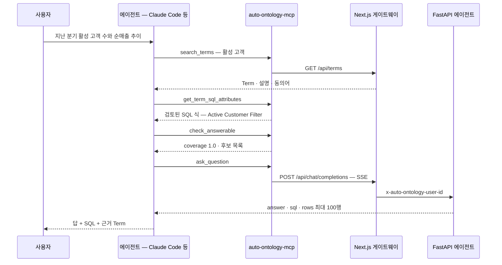
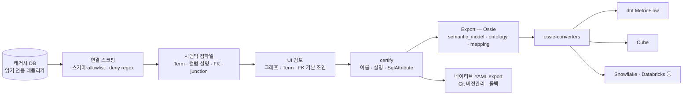
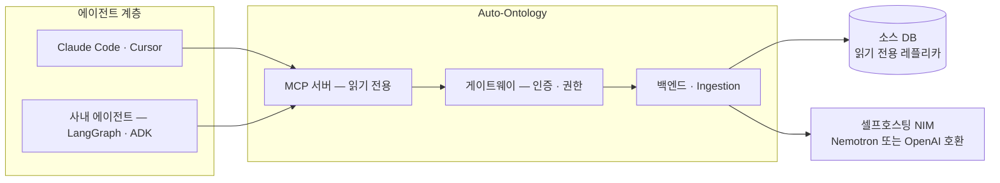
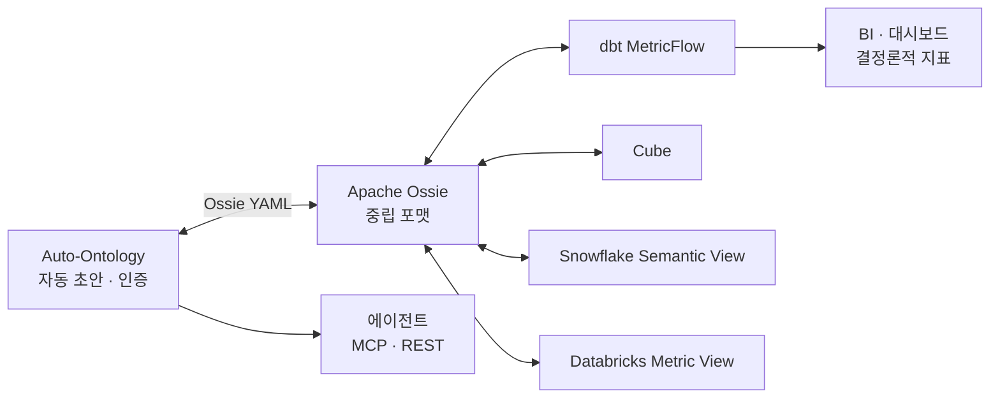
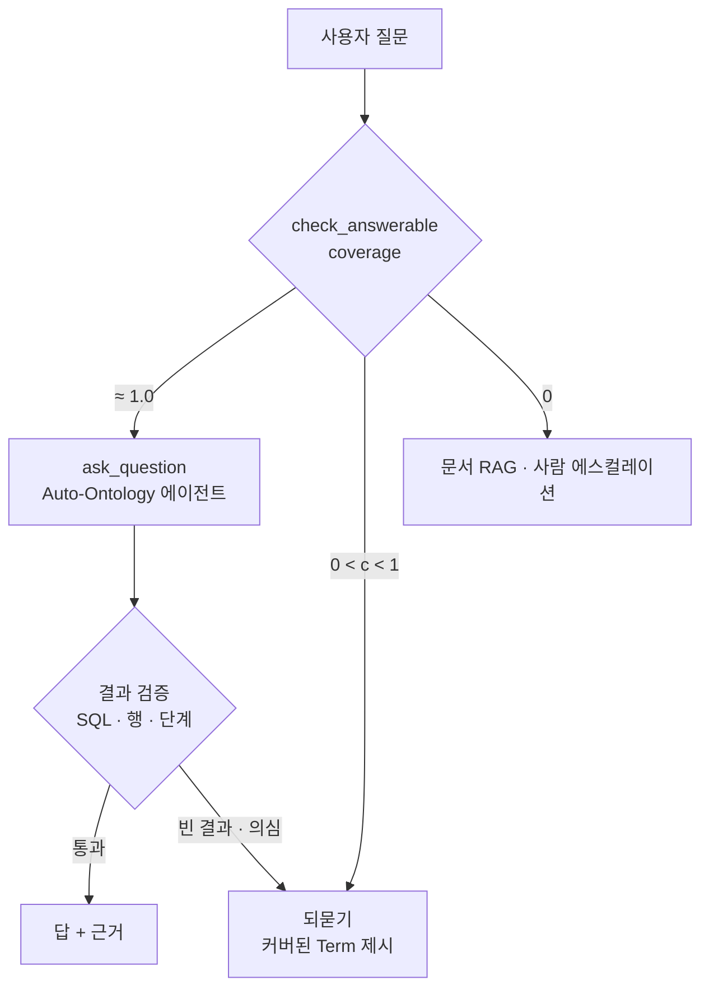
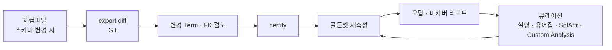

# NVIDIA Auto-Ontology 활용 가이드

작성일: 2026-11-04 · 대상 버전: `main` @ `caced11` (v1.1.0) · 구조·코드 분석은 [auto-ontology-analysis.md](auto-ontology-analysis.md) 참조

## 결론 요약

Auto-Ontology는 "사내 데이터 질의 에이전트를 통째로 대체하는 플랫폼"으로 보기보다, **용도별로 잘라서 쓰는 도구 상자**로 보는 편이 맞다. 가치가 큰 순서로 정리하면 다음과 같다.

| # | 활용 패턴 | 얻는 것 | 난이도 | 추천도 |
|---|---|---|---|---|
| A | **사내 에이전트용 MCP 컨텍스트 서버** | Claude Code·Cursor·사내 에이전트가 비즈니스 용어, 검토된 SQL, 조인을 도구로 조회한다 | 중 | ★★★ |
| B | **레거시 DB 시맨틱 모델 초안 생성기** | 문서 없는 DB에서 Term·컬럼 설명·FK·junction 초안을 얻고, Ossie로 dbt·Cube 등에 넘긴다 | 중 | ★★★ |
| C | 셀프서비스 데이터 Q&A (내장 Chat·REST) | 현업용 자연어 질의와 SQL·근거 노출 | 중상 | ★★ |
| D | **답변 가능성 게이트** | 다른 에이전트 앞단에서 범위 밖 질문을 싸게 걸러내고 되묻게 한다 | 하 | ★★ |
| E | text-to-SQL 정확도 실험 하네스 | 같은 모델로 "온톨로지 유무"를 결정론적으로 비교한다 | 중 | ★★ |
| F | 컴포넌트·패턴 차용 | FK 추론과 값 검증, 조인 BFS 규칙, MCP allow-list 설계를 자체 시스템에 이식한다 | 상 | ★ |

**공통 전제**:

1. 공개된 정확도 수치가 없으므로 **자체 골든셋으로 E를 먼저 돌린 뒤** A·C의 운영 여부를 결정한다.
2. 소스 DB는 **읽기 전용 계정**으로 붙인다.
3. 데이터 반출이 민감하면 **셀프호스팅 NIM**을 쓴다.

---

## 1. 어떤 상황에 쓰나: 의사결정 흐름



---

## 2. 활용 패턴 상세

### 2.1 패턴 A: 사내 에이전트용 MCP 컨텍스트 서버

**문제**: 코딩·분석 에이전트에 DB 접근 권한을 주면 스키마를 덤프하고 조인을 즉흥적으로 만든다. "활성 고객", "순매출" 같은 사내 정의도 모른다.

**해법**: Auto-Ontology MCP를 붙여 에이전트가 **의미 계층을 통해서만** 데이터에 접근하게 한다. MCP에는 물리 스키마를 탐색하는 도구가 일부러 없다.



**설정** (MCP는 Docker Compose에 포함되지 않으므로 따로 실행한다):

```bash
# 1) MCP 서버 실행 — 기본 포트 3003, 게이트웨이 URL만 알려 주면 된다
AUTO_ONTOLOGY_API_URL=http://localhost:3000 \
  uvx --from "git+https://github.com/NVIDIA/auto-ontology.git#subdirectory=mcp" auto-ontology-mcp

# 2) 게이트웨이가 OAuth 인가 서버 역할을 하는지 확인 (200이어야 로그인 가능)
curl -s -o /dev/null -w '%{http_code}\n' http://localhost:3000/.well-known/oauth-authorization-server

# 3) Claude Code에 등록 (Streamable HTTP) — 첫 호출 때 브라우저 로그인
claude mcp add --transport http auto-ontology http://localhost:3003/mcp
```

Cursor는 `~/.cursor/mcp.json`에 `{"mcpServers": {"auto-ontology": {"url": "http://localhost:3003/mcp"}}}`를 넣는다. Claude Desktop은 `npx mcp-remote http://localhost:3003/mcp`로 브리지한다.

**운용 팁**:

- **두 가지 사용 모드**를 구분한다.
  - `ask_question` 위임 모드: 내장 에이전트가 SQL을 만들고 검증·실행한다. 정확도 장치(값 probe, 재구성 루프)를 그대로 쓰지만 수십 초가 걸린다.
  - 어휘 조회 모드: `get_term_columns`·`get_sql_attribute`로 정의만 가져오고 SQL은 호출한 에이전트가 직접 만든다. 빠르지만 검증은 호출 측 책임이다.
- 에이전트 시스템 프롬프트나 스킬에 "비즈니스 용어는 반드시 `search_terms`로 먼저 확인한다"를 넣는다. 서버 `INSTRUCTIONS`도 같은 순서를 권한다.
- 공식 스킬을 함께 쓰면 MCP와 REST 사용 순서, SQL·행 검증 절차를 에이전트가 따른다: `npx skills add nvidia/skills` 후 `nvidia-ontology-query`.
- **권한은 로그인한 사람 기준**이다. viewer는 viewer의 답만 받는다. 서버 자체에 토큰을 넣는 방법은 일부러 막혀 있다.

### 2.2 패턴 B: 레거시 DB 시맨틱 모델 초안 생성기

**문제**: 수백 개 테이블에 FK 선언도, 컬럼 주석도 없는 ERP나 DW가 있다. dbt나 Cube 모델을 처음부터 쓰려면 몇 주가 걸린다.

**해법**: Auto-Ontology의 컴파일 결과를 **초안**으로 쓰고, 사람이 인증한 뒤 Ossie로 내보낸다.



**잘 해 주는 것**:

- 선언되지 않은 FK를 추론하고, 값이 하나도 겹치지 않는 가짜 FK를 SQL로 지운다.
- junction 테이블을 판별하고, 브리지 조인을 SqlAttribute로 만든다.
- 같은 대상을 여러 FK가 가리킬 때(배송지·청구지 고객 등) 기본 조인을 고른다.
- 설명 없는 컬럼에 비즈니스 설명을 붙이고, 날짜 포맷, 혼합 포맷 경고, JSONB 키 경로, 단위 주석을 단다.
- `_HIST`·`_ARC` 같은 변형 테이블에 표시명 접두어를 붙인다.

**직접 채워야 하는 것**:

- **개념 통합**: Term은 기본적으로 테이블 하나당 하나다. 여러 시스템의 "고객" 테이블을 하나의 개념으로 묶는 일은 사람이 한다.
- **지표**: SqlAttribute 자동 제안은 쿼리 이력이 있어야 나온다. 이력을 주는 엔진은 사실상 Snowflake와 ClickHouse뿐이고 Postgres는 빈약하다. 나머지 엔진에서는 Custom Analysis(이름 붙인 예제 SQL)나 수동 SqlAttribute로 핵심 지표를 등록한다.
- **그레인과 팬아웃 규칙**: dbt나 Cube로 넘긴 뒤 그쪽 지표 엔진에서 확정한다.

**팁**: export한 YAML을 Git에 커밋하고, 컴파일을 다시 돌린 결과와 diff하면 스키마 변경을 추적할 수 있다. management 스킬의 publication 절차(YAML과 SHA-256 보관, 격리 환경 적용, 재export 비교)가 바로 이 흐름이다.

### 2.3 패턴 C: 셀프서비스 데이터 Q&A (내장 Chat·REST)

현업 사용자에게 Chat UI를 그대로 열어 주거나, REST로 사내 메신저 봇이나 포털에 붙인다. 답과 함께 **SQL, 실행 단계, 결과 행, 차트**가 오기 때문에 "근거 있는 답"을 보여 주기 좋다.

```python
# 사내 봇 백엔드에서 Auto-Ontology에 질문하고 SSE를 소비하는 최소 예시
import json, os, uuid, requests

def ask(question: str, conversation_id: str | None = None) -> dict:
    resp = requests.post(
        f"{os.environ['AO_URL']}/api/chat/completions",
        headers={"x-api-key": os.environ["AO_TOKEN"]},  # UI 사용자 메뉴 → API Tokens
        json={"question": question, **({"conversation_id": conversation_id} if conversation_id else {})},
        stream=True, timeout=900,
    )
    resp.raise_for_status()
    steps = []
    for line in resp.iter_lines(decode_unicode=True):
        if not line or not line.startswith("data:"):
            continue
        payload = line.removeprefix("data:").strip()
        if payload == "[DONE]":
            break
        ev = json.loads(payload)
        if ev["type"] == "step":
            steps.append(ev.get("node"))          # 진행 표시용
        elif ev["type"] == "result":
            a = ev["answer"]
            return {"text": a["response"], "sql": a["sql_code"],
                    "rows": a.get("sql_response_from_db"), "steps": steps}
        elif ev["type"] == "error":
            raise RuntimeError(ev["message"])
    raise RuntimeError("stream ended without result")

thread = str(uuid.uuid4())                  # 대화 스레드마다 클라이언트가 생성
print(ask("지난달 지역별 매출 상위 5개는?", thread))
print(ask("그럼 8월은?", thread))             # 최근 5턴 기반 독립 질문 재작성
```

- 같은 `conversation_id`에 요청을 동시에 보내면 `409`가 난다. 봇은 스레드별로 직렬화해야 한다.
- 응답이 수십 초 걸리므로 `step` 이벤트로 "조인 경로 확인 중" 같은 진행 상황을 보여 주는 UX가 필수다.
- SQL 실행 기본 타임아웃은 30초다(Settings → Agent Settings).

### 2.4 패턴 D: 답변 가능성 게이트 (라우터)

`check_answerable`(`POST /api/question-entity-coverage`)은 엔티티를 추출하는 LLM 1회와 벡터 검색만으로 끝난다. 그래서 `ask_question`보다 훨씬 싸다. 범용 사내 어시스턴트 앞단에서 **"이 질문은 DB로 답할 수 있나"를 먼저 판정하는 라우터**로 쓴다.

```python
def route(question: str) -> str:
    r = requests.post(f"{AO_URL}/api/question-entity-coverage",
                      headers={"x-api-key": AO_TOKEN},
                      json={"question": question, "max_distance": 0.75}, timeout=60)
    data = r.json()["data"]                 # {"coverage": 0~1, "candidates": [{label, attribute, term, id}]}
    if data["coverage"] >= 0.99:
        return "sql_agent"                  # ask_question으로 위임
    if data["coverage"] > 0:
        return "clarify"                    # 커버된 후보를 보여 주고 되묻기
    return "doc_rag"                        # 정형 데이터 밖 — 문서 RAG나 사람에게
```

**주의**:

- 커버리지는 `커버된 엔티티 ÷ 추출된 엔티티`이고, **ColumnAttribute 히트만** 계산에 들어간다. SqlAttribute만으로 표현되는 지표는 커버리지에 반영되지 않는다.
- 임베딩 거리 임계값 기반이라 "비슷하지만 다른 컬럼"이 있으면 위양성이 생긴다. 게이트는 **"답할 수 없음"을 걸러내는 용도**로 쓰고, "답할 수 있음"은 실행 결과로 다시 확인한다.
- REST 응답에는 미커버 엔티티 목록이 없다. 그 목록은 내부 플로우에서만 켜진다. 무엇이 빠졌는지 사용자에게 보여 주려면 질문의 엔티티와 `candidates`를 비교해서 직접 계산해야 한다.
- `max_distance`는 사내 질문 샘플로 보정한다. 0.6~0.8 사이에서 정밀도와 재현율 곡선을 그려 보면 된다.

### 2.5 패턴 E: text-to-SQL 정확도 실험 하네스

도입을 결정하기 전에 가장 먼저 할 일이다. [auto-ontology-eval](https://github.com/NVIDIA/auto-ontology-eval)은 같은 모델로 두 실험군을 돌린다.

- Control: 스키마 덤프만 프롬프트에 넣는다.
- Treatment: Auto-Ontology 에이전트가 쓰인다.

두 쪽의 SQL을 실행 결과 일치로 결정론적으로 채점하고, 질문 단위로 "고친 것과 망친 것"을 출력한다.

```bash
git clone https://github.com/NVIDIA/auto-ontology-eval.git && cd auto-ontology-eval
uv sync && cp .env.example .env     # DEFAULT_MODELS_API_KEY, CONNECTION_STRINGS, GYM_MODEL
# 사내 데이터셋: datasets/<name>/evaluation.json (질문 + DB ID + 정답 SQL)
#               + 선택 metadata.json(테이블 설명) · custom_analyses.json(예제 SQL)
# ontology_sql_eval/gym/tasks.py의 DATASETS에 방언·DDL 위치 등록
uv run python main.py --database-name <name> --eval-workers 3 --run-dir runs/2026-11-pilot
```

**설계 시 체크**:

- 두 실험군에 **같은 모델**을 지정한다. Treatment는 `REASONING_*`·`NON_REASONING_*`, Control은 `GYM_MODEL`이다.
- 레이트 리밋이 걸리면 점수가 0 근처로 떨어져 "약한 모델"처럼 보인다. `health/*` 카운터를 확인하고, 응답 없는 질문이 5%를 넘으면 수치를 인용하지 않는다(하네스가 자동으로 막는다).
- SQL exemplar와 value anchor 옵션은 Treatment에만 들어간다. 공정 비교를 하려면 끈다.
- 골든셋은 **실제 사내 질문 50~200개**로 만든다. 지표 정의, 다단 조인, 필터 값 표기, 범위 밖 질문을 고루 섞는다.
- 측정은 세 시점에 한다. ① 컴파일 직후(인증 전) ② 상위 Term·SqlAttribute 인증 후 ③ Custom Analysis 추가 후. "사람의 인증이 몇 %p를 더하는가"를 숫자로 확인할 수 있다.

### 2.6 패턴 F: 컴포넌트·패턴 차용

Apache-2.0이라 고지만 하면 코드를 가져다 쓸 수 있다. 통째로 배포하지 않아도 이식할 가치가 있는 부분은 다음과 같다.

| 차용 대상 | 위치 | 이식처 예 |
|---|---|---|
| 프로파일링 + LLM FK 추론 + **값 겹침 프루닝** | `semantic/visit_enter.py`, `fk_suggester.py`, `semantic_fk.py` | 데이터 카탈로그 FK 자동 문서화 |
| PK-only 역방향 조인 BFS | `dal/attributes.py::_find_table_join_hops` | 자체 text-to-SQL 조인 경로 힌트 |
| 리터럴 near-miss·스케일 불일치 probe | `retrieval/text_to_sql/db_probe/literal_check.py` | 빈 결과 자동 수리 |
| 읽기 전용 probe 관문 | `db_probe/executor.py` | LLM이 쓴 탐색 SQL의 안전 실행 |
| 정렬된 커밋 큐 | `semantic/pipeline.py` | 병렬 LLM 배치 작업의 결정론적 저장 |
| OpenAPI 기반 allow-list MCP | `mcp/auto_ontology_mcp/tools.py` | 기존 REST 서비스의 MCP 노출 |
| 노드 시작 시점 SSE 진행 이벤트 | `text_to_sql_graph.py::announce_node_start` | LangGraph 스트리밍 UX |

---

## 3. 통합 아키텍처 레퍼런스

### 3.1 MCP 중심 (패턴 A)



### 3.2 Ossie 허브 (패턴 B와 기존 시맨틱 레이어 공존)



지표의 **진실 원천은 dbt나 Cube에 둔다.** Auto-Ontology는 ① 레거시 소스의 초안 생성기 ② 에이전트용 MCP 노출 계층으로 쓴다. 지표가 바뀌면 Ossie로 다시 import해서 에이전트 쪽 정의를 동기화한다.

### 3.3 게이트 + 다중 엔진 라우팅 (패턴 D)



---

## 4. 도입 로드맵

| 단계 | 기간(예시) | 할 일 | 산출물·통과 기준 |
|---|---|---|---|
| **0. 준비** | 2~3일 | 대상 DB 하나 선정(테이블 30~150개 권장), 읽기 전용 계정과 레플리카, 모델 엔드포인트 결정(호스팅 또는 NIM), 데이터 반출 리뷰 | 보안 승인, `.env` |
| **1. PoC** | 1~2주 | Compose 기동 → 연결 스코핑 → 컴파일 → UI로 Term·FK 검토 → 골든셋 50개 구성 → **패턴 E로 control 대비 측정** | 정확도 차이, 고친·망친 질문 목록 |
| **2. 큐레이션** | 1~2주 | 상위 Term 20~30개 이름·설명 인증, 핵심 지표를 SqlAttribute·Custom Analysis로 등록, 용어집(약어·한글 용어) 입력, 재측정 | 인증 전후 정확도 차이 |
| **3. 파일럿** | 2~4주 | MCP를 분석팀 에이전트에 연결(패턴 A), 게이트 임계값 보정(패턴 D), 오답 리포트 → 큐레이션 루프 | 주간 오답률, 커버리지 분포 |
| **4. 운영화** | — | Helm 배포, Vault, 내부 포트 격리, 백업, export YAML의 Git 관리, 재컴파일 주기 결정 | 런북, 롤백 절차 |

---

## 5. 실습: 로컬에서 30분 안에 확인하기

```bash
git clone https://github.com/NVIDIA/auto-ontology.git && cd auto-ontology
cp .env.example .env
# .env: DEFAULT_MODELS_API_KEY=nvapi-…, AUTH_SECRET=$(openssl rand -base64 32),
#       APP_URL=http://localhost:3000, POSTGRES_PASSWORD=…,
#       CONNECTION_STRINGS=postgresql://postgres:<pw>@postgres:5432/wideworldimporters,
#       AUTO_ONTOLOGY_ADMIN_PASSWORD=…, PGADMIN_PASSWORD=…
#       (역할별 nvapi-your-api-key-here 줄은 지우면 DEFAULT로 폴백)

docker compose up -d --wait postgres
git clone https://github.com/NVIDIA/auto-ontology-eval.git ../auto-ontology-eval
(cd ../auto-ontology-eval && uv sync && cp .env.example .env && \
  POSTGRES_PASSWORD='<pw>' uv run python scripts/seed/seed_wwi.py --database-name wideworldimporters --drop)

docker compose up -d --build
# http://localhost:3000 로그인 → Settings → Semantic Compilation 켜기 → "Semantic compilation is ready"
```

확인할 것:

1. **Exploration 그래프**: Term 31개 안팎이 나오는지, 주문·송장·고객 간 SEMANTIC_FK가 맞는지.
2. **Chat**: "What was revenue for the USB food flash drive - sushi roll in Pennsylvania in June 2015?"에 6-way 조인 SQL과 단계가 나오는지.
3. **범위 밖 질문**: 광고비 ROAS처럼 데이터에 없는 질문에 `check_answerable` coverage가 1 미만으로 나오는지.
4. **MCP**: §2.1 설정 후 Claude Code에서 "Auto-Ontology에서 Invoice Line Term의 컬럼과 SQL 속성을 보여 줘".

UI가 재시작 후 왼쪽 내비게이션 없이 뜨면 오래된 세션 쿠키 문제다. `localhost:3000`의 사이트 데이터를 지운다.

---

## 6. 도입 시 고려사항

### 6.1 보안·권한

- **읽기 전용 계정은 필수다.** 내부 probe 경로는 SELECT만 허용하는 관문이 있다. 하지만 메인 질의 실행 경로에서는, 확인한 범위 안에서는, 문장 유형을 화이트리스트로 강제하는 코드를 찾지 못했다. DB 권한으로 막는다.
- **Vault를 켠다.** 켜지 않으면 연결 비밀번호가 Postgres에 평문 JSON으로 저장된다. 4개 변수가 모두 있어야 활성화되고, 하나라도 빠지면 경고만 남기고 평문으로 폴백한다.
- **3001·3002 포트를 격리한다.** 3001은 사용자 헤더를 무검증으로 믿고, 3002는 인증이 없다(compile·reset 엔드포인트 포함).
- **사용자별 데이터 권한**: Databricks만 SSO 토큰 교환으로 본인 권한을 쓴다. 다른 엔진은 서비스 계정 하나로 실행되므로, 권한 경계가 다른 데이터는 **연결이나 배포를 분리**한다.
- **데이터 반출**: 컴파일하는 동안 컬럼 설명과 샘플 값(최빈 5개, 30자 이하)이 LLM 프롬프트와 임베딩 텍스트로 나간다. 질의할 때는 결과 행 일부가 응답 생성에 쓰인다. 규제 데이터라면 NIM을 셀프호스팅하고(`<ROLE>_ENDPOINT`), PII 태그를 검토하고, 민감 컬럼은 deny regex로 뺀다.
- **KumoRFM**: 호스팅 서비스를 쓰면 테이블을 업로드한다. 코드상 활성화 조건은 `KUMO_RFM_API_URL`이고, 셀프호스팅 Universal TFM NIM을 가리키게 할 수 있다.

### 6.2 한국어 환경

- 컴파일이 만드는 Term 이름, 설명, 표시명은 **영어**다. 프롬프트가 모두 영어다.
- 질의 그래프에 번역 노드가 없다. `route_translation` 라우터는 정의만 돼 있고 그래프에 연결돼 있지 않다. 한국어 질문은 엔티티 추출 LLM과 임베딩 모델의 **교차언어 매칭**에 기대게 된다.
- **Term `synonyms` 필드는 API로 수정할 수 없다.** `PATCH /api/terms/{id}`(`TermUpdate`)가 받는 것은 이름, 설명, 인증 플래그, 소유자뿐이다. 동의어는 컴파일할 때 **테이블 설명에 명시적으로 적힌 별칭**("also known as …", 괄호 약어)에서만 추출된다(`term_extractor._extract_synonyms`).
- **권장 보완책** (사용자가 편집할 수 있는 경로 순):
  1. 사내 약어와 한글 업무 용어를 **용어집(Glossary, Settings → Semantic Input)** 에 등록한다. 질문 정제·subject 해석 프롬프트와 SQL 생성 프롬프트에 주입된다.
  2. 핵심 Term과 ColumnAttribute의 **설명(description)에 한국어 표현을 병기**한다. Term 설명을 수정하면 Term 행이, ColumnAttribute를 수정하면 해당 속성 행이 다시 임베딩되어 검색에 반영된다.
  3. 소스 DB를 손댈 수 있다면 테이블 COMMENT에 `(also known as 고객, 거래처)` 형태로 한국어 별칭을 적은 뒤 컴파일한다. 그러면 synonyms에 들어가고 ColumnAttribute 임베딩 텍스트에도 붙는다. 재컴파일은 Term이 없는 테이블만 처리하므로 기존 테이블에는 적용되지 않는다.
  4. 자주 묻는 한국어 질문을 **Custom Analysis**(질문형 이름과 SQL)로 등록해 검색 앵커로 쓴다.
  5. 패턴 E 골든셋에 한국어 질문을 넣어 영어 질문과의 정확도 차이를 따로 측정한다.
  6. 그래도 부족하면 앞단에서 질문을 영어로 정규화하는 전처리를 둔다.

### 6.3 비용·지연

- 질문당 LLM 호출은 정상 경로에서 대략 7회 이상이다. 재구성 루프가 돌면 회당 2~3회씩 늘어난다. 응답은 수십 초 걸린다.
- 비용을 줄이는 방법:
  - 게이트(패턴 D)로 범위 밖 질문을 먼저 걸러낸다.
  - `NON_REASONING`에 작은 모델을 배정한다.
  - 자주 쓰는 질문은 Custom Analysis로 만들어 검색 적중률을 올린다.
- 컴파일은 테이블당 LLM 3회 이상에 FK 해석이 더해져 수 분~수십 분 걸린다. `SEMANTIC_LLM_MAX_INFLIGHT`·`LLM_MAX_INFLIGHT`는 엔드포인트 레이트 리밋에 맞춘다. 503이나 429가 나면 낮춘다.
- 대형 웨어하우스에서는 Distinct Value Scanning을 끄는 것을 검토한다. DISTINCT probe가 컬럼마다 전체 스캔이 될 수 있다.

### 6.4 품질 관리 루프



- `certified` 플래그를 신뢰 신호로 쓴다. 예를 들어 에이전트 프롬프트에 "인증된 SqlAttribute를 우선 사용"을 넣는다.
- 재컴파일은 **Term이 없는 테이블만** 처리한다(`fetch_all_tables_without_term`). 기존 Term은 보존된다. 스키마가 크게 바뀌면 해당 테이블의 Term을 정리한 뒤 다시 돌린다.
- 오답이 나면 원인을 SSE `thoughts`와 `steps`로 분류한다. 스키마 링크 오류, 조인 오류, 지표 정의 오류, 값 표기 오류 중 어느 것인지에 따라 큐레이션 대상이 달라진다.

---

## 7. 대안과의 조합 가이드

| 이미 쓰고 있는 것 | Auto-Ontology의 역할 | 비고 |
|---|---|---|
| dbt Semantic Layer | Ossie import로 지표 정의를 가져와 MCP로 노출하고, 미모델링 소스의 초안을 생성 | 지표의 진실 원천은 dbt |
| Cube | 동일. Cube API는 BI용, Auto-Ontology는 에이전트 탐색용 | |
| Snowflake Cortex·Databricks Genie | 단일 플랫폼이면 네이티브가 우선. 이기종 소스를 합쳐 하나의 MCP로 노출해야 할 때만 | Databricks는 OBO 지원 |
| [Wren AI](../wren-ai/analysis.md) | 선택지 경쟁 관계. 결정론적 MDL 엔진이 필요하면 Wren, 초안 자동화가 필요하면 Auto-Ontology | 둘 다 OSS |
| Palantir Foundry | 레거시 소스의 초안을 만들어 Ontology 모델링 입력으로 사용 | NVIDIA 자체도 이 조합 |
| DataHub·OpenMetadata | 카탈로그는 거버넌스와 계보, Auto-Ontology는 에이전트 질의 계층. 카탈로그의 설명과 태그를 소스 comment로 내려 주면 컴파일 품질이 오른다 | 컴파일러는 기존 설명이 있으면 LLM 설명을 생략 |
| Graph RAG ([LightRAG](../lightrag/README.md) 등) | 정형 데이터는 Auto-Ontology, 비정형 문서는 Graph RAG. 게이트(패턴 D)로 라우팅 | |

---

## 참고

- 구조·코드 분석: [auto-ontology-analysis.md](auto-ontology-analysis.md)
- 공식 문서: [README](https://github.com/NVIDIA/auto-ontology#readme) · [MCP](https://github.com/NVIDIA/auto-ontology/blob/main/docs/mcp.md) · [Conversation API](https://github.com/NVIDIA/auto-ontology/blob/main/docs/conversation-api.md) · [Connections](https://github.com/NVIDIA/auto-ontology/blob/main/docs/connections.md) · [DEPLOYMENT](https://github.com/NVIDIA/auto-ontology/blob/main/DEPLOYMENT.md)
- 평가: [auto-ontology-eval](https://github.com/NVIDIA/auto-ontology-eval)
- 표준: [Apache Ossie 분석](../../data-platforms/ossie/apache-ossie-code-analysis.md) · [apache/ossie-converters](https://github.com/apache/ossie-converters)
