# LLMOps · LLM Observability 9종 비교 분석 (2026-11)

> **대상**: Langfuse · Helicone · Opik · Laminar · W&B Weave · PostHog(AI Observability) · OpenLIT · LangWatch · HoneyHive
> **조사 시점**: 2026-11-24. 각 도구의 GitHub 저장소를 clone해 소스(기준 커밋은 [부록 A](#부록-a-분석-기준-커밋))로 확인하고, 2026-06 이후 바뀐 내용은 웹(공식 changelog·블로그·문서)으로 교차 검증했다. 확인하지 못한 항목은 *(미확인)* 으로 표시했다.
> **관점**: 기능·장단점보다 **인프라 구성**(셀프호스트 시 무엇을 띄우는지, 수집 파이프라인이 어떻게 생겼는지)에 무게를 둔다.
> **시각화 버전**: [llmops-tools-comparison.html](llmops-tools-comparison.html) — 기능 히트맵, 인프라 무게 차트, 데이터스토어 매트릭스, 도구별 아키텍처 다이어그램과 실제 UI 스크린샷 포함.
> **같은 토픽의 다른 문서**: [README(지형도, 2026-06)](README.md) · [Langfuse 심층](langfuse.md) · [플랫폼 심층(2026-06)](platforms.md) · [표준·생태계](standards-and-ecosystem.md)

---

## 0. TL;DR

1. **ClickHouse가 9개 모두의 분석 저장소다.** Langfuse·Helicone·Opik·Laminar·Weave·PostHog·OpenLIT·LangWatch·HoneyHive 전부 trace/span을 ClickHouse에 넣는다. 도구 간 차이는 그 옆에 무엇을 더 띄우느냐(Postgres·MySQL·Redis·큐·S3·검색엔진)에서 갈린다.
2. **셀프호스트 무게는 10배 이상 차이 난다.** OpenLIT은 컨테이너 3개, Laminar(LITE)는 5개, Langfuse·LangWatch는 7개, Opik은 8개(+ZooKeeper)다. PostHog hobby는 47개(상태 저장소 9종)이고, W&B Weave와 HoneyHive는 엔터프라이즈 계약과 Kubernetes가 있어야 셀프호스트할 수 있다.
3. **2026 하반기에 개방성이 크게 후퇴했다.** W&B Weave는 서버 코드를 비공개 저장소로 옮겼고(2026-10-13), Laminar는 ELv2 Enterprise Edition을 분리했으며(2026-11), OpenLIT은 비공개 `openlit-enterprise` 에디션을 만들었다. 기능 게이트가 없는 완전한 Apache-2.0으로 남은 활성 플랫폼은 **Opik**뿐이다(Helicone도 Apache-2.0 단일이지만 사실상 유지보수만 한다).
4. **소유권도 크게 흔들렸다.** Langfuse는 ClickHouse에 인수됐고(2026-01), Helicone은 Mintlify 인수(03) 후 결별하고 다시 Experiential Labs로 넘어갔다(11). HoneyHive는 Elastic이 인수 계약을 발표했다(2026-11-19, 미종결). W&B는 CoreWeave Forge로 흡수되는 중이다. 시장 전체로 보면 Arize도 Dynatrace에 인수됐다($915M, 2026-10 종결).
5. **관측 도구가 게이트웨이와 코딩 에이전트로 확장하고 있다.** Langfuse(Rust AI Gateway, 2026-11 beta)와 LangWatch(Go AI Gateway, 2026-06)가 게이트웨이를 붙였다. Claude Code·Codex 같은 **코딩 에이전트 트레이싱**은 Langfuse·Laminar·LangWatch·OpenLIT·HoneyHive·PostHog·Opik이 지원한다(대부분 2026년 추가).
6. **용도별 선택**:
   - 범용 OSS 풀 루프는 **Langfuse**.
   - 기능 게이트 없는 OSS와 평가·가드레일·옵티마이저는 **Opik**.
   - 게이트웨이·거버넌스·시뮬레이션까지 한 제품에 필요하면 **LangWatch**.
   - 장시간·브라우저 에이전트 디버깅은 **Laminar**.
   - 가장 가볍게 OTel과 GPU까지 보려면 **OpenLIT**.
   - LLM 품질을 제품 지표와 엮으려면 **PostHog**.
   - ML 학습 루프와 결합하려면 **W&B Weave**.
   - 규제 산업에서 CP/DP 분리 배포가 필요하면 **HoneyHive**.
   - **Helicone은 신규 도입 비권장**이다.

### 한눈에 보기

| 도구 | 한 줄 정의 | 소유 · 상태 (2026-11) | 라이선스 | 기본 셀프호스트 구성 | 대표 강점 |
|---|---|---|---|---|---|
| **Langfuse** | OTel 네이티브 풀 루프 LLM 엔지니어링 플랫폼 | ClickHouse · ✅ 매우 활발 (v4.84) | MIT + `ee/` | compose 7 컨테이너 / 4 스토어 | 평가·프롬프트(+Skill)·어노테이션·게이트웨이를 한 제품에 |
| **Helicone** | 프록시 기반 로깅 + AI 게이트웨이 | Experiential Labs · ⚠️ 유지보수 | Apache-2.0 | compose 9 컨테이너 / 4 스토어 (프록시 별도) | base URL 교체만으로 통합, 엣지 캐시·레이트리밋 |
| **Opik** | 평가 중심 OSS 관측 + 에이전트 최적화 | Comet · ✅ 매우 활발 (2.2.155) | Apache-2.0 (게이트 없음) | `opik.sh` 8 컨테이너 / 5 스토어 | 40여 메트릭·Test Suite·가드레일·옵티마이저가 전부 OSS |
| **Laminar** | 에이전트 전용 관측 (Rust 수집) | LMNR AI (YC S24) · ✅ 활발 (v0.3.4) | Apache-2.0 + ELv2 EE | compose 5 컨테이너 / 3 스토어 (FULL 7/5) | 브라우저 세션 리플레이, 메시지 dedup 압축, SQL 에디터 |
| **W&B Weave** | 에이전트 trace·평가 툴킷 (W&B 플랫폼) | CoreWeave · ✅ 활발 (0.54.1) | SDK Apache-2.0, **서버 비공개** | W&B Server 전체(K8s, 엔터프라이즈 라이선스) | 평가 비교 UX, 객체 버전관리, 학습 루프 결합 |
| **PostHog** | 제품 분석 플랫폼 안의 AI Observability | PostHog · ✅ 활발 (rolling) | MIT + `ee/` | hobby compose 47 컨테이너 / 9 스토어 | LLM trace를 사용자·리플레이·플래그·실험과 조인 |
| **OpenLIT** | OTel 네이티브 경량 관측 + GPU | OpenLIT · ✅ 활발 (2.2.0) | Apache-2.0 CE + 비공개 EE | compose 3 컨테이너 / 2 스토어 | 최소 풋프린트, GPU·eBPF·코딩 에이전트 관측 |
| **LangWatch** | 관측·평가·게이트웨이·거버넌스 통합 | LangWatch (암스테르담) · ✅ 매우 활발 (3.28) | Apache-2.0 + `enterprise/` | compose 7 컨테이너 / 3 스토어 | 이벤트 소싱, Scenario 시뮬레이션, Go 게이트웨이 |
| **HoneyHive** | 엔터프라이즈 에이전트 관측·평가 SaaS | HoneyHive → **Elastic 인수 계약** · ⚠️ | 플랫폼 폐쇄 (SDK MIT) | EKS Helm(CP+DP), PG×2·Redis×2·NATS×2·CH | CP/DP 분리, 알림·정책·컴플라이언스 |

---

## 1. 비교 프레임 — 무엇을 해결하는가

LLM 앱은 출력이 비결정적이고, 에이전트는 수십~수백 스텝의 트리로 실행되며, 비용과 지연은 런타임에 정해진다. `assert`로 품질을 단언할 수도 없다. LLMOps/Observability 도구는 **"trace 수집 → 평가 → 데이터셋 → 프롬프트·에이전트 개선 → 재배포"** 피드백 루프를 제공해 이 공백을 메운다(문제 정의 상세는 [README §1](README.md#1-무엇을-해결하는가-problem-statement)).

9개 도구는 데이터를 **어디서 잡느냐**에 따라 네 가지 원형(archetype)으로 나뉜다.

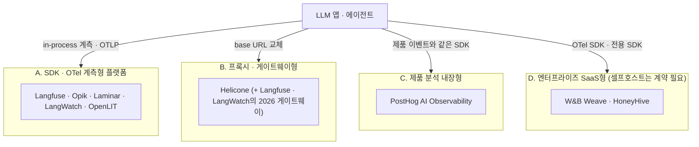

| 원형 | 데이터 획득 지점 | 장점 | 한계 | 해당 도구 |
|---|---|---|---|---|
| **A. SDK·OTel 계측형** | 앱 프로세스 안(데코레이터·자동계측·OTLP) | span 트리·툴 호출·리트리버까지 세밀하게 잡는다. 벤더 중립(OTel) | 코드 변경이 필요하다. 계측 라이브러리 품질에 좌우된다 | Langfuse, Opik, Laminar, LangWatch, OpenLIT |
| **B. 프록시·게이트웨이형** | 네트워크 경로(LLM API 앞단) | 코드 무수정, 언어 무관. 캐시·레이트리밋·예산을 같은 지점에서 처리 | 비-LLM 스텝(툴·검색)이 보이지 않는다. 호출 경로에 홉이 추가된다 | Helicone (Langfuse·LangWatch는 A+B 겸용) |
| **C. 제품 분석 내장형** | 제품 이벤트 파이프라인(`$ai_*` 이벤트) | 사용자·세션 리플레이·실험과 같은 ID 공간에 있어 "LLM 변경이 전환율에 준 영향"을 바로 조회 | span 원형을 보존하지 않는다. OTel 수용 범위가 좁고 셀프호스트가 무겁다 | PostHog |
| **D. 엔터프라이즈 SaaS형** | OTel SDK(HoneyHive)·전용 SDK(Weave) | 거버넌스·컴플라이언스, 대형 벤더 생태계(ML 학습·Elastic) | 서버 코드가 비공개다. 셀프호스트는 엔터프라이즈 계약과 K8s가 필요하다 | W&B Weave, HoneyHive |

> 2026년의 큰 흐름은 **A와 B의 융합**이다. 계측형 플랫폼이 게이트웨이를 붙이면서(Langfuse·LangWatch) "앱이 계측한 trace"와 "게이트웨이를 지난 모든 호출(코딩 에이전트 포함)"을 **같은 스키마**로 저장한다. 반대로 순수 프록시형(Helicone)은 시장에서 밀려났다.

---

## 2. 2026 지형 변화 — 소유권·라이선스 타임라인

| 시점 | 이벤트 | 영향 |
|---|---|---|
| 2025-05-05 | **CoreWeave**, Weights & Biases 인수 종결 (~$1.7B) | Weave가 CoreWeave 학습·추론 사업의 피드백 수집 계층으로 재배치되기 시작 |
| 2026-01-16 | **ClickHouse**, Langfuse 인수 ($400M Series D 동시 발표) | MIT core 유지. Helm v2가 공식 ClickHouse operator로 전환. Self-Hosted Government(FIPS) 티어 추가 |
| 2026-03-03 | **Mintlify**, Helicone 인수 → 유지보수 모드 | 신규 가입 차단, 커밋 대부분이 보안 패치 |
| 2026-03-16 | Laminar $3M Seed (Atlantic.vc 리드) | 같은 해 11월 open-core(ELv2 EE)로 수익화 |
| 2026-04-08 | LangWatch v3.0 — OpenSearch 제거, ClickHouse + 이벤트 소싱 | 셀프호스트 스토어가 4종에서 3종으로 줄어듦 |
| 2026-04-20 | Opik 2.0 — 모든 엔티티를 project 스코프로 재편 | 하위호환이 깨짐. 셀프호스트는 마이그레이션 잡 6개 필요 |
| 2026-06-29 | LangWatch AI Gateway(3.5.0) | 관측 + 게이트웨이 + 거버넌스 통합 노선 |
| 2026-07-29 | Langfuse **v4.0.0** OSS GA (단일 `events_full` 테이블) | Cloud는 2026-11-16부터 v4 전용, 11-19에 v3 API 제거 |
| 2026-08~10 | **Dynatrace**, Arize 인수 ($915M, 10-01 종결) | (비교 대상 외) Phoenix·AX는 유지 발표 |
| 2026-09-30 | **CoreWeave Forge** 출시, W&B 계정 로그인이 Forge로 이전 | 문서·가격 페이지가 coreweave.com으로 이동 |
| 2026-10-13 | **W&B Weave trace 서버를 비공개 `wandb/core`로 이전** | 공개 저장소에는 SDK와 mock 서버만 남음. 마지막 공개 서버 코드는 v0.53.12 |
| 2026-10-18 | Helicone "더 이상 Mintlify 소속 아님" | — |
| 2026-11-04 | Langfuse **AI Gateway** public beta (Rust, MIT) | 계측 없는 트래픽(코딩 에이전트 등)도 trace로 수집 |
| 2026-11-10 | Laminar v0.3.4 — **ELv2 Enterprise Edition** | Signals·클러스터링·알림이 EE 전용 |
| 2026-11-11 | Helicone → **Experiential Labs**(YC S26) 소유로 이전 | 조건·로드맵 비공개 |
| 2026-11-19 | **Elastic**, HoneyHive 인수 계약 발표 (미종결) | Elastic Observability로 통합 예정. ClickHouse 기반 스택의 존속 여부는 *(미확인)* |

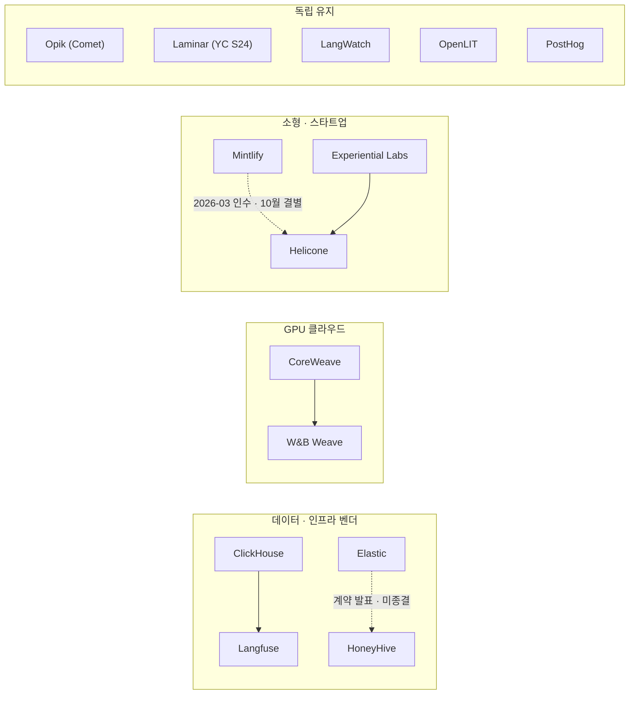

**라이선스 방향 정리**

| 방향 | 도구 | 내용 |
|---|---|---|
| 개방 유지·확대 | Opik | 플랫폼 전체 Apache-2.0, `ee/` 없음(Ollie 런타임·Cost Intelligence 데몬은 저장소에 없음) |
| 개방 유지·확대 | Langfuse | MIT core 유지. 인앱 에이전트 Halo를 EE에서 MIT로 이동, AI Gateway도 MIT |
| open-core 신설 | Laminar | 2026-11 ELv2 EE: Signals·클러스터링·Slack/이메일 알림 |
| open-core 신설 | OpenLIT | 비공개 `openlit-enterprise`: 커스텀 역할·감사 로그·외부 알림 채널 |
| open-core 유지 | LangWatch | `enterprise/`: SSO·SCIM·Governance 등. 무라이선스도 볼륨 무제한 |
| open-core 유지 | PostHog | `ee/`: 일부 AI 부가기능이 `ee/hogai` 의존 |
| 폐쇄 전환·유지 | W&B Weave | 서버 비공개 전환(2026-10). SDK만 Apache-2.0 |
| 폐쇄 전환·유지 | HoneyHive | 처음부터 폐쇄. SDK(MIT)·CLI·OpenAPI만 공개 |

---

## 3. 스냅샷 비교표

| 도구 | 저장소 · 최신 버전 | 소유 · 펀딩 | 호스팅 옵션 | 가격 (무료 → 첫 유료) |
|---|---|---|---|---|
| Langfuse | `langfuse/langfuse` · **v4.84.0** (2026-11-23) | ClickHouse, Inc. | Cloud(EU·US·JP·HIPAA) / OSS self-host / EE 라이선스 / Self-Hosted Government | 50k units/월 무료 → Core $29/월 |
| Helicone | `Helicone/helicone` · 마지막 GitHub release·공개 이미지 **2025-08-21** | Experiential Labs (YC S26) | Cloud(신규 가입 차단) / self-host compose·all-in-one | 10k req/월 무료 → Pro $79/월 |
| Opik | `comet-ml/opik` · **2.2.155** (2026-11-23), 2.3.0 컷 중 | Comet ML (독립) | Cloud / OSS 풀 플랫폼 / Enterprise(on-prem·전용) | 25k spans/월 무료 → Pro $19/월 |
| Laminar | `lmnr-ai/lmnr` · **v0.3.4** (2026-11-10) | LMNR AI, $3M Seed | Cloud / OSS compose / Helm / EE 라이선스 / Managed self-hosting / Hybrid 데이터플레인 | 1GB 무료 → Pro $30/월 |
| W&B Weave | `wandb/weave`(SDK) · **0.54.1** (2026-11-05), W&B Server 0.86 | CoreWeave 자회사 | SaaS / Dedicated / Self-Managed(Weave 라이선스) / BYOB | 1GB/월 무료 → Pro $60/월 (초과 $0.10/MB) |
| PostHog | `PostHog/posthog` · 연속 배포(태그 없음), Python SDK 8.2.1 | PostHog Inc. | Cloud US/EU / hobby self-host(무지원) | AI 이벤트 100k/월 무료 → $0.00035/event부터 |
| OpenLIT | `openlit/openlit` · **2.2.0** (2026-11-19) | OpenLIT (소규모) | self-host CE / EE 라이선스 / Cloud 미출시 | CE 무료, EE 문의 |
| LangWatch | `langwatch/langwatch` · **3.28.0** (2026-11-23) | Reasoning Engine B.V., €1M pre-seed | Cloud / Self-managed(compose·Helm·npx) / Cloud Enterprise / Hybrid | 50k events/월 무료 → Growth €29/seat/월 |
| HoneyHive | 플랫폼 비공개 · SDK **v1.9.0** (2026-11-18), Helm CP 1.12.1·DP 1.13.2 | HoneyHive → Elastic(인수 계약) | SaaS / Dedicated / Hybrid(Federated) / Self-host(Enterprise, EKS 전용) | 10k events/월 무료 → Enterprise 견적 |

---

## 4. 기능 비교 매트릭스

### 4.1 채점 기준

0 = 없음, 1 = 기본, 2 = 충실, 3 = 세트 내 최상급. **제품 전체(Cloud·EE 포함) 기준**으로 채점했다. OSS 셀프호스트에서 빠지는 기능은 [§4.3](#43-oss-셀프호스트에서-빠지는-기능-게이트)에 따로 정리했다.

- **SelfHostEase**
  - 3: 컨테이너 3개 이하, 상태 저장소 2종 이하
  - 2: 단일 명령 compose, 컨테이너 7개 안팎, 스토어 4종 이하
  - 1: 무겁거나(스토어 5종 이상) 프로덕션 비권장
  - 0: 엔터프라이즈 계약 없이는 불가
- **OSSOpenness**
  - 3: 플랫폼 전체가 허용형 OSS
  - 2: OSS core + 상용 디렉터리
  - 1: SDK만 OSS이고 서버 코드는 과거본만 공개
  - 0: 플랫폼 폐쇄

### 4.2 점수표

| 기능 | Langfuse | Helicone | Opik | Laminar | Weave | PostHog | OpenLIT | LangWatch | HoneyHive |
|---|:-:|:-:|:-:|:-:|:-:|:-:|:-:|:-:|:-:|
| Tracing | 3 | 2 | 3 | 3 | 3 | 2 | 2 | 3 | 2 |
| Agent tracing | 3 | 1 | 3 | 3 | 3 | 2 | 2 | 3 | 3 |
| Offline eval | 3 | 1 | 3 | 2 | 3 | 2 | 1 | 3 | 3 |
| Online eval | 3 | 1 | 3 | 2 | 3 | 3 | 2 | 3 | 3 |
| Prompt mgmt | 3 | 2 | 2 | 1 | 2 | 2 | 2 | 2 | 2 |
| Datasets · Experiments | 3 | 1 | 3 | 2 | 3 | 2 | 1 | 3 | 3 |
| Human annotation | 3 | 1 | 2 | 2 | 2 | 2 | 1 | 2 | 3 |
| Gateway · Proxy | 2 | 3 | 1 | 0 | 0 | 1 | 0 | 3 | 0 |
| Cost tracking | 3 | 3 | 2 | 2 | 2 | 3 | 2 | 3 | 2 |
| Dashboards | 2 | 2 | 2 | 3 | 2 | 3 | 3 | 2 | 2 |
| Alerts | 2 | 2 | 2 | 2 | 2 | 2 | 2 | 2 | 3 |
| OTel native | 3 | 1 | 2 | 3 | 2 | 1 | 3 | 3 | 2 |
| Self-host ease | 2 | 1 | 1 | 2 | 0 | 1 | 3 | 2 | 0 |
| Product analytics | 1 | 1 | 1 | 1 | 1 | 3 | 1 | 1 | 1 |
| OSS openness | 2 | 3 | 3 | 2 | 1 | 2 | 2 | 2 | 0 |
| **합계 (정렬용)** | **38** | **25** | **33** | **30** | **29** | **31** | **27** | **37** | **29** |

> 합계는 정렬용이다. 15개 항목에 같은 가중치를 준 단순 합이라 "어느 도구가 더 좋다"는 뜻이 아니다. PostHog의 제품 분석 3점이나 Helicone의 게이트웨이 3점처럼 **단일 항목이 결정적인 경우**가 많다.

**점수 근거 하이라이트**

- **Langfuse**: 평가 루프 전 항목 3점. code evaluator 실행기 3종, observation 단위 LLM-judge, 버전 관리되는 prompt + skill, annotation queue + corrected output. 게이트웨이는 beta이고 fallback·캐시가 없어 2점.
- **Helicone**: 게이트웨이(엣지 캐시·레이트리밋·폴백·키 vault)와 비용(나노달러 정수 저장)은 3점. span 트리 모델이 아니고 Experiments(2025-09)와 Python evaluator가 제거돼 평가 항목은 1점.
- **Opik**: 40여 메트릭, Test Suite(assertion), 온라인 규칙(LLM·Python 코드), Agent Optimizer 6종 알고리즘. SDK가 OTel이 아닌 자체 REST 배치라 OTel 2점.
- **Laminar**: SQL 에디터·SQL 대시보드 3점. 런타임 프롬프트 레지스트리가 없어 Prompt 1점, 게이트웨이 0점.
- **W&B Weave**: Evaluation 비교 UI·Leaderboard·Monitors·Signals로 평가 3점. 서버 비공개와 엔터프라이즈 전용 셀프호스트로 운영 항목 0~1점.
- **PostHog**: 제품 분석 유일 3점. 비용 계산(모달리티·캐시 TTL·웹검색, "unknown ≠ $0")과 HogQL 대시보드 3점. OTLP는 traces만 받고 OpenInference를 지원하지 않아 1점.
- **OpenLIT**: OTLP gRPC·HTTP 수신과 최신 `gen_ai.*` 추종으로 OTel 3점. 커스텀 대시보드 빌더 3점. 데이터셋·실험 기능이 없어 1점.
- **LangWatch**: 게이트웨이(가상 키·예산·가드레일·routing·A2A) 3점. 18+ semconv canonicaliser로 OTel 3점. Scenario 시뮬레이션·red team으로 오프라인 평가 3점.
- **HoneyHive**: Alerts(threshold·drift·severity·전용 Notification Service)와 annotation queue 자동 라우팅 3점. 플랫폼 폐쇄로 개방성 0점.

### 4.3 OSS 셀프호스트에서 빠지는 기능 (게이트)

| 도구 | 셀프호스트 무료로 쓰는 것 | 상용 라이선스·Cloud 전용 |
|---|---|---|
| Langfuse | trace·eval(LLM·code)·prompt·skill·dataset·annotation·alerts·gateway·Halo, 사용량 무제한 | project-level RBAC, SCIM, audit log, data retention, server-side masking, protected prompt label |
| Helicone | 전 기능 (Apache-2.0) | — (단, 프로덕션 등가 구성은 Cloudflare Workers·AWS SQS 의존) |
| Opik | 전 기능: 온라인 규칙·가드레일·옵티마이저·알림·대시보드 | Ollie 에이전트 런타임, Diagnostics, Cost Intelligence, SSO·RBAC·SLA |
| Laminar | tracing·SQL·대시보드·평가·데이터셋·라벨링·브라우저 리플레이 | **Signals(온라인 판정)·클러스터링·Slack/이메일 알림**·Laminar Agent·SSO/SCIM·audit (ELv2) |
| W&B Weave | (셀프호스트 자체가 엔터프라이즈 라이선스) | 전체 |
| PostHog | AI observability 코어(MIT) | `ee/` 의존 기능(trace 요약 임베딩·일부 MaxTool), 고객용 AI Gateway(미GA) |
| OpenLIT | trace·eval·prompt hub·vault·대시보드·실시간 threshold finding | 커스텀 역할, 감사 로그, **외부 알림 채널**(Slack·PagerDuty 등), Datadog·New Relic 소스 |
| LangWatch | 전 기능, 볼륨·사용자 무제한 | SSO·RBAC·SCIM·감사 로그·Governance anomaly rules·게이트웨이 webhook |
| HoneyHive | (셀프호스트 자체가 엔터프라이즈 계약) | 전체 |

---

## 5. 인프라 구성 비교

### 5.1 공통 참조 아키텍처

9개 도구의 수집 경로는 세부 구현은 달라도 다음 골격으로 수렴한다. **수신(ingest) → 내구 버퍼(S3·큐) → 워커 → ClickHouse(OLAP) + RDB(OLTP)**.

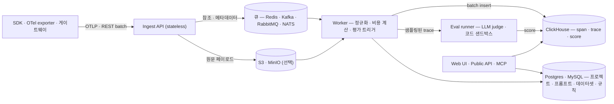

| 레이어 | 역할 | 도구별 선택 |
|---|---|---|
| **OLAP (trace 저장)** | 대용량 span 집계·필터·검색 | **ClickHouse 9/9** |
| **OLTP (메타데이터)** | 조직·프로젝트·프롬프트·데이터셋·평가 규칙·API key | Postgres(Langfuse·Helicone·Laminar·PostHog·LangWatch·HoneyHive), MySQL(Opik·Weave), SQLite(OpenLIT) |
| **큐 · 버퍼** | 수신과 쓰기 분리, 버스트 흡수, 평가 트리거 | Redis BullMQ(Langfuse), Redis group-queue(LangWatch), Redis Streams(Opik), RabbitMQ(Laminar FULL), Kafka·Redpanda(PostHog·Weave 평가), NATS JetStream(HoneyHive·OpenLIT 알림), SQS(Helicone Cloud) |
| **오브젝트 스토리지** | 원문 배치·미디어·첨부·cold tier | S3·MinIO(Langfuse·Helicone·Opik·HoneyHive·Weave), SeaweedFS(PostHog, Langfuse Helm), 선택(Laminar·LangWatch) |
| **검색 엔진** | span 풀텍스트 | Quickwit(Laminar). 나머지는 ClickHouse text·ngram bloom index로 대체(LangWatch는 2026-04 OpenSearch 제거) |
| **코디네이션** | ClickHouse 복제·분산 락 | ZooKeeper(Opik·PostHog), ClickHouse Keeper(Weave·HoneyHive·Langfuse Helm), etcd(PostHog PersonHog) |

### 5.2 셀프호스트 구성 요약

| 도구 | 공식 기본 방식 | 컨테이너 | 상태 저장소 | 최소·권장 리소스 | K8s · IaC | 운영상 주의 |
|---|---|---|---|---|---|---|
| **Langfuse** | `docker compose up` | **7** (web·worker·ai-gateway·ClickHouse·MinIO·Redis·Postgres). 게이트웨이를 빼면 6 | **4** | web·worker 각 ≥2 CPU / 4 GB | Helm v2(공식 ClickHouse operator alpha + Keeper, SeaweedFS, Valkey), Terraform AWS·GCP·Azure | ClickHouse ≥25.12, Redis `noeviction`, 전 컴포넌트 UTC, v4 backfill 시 디스크 ~3배 |
| **Helicone** | `helicone-compose.sh helicone up` | **9** (상시 7 + one-shot 2). 프록시 워커 5개 별도, 풀 구성 16 | **4** (+Kafka 선택) | 미공개 | `helicone-helm-v3`(2025-09 이후 미갱신) | 공개 이미지 2025-08 이후 미갱신(보안 패치는 소스 빌드). self-host 프록시는 `wrangler dev --local` 개발 서버 |
| **Opik** | `./opik.sh` | **8** (+one-shot 4) | **5** (ClickHouse·MySQL·Redis·MinIO·ZooKeeper) | dev 4 vCPU/8 GB, prod 13 vCPU/32 GB | Helm + Altinity operator, 백업·cold tier 잡 | python-backend가 **privileged**(DinD 샌드박스). JVM 메모리 큼 |
| **Laminar** | `docker compose up` (LITE) | **5** (FULL 7) | **3** (PG·CH·Quickwit), FULL은 +RabbitMQ·Valkey = 5 | 미공개 (데이터플레인 차트 2 vCPU/4 GB) | `lmnr-helm`(S3 필수), `lmnr-helm-dataplane`(Hybrid), Terraform provider | LITE는 인메모리 큐라 재시작 시 유실 가능. Quickwit 0.9 업그레이드는 비가역 |
| **W&B Weave** | W&B Server Self-Managed (Helm operator) | **~15–25 pods** (W&B 플랫폼 + Weave 서비스 5 + CH 3 + Keeper 3) | **4–5** (MySQL·Redis·오브젝트·ClickHouse+Keeper, +Kafka/Bufstream) | Weave 최소 7 pods ≈ 4.5–15 CPU / 7.8–58 Gi / 180 Gi | `operator-wandb` Helm, `terraform-aws-wandb` 등 | **Weave 라이선스 필수**, K8s 1.34+, **x86만**, 유효 TLS 필수 |
| **PostHog** | `bin/deploy-hobby` (hobby compose) | **47** (init ~5 포함) | **9** (Postgres·Redis·Valkey·ClickHouse·ZooKeeper·Redpanda·SeaweedFS×2·etcd) | **8 GB+** RAM, ~100k events/월 권장 상한 | Helm **sunset**, Terraform 없음 | 지원·보증 없음, 버전 태그 없음(`latest`). LLM 관측만 원하면 과잉 |
| **OpenLIT** | `docker compose up` | **3** (ClickHouse·NATS·openlit) | **2** (ClickHouse + 내장 SQLite) + NATS 휘발 버퍼 | Helm 기본 limit 2 CPU / 2 Gi | Helm(1.24.0, 앱 2.2.0보다 뒤처짐), eBPF controller 차트 | 앱 메타데이터가 SQLite라 **단일 replica**. OTLP 무인증 수신·익명 텔레메트리가 기본 on |
| **LangWatch** | `docker compose up` / `npx @langwatch/server` | **7** (app·workers·nlp·langevals·PG·Redis·CH) | **3** | 4 CPU / 8 GB (prod 4 CPU/16 GB, HA 3노드) | Helm overlay(size × access × infra), ~10 워크로드 | 2026년에만 ES→CH, Next.js→Hono, Python→Go 전환. 업그레이드 hook 최대 45분 |
| **HoneyHive** | Enterprise Helm (CP·DP 차트) on **AWS EKS** | **~11 앱 서비스 + stateful → 15–25+ pods** | **5종·8 인스턴스** (PG×2·Redis×2·NATS×2·ClickHouse+Keeper·S3) | 미공개("support 문의") | `hive-control-plane`·`hive-data-plane`·`chi-installation` Helm, 비공개 Terraform | 엔터프라이즈 계약 + license 파일, 필수 operator 4종(Altinity·NACK·Prometheus CRD·EBS CSI) |

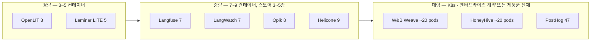

### 5.3 데이터스토어 매트릭스

● 필수 · ○ 선택·대체 · – 사용 안 함

| 도구 | ClickHouse | PostgreSQL | MySQL | SQLite | Redis·Valkey | 메시지 큐 | 오브젝트 스토리지 | 검색 엔진 | 코디네이션 |
|---|:-:|:-:|:-:|:-:|:-:|:-:|:-:|:-:|:-:|
| Langfuse | ● | ● | – | – | ● (BullMQ 겸용) | – | ● | – | ○ (Helm Keeper) |
| Helicone | ● | ● | – | – | ● | ○ (SQS·Kafka) | ● | – | – |
| Opik | ● | – | ● | – | ● (Streams 겸용) | – | ● | – | ● (ZooKeeper) |
| Laminar | ● | ● | – | – | ○ (FULL) | ○ (RabbitMQ, FULL) | ○ (Helm 필수) | ● (Quickwit) | – |
| W&B Weave | ● | – | ● | – | ● | ○ (Kafka·Bufstream, 온라인 평가) | ● | – | ● (Keeper) |
| PostHog | ● | ● | – | – | ● | ● (Redpanda) | ● (SeaweedFS) | – | ● (ZooKeeper·etcd) |
| OpenLIT | ● | – | – | ● | – | ○ (NATS, 실시간 알림) | – | – | – |
| LangWatch | ● | ● | – | – | ● (group-queue 겸용) | – | ○ (cold tier) | – | ○ (복제 시 Keeper) |
| HoneyHive | ● | ● (×2) | – | – | ● (×2) | ● (NATS×2) | ● | – | ● (Keeper) |

**읽는 법**

- **ClickHouse는 9/9**다. Langfuse가 ClickHouse에 인수되고 Helm이 공식 ClickHouse operator로 바뀐 것, Weave·HoneyHive·Opik이 Altinity operator를 쓰는 것 모두 같은 흐름이다.
- **별도 큐를 두지 않는 쪽**(Langfuse·Opik·LangWatch)은 Redis에 큐 역할까지 맡기고, Langfuse는 원문을 S3에 먼저 쓴다. **전용 큐를 두는 쪽**(PostHog Kafka, HoneyHive NATS, Laminar RabbitMQ)은 처리량과 격리를 얻는 대신 운영 컴포넌트가 늘어난다.
- **OpenLIT만 RDB가 없다**(SQLite). 대신 앱 데이터(프롬프트·vault·평가)까지 ClickHouse에 두기 때문에 앱을 수평 확장할 수 없다.
- **전문 검색 엔진**을 따로 두는 것은 Laminar(Quickwit)뿐이다. 나머지는 ClickHouse의 text index(Langfuse v4), ngram bloom(Helicone·Weave), LWQL(LangWatch)로 해결한다.

### 5.4 수집(ingestion) 파이프라인 패턴 비교

| 도구 | 수집 프로토콜 | 버퍼 · 큐 | 쓰기 방식 | 원문(프롬프트·응답) 저장 | 내구성 포인트 |
|---|---|---|---|---|---|
| Langfuse | OTLP/HTTP(`/api/public/otel/v1/traces`)만. v4에선 사실상 단일 경로 | **S3에 원문 배치 → Redis BullMQ에는 fileKey만** | worker가 1000 rows·1초 단위로 `events_full` batch insert, MV가 `events_core` 생성 | S3 + ClickHouse `events_full`(ZSTD) | ClickHouse 장애 중에도 S3에 남는다. 대신 S3가 hot path에 들어간다 |
| Helicone | 프록시(Cloudflare Worker) + REST + 레거시 OpenLLMetry JSON | Cloud: SQS(·Kafka). self-host: **큐 없이 Jawn으로 HTTP 직접** | Jawn 14단 Chain-of-Responsibility → PG·S3·CH 병렬 기록 | ≤10MB는 ClickHouse(본문 TTL 3개월), 초과분은 S3 | 응답 후 `ctx.waitUntil` 비동기 로깅 → 로그 장애가 트래픽 장애로 번지지 않는다 |
| Opik | 자체 REST batch(`/v1/private/traces/batch`) + OTLP/HTTP | 서버 큐 없음. **SDK가 로컬 SQLite에 실패분 보관 후 재전송** | ClickHouse `async_insert=1`, Guava EventBus → Redis Streams로 온라인 평가 fan-out | ClickHouse + MinIO(첨부) | OTel traceId → UUIDv7 매핑을 Redis에 둔다. Redis 장애 시 trace가 쪼개질 수 있다 |
| Laminar | OTLP gRPC(8001)·HTTP(8000) | FULL: RabbitMQ(+Streams). LITE: tokio mpsc 인메모리 | consumer batch, trace는 `traces_agg`·`traces_static` **델타 쓰기**(read-before-write 없음) | ClickHouse `unique_content`: **메시지 단위 BLAKE3 dedup** | Redis seen-mark가 dedup 정합성의 일부다. LITE는 재시작 시 유실 가능 |
| W&B Weave | 자체 REST(`calls/complete`) + OTLP 2종(`/otel/v1/traces`, `/agents/otel/v1/traces`) | 쓰기 경로 큐 없음. **Kafka는 평가 트리거 전용**(commit 후 best-effort) | SDK가 start·end를 짝지어 **1 call = 1 row** → `calls_complete` async insert | ClickHouse(`files` 테이블) 또는 BYOB 버킷 | 큐가 죽어도 수집은 성공한다. 대신 Monitor 점수가 누락될 수 있다 |
| PostHog | `/i/v1/ai/events` + OTLP(`/i/v0/ai/otel`, traces만) | **전용 `capture-ai`(Rust) → Kafka(Redpanda)** | Node AI 파이프라인(비용 계산·blob offload) → **이중 쓰기**: `events`(본문 제거) + `ai_events`(전체) | `ai_events` 기본 **30일 TTL**(30~365), 미디어는 S3 `phaiblob://` | AI lane을 일반 제품 이벤트와 완전히 격리(capture·토픽·overflow·CH 위성 클러스터) |
| OpenLIT | OTLP gRPC(4317)·HTTP(4318) traces·metrics·logs | **큐 없음(동기 insert)**. NATS는 insert 성공 후 알림 fan-out에만 쓴다 | Go receiver가 API key로 테넌트 ClickHouse를 정해 `otel_traces`에 batch insert | ClickHouse `otel_traces`(기본 TTL ~30일) | 백프레셔가 클라이언트로 전파된다. 앞단에 OTel Collector를 두는 것을 권장 |
| LangWatch | OTLP/HTTP traces·logs·metrics + 레거시 collector | **Redis group-queue**(tenant·aggregate FIFO) | **이벤트 소싱**: `event_log` append → projection(`stored_spans`·`trace_summaries`·analytics) | ClickHouse `stored_spans`(OTel 원형), cold tier S3 | projection을 재빌드하고 비용을 재계산할 수 있다(가격표 수정 후 replay) |
| HoneyHive | OTLP HTTP(json 기본)·gRPC(`/opentelemetry/v1/traces`) | **NATS JetStream**(CP `events.>`, DP `evaluation.>`) | DP Ingestion이 즉시 ack → CP Writer가 enrichment 후 ClickHouse batch, 실패분은 S3 DLQ | **DP S3**(원문) / CP ClickHouse(메타·지표) | at-least-once, plane 분리로 데이터 거주성 확보 |

### 5.5 ClickHouse 스키마 설계 비교

| 도구 | 핵심 테이블 · 엔진 | 정렬 키 · 파티션 | 설계 포인트 |
|---|---|---|---|
| Langfuse v4 | `events_full` — ReplacingMergeTree(event_ts, is_deleted) + MV `events_core` | `ORDER BY (project_id, toStartOfMinute(start_time), xxHash32(trace_id), span_id, start_time)`, 월 파티션, `SAMPLE BY`, FTS index | v3의 traces·observations join + `FINAL` dedupe를 없애고 **span 1행 append-only**로 전환. trace 속성은 SDK가 모든 span에 비정규화한다 |
| Helicone | `request_response_rmt` — ReplacingMergeTree(updated_at) | `(organization_id, provider, model, user_id, request_created_at, request_id)` | 요청 단위 와이드 테이블. 비용은 `UInt64` 나노달러. HQL용 **ROW POLICY**로 테넌트 격리 |
| Opik | `traces_local_v2`·`spans_local_v2` — ReplicatedReplacingMergeTree(last_updated_at, is_deleted) | `ORDER BY (workspace_id, project_id, id)`, **`toMonday(UUIDv7 시각)` 주 파티션** | 불변 id에서 파티션을 유도해 업데이트(재삽입)가 항상 같은 파티션에 떨어진다. cold S3 tier |
| Laminar | `spans`(MergeTree) + `traces_agg`(AggregatingMergeTree) + `traces_static`(**CoalescingMergeTree**) | `(project_id, start_time, trace_id, span_id)` | trace는 델타로만 쓰고 뷰에서 GROUP BY로 접는다(`FINAL` 금지). 사용자 SQL은 project-scoped 파라미터화 뷰로 재작성한다 |
| W&B Weave | `calls_complete` ReplacingMergeTree + `spans`(GenAI semconv **정규 컬럼화**) | `(project_id, started_at, id)`, 월 파티션, TTL | `gen_ai.*`를 타입 컬럼으로 펼치고 MV로 에이전트·메시지 집계. v1(`call_parts`→`calls_merged`)에서 v2로 무중단 이행 |
| PostHog | `events`(본문 제거본) + `sharded_ai_events` MergeTree | `(team_id, trace_id, timestamp)`, trace 단위 샤딩, `TTL drop_date` | Kafka 헤더로 팀별 보존 기간을 전달한다. 읽기는 `ai_events`를 먼저 보고 없으면 `events`로 fallback |
| OpenLIT | `otel_traces` MergeTree (OTel ClickHouse exporter 호환) | `(ServiceName, SpanName, toDateTime(Timestamp))`, 일 파티션, TTL 730h | OTel 표준 스키마를 그대로 쓴다. 프롬프트·vault·평가 같은 앱 데이터도 ClickHouse에 둔다 |
| LangWatch | `event_log` ReplacingMergeTree(EventTimestamp) → projections | `(TenantId, AggregateType, AggregateId, IdempotencyKey)` | ClickHouse를 **이벤트 스토어**로 쓴다. IdempotencyKey로 재전송 중복을 흡수한다 |
| HoneyHive | `events` ReplacingMergeTree + `session_aggregates` AggregatingMergeTree | *(미확인)* | 문서 기준. 본문은 DP S3, 메타·지표는 CP ClickHouse에 둔다 |

> **공통 교훈**: "trace는 업데이트된다(start → end, 점수 부착)"는 문제를 각자 다르게 푼다.
> - **ReplacingMergeTree 재삽입**: Opik·Helicone·Weave v1
> - **클라이언트에서 start·end를 합쳐 한 번만 쓰기**: Weave v2·Langfuse v4
> - **델타 집계**: Laminar
> - **이벤트 로그 + projection**: LangWatch
>
> 공통 목표는 읽기 시점의 `FINAL`·join 비용을 없애는 것이다.

### 5.6 배포 모델 매트릭스

| 도구 | Cloud (멀티테넌트) | OSS 셀프호스트 | 상용 셀프호스트 | Hybrid (데이터만 고객 측) | BYOC·관리형 |
|---|:-:|:-:|:-:|:-:|:-:|
| Langfuse | ● | ● | ● (EE·Government) | – | *(미확인)* |
| Helicone | ● (가입 차단) | ● | – | – | – |
| Opik | ● | ● | ● | – | ● (Comet 관리 전용 배포) |
| Laminar | ● | ● | ● (ELv2) | ● (`lmnr-helm-dataplane`) | ● (Managed self-hosting) |
| W&B Weave | ● | – | ● (Self-Managed) | ○ (BYOB: 미디어만) | ● (Dedicated) |
| PostHog | ● | ● (hobby, 무지원) | – | – | – |
| OpenLIT | – (미출시) | ● | ● (EE) | – | – |
| LangWatch | ● | ● | ● (enterprise) | ● (고객 VPC에 ClickHouse+S3) | ● (Cloud Enterprise) |
| HoneyHive | ● | – | ● (EKS) | ● (Federated: CP는 HoneyHive, DP는 고객) | ● (BYOC·BYOVPC) |

---

## 6. 도구별 심층

### 6.1 Langfuse — OTel 네이티브 풀 루프 플랫폼 (ClickHouse 소유)

**포지셔닝 변화**: 2026-11 저장소 설명은 "Open source AI engineering platform: **AI Gateway, agent observability, evals, and prompt/skill management**, built on OpenTelemetry"다. 앱 개발자가 계측하는 트레이싱 도구에서 **회사의 모든 AI 호출**(Claude Code·Codex 같은 코딩 에이전트 포함)이 지나가는 플랫폼으로 넓어졌다. v4부터는 trace 중심에서 **observation(span) 중심**으로 데이터 모델이 바뀌었다.

**핵심 특징**
- **Tracing**: observation type 10종(SPAN·GENERATION·AGENT·TOOL·CHAIN·RETRIEVER·EVALUATOR·EMBEDDING·GUARDRAIL·EVENT), session·user·environment, full-text search(v4), agent graph.
- **Evals**: observation 단위 LLM-as-judge, code evaluator(실행기 `insecure-local`·`aws-lambda`·외부 HTTP), 평가 규칙의 7일치 매칭량·비용 미리보기, annotation queue와 corrected output.
- **Prompt + Skill 관리**: 버전·라벨 배포, prompt dependency. 2026-11 기본 활성화된 **Skill Management**는 `SKILL.md`와 부속 파일을 버전 관리하고, trace에 어떤 skill이 로드됐는지 기록한다.
- **AI Gateway (beta)**: Rust/axum로 만든 stateless relay. OpenAI·Anthropic native 포맷을 그대로 중계하고, per-key·per-user·org 예산을 건다. 자기 기록은 **Langfuse 자신의 OTLP 엔드포인트로 올리기 때문에** 게이트웨이 로그가 일반 trace와 같은 스키마다.
- **그 외**: Alerts(Slack·PagerDuty·webhook), Halo(인앱 에이전트, Mastra 기반, MIT), Topics(trace 클러스터링, early access), 내장 MCP 서버, CLI.

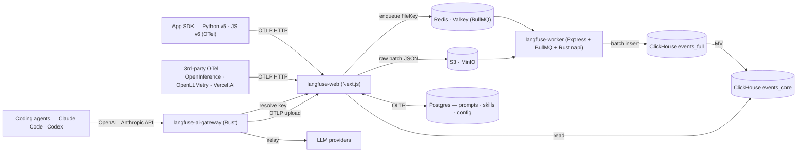

**인프라**: compose 7 컨테이너(`langfuse:4`, `langfuse-worker:4`, `ai-gateway:4`, ClickHouse 26.3, MinIO, Redis 7, Postgres 17)와 4 스토어. Helm v2는 Bitnami를 버리고 **공식 ClickHouse operator(ClickHouseCluster·KeeperCluster CR, alpha)**·SeaweedFS·Valkey로 바뀌었다. 확장 방법은 web·worker HPA, `QUEUE_CONSUMER_*_IS_ENABLED`로 워커 역할 분리, ClickHouse cluster 모드다.

**코드 레벨 포인트**
- **S3-first, 큐에는 참조만** (`packages/shared/src/server/otel/OtelIngestionProcessor.ts`). web은 파싱·검증 후 원문을 S3에 쓰고 BullMQ에는 `fileKey`만 넣는다. Redis 메모리가 페이로드 크기와 무관해진다.
- **v4 wide immutable 테이블** (`clickhouse/migrations/canonical/0039_create_events_full.up.sql`). 읽기 시점 join·`FINAL` 제거가 "최대 165배 빠름" 주장의 근거다. 대가로 SDK 메이저 업그레이드(Py v5·JS v6는 v4 서버 전용)가 강제된다.
- **SDK 헤더 기반 write-path 라우팅** (`worker/src/queues/otelIngestionQueue.ts`). `x-langfuse-ingestion-version: 4` 헤더가 없는 서드파티 OTel exporter는 `dual_write` 모드에서 staging 테이블을 거쳐 **약 15분 지연**된다.
- **TS 모놀리스에 Rust 점진 도입**. 게이트웨이는 별도 Rust 바이너리이고, worker에는 napi-rs로 ClickHouse Native format 인코더와 UMAP·HDBSCAN을 넣었다. 비용 계산 로직이 TS와 Rust에 중복돼 있다.

| 장점 | 단점 |
|---|---|
| MIT core로 사용량 무제한 셀프호스트. Halo·Gateway도 MIT | 7 컨테이너·4 스토어, Helm은 ClickHouse operator(alpha)+Keeper까지 필요 |
| semconv 매핑 폭 최대(gen_ai·OpenInference·OpenLLMetry·Vercel AI·MLflow·Logfire·LiveKit) | OTLP **gRPC 미지원**, OTLP metrics·logs는 no-op |
| 평가·프롬프트·skill·데이터셋·어노테이션·알림·게이트웨이 풀 루프 | v3→v4 마이그레이션 부담(SDK 메이저, trace-level evaluator 재작성, Cloud v3 API 제거) |
| ClickHouse 본가 소유라 최신 ClickHouse 기능(text index, lightweight update)을 바로 쓴다 | S3가 수집 hot path. 게이트웨이는 beta이고 fallback·캐시·라우팅이 없다 |

---

### 6.2 Helicone — 프록시 기반 로깅 + AI 게이트웨이 (⚠️ 유지보수 모드)

**포지셔닝 변화**: README는 "AI Gateway & LLM Observability Platform"이다. **base URL만 바꿔** 로그·비용·지연을 수집하고, 같은 경로에서 캐시·레이트리밋·폴백을 제공한다. 2026-03 Mintlify 인수 후 유지보수 모드로 들어갔고, 2026-10 결별을 거쳐 2026-11 **Experiential Labs**(YC S26, 2인 팀) 소유가 됐다. 2026-03 이후 커밋은 월 1~6건으로 대부분 보안 패치다. 신규 가입은 코드상 차단돼 있다.

**핵심 특징**
- **Gateway**: 프로바이더별 서브도메인 프록시(wrangler route 84개)와 통합 `ai-gateway.helicone.ai`(BYOK·크레딧 결제, 비용순 폴백). Cloudflare KV 엣지 캐시, Durable Object 레이트리밋, Vault, LLM security.
- **Sessions**: `Helicone-Session-Id`/`-Path` 헤더로 경로형 트리를 만든다. 툴 호출은 manual logger로 직접 보내야 한다.
- **비용**: `packages/cost` 모델 레지스트리를 쓰고 ClickHouse `cost UInt64`(나노달러)에 저장한다.
- **HQL**: 사용자에게 ClickHouse SQL을 직접 열어준다(ROW POLICY로 격리).
- **평가 후퇴**: Experiments를 제거했고(2025-09) Python evaluator를 retired했다.

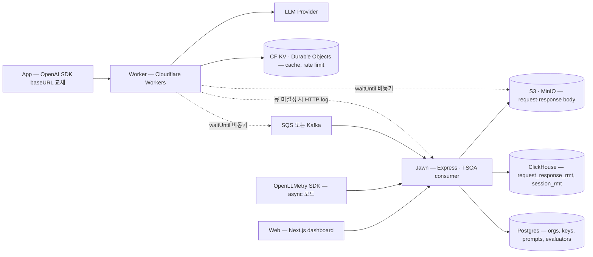

**인프라**: `docker/docker-compose.yml`은 9 컨테이너(Postgres 17.4·ClickHouse 24.3·MinIO·Redis·mailhog·migrations·jawn·web + minio-setup)와 4 스토어다. **프록시는 기본 구성에 없다.** 2026-08 보안 하드닝(INC-657)에서 Jawn의 `/v1/gateway/*` 라우트가 제거됐고, 프록시를 쓰려면 `workers` 프로필(Node 18 위 `wrangler dev --local` 5개)을 추가해야 한다. All-in-one 이미지는 supervisord로 PG·CH·MinIO·Jawn·Web을 한 컨테이너에 넣지만 **2025-08 이후 갱신되지 않았다**.

**코드 레벨 포인트**
- 응답을 먼저 스트리밍하고 로깅은 `ctx.waitUntil(log(...))`로 경로 밖에서 처리한다. 2026-05 AWS 계정 잠금으로 로그 처리가 4일 중단됐을 때도 프록시는 정상 동작했다.
- 큐 메시지에 사용자의 원본 Helicone 키가 평문으로 실린다(Jawn이 메시지마다 재인증). 코드 주석에 "the queue must be treated as secret-bearing"이라고 명시돼 있다.
- 바디 저장 위치를 크기로 나눈다. 10MB 이하는 ClickHouse 컬럼(TTL 3개월 + ngram bloom), 초과분은 S3에 둔다.

| 장점 | 단점 |
|---|---|
| 언어·프레임워크 무관 1줄 통합 | **거버넌스 리스크 최상**: 9개월 사이 소유권 2회 이전, 기능 개발 정지 |
| 세트 내 가장 성숙한 게이트웨이(엣지 캐시·레이트리밋·폴백·vault) | self-host 프록시가 개발 서버 기반. 프로덕션 등가 구성은 Cloudflare·SQS에 종속 |
| 프록시와 로그 파이프라인 분리로 장애 격리 | span 모델이 아니고 OTel은 레거시 OpenLLMetry JSON만 받는다 |
| 전체 Apache-2.0 단일 라이선스 | 2026-02~10 critical·high 취약점 다수 수정 이력(cross-tenant 조회 등) |

---

### 6.3 Opik (Comet) — 평가 중심, 게이트 없는 Apache-2.0

**포지셔닝 변화**: 출발점은 "평가 우선 OSS 관측"이었다. 2026-04 **Opik 2.0**에서 "1 project = 1 agent" 모델로 재편했고, 하반기에는 **디버그 → 수정 → 검증 루프**로 확장했다. Ollie가 trace와 로컬 코드(`opik connect`)를 함께 보고 수정을 제안·재실행하며, 실패 trace를 Test Suite로 박제한다. README는 "the full platform, backend included … all under Apache-2.0 … no Enterprise sales conversation required"를 강조한다.

**핵심 특징**
- **평가**: LLM-judge 계열(Hallucination·AnswerRelevance·G-Eval·LLM Juries·TrajectoryAccuracy 등)과 휴리스틱 20여 종. **Test Suites**는 LLM이 assertion으로 pass/fail을 판정하고 하위 span을 도구로 검사한다. PyTest 통합.
- **온라인 평가 규칙**: trace·span·thread 단위로 LLM-judge·Python 코드 메트릭·Jev 분류기 judge를 실행한다. 샘플링·필터·지출 예산을 걸 수 있다.
- **Agent Optimizer**: Evolutionary·Few-shot Bayesian·**GEPA**·Hierarchical Reflective·MetaPrompt·Parameter. UI에서는 Optimization Studio로 쓴다.
- **Guardrails**: PII(Presidio)·토픽·프롬프트 인젝션·LLM judge·커스텀 파인튜닝 분류기. 선택형 GPU 서버로 띄운다.
- **그 외**: Agent graph, Threads, Annotation Queue(조건 기반 자동 채우기), Alerts(Slack·PagerDuty·webhook), MCP(OAuth 2.1).

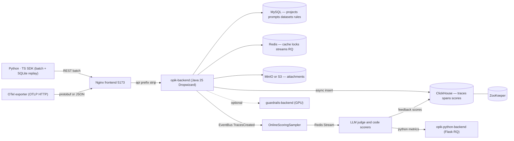

**인프라**: `./opik.sh` 하나로 8개 상시 컨테이너(mysql 8.4·redis 7.2·clickhouse 26.3·zookeeper·minio·backend·python-backend·frontend)와 one-shot 4개, 5 스토어가 뜬다. Helm은 Altinity operator, 백업 CronJob, cold tier(S3) 잡까지 포함한다. **공개된 실운영 레퍼런스**: 일 4–6M traces, 누적 40M traces·250M spans(5 TB)를 Backend 10 pod(3 CPU/5 GB)와 ClickHouse 2 replica(각 30 CPU/230 GB RAM)로 운영하며, ClickHouse CPU는 평균 10–20%다.

**코드 레벨 포인트**
- **OTel traceId → UUIDv7 매핑을 Redis에 TTL로 저장** (`OpenTelemetryService.java`). 파티셔닝을 위해 시간 정렬 id가 필요해서다. Redis 장애 시에는 trace 분할을 감수하고 가용성을 택한다.
- **주 단위 파티션** (`000101_create_traces_local_v2_table.sql`). `PARTITION BY toMonday(id_at)`, `id_at`은 UUIDv7에서 materialize한다.
- **온라인 평가 = 인메모리 EventBus → Redis Streams**. 별도 MQ 없이 분산 consumer group을 쓴다.
- **OTel 부모 span의 누적 usage 이중 집계 제거**. PydanticAI·Logfire처럼 부모 span에 누적 토큰을 싣는 프레임워크 때문에 비용이 이중 집계되는 것을 막는다.

| 장점 | 단점 |
|---|---|
| **기능 게이트 없는** 셀프호스트(온라인 규칙·가드레일·옵티마이저·알림 포함) | 8 컨테이너 + ZooKeeper + privileged python-backend, JVM 메모리 |
| 평가 표면 최대(40여 메트릭·Test Suite·thread 평가·GEPA) | SDK가 OTel이 아닌 자체 REST. OTLP는 HTTP만 받는다 |
| 대규모 운영 레퍼런스와 백업·티어링 잡 공개 | 2.0 같은 잦은 breaking change |
| 하루 수 회 릴리스, MCP·`opik connect`로 코딩 에이전트와 통합 | 2026-H2 차별 기능(Ollie·Diagnostics·Cost Intelligence)은 Comet 플랫폼 의존. comet.com 보안사고(2026-10, Cloud 한정) |

---

### 6.4 Laminar — 에이전트 전용 관측, Rust 수집 경로

**포지셔닝 변화**: "open-source observability platform **purpose-built for AI agents**"다. 2026-H2에는 **trace 인텔리전스**로 이동했다. Signals(자연어로 정의한 행동을 모든 trace에서 탐지·클러스터링·알림), 자체 trace 분석 모델 **flow-1**(RL 학습, 벤더 주장 프런티어 모델 대비 1/20 비용), Debugger(캐시 리플레이)가 핵심이다. 2026-11부터 Signals·알림은 **ELv2 EE** 기능이 됐다.

**핵심 특징**
- **브라우저 에이전트 세션 리플레이**: Playwright·Browser Use·Stagehand 세션을 rrweb으로 녹화해 trace 타임라인과 동기 재생한다. 세트 내 유일한 기능이다.
- **메시지 dedup 압축**: 이미 본 LLM 입력 메시지는 32바이트 BLAKE3 해시로만 전송·저장한다. 벤더는 "20x 압축"이라고 주장한다.
- **SQL 에디터**: 안전 validator가 쿼리를 project-scoped 뷰로 재작성한다. UI·CLI·MCP(`query_laminar_sql`)가 같은 엔진을 쓴다. SQL 기반 대시보드도 있다.
- **실시간 trace**: 진행 중 trace를 SSE로 본다.
- **Debugger**: 기록한 LLM 응답을 캐시 리플레이하고 수정 지점부터 재실행해 eval로 검증한다.
- **그 외**: 시스템 프롬프트 자동 추출·버전닝, labeling queue + render template, 코딩 에이전트 플러그인(Claude Code·Codex·OpenCode·Pi).

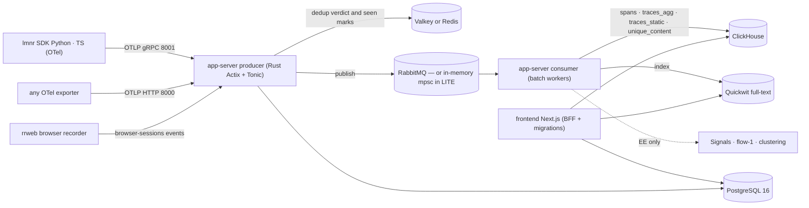

**인프라**: 기본 `docker compose up`(LITE)은 Postgres 16·ClickHouse 26.5·Quickwit 0.9·app-server·frontend 5 컨테이너다. RabbitMQ와 Redis는 **인메모리로 대체**된다. `docker-compose-full.yml`은 RabbitMQ·Valkey 9.1을 더해 7 컨테이너·5 스토어가 된다. 같은 Rust 바이너리가 `ENVIRONMENT=LITE|FULL|PRODUCTION`에 따라 분기한다. Helm은 별도 저장소이고 S3가 필수다. **Hybrid** 차트는 고객 측에 ClickHouse와 Data Plane Proxy만 배포한다. GitHub 주 언어가 TypeScript로 바뀌었지만 백엔드는 여전히 Rust(~102k LOC)다. Next.js 프론트(~178k LOC)가 BFF이자 마이그레이션 러너로 커진 결과다.

**코드 레벨 포인트**
- **trace = 델타만 쓰는 두 테이블**: `traces_agg`(SimpleAggregateFunction)와 `traces_static`(ClickHouse 26.x **CoalescingMergeTree**). 늦게 도착한 span도 read-before-write 없이 병합된다.
- **동일 바이너리의 graceful degradation**: `enum MessageQueue { Rabbit, TokioMpsc }`. "PG+CH만 필수"라는 진입 장벽 완화 설계다.
- **open-core 경계를 cargo feature로 구현**: `#[cfg(feature = "signals")]`. OSS 빌드는 no-op stub이라 Signals UI는 보이지만 처리 엔진이 동작하지 않는다.

| 장점 | 단점 |
|---|---|
| 장시간 에이전트 저장 최적화(메시지 dedup, Rust 수집) | **2026-11 open-core**: Signals·클러스터·알림이 EE 전용이라 OSS에는 온라인 판정·알림이 사실상 없다 |
| OTLP gRPC+HTTP, 최신 GenAI semconv 무손실 | 런타임 프롬프트 레지스트리 없음, 내장 eval 메트릭 빈약 |
| 브라우저 세션 리플레이·실시간 trace·디버거·SQL+MCP | 범용 게이트웨이 없음. FULL은 5 스토어, Helm은 S3 필수 |
| LITE 5 컨테이너, Hybrid·Managed 배포 옵션 | 작은 팀(seed $3M), 빠른 스키마 변화(CH 마이그레이션 85개) |

---

### 6.5 W&B Weave — 에이전트 trace·평가 툴킷 (CoreWeave, 서버 비공개 전환)

**포지셔닝 변화**: README는 "toolkit for **tracing and evaluating AI agents**"다. Agents 탭(conversation → turn → LLM call → tool call)이 앞에 있고, `@weave.op` Calls 탭은 보조로 밀렸다. 2026-09 CoreWeave Forge 출시와 함께 Weave는 **observe → curate → post-train(RL·SFT)** 루프의 관측 계층으로 재배치되고 있다. **2026-10-13 trace 서버 코드가 비공개 `wandb/core`로 이전**됐다(PR #8018). 공개 저장소에는 SDK와 in-memory mock 서버만 남았다.

**핵심 특징**
- **`@weave.op`**: 함수 입출력·코드 자체를 **content-addressed digest로 자동 버전 관리**한다(`weave:///entity/project/op/name:digest`). Dataset·Model·Scorer·Prompt가 같은 ref 체계로 엮여 재현성이 좋다.
- **Evaluations**: `weave.Evaluation(dataset, scorers)`, radar·bar·scorecard diff 비교 UI, Leaderboard, 내장 scorer 20+종.
- **Monitors·Signals**: 온라인 평가. Signals는 태그 설명만 쓰면 LLM judge를 자동 구성한다. Insights(intent·failure signature 클러스터링)와 AlertSpec(threshold)도 있다.
- **Agents**: GenAI semconv 기반 Conversation SDK와 별도 OTLP 엔드포인트(`/agents/otel/v1/traces`)를 쓴다. OpenAI Agents·Claude Agent SDK·Google ADK를 자동 패치한다.
- **W&B 결합**: 학습 run과 추론 trace를 연결하고(`wb_run_id`), W&B Inference(CoreWeave GPU 오픈모델 API)와 연동된다.

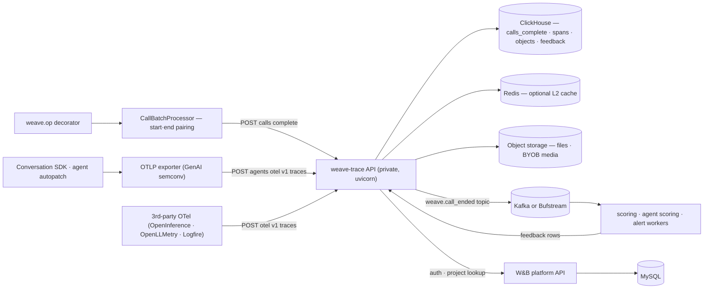

**인프라**: **Weave 단독 셀프호스트 경로는 없다.** W&B Server(Self-Managed) 전체에 Weave-enabled 라이선스를 더해야 한다. 요구사항은 K8s 1.34+(**x86 전용**), MySQL 8.4, Redis 7, 오브젝트 스토리지, **ClickHouse 3 replica + Keeper 3**(Altinity operator)이고, 온라인 평가에는 Kafka 또는 Bufstream+etcd가 더 필요하다. `operator-wandb` Helm에 Weave 서비스 5종(`weave-trace` API, scoring·agent-scoring·evaluate-model·alert 워커)이 정의돼 있다. 문서상 Weave 최소 구성은 7 pods, 4.5–15 CPU, 7.8–58 Gi RAM, 180 Gi 디스크다.

**코드 레벨 포인트** (공개 서버 v0.53.12 기준)
- **클라이언트에서 start·end를 짝지어 1 call = 1 row로 쓴다** (`call_batch_processor.py`, `MAX_BATCH_SIZE=1000`). 서버의 AggregatingMergeTree 병합 비용을 클라이언트로 옮긴 설계다. 장기 실행 op는 `eager_call_start`로 예외 처리한다.
- **GenAI semconv를 ClickHouse 정규 컬럼으로** (`030_add_agent_tables.up.sql`). `agent_name`, `input_tokens`, `input_messages Array(Tuple(...))` 같은 컬럼에 MV로 에이전트·메시지 집계를 만든다.
- **commit-after produce**: ClickHouse가 source of truth이고 Kafka는 best-effort다. 수집은 성공해도 Monitor 점수는 누락될 수 있다(at-most-once).

| 장점 | 단점 |
|---|---|
| 코드·객체 자동 버전 관리로 재현성 최고 | **서버 비공개(2026-10)**: 감사·셀프 패치 불가. "Weave = OSS" 표기는 이제 틀린다 |
| 평가 비교 UI·Leaderboard·scorer 라이브러리 성숙 | 셀프호스트는 엔터프라이즈 전용이고 9개 중 가장 무거운 축 |
| ML 실험 추적·post-training 루프와 같은 프로젝트에서 결합 | 가격이 ingestion MB 기준이라(초과 $0.10/MB) 대형 컨텍스트 에이전트에 불리 |
| 범용 OTLP가 OpenInference·OpenLLMetry·Logfire·Vercel·MLflow를 흡수 | Calls와 Agents spans 두 모델이 공존해 혼란. 벤더 중립성 약화(CoreWeave 결합) |

---

### 6.6 PostHog AI Observability — 제품 분석 안의 LLM 관측

**포지셔닝 변화**: 2026년 중 제품명이 "LLM analytics"에서 **"AI observability"**로 바뀌었다(`/docs/llm-analytics` → `/docs/ai-observability` 리다이렉트, 정확한 공지일은 *(미확인)*). 제품 README는 "has grown into a **full LLM platform**: traces, evaluations, clustering, prompt management, a model gateway, a playground, and review queues"라고 쓴다. 회사 전체로는 "self-driving products"의 컨텍스트 레이어로, AI 이상 탐지가 Self-driving investigation의 신호원이 된다.

**핵심 특징**
- **이벤트 모델**: `$ai_generation`·`$ai_span`·`$ai_trace`·`$ai_embedding`·`$ai_metric`·`$ai_feedback`·`$ai_evaluation`. trace 트리는 `$ai_trace_id`·`$ai_parent_id`로 구성한다.
- **평가 3종**: LLM-as-judge(BYOK), **Hog 코드 eval**(무료·결정적), **Sentiment**(로컬 ML). 대상은 generation·trace·session이고 30일 backfill과 리포트를 지원한다.
- **Prompt 관리 GA(2026-08)**: 버전·라벨·캐시 SDK. **feature flag·experiment 통계 엔진으로 프롬프트 A/B**를 돌릴 수 있다.
- **제품 데이터 조인**: 세션 리플레이·에러 트래킹·feature flag·experiment·survey와 같은 ID 공간에 있다. HogQL SQL로 "프롬프트 v2가 리텐션을 바꿨나"를 바로 조회한다.
- **그 외**: Clustering(UMAP+HDBSCAN+LLM 라벨링), Trace Reviews(리뷰 큐·버전드 scorer), 원격 MCP.

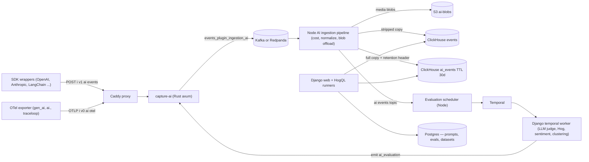

**인프라**: hobby compose는 **47 services**다. 상태 저장소 9개는 Postgres(Temporal 공유)·Redis 7·Valkey·ClickHouse·ZooKeeper·Redpanda·SeaweedFS×2·etcd(PersonHog)다. 설치 스크립트는 "You REALLY need 8GB or more"라고 경고하고, 문서는 **월 ~100k 이벤트**를 넘으면 Cloud 이전을 권장하며 지원·보증이 없다고 밝힌다. Helm은 sunset됐다. Cloud는 capture-ai·AI ingestion·`ai_events` 위성 ClickHouse 클러스터를 따로 운영하지만 셀프호스트로는 재현되지 않는다.

**코드 레벨 포인트**
- **이벤트 이중 쓰기 + heavy 속성 분리** (`split-ai-events-step.ts`). 공용 `events`에는 본문을 뺀 사본을, 전용 `ai_events`에는 전체를 쓴다. "LLM 이벤트 = 제품 이벤트" 원칙(퍼널·코호트 조인)을 지키면서 프롬프트가 공용 테이블을 비대하게 만드는 것을 막는다.
- **비용은 ingestion 시점에 계산하고 "unknown ≠ $0"** (`costs/index.ts`). 토큰 수를 모르면 0달러로 날조하지 않는다. 가격표는 OpenRouter와 동기화(566 모델)하고, 캐시 TTL별·모달리티별·웹검색 비용까지 계산한다.
- **OTLP는 Rust capture에서 이벤트로 평탄화**. 비-AI span은 버린다. 분석은 단순해지지만 span 원형을 보존하지 않는다.

| 장점 | 단점 |
|---|---|
| **유일한 제품 분석 네이티브**: 사용자·리플레이·플래그·실험·서베이와 조인 | 셀프호스트 사실상 비권장(47 컨테이너·9 스토어·8GB+·무지원) |
| 프롬프트 A/B를 실제 실험 통계 엔진으로 | OTLP traces만, OpenInference 미지원, span 원형 미보존 |
| 매우 정교한 비용 계산, HogQL 대시보드 | 본문 기본 **30일 보존**(최대 365일) |
| 무료 100k 이벤트/월, 좌석 무과금, Hog eval·sentiment은 LLM 비용 0 | 에이전트 그래프·실험 비교 UX는 전문 도구 대비 얕다. span이 많은 에이전트는 이벤트 과금이 빠르게 증가 |

---

### 6.7 OpenLIT — OTel 네이티브 경량 관측 + GPU·eBPF

**포지셔닝 변화**: 2026년에 메시지가 세 번 바뀌었다. "OpenTelemetry-native AI Engineering platform"(~2026-09) → "**agent harness engineering platform**"(2026-10) → "**Same Agent, Smaller Bill!** / intelligence layer for AI ROI"(2026-11)다. 다만 코드·웹 어디에도 새 토큰 절감 제품(압축·라우팅·캐시)은 없다. 실체는 **메시지 피벗**이고 코어는 여전히 OTel 관측 플랫폼이다. 비용 서사는 loop 탐지(낭비 토큰 표시), Auto Pricing, 코딩 에이전트 지출 추적 같은 기존 기능을 재포장한 것이다.

**핵심 특징**
- **진짜 OTel 네이티브**: SDK(Python 56·TS 41 계측 모듈)가 표준 OTLP만 내보낸다. 그래서 OpenLIT이 아닌 다른 백엔드(Grafana·Datadog·SigNoz)로도 보낼 수 있다. 최신 `gen_ai.*`(`gen_ai.provider.name`, `gen_ai.input.messages`)를 따른다.
- **GPU 모니터링**: NVIDIA·AMD·Intel 지원, eBPF CUDA 커널 트레이싱.
- **eBPF zero-code controller**: `tcp_v4/v6_connect` kprobe로 LLM 엔드포인트에 연결하는 프로세스를 찾아 코드 변경 없이 계측한다.
- **코딩 에이전트 관측**: Claude Code·Cursor·Codex·OpenCode·Hermes의 hook 이벤트를 `coding_agent.*` + `gen_ai.*`로 정규화한다.
- **그 외**: 커스텀 대시보드 빌더, 온라인 LLM-judge 11종(cron), Prompt Hub, Vault, Rule Engine, OpenGround(모델 비교), Otter(NL→SQL), 외부 소스(Tempo·Jaeger·Loki·Prometheus) 조회.

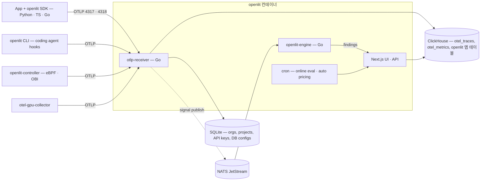

**인프라**: compose 3 컨테이너(ClickHouse 24.4, NATS 2.10, `openlit`)다. `openlit` 단일 컨테이너 안에서 Next.js·Go OTLP receiver·Go engine·cron이 함께 돈다. Postgres·Redis·S3가 필요 없는 **세트 내 최소 풋프린트**다. 2.1.1에서 번들 OTel Collector와 OpAMP supervisor를 1st-party Go receiver로 교체했고, **API key → 테넌트별 ClickHouse 라우팅**을 수신 단계에서 처리한다. 대가로 앱 메타데이터가 SQLite라 **단일 replica**만 가능하다. Helm 차트(1.24.0)는 앱(2.2.0)보다 뒤처져 있고 NATS가 빠져 있다. K8s Operator는 2026-04에 삭제되고 eBPF controller로 대체됐다.

**코드 레벨 포인트**
- **테넌트 속성 위조 방지**: 수신 페이로드의 `openlit.organisation.id`·`openlit.project.id`를 항상 먼저 지우고 API key 기준으로 다시 붙인다.
- **알림은 "insert 후 비차단 fan-out"**: ClickHouse 쓰기 성공 후에만 NATS로 신호를 보내고, 버퍼가 차면 drop한다. 프롬프트·개인 속성은 신호에 싣지 않는다.
- **코딩 에이전트 스키마 계약** (`coding-agents-convention.md`): "Adapters MUST stamp `coding_agent.session.id` on every span", "`gen_ai.system` MUST be the LLM provider, not the agent vendor".

| 장점 | 단점 |
|---|---|
| 3 컨테이너, Postgres·Redis·S3 불필요 | 아키텍처·메시지 churn(2026년에만 Operator·Fleet Hub 제거, Collector 교체, 브랜딩 3회) |
| 표준 OTLP만 쓰므로 락인 최소, OTLP gRPC·HTTP + logs·metrics | **open-core 전환**: 외부 알림 채널·커스텀 역할·감사 로그가 비공개 EE |
| GPU·eBPF·코딩 에이전트까지 인프라 관점 커버리지 최대 | 데이터셋·실험·주석 큐 없음. SQLite라 앱 HA 불가 |
| 커스텀 대시보드 빌더, 외부 관측 스택과 공존 | 수신에 큐가 없어(동기 insert) 버스트에 약함. OTLP 무인증·익명 텔레메트리 기본 on |

---

### 6.8 LangWatch — 관측·평가·게이트웨이·거버넌스 통합 (이벤트 소싱)

**포지셔닝 변화**: 타깃이 "AI 엔지니어"에서 **"AI Platform 팀"**으로 옮겨갔다. 설명은 "Trace, test, route and govern every agent & coding assistant in the company"다. README의 4개 영역은 다음과 같다.
1. LLM Ops(관측·Scenario 시뮬레이션·평가·프롬프트)
2. **Coding Agents**(Claude Code·Codex·Copilot 세션, PR당·팀별 비용)
3. **AI Gateway**
4. **AI Governance**(사내 AI 도구 인벤토리·OCSF/SIEM·에이전트 kill switch)

2026년에 스택이 거의 다시 만들어졌다. OpenSearch를 제거하고 ClickHouse 이벤트 소싱으로 옮겼으며(v3.0), Next.js를 Hono + Vite SPA로, Python NLP를 Go `nlpgo`로 바꿨다. **DSPy Optimization Studio는 Workflows로 대체**됐다(3.18.0).

**핵심 특징**
- **평가**: Experiments(오프라인), **Monitors**(온라인), **Guardrails**(동기 차단), **Instant Evals**(자연어 질문을 과거 전체 행에 실행, 벤더 주장 "10,000건 ~1분, <$1"), LangEvals 30+ evaluator(RAGAS·PII·jailbreak 등).
- **Scenario 시뮬레이션·red team suite**(OWASP LLM Top 10): 사용자 시뮬레이터 + judge로 에이전트를 end-to-end 테스트한다. 세트 내 유일하다.
- **AI Gateway**(Go, Bifrost 기반): 가상 키, 예산(사전 체크는 동기, 차감은 trace fold로 비동기), RPM·RPD, guardrail, tool·MCP·URL 정책, 캐시, fallback·routing, **A2A 프록시**(3.28.0).
- **OTel 수용 폭**: traces·logs·metrics를 모두 받고, 18+ canonicaliser(GenAI·OpenInference·Traceloop·Vercel·Claude Code·Codex·Spring AI·Strands 등)로 정규화한다. 비-AI span도 원형 그대로 저장한다.

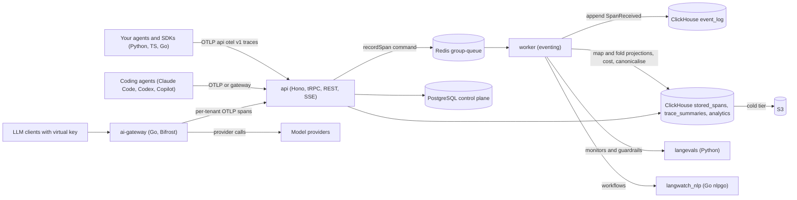

**인프라**: compose 7 컨테이너(app·workers·langwatch_nlp·langevals·postgres 16·redis·clickhouse-serverless)와 3 스토어이고, 권장 사양은 4 CPU/8 GB다. AI Gateway와 Langy는 compose에 없고 Helm에 있다. Helm은 size(minimal·dev·prod·ha) × access × infra(postgres-external·clickhouse-replicated·cold-storage-s3 등) overlay 조합이며 기본 ~10 워크로드다. **`npx @langwatch/server`**는 Docker 없이 포터블 Postgres 18·Redis 7.4.5·ClickHouse 바이너리와 Go 서비스를 네이티브 프로세스로 띄운다. Redis 8의 AGPL을 피하려고 7.4에 고정했다.

**코드 레벨 포인트**
- **ClickHouse를 이벤트 스토어로 쓴다** (`00002_create_schema.sql`). `event_log`는 IdempotencyKey 기반 ReplacingMergeTree다. Kafka 없이 append-only 로그와 재생 가능한 projection을 구현했다.
- **비용은 projection 시점에 계산한다**. 원시 span은 불변 이벤트로 남으므로 **가격표를 고친 뒤 비용을 재계산(replay)할 수 있다**. ingestion 시점에 비용을 굳히는 PostHog와 대비된다.
- **게이트웨이 hot path에 DB 쓰기가 없다** (`budget.go`). "Cost recording is NOT done here — the trace-fold subscriber … folds OTel span usage into the ClickHouse budget ledger", 즉 trace가 곧 spend의 단일 진실이다.

| 장점 | 단점 |
|---|---|
| OTel 수용 폭 최상위(traces·logs·metrics, 18+ semconv, 원형 저장) | **아키텍처 변동이 매우 잦다**(2026년에만 ES→CH, Next.js→Hono, Python→Go, BullMQ 제거). 업그레이드 부담 |
| 이벤트 소싱으로 projection 재빌드·비용 재계산 가능 | 범위 확장(Gateway·Governance·Langy·Coding agents)으로 초점 분산 |
| 평가 폭 최대 축(Scenario·red team·Instant Evals·Monitors·Guardrails) | Helm 풀세트 무거움(app·workers 각 2Gi, LangEvals 6Gi) |
| 게이트웨이·코딩 에이전트·거버넌스를 하나의 OSS로. 무라이선스 볼륨 무제한 | 소규모 회사(pre-seed 확인), 제품 분석 연계 없음, 문서·코드 일부 불일치 |

---

### 6.9 HoneyHive — 엔터프라이즈 에이전트 관측·평가 SaaS (Elastic 인수 계약)

**포지셔닝 변화**: "Agent Observability & Evaluation Platform"으로 은행·규제 산업이 프로덕션 에이전트를 관찰·평가·신뢰하게 하는 제품이다(대표 고객 Commonwealth Bank of Australia). 2026년 변화는 세 갈래다.
1. **코딩 에이전트**(Claude Code hook daemon, Devin exporter, `analyze` → CI 자동 수정 PR)
2. **no-code 에이전트 플랫폼** 관측(Microsoft Copilot Studio·Salesforce Agentforce·ServiceNow)
3. **CP/DP 분리 + 타입드 API key**로 데이터 거주성 강화

**2026-11-19 Elastic이 인수 계약을 발표했다(미종결).** Elastic Observability로 통합될 예정이다.

**핵심 특징**
- **5가지 trace 뷰**(Tree·Timeline·Graph·Trajectory·Thread)와 Session Summary(children·duration·tokens·cost·success rate·평가 점수).
- **Evaluator 3종**: Python(RestrictedPython 샌드박스), LLM judge(내부 LiteLLM proxy 경유), Human. 샘플링·버전·publish를 관리한다. Experiments·run 비교·CI gating(p90·p95·p99 집계)을 지원한다.
- **Annotation Queues** 필터 기반 자동 라우팅, **Alerts**(threshold·drift, critical·warning·resolution, SES·Slack·webhook 전용 Notification Service), Policies(조직 전체 평가 표준).
- **엔터프라이즈 거버넌스**: SSO·SAML·JIT·MFA, 세밀 RBAC, SIEM 감사 로그, SOC 2 Type II·HIPAA BAA·EU 거주, Snowflake·Databricks·BigQuery·S3 export.

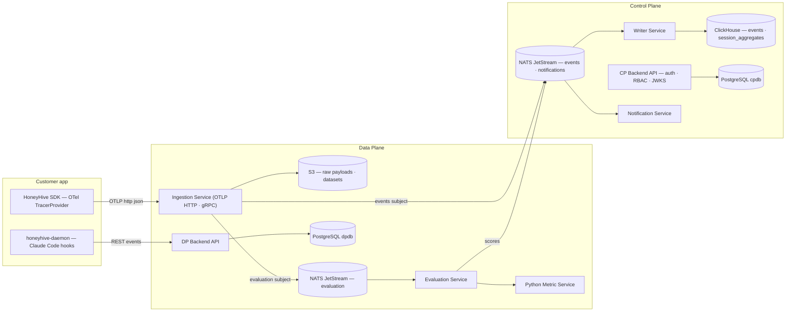

**인프라** (closed-source라 공식 문서와 공개 SDK·archived 저장소로 재구성): 셀프호스트는 **엔터프라이즈 계약 + license 파일**이 필요하고 **AWS EKS만 공식 지원**한다.
- **Helm**: `hive-control-plane`(API·UI·Controller·Writer·Notification), `hive-data-plane`(Ingestion·API·Controller·Evaluation·LLM Proxy·Python metric), `chi-installation`(Altinity CHI).
- **외부 의존**: PostgreSQL ×2(CP·DP, 차트가 배포하지 않으므로 RDS 등 외부 제공), Redis ×2, **NATS JetStream ×2**(각 3 replica), ClickHouse + Keeper, S3.
- **필수 operator**: Altinity·NACK·Prometheus CRD·EBS CSI.

**코드 레벨 포인트** (공개 SDK `honeyhiveai/python-sdk` v1.9.0)
- **OTLP를 `http/json` 기본, ingestion 전용 키로 전송**한다. 쓰기 전용 키(`hh_ingst_`)로 앱에 읽기 권한을 주지 않는다. 키 타입은 CP(`hh_fgcp_`)·DP(`hh_fgdp_`)·ingestion으로 분리된다.
- **기존 TracerProvider와 공존하는 Provider Strategy**. Datadog 등이 이미 global provider를 잡고 있으면 덮어쓰지 않고 독립 provider로 붙는다.
- **OpenInference span.kind → 4종 event_type**(session·model·chain·tool)으로 투영한다. AGENT·RETRIEVER 구분은 metadata로만 남는다. `traceloop.association.properties.*` 호환 속성을 주입하는 것으로 보아 백엔드가 Traceloop 포맷에서 출발한 것으로 보인다.

| 장점 | 단점 |
|---|---|
| **CP/DP 분리 + virtual data plane**: 본문은 고객 S3, 관리만 위탁. 규제 산업에 설득력 최고 | **플랫폼 완전 폐쇄**. 셀프호스트는 Enterprise·EKS 전용이고 PoC를 직접 띄워볼 수 없다 |
| OTel 수집 + OpenInference·OpenLLMetry instrumentor 재사용, 기존 APM과 공존 | 스택이 매우 무겁다(PG×2·Redis×2·NATS×2·CH + operator 4종), 사양 비공개 |
| 알림·정책·annotation 라우팅 등 운영 기능, 컴플라이언스 인증 | Free(10k events) 다음이 바로 Enterprise 견적 |
| 코딩 에이전트·no-code 에이전트 수집을 가장 먼저 제품화 | **Elastic 인수**로 로드맵·셀프호스트 지원·ClickHouse 스택 지속 여부가 불확실 |

---

## 7. 통합 방식 · 표준(OTel) 비교

| 도구 | SDK (언어 · 기반) | OTLP 수신 엔드포인트 | Transport | 해석하는 semconv | 프록시·게이트웨이 | 통합 규모 | MCP · CLI |
|---|---|---|---|---|---|---|---|
| Langfuse | Python v5 · JS v6 (**OTel 기반**) | `/api/public/otel/v1/traces` | HTTP(protobuf·JSON) only | gen_ai · OpenInference · OpenLLMetry · Vercel AI · MLflow · Logfire · LiveKit | AI Gateway (Rust, beta) | 50+ | 내장 MCP · CLI 1.x |
| Helicone | TS · Python (+manual logger) | 없음 (`/v1/trace/log` 레거시 JSON) | — | 레거시 OpenLLMetry `gen_ai.prompt.N.*`만 | **프록시가 본체** | 문서 76쪽, provider 20여 개 | `@helicone/mcp`, CLI 없음 |
| Opik | Python · TS (**자체 REST batch**) | `/api/v1/private/otel` | HTTP only | gen_ai · OpenInference · Logfire · LiteLLM · LiveKit · smolagents · Claude Code | LLM Gateway(beta, dev용) | 자동계측 Py 25 · 문서 ~89 | MCP(OAuth 2.1) · CLI |
| Laminar | Python · TS (**OTel 기반**) | `/v1/traces` (+`/v1/logs`) | **gRPC 8001 + HTTP 8000** | gen_ai 최신 · OpenLLMetry 스타일 · Vercel AI v7 · pydantic_ai · OpenRouter | 없음 | 32 | 내장 MCP · CLI |
| W&B Weave | Python · TS (`@weave.op` 자체 + OTel Conversation SDK) | `/otel/v1/traces` · `/agents/otel/v1/traces` | HTTP | gen_ai · OpenInference · Traceloop · Vercel · MLflow · Logfire · OpenLIT | 없음 | 통합 디렉터리 30 | W&B MCP |
| PostHog | Python · JS · Go (래퍼 + OTel processor) | `/i/v0/ai/otel` (**traces만**) | HTTP | gen_ai · Traceloop · Vercel AI · Pydantic AI (**OpenInference 미지원**) | 내부용(미GA), 외부 게이트웨이 콜백 | 설치 가이드 46 | 원격 MCP · wizard |
| OpenLIT | Python · TS · Go (**OTel 기반**) | `:4318/v1/{traces,metrics,logs}`, `:4317` | **gRPC + HTTP** | gen_ai 최신 (OpenInference·OpenLLMetry 전용 해석은 *(미확인)*) | 없음 | 70+ | CLI(코딩 에이전트) |
| LangWatch | Python · TS · Go (**OTel 기반**) | `/api/otel/v1/{traces,logs,metrics}` | HTTP | **18+ canonicaliser** (gen_ai · OpenInference · Traceloop · Vercel · Claude Code · Codex · Spring AI · Strands …) | AI Gateway (Go) | 가이드 40+ · 코딩 에이전트 8 | MCP · CLI |
| HoneyHive | Python (**OTel 기반**) · TS API client | `/opentelemetry/v1/traces` | HTTP(json 기본) + gRPC | OpenInference · OpenLLMetry (gen_ai 직접 매핑은 *(미확인)*) | 없음(내부 LiteLLM은 judge용) | extras 19 · "100+" | MCP · CLI |

**관찰**
- **SDK 자체가 OTel**인 도구(Langfuse·Laminar·OpenLIT·LangWatch·HoneyHive)는 백엔드를 갈아탈 때 SDK를 바꾸지 않고 exporter 엔드포인트만 바꾸면 된다. Opik·Weave는 자체 프로토콜이 주력이고 OTLP는 보조 경로다.
- **OTLP gRPC**는 Laminar·OpenLIT·HoneyHive만 받는다. Langfuse·Opik·LangWatch·PostHog는 HTTP만 받으므로, gRPC exporter를 쓰는 환경이라면 앞단에 OTel Collector를 둬야 한다.
- OTel GenAI semconv는 2026-11 현재도 **Development** 단계다. 2026-06 semantic-conventions v1.42.0에서 별도 저장소(`semantic-conventions-genai`)로 분리됐고, `gen_ai.system` → `gen_ai.provider.name`처럼 속성명이 계속 바뀐다. 그래서 **여러 규약을 정규화하는 canonicaliser 폭**(LangWatch 18+, Langfuse 7+, Weave·Opik 6+)이 실질 경쟁력이 된다.

---

## 8. 데이터 모델 비교

| 도구 | 기본 단위 | trace 표현 | span 타입 | 평가 결과 | 대화·사용자 그룹 |
|---|---|---|---|---|---|
| Langfuse v4 | **observation(span) 1행** | root span (별도 trace 테이블 없음) | 10종 (GENERATION·AGENT·TOOL·RETRIEVER·GUARDRAIL…) | Score: NUMERIC·CATEGORICAL·BOOLEAN·TEXT·**CORRECTION** | `session_id` · `user_id` |
| Helicone | **request 1행** | Session = 헤더 path로 구성 | 없음 (요청 단위) | score·feedback | `Helicone-Session-Id` · user |
| Opik | Trace + Span | Trace 엔티티 (UUIDv7) | general·tool·llm·guardrail | FeedbackScore (trace·span·thread) | Thread · Project |
| Laminar | span | `traces_agg`+`traces_static` 뷰 | 9종 (LLM·TOOL·EXECUTOR·EVALUATOR·CACHED…) | evaluation_scores · signal_events | `session_id` · `user_id` |
| W&B Weave | Call (op ref) / Agent span | Call 트리 / GenAI span | op 자유 정의 / `operation_name` | Feedback (reaction·note·score·annotation) | `thread_id`·`turn_id` / `conversation_id` |
| PostHog | **이벤트** (`$ai_*`) | `$ai_trace` 이벤트 + trace_id | `$ai_generation`·`$ai_span`·`$ai_embedding` | `$ai_evaluation` 이벤트 | `$ai_session_id` · **person(distinct_id)** |
| OpenLIT | OTel span 원형 | trace_id 그룹 | OTel SpanKind + `gen_ai.operation.name` | `openlit_evaluation` | `coding_agent.session.id` 등 |
| LangWatch | **이벤트**(`SpanReceived`) → projection | `trace_summaries` (fold) | OTel 원형 + canonical 속성 | evaluation_runs | `langwatch.thread.id` · `user.id` |
| HoneyHive | session · event | session = 최상위 event | **4종** (session·model·chain·tool) | event의 `metrics` · `feedback` | `session_id` · `user_properties` |

> 모델이 단순할수록(HoneyHive 4종, Helicone 요청 단위) 3rd-party semconv를 투영할 때 정보가 손실된다. 모델이 OTel 원형에 가까울수록(OpenLIT·LangWatch·Laminar) 손실은 없지만 UI·분석 레이어가 정규화를 떠안는다.

---

## 9. 성능 · 스케일 특성

**공개된 수치** (대부분 벤더 자체 발표라 독립 검증 전에는 참고용)

| 도구 | 수치 | 출처 성격 |
|---|---|---|
| Opik | 일 4–6M traces, 누적 40M traces·250M spans(5 TB), Backend 10 pod + ClickHouse 2 replica(30 CPU/230 GB), CH CPU 10–20% | 공식 셀프호스트 스케일링 문서 |
| Langfuse | v4 단일 테이블로 "최대 165배 빠름". AI Gateway 이미지 22MB, p50 오버헤드 <3ms, 2 vCPU에서 동시 스트림 1,000+ | 벤더 changelog · ClickHouse 블로그 |
| Laminar | 메시지 dedup으로 trace 저장 "20x 압축". flow-1 trace당 $0.0011, F1 .835 | 벤더 블로그 · 자체 벤치 |
| LangWatch | Instant Evals "10,000행 ~1분, <$1" | 벤더 문서 |
| PostHog | hobby는 월 ~100k 이벤트 권장 상한. 이벤트당 8 MiB, OTLP 요청 4MB·span 100개 상한 | 공식 문서 · 코드 |
| W&B Weave | 최소 7 pods(4.5–15 CPU), weave-trace HPA small 2–4 · large ~10 replica | 공식 셀프호스트 문서 |

**스케일 전략과 알려진 제약**

| 도구 | 수평 확장 지점 | 백프레셔·버퍼 | 알려진 제약 |
|---|---|---|---|
| Langfuse | web·worker HPA, 워커 역할 분리, ClickHouse cluster | S3 + BullMQ(sharded) | S3 throttle이 곧 수집 장애. ClickHouse ≥25.12 필수 |
| Helicone | CF Worker 엣지 자동 확장, Jawn consumer 수 | SQS(Cloud), self-host는 큐 없음 | self-host 프록시가 개발 서버. Jawn 장애 시 로그 유실 가능 |
| Opik | backend·python-backend stateless, CH는 수직 확장 후 replica | ClickHouse async insert + SDK SQLite replay | OTLP 경로가 Redis 매핑에 의존 |
| Laminar | app-server producer·consumer 분리, RabbitMQ Streams | RabbitMQ (LITE는 인메모리) | LITE 재시작 시 유실. 다중 샤드 CH 가이드 *(미확인)* |
| W&B Weave | weave-trace HPA, CH 3 replica | 쓰기 경로 큐 없음, Kafka는 평가용 | x86 전용, Monitor 점수 at-most-once |
| PostHog | Cloud는 AI 전용 capture·ingestion·CH 위성 클러스터 | Kafka(Redpanda) | 셀프호스트로는 Cloud 분리 구조를 재현할 수 없다 |
| OpenLIT | ClickHouse 외부화, 앞단 OTel Collector | **없음(동기 insert)** | SQLite라 앱 단일 replica |
| LangWatch | app·workers stateless(HA 3), CH Replicated + Keeper | Redis group-queue | 부팅 시 tsx 로드로 app·workers 각 2Gi 미만이면 OOM |
| HoneyHive | Karpenter + HPA, DP 1–100 노드(archived 예시) | NATS JetStream ×2 + S3 DLQ | 사양 비공개, EKS 전용 |

---

## 10. 선택 가이드

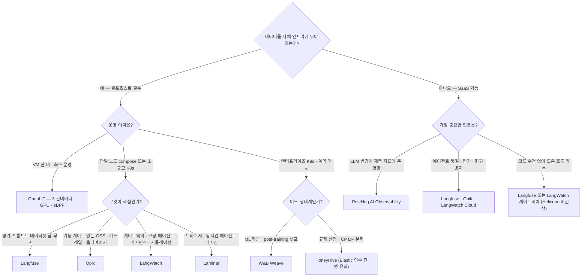

| 상황 | 1순위 | 대안 | 이유 |
|---|---|---|---|
| 범용 OSS LLM 관측, 프로덕션 규모 | **Langfuse** | LangWatch | MIT core, 가장 넓은 semconv 매핑, 평가·프롬프트·skill·어노테이션 풀 루프, ClickHouse 본가의 지원 |
| 라이선스 게이트 없이 모든 기능을 셀프호스트 | **Opik** | LangWatch(무라이선스 무제한) | 온라인 규칙·가드레일·옵티마이저·알림까지 Apache-2.0 |
| 사내 AI 플랫폼 팀: 가상 키·예산·코딩 에이전트 비용·거버넌스 | **LangWatch** | Langfuse(Gateway + budget) | 게이트웨이·코딩 에이전트·OCSF/SIEM·kill switch까지 OSS 한 제품 |
| 브라우저·장시간 에이전트, SQL로 trace 조사 | **Laminar** | Langfuse | rrweb 세션 리플레이, 메시지 dedup, SQL+MCP. 단 온라인 판정·알림은 EE |
| 가장 가벼운 셀프호스트, GPU·인프라 함께 | **OpenLIT** | Laminar LITE | 3 컨테이너, 표준 OTLP, GPU·eBPF. 평가 워크플로는 약하다 |
| LLM 기능이 전환·리텐션에 준 영향 | **PostHog** | (Langfuse → PostHog export) | 리플레이·플래그·실험과 같은 ID 공간. 셀프호스트는 비권장 |
| W&B로 모델 학습 중, 평가 비교·재현성 | **W&B Weave** | Opik | 객체 버전관리·평가 비교 UI·학습 run 연결. 셀프호스트는 엔터프라이즈 |
| 은행·규제 산업, 본문을 고객 영역에 두고 관리만 위탁 | **HoneyHive** | LangWatch Hybrid · Laminar Hybrid | CP/DP 분리, 컴플라이언스. Elastic 인수 이후 로드맵 확인 필요 |
| 코드 수정 없이 프록시로 로깅 | Langfuse·LangWatch 게이트웨이 | (LiteLLM proxy + 플랫폼 콜백) | **Helicone은 소유권·유지보수 리스크로 신규 도입 비권장** |

---

## 11. 종합 평가 · 엔지니어 관점 인사이트

1. **"어느 도구냐"보다 "ClickHouse를 운영할 수 있느냐"가 먼저다.** 9개가 모두 ClickHouse 위에 있다. 셀프호스트 운영 비용의 대부분은 ClickHouse(복제·Keeper·디스크·버전 요구)에서 나온다. 사내에 ClickHouse 운영 경험이 없다면 managed ClickHouse(ClickHouse Cloud 등)에 붙이거나, 컨테이너 수가 적은 도구를 고르는 편이 현실적이다.

2. **"오픈소스"라는 라벨은 2026 하반기에 다시 읽어야 한다.**
   - Weave는 서버를 닫았다. Laminar·OpenLIT은 온라인 판정·알림 같은 **운영 핵심 기능**을 EE로 옮겼다.
   - 게이트되는 기능은 대체로 "프로덕션에서 매일 쓰는 것"(온라인 평가, 알림 채널, RBAC·SSO·감사)이다. PoC 단계에서는 보이지 않다가 운영 단계에서 비용으로 돌아온다.
   - 도입 전에 [§4.3 게이트 표](#43-oss-셀프호스트에서-빠지는-기능-게이트)를 자기 요구사항과 대조해야 한다.

3. **OTel 수용은 필요조건일 뿐 충분조건이 아니다.**
   - 같은 "OTLP 지원"이라도 차이가 크다. PostHog은 traces만 받고 OpenInference를 지원하지 않으며, Helicone은 레거시 JSON만 받는다. 반대쪽 끝에는 LangWatch(18+ 규약, logs·metrics까지)가 있다.
   - 계측은 **OTel GenAI semconv 기반 라이브러리(OpenLLMetry·OpenInference·벤더 OTel SDK)**로 하는 것이 안전하다. 백엔드는 canonicaliser 폭과 gRPC 지원 여부로 고른다.
   - semconv가 아직 Development 단계라 속성명이 바뀌므로, 정규화 레이어가 두꺼운 백엔드가 유리하다.

4. **쓰기 모델이 append-only로 수렴했고, 그 대가는 SDK 메이저 업그레이드다.**
   - Langfuse v4(span 1행 + 비정규화), Weave v2(클라이언트 start·end pairing), Laminar(델타 집계), LangWatch(이벤트 소싱) 모두 읽기 시점의 `FINAL`·join을 없애는 방향이다.
   - 이 전환은 거의 항상 **SDK 메이저 업그레이드**를 강제한다(Langfuse Py v5·JS v6, Opik 2.0). 도입 시 "다음 데이터 모델 전환 때 무엇을 바꿔야 하나"를 함께 따져야 한다.

5. **관측과 게이트웨이가 합쳐지고, trace가 곧 비용 원장이 된다.**
   - Langfuse와 LangWatch는 게이트웨이 로그를 **일반 trace와 같은 파이프라인**으로 넣고, 예산 차감도 trace fold로 처리한다.
   - "trace = spend ledger" 설계는 비용 거버넌스와 품질 관측을 한 저장소에서 조인하게 해 준다. 대신 게이트웨이 기능(fallback·캐시·라우팅)은 아직 전문 게이트웨이(LiteLLM 등)보다 얕다.

6. **코딩 에이전트 관측이 2026년의 새 전장이다.**
   - Claude Code·Codex·Copilot 세션, PR당·팀별 비용, 루프 탐지를 7개 도구가 지원한다(Langfuse·Laminar·LangWatch·OpenLIT·HoneyHive·PostHog·Opik).
   - 수집 방식은 셋으로 갈린다: hook daemon(HoneyHive·OpenLIT), 게이트웨이 경유(Langfuse·LangWatch), OTel 플러그인(Laminar).
   - 사내 "AI 사용량 거버넌스"가 관측 도구의 구매 이유로 떠오르고 있다.

7. **소유권 리스크는 기술적으로 헤지해야 한다.**
   - 9개 중 4개(Langfuse·Helicone·Weave·HoneyHive)가 2025~2026년에 소유권이 바뀌었다.
   - 대응은 다음과 같다:
     - ① 계측을 OTel 표준으로 유지한다.
     - ② 원문·점수를 주기적으로 export한다(S3·웨어하우스).
     - ③ 셀프호스트 가능한 도구를 우선한다.
   - 이렇게 하면 도구가 인수·종료돼도 백엔드만 교체하면 된다.

8. **비용 계산 위치와 본문 보존 정책을 확인해야 한다.**
   - **비용 계산 위치**:
     - ingestion 시점: PostHog·Langfuse·Helicone
     - 클라이언트: OpenLIT SDK
     - projection 시점: LangWatch. 가격표를 고친 뒤 재계산할 수 있다.
   - **본문 보존 기본값**:
     - PostHog `ai_events` 30일
     - OpenLIT `otel_traces` ~30일
     - Helicone ClickHouse 본문 3개월
   - 이 기본값은 감사 대응과 "운영 trace → 평가 데이터셋" 큐레이션 가능 기간을 좌우한다.

---

## 출처

**도구별 (저장소·공식 문서)**
- Langfuse: [github.com/langfuse/langfuse](https://github.com/langfuse/langfuse) · [v4 changelog](https://langfuse.com/changelog/2026-08-17-langfuse-v4) · [v3→v4 업그레이드 가이드](https://langfuse.com/self-hosting/upgrade/upgrade-guides/upgrade-v3-to-v4) · [AI Gateway public beta](https://langfuse.com/changelog/2026-11-04-ai-gateway-public-beta) · [Skill Management](https://langfuse.com/changelog/2026-11-03-skill-management) · [ClickHouse 인수 발표](https://clickhouse.com/blog/clickhouse-acquires-langfuse-open-source-llm-observability) · [langfuse-k8s](https://github.com/langfuse/langfuse-k8s) · [pricing](https://langfuse.com/pricing)
- Helicone: [github.com/Helicone/helicone](https://github.com/Helicone/helicone) · [Mintlify 인수 발표](https://www.mintlify.com/blog/mintlify-acquires-helicone) · [helicone.ai](https://www.helicone.ai/) · [Experiential Labs (YC)](https://www.ycombinator.com/companies/experiential-labs) · [helicone-helm-v3](https://github.com/Helicone/helicone-helm-v3) · [Docker Hub tags](https://hub.docker.com/v2/repositories/helicone/helicone-all-in-one/tags)
- Opik: [github.com/comet-ml/opik](https://github.com/comet-ml/opik) · [changelog](https://www.comet.com/docs/opik/changelog) · [self-host changelog](https://www.comet.com/docs/opik/self-host/changelog) · [Opik v2 업그레이드](https://www.comet.com/docs/opik/opik-v2-upgrade.md) · [pricing](https://www.comet.com/site/pricing/) · [2026-10 보안사고 공지](https://www.comet.com/site/blog/security-incident-october-2026/)
- Laminar: [github.com/lmnr-ai/lmnr](https://github.com/lmnr-ai/lmnr) · [lmnr-helm](https://github.com/lmnr-ai/lmnr-helm) · [lmnr-helm-dataplane](https://github.com/lmnr-ai/lmnr-helm-dataplane) · [hosting options](https://laminar.sh/docs/hosting-options) · [flow-1](https://laminar.sh/blog/flow-1) · [$3M seed (tech.eu)](https://tech.eu/2026/03/17/agent-debugging-startup-laminar-raises-3m-seed-to-tackle-the-observability-gap-in-ai-agents/) · [pricing](https://laminar.sh/pricing)
- W&B Weave: [github.com/wandb/weave](https://github.com/wandb/weave) · [operator-wandb Helm](https://github.com/wandb/helm-charts/tree/main/charts/operator-wandb) · [Weave self-managed](https://docs.coreweave.com/weave/guides/platform/weave-self-managed) · [self-managed requirements](https://docs.coreweave.com/platform/hosting/self-managed/requirements) · [CoreWeave Forge](https://coreweave.com/news/coreweave-forge-launches-turning-the-ai-loop-production-run-into-a-better-model-and-agent) · [Forge pricing](https://coreweave.com/forge-pricing) · [W&B 인수 완료](https://www.coreweave.com/blog/coreweave-completes-acquisition-of-weights-biases)
- PostHog: [github.com/PostHog/posthog](https://github.com/PostHog/posthog) · [posthog-python](https://github.com/PostHog/posthog-python) · [AI observability docs](https://posthog.com/docs/ai-observability) · [data retention](https://posthog.com/docs/ai-observability/data-retention) · [OpenTelemetry 설치](https://posthog.com/docs/ai-observability/installation/opentelemetry) · [AI evals](https://posthog.com/docs/ai-evals) · [pricing](https://posthog.com/pricing)
- OpenLIT: [github.com/openlit/openlit](https://github.com/openlit/openlit) · [openlit-2.2.0 release](https://github.com/openlit/openlit/releases/tag/openlit-2.2.0) · [openlit.io](https://openlit.io/) · [Enterprise](https://docs.openlit.io/latest/openlit/enterprise) · [Helm](https://github.com/openlit/helm)
- LangWatch: [github.com/langwatch/langwatch](https://github.com/langwatch/langwatch) · [AI Gateway](https://langwatch.ai/docs/ai-gateway/overview) · [pricing](https://langwatch.ai/pricing) · [pre-seed (Silicon Canals)](https://siliconcanals.com/langwatch-raises-e1m-in-pre-seed-round/)
- HoneyHive: [honeyhiveai/python-sdk](https://github.com/honeyhiveai/python-sdk) · [honeyhive-daemon](https://github.com/honeyhiveai/honeyhive-daemon) · [platform architecture](https://docs.honeyhive.ai/v2/platform-architecture) · [self-hosted](https://docs.honeyhive.ai/v2/setup/self-hosted) · [infrastructure requirements](https://docs.honeyhive.ai/v2/setup/infrastructure-requirements) · [Elastic 인수 (HoneyHive)](https://www.honeyhive.ai/blog/elastic) · [Elastic 블로그](https://elastic.co/blog/elastic-and-honeyhive) · [pricing](https://www.honeyhive.ai/pricing)

**시장 · 표준**
- [Dynatrace, Arize 인수 완료 (2026-10-01)](https://www.financialcontent.com/article/bizwire-2026-10-1-dynatrace-completes-acquisition-of-arize-extending-ai-observability-across-the-full-development-lifecycle) · [TechTarget](https://www.techtarget.com/it-strategy/news/366648773/Dynatrace-acquires-Arize-for-AI-agent-development)
- [Who Bought Your LLM Observability Tool? (Developers Digest, 2026-10)](https://www.developersdigest.tech/blog/llm-observability-acquisitions-2026) · [ai-evals.tools 인수 정리](https://ai-evals.tools/editorial/llm-evals-observability-company-acquisitions)
- [OTel GenAI semconv 현황 (Dash0, 2026-09)](https://www.dash0.com/knowledge/opentelemetry-genai-semantic-conventions-explained) · [Greptime — GenAI semconv](https://greptime.com/blogs/2026-05-09-opentelemetry-genai-semantic-conventions)

---

## 부록 A. 분석 기준 커밋

| 도구 | 저장소 @ 커밋 | 날짜 · 버전 |
|---|---|---|
| Langfuse | `langfuse/langfuse@948ac04` | 2026-11-23 · v4.84.0 |
| Helicone | `Helicone/helicone@9254d10` | 2026-11-17 |
| Opik | `comet-ml/opik@cea0c48` | 2026-11-23 · 2.2.155 (main `version.txt` 2.3.0) |
| Laminar | `lmnr-ai/lmnr@dc5f238` | 2026-11-10 · v0.3.4 |
| W&B Weave | `wandb/weave@30f07a1` (서버는 삭제 직전 `ada0360~1` = v0.53.12 열람) | 2026-11-19 |
| PostHog | `PostHog/posthog@c845e2b` (sparse) · `posthog-python` v8.2.1 | 2026-11-24 |
| OpenLIT | `openlit/openlit@463a1c1` | 2026-11-19 · 2.2.0 |
| LangWatch | `langwatch/langwatch@d86b90e` | 2026-11-24 · 3.28.0 |
| HoneyHive | `honeyhiveai/python-sdk@570e5d6` · `honeyhive-daemon@7dcce1b` (플랫폼 비공개) | 2026-11-18 · SDK v1.9.0 |

clone 위치는 `.repos/llmobs/`이고 `.gitignore`의 `/.repos/` 규칙으로 업로드에서 제외된다.
