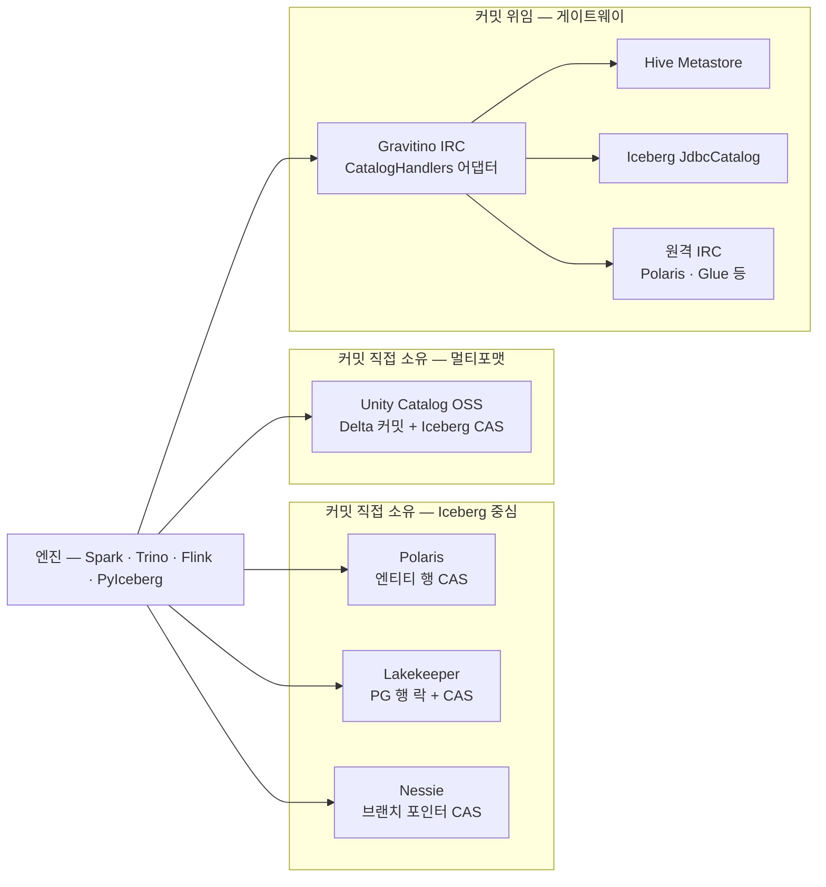
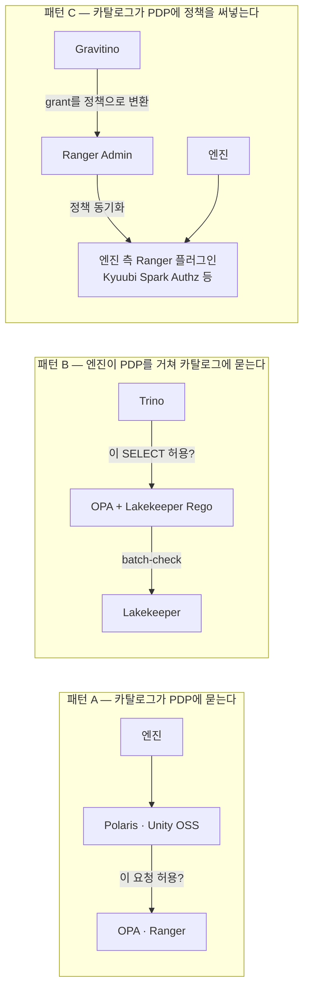
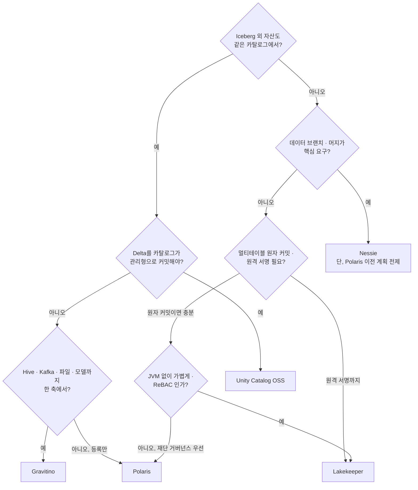

# 오픈 레이크하우스 카탈로그 5종 코드 레벨 비교 — Polaris · Lakekeeper · Nessie · Gravitino · Unity Catalog OSS

> 조사 시점: 2026-11-17 · 다섯 저장소를 모두 클론해 소스 단위로 확인했다. 아래 커밋을 기준으로 하며, 파일 경로는 각 저장소 루트 기준이다.
> 관련 문서: [Gravitino 심층 분석](../gravitino/gravitino-analysis.md) · [Gravitino vs DataHub vs OpenMetadata](../gravitino/gravitino-vs-datahub-openmetadata.md) · [전사 데이터 스택 지형도](../enterprise-data-stack/landscape.md) · [Apache Ossie 코드 분석](../ossie/apache-ossie-code-analysis.md)

| 프로젝트 | 저장소 | 분석 커밋 | 최신 릴리스 |
|---|---|---|---|
| Apache Polaris | `apache/polaris` | `dc8eb48` | 1.9.0 (2026-11-14) |
| Lakekeeper | `lakekeeper/lakekeeper` | `40a4628` | 0.15.1 (2026-11-15) |
| Project Nessie | `projectnessie/nessie` | `0de8d31` | 0.110.0 (2026-11-06) |
| Apache Gravitino | `apache/gravitino` | `b43a791c` | 1.3.1 (main = `2.0.0-SNAPSHOT`) |
| Unity Catalog OSS | `unitycatalog/unitycatalog` | `be2734c` | 0.7.0 (2026-10-13) |

---

## 0. TL;DR

1. **다섯 개 모두 "Iceberg REST Catalog(IRC)"를 말하지만, 갈리는 축은 "커밋을 누가 소유하는가"다.**
   - 직접 소유 · Iceberg 중심 — **Polaris, Lakekeeper, Nessie**
   - 직접 소유 · 멀티포맷 — **Unity Catalog OSS** (Delta catalog-managed commit + Iceberg)
   - **위임** — **Gravitino**. IRC 요청을 받아 뒤에 있는 Hive·JDBC·REST 카탈로그에 커밋을 넘기는 게이트웨이다.
2. **IRC 스펙을 완전히 구현한 곳은 하나도 없다.**
   - 원자적 멀티테이블 트랜잭션은 Polaris·Lakekeeper·Nessie에만 있고, Gravitino·UC에는 없다.
   - 서버사이드 스캔 플래닝(`/plan`, `/tasks`)은 **Gravitino에만** 있다.
   - 원격 서명(`/sign`)은 **Lakekeeper·Nessie에만**(S3 한정) 있다.
3. **행 필터·컬럼 마스킹은 다섯 모두 사실상 없다.**
   - 예외는 하나, Gravitino의 **실험적** `read-restrictions` 구현이다. 2026-10 Iceberg REST 스펙에 머지된 표준을 따른다.
   - Unity Catalog의 마스킹·행 필터는 **Databricks 관리형 기능**이고 OSS 코드에는 없다(로드맵 `❓`).
4. **기본값이 안전하지 않다.**
   - UC는 인가가 꺼져 있다(`server.authorization=disable`).
   - Nessie는 인증·인가가 꺼져 있고 저장소가 in-memory다.
   - Lakekeeper는 OpenFGA를 설정하지 않으면 AllowAll이다.
   - Gravitino는 `authorization.enable=false`다.
   - 내장 RBAC가 기본으로 켜진 것은 Polaris뿐이다.
5. **선택은 대부분 두 질문으로 정리된다.** ① 워크로드가 Iceberg 100%인가? ② Delta를 카탈로그가 1급으로 관리해야 하는가?

| | 한 줄 정체성 | 주체 · 거버넌스 |
|---|---|---|
| **Polaris** | Iceberg REST의 사실상 레퍼런스 구현에 2단 RBAC와 연합(federation)을 얹었다 | **ASF TLP** (2026-02 졸업), Snowflake·Dremio 출신 |
| **Lakekeeper** | Rust 단일 바이너리 + Postgres. IRC 쓰기 경로를 가장 충실하게 구현했다 | **Vakamo** 단일 회사, 오픈코어(Lakekeeper Plus) |
| **Nessie** | 카탈로그 레벨 Git — 브랜치·머지·트랜스플랜트와 멀티테이블 원자 커밋 | **Dremio**(2026 SAP 인수) 주도, **비-ASF**, Polaris로 흡수 예정 |
| **Gravitino** | 카탈로그들의 카탈로그. IRC는 여러 면 중 하나일 뿐이다 | **ASF TLP** (2025-06 졸업), Datastrato 출신 |
| **Unity Catalog OSS** | Delta를 1급으로 다루고 Iceberg와 AI 자산(Volume·Function·Model)까지 묶는다 | **Databricks** 주도, LF AI & Data **sandbox** |

---

## 1. 프로젝트 개요

### 1.1 해결하려는 문제 (Problem Statement)

Iceberg REST Catalog 스펙 덕분에 카탈로그가 **교체 가능한 HTTP 서버**가 되었다. 엔진은 `type=rest`와 `uri=...`만 알면 된다. 그 결과 "어떤 엔진을 쓸까"와 "어떤 카탈로그를 쓸까"가 별개의 결정이 되었고, 카탈로그 시장이 폭발했다.

문제는 **"IRC 호환"이 이진값처럼 쓰인다**는 점이다. 같은 `uri`를 받는 서버들이 실제로는 다음 다섯 가지에서 크게 다르다.

| 축 | 질문 |
|---|---|
| 커밋 소유 | 메타데이터 포인터의 CAS를 이 서버가 직접 하는가, 다른 시스템에 넘기는가 |
| 스펙 커버리지 | 멀티테이블 트랜잭션, 뷰, 스캔 플래닝, 원격 서명, 크리덴셜 벤딩 중 무엇이 실제로 구현되었나 |
| 인가 | 무엇을 단위로 막는가(테이블? 브랜치? 컬럼?), 엔진까지 어떻게 전파되는가 |
| 데이터 평면 | 엔진이 받는 스토리지 자격증명이 얼마나 좁게 잘리는가 |
| 범위 | Iceberg 밖(Delta·Hive·파일·모델·토픽)을 다루는가 |

이 문서는 다섯 카탈로그를 이 축으로 **코드에서 확인한 사실만으로** 비교한다.

### 1.2 탄생 배경

| | 시작 | 출신 | 출발 동기 |
|---|---|---|---|
| Polaris | 2024-06 Snowflake 공개 → 2024-08 ASF 인큐베이터 → **2026-02 TLP** | Snowflake + Dremio | Snowflake Open Catalog의 OSS 코어. 벤더 중립 IRC |
| Lakekeeper | 2024 | Vakamo | `apache/iceberg-rust` 기반의 경량·보안 중심 IRC |
| Nessie | 2020 | Dremio | 데이터 레이크에 Git 시맨틱(브랜치·머지·롤백). 2024-08 "Nessie의 기능을 Polaris에 기여" 계획 발표 |
| Gravitino | 2023 → 2024-06 인큐베이터 → **2025-06 TLP** | Datastrato | 이질적 소스(Hive·Iceberg·JDBC·Kafka·파일·모델)를 하나의 메타데이터 평면으로 |
| Unity Catalog OSS | 2024-06 오픈소스화 → LF AI & Data | Databricks | Databricks Unity Catalog의 오픈 API·서버. Delta·Iceberg·AI 자산 통합 |

---

## 2. 한눈에 보는 비교표

> 모든 셀은 위 커밋의 코드·저장소 내 문서로 확인한 값이다. "—"는 해당 없음, "없음"은 코드에서 찾지 못했다는 뜻이다.

| 항목 | **Polaris** | **Lakekeeper** | **Nessie** | **Gravitino** | **Unity Catalog OSS** |
|---|---|---|---|---|---|
| 언어 · 프레임워크 | Java 21 · Quarkus 3.40 | **Rust** · axum 0.8 | Java 21 · Quarkus 3.40 | Java 17 · Jetty | Java 17 · **Armeria** |
| Iceberg 라이브러리 | 1.12.0 | iceberg-rust 포크 | 1.12.0 | 1.11.0 (실험 클래스패스 1.13.0) | 1.11.0 |
| 메타데이터 저장소 | Postgres·CockroachDB(JDBC), MongoDB(beta)·DynamoDB(실험) | **Postgres ≥15 전용** | Postgres·MongoDB·BigTable·RocksDB 외 다수 | H2·MySQL·PG(엔티티) + **IRC 백엔드는 별도**(Hive·JDBC·REST) | H2(기본)·PG·MySQL (Hibernate) |
| 필수 인프라(프로덕션) | 서버 + PG | 바이너리 + PG (+ OpenFGA) | 서버 + PG/Mongo | 서버 + RDB + 백엔드 카탈로그 | 서버 + PG/MySQL |
| **커밋 소유** | 직접 (JDBC 행 CAS) | 직접 (PG 행 락 + CAS) | 직접 (브랜치 포인터 CAS) | **위임** (백엔드 카탈로그) | 직접 (PG 비관적 락 + CAS) |
| 테이블 포맷 | Iceberg (+ generic table beta) | Iceberg (+ generic table) | Iceberg (Delta는 모델만) | **Iceberg·Hive·Paimon·Hudi·Delta·Lance·JDBC** | **Delta(관리형)·Iceberg**·Parquet·CSV 등 |
| 비테이블 자산 | Policy, Semantic Model(beta) | Tag | — | **Fileset·Topic·Model·Function·View** | **Volume·Function·Model** |
| 멀티테이블 트랜잭션 | ✅ 원자적 (카탈로그 내) | ✅ 원자적 (warehouse 내) | ✅ 원자적 (브랜치 = 1 커밋) | ❌ | ❌ |
| Iceberg 뷰 | ✅ (+register-view) | ✅ (DEFINER/INVOKER) | ✅ | ✅ | ❌ (`loadView` 항상 404) |
| 스캔 플래닝 | ❌ | ❌ | ❌ | **✅** | ❌ |
| 원격 서명 | ❌ (501) | ✅ S3·STACKIT | ✅ S3 | ❌ | ❌ |
| 크리덴셜 벤딩 | S3·GCS·Azure | S3·R2·OSS·STACKIT·GCS·ADLS | S3·GCS·ADLS | S3·GCS·ADLS·OSS | S3·GCS·Azure |
| `Idempotency-Key` | ✅ (기본 off) | ✅ (기본 on, 30분) | ❌ | ✅ (기본 off, in-memory) | ❌ |
| 인가 모델 | 2단 RBAC (catalog role ↔ principal role) | **ReBAC (OpenFGA)** | CEL 규칙 | RBAC + Ranger 푸시다운 | Casbin RBAC (사용자만, 그룹 없음) |
| 권한 종류 수 | **111** privilege | 208 `can_*` 관계 (테이블 할당 권한 8) | 14 check type | 45 privilege | 25 privilege |
| 외부 PDP | **OPA(beta)·Ranger 내장** | OPA 브리지(Trino 측) | 플러그인 SPI | **Ranger 정책 쓰기** | OPA |
| 행 · 컬럼 보안 | 없음 | 없음 | 없음 | **실험적 read-restrictions** | 없음 (Databricks 관리형 전용) |
| 기본 인가 상태 | **켜짐** (internal) | AllowAll | 꺼짐 | 꺼짐 | 꺼짐 |
| 연합(federation) | ✅ IRC·Hive·Hadoop·BigQuery (기본 off) | ❌ | ❌ | **✅ 카탈로그 연합이 본업** | ❌ |
| 브랜치 · 버전 | — | — | **✅ Git식** | — | — |
| 변경 이벤트 | 149종 (Kafka·OTel·CloudWatch) | CloudEvents (NATS·Kafka) | Kafka·NATS | EventListener 플러그인 | 감사 sink (기본 off) |
| 테이블 유지보수 | 정책 **저장만** | OSS는 정리 큐만, **compaction은 Plus** | Nessie GC (orphan 삭제) | **TMS가 실제 실행** | 관리형 스토리지 정리만 |
| 내장 UI | 없음 | Console (DuckDB-WASM 쿼리) | 별도 저장소 | Web UI v2 | `ui/`, `ui-new/` |

---

## 3. 아키텍처 분석

### 3.1 커밋 소유 스펙트럼

가장 먼저 봐야 할 구조적 차이다. **Iceberg 테이블의 "현재 상태"는 `metadata.json` 위치를 가리키는 포인터 하나다.** 그 포인터를 compare-and-swap 하는 주체가 누구인지가 카탈로그의 성격을 결정한다.



이 그림 하나로 여러 현상이 설명된다.

- **Gravitino에 멀티테이블 트랜잭션이 없는 이유.** 커밋을 HMS·`JdbcCatalog`에 넘기는데, 이 백엔드들은 테이블 여러 개를 한 번에 원자적으로 바꾸는 API가 없다.
- **Gravitino만 연합이 자연스러운 이유.** 처음부터 "뒤에 다른 카탈로그가 있다"를 전제로 설계되었다.
- **Nessie만 브랜치를 줄 수 있는 이유.** 포인터가 테이블 단위가 아니라 **브랜치 단위**다. 브랜치 하나가 모든 테이블의 포인터 묶음을 가리킨다.

### 3.2 컴포넌트 구조

```mermaid
flowchart TB
    subgraph P["Polaris"]
        P1["Quarkus REST<br/>IRC · Management · Policy · Generic Table"]
        P2["PolarisAuthorizer<br/>internal · OPA · Ranger"]
        P3["MetaStoreManager<br/>Atomic · TransactionWorkspace"]
        P4[("JDBC — PG · CockroachDB<br/>NoSQL — Mongo · DynamoDB")]
        P1 --> P2 --> P3 --> P4
    end

    subgraph L["Lakekeeper"]
        L1["axum 라우터<br/>catalog v1 · management v1 · lakekeeper v1"]
        L2["Authorizer 트레이트<br/>OpenFGA · AllowAll"]
        L3["CatalogStore 트레이트"]
        L4[("PostgreSQL<br/>정규화된 메타데이터 테이블")]
        L5["태스크 큐 워커<br/>SKIP LOCKED"]
        L1 --> L2 --> L3 --> L4
        L5 --> L4
    end

    subgraph N["Nessie"]
        N1["Quarkus REST<br/>Native API v2 · Iceberg REST"]
        N2["CEL Authorizer"]
        N3["VersionStore<br/>커밋 로그 · 레퍼런스 · 인덱스"]
        N4[("Persist SPI<br/>JDBC2 · Mongo2 · BigTable · RocksDB")]
        N1 --> N2 --> N3 --> N4
    end

    subgraph G["Gravitino"]
        G1["Jetty — Gravitino REST · IRC 보조 서비스"]
        G2["Dispatcher 체인<br/>Hook · Event · Normalize · Operation"]
        G3["카탈로그 플러그인<br/>IsolatedClassLoader"]
        G4[("엔티티 저장소 — RDB")]
        G5[("실제 원본 — HMS · JDBC · Kafka · S3")]
        G1 --> G2 --> G3 --> G5
        G2 --> G4
    end

    subgraph U["Unity Catalog OSS"]
        U1["Armeria<br/>UC API · Iceberg REST · Delta API · SCIM"]
        U2["UnityAccessDecorator<br/>SpEL 표현식"]
        U3["Repository 계층<br/>Hibernate"]
        U4[("H2 · PG · MySQL")]
        U1 --> U2 --> U3 --> U4
    end
```



### 3.3 커밋 원자성 — 같은 문제에 다섯 가지 답

**Polaris — 엔티티 버전 낙관적 CAS** (`persistence/relational-jdbc/.../JdbcBasePersistenceImpl.java:213-237`)

```java
Map<String, Object> params = Map.of("id", originalEntity.getId(), "catalog_id", ...,
    "entity_version", originalEntity.getEntityVersion(),
    "grant_records_version", originalEntity.getGrantRecordsVersion(), "realm_id", realmId);
int rowsUpdated = queryAction.apply(connection,
    QueryGenerator.generateUpdateQuery(ModelEntity.getAllColumnNames(), ModelEntity.TABLE_NAME, values, params));
if (rowsUpdated == 0) {
  throw new RetryOnConcurrencyException("Entity '%s' id '%s' concurrently modified; ...", ...);
```

`WHERE` 절에 `entity_version`과 **`grant_records_version`이 함께** 들어간다. 테이블 메타데이터 변경과 권한 변경을 한 버전 축에서 직렬화한다는 뜻이다. 권한이 바뀐 순간 진행 중이던 커밋도 재시도하게 된다. 그 전에 `LocalIcebergCatalog.doCommit`(`:1987`)이 base metadata location을 한 번 더 비교한다.

**Lakekeeper — 정렬된 행 락 + 위치 비교** (`crates/lakekeeper-storage-postgres/src/tabular/table/commit.rs:213-246`)

```rust
SELECT tabular_id, metadata_location
FROM tabular
WHERE warehouse_id = $1 AND tabular_id = ANY($2::uuid[]) AND typ = 'table'
    AND deleted_at IS NULL
ORDER BY tabular_id
FOR NO KEY UPDATE
...
if current_location.as_deref() != expected_location {
    return Err(ConcurrentUpdateError::new(warehouse_id, table_id).into());
}
```

`ORDER BY tabular_id`로 **락 획득 순서를 고정해 데드락을 피한다.** 최종 `UPDATE`에도 `metadata_location IS NOT DISTINCT FROM old` 조건을 다시 건다(`:358`). 서버는 충돌 시 최신 메타데이터에 요구사항을 재적용해 **2회까지 지터 백오프로 재시도**한다(`server/tables.rs:117, 1495-1561`).

**Nessie — 브랜치 포인터 단일 CAS** (`versioned/storage/jdbc2/.../SqlConstants.java:91-111`, `BaseCommitHelper.java:609-621`)

```java
"UPDATE refs SET pointer=?, previous=? WHERE repo_id=? AND name=? AND pointer=? AND deleted=? ..."

void bumpReferencePointer(ObjId newHead, Optional<?> retryState) throws RetryException {
  try {
    persist.updateReferencePointer(reference, newHead);
  } catch (RefConditionFailedException e) {
    throw new RetryException(retryState);
  }
```

테이블별 포인터가 없다. 커밋 객체(내용 주소 지정, 불변)를 먼저 저장하고, **브랜치 HEAD 하나를 CAS**한다. 같은 연산을 백엔드마다 네이티브로 구현한다 — Cassandra LWT, Mongo `updateOne`, DynamoDB 조건부 put, BigTable `checkAndMutateRow`. 대가로, **같은 브랜치에 대한 동시 커밋은 테이블이 달라도 한 포인터에서 경합**한다. 문서도 "관계형 DB는 같은 브랜치 동시 커밋에서 병목"이라고 적어두었다(`site/in-dev/configuration.md:360-363`).

**Unity Catalog OSS — 비관적 락 + CAS** (`server/.../persist/TableRepository.java:687-702`)

```java
RepositoryUtils.lockTableForCommit(session, dao, dao.getId(),
    Optional.of(fullName), ErrorCode.UPDATE_REQUIREMENT_CONFLICT);
if (!Objects.equals(dao.getIcebergMetadataLocation(), expectedMetadataLocation)) {
  throw new BaseException(ErrorCode.UPDATE_REQUIREMENT_CONFLICT,
      "Metadata location for " + fullName + " changed concurrently: ...");
}
```

`PESSIMISTIC_WRITE`로 `uc_tables` 행을 잠근 뒤 비교한다. Delta 쪽 catalog-managed commit도 같은 락을 쓰고(`DeltaCommitRepository.java:468-472`), `(table_id, commit_version)` 유니크 제약과 **백필 안 된 커밋 최대 10개** 제한(`:147`)으로 Delta 로그 순서를 보장한다. **Delta 커밋을 카탈로그가 직렬화하는 것은 다섯 중 UC만 한다.**

**Gravitino — 위임** (`iceberg/iceberg-common/.../ops/IcebergCatalogWrapper.java:458-470`)

```java
public LoadTableResponse updateTable(
    TableIdentifier tableIdentifier, UpdateTableRequest updateTableRequest) {
  ...
  getMetadataCache().invalidate(tableIdentifier);
  validateDefaultSpecAndSortOrder(tableIdentifier, updateTableRequest);
  loadTableResponse =
      CatalogHandlers.updateTable(getCatalog(), tableIdentifier, updateTableRequest);
```

Iceberg 라이브러리의 `CatalogHandlers`에 그대로 넘긴다. 실제 CAS는 `getCatalog()`가 돌려주는 백엔드(`memory`·`hive`·`jdbc`·`rest`)가 한다. HMS면 HMS 락, JDBC면 `iceberg_tables` 행의 `metadata_location` CAS, REST면 원격 카탈로그의 커밋이다. **Gravitino IRC의 정합성 보장 수준은 백엔드 선택에 따라 달라진다.**

### 3.4 멀티테이블 트랜잭션 — 원자성의 범위

| | 구현 | 메커니즘 | 원자성 범위 | 제외되는 경우 |
|---|---|---|---|---|
| Polaris | ✅ | `TransactionWorkspaceMetaStoreManager`가 메모리에 버퍼링한 뒤 `updateEntitiesPropertiesIfNotChanged`로 DB 트랜잭션 1회 (`IcebergCatalogHandler.java:1498-1640`) | **카탈로그 1개** | staged create, 연합 카탈로그, NoSQL에서 카탈로그를 넘는 쓰기 |
| Lakekeeper | ✅ | 메타데이터 파일을 먼저 쓴 뒤, PG 트랜잭션 1회 + 정렬된 행 락 + CAS (`server/tables.rs:2004-2072`) | **warehouse 1개** | — |
| Nessie | ✅ | 모든 변경을 **Nessie 커밋 1개**로 (`MultiTableUpdate.java:60-87`) | **브랜치 1개** | Iceberg 테이블 외 콘텐츠 |
| Gravitino | ❌ | `/transactions/commit` 경로 자체가 없음 | — | — |
| Unity OSS | ❌ | 없음 | — | — |

공통 패턴: Polaris·Lakekeeper·Nessie 셋 모두 **메타데이터 파일을 스토리지에 먼저 쓰고 → DB 커밋 → 실패하면 쓴 파일을 삭제**한다. 오브젝트 스토리지와 DB를 잇는 2단계 커밋이 없으니, "고아 파일을 감수하되 정리 시도"가 업계 표준 해법이 되었다.

### 3.5 저장소 · 캐시 · HA

| | 서버 상태 | 캐시 | 노드 간 캐시 일관성 | 비고 |
|---|---|---|---|---|
| Polaris | stateless | `InMemoryEntityCache` | 캐시 적중 시 `entity_version`·`grant_records_version`으로 **재검증** (`Resolver.java:565-600`) | NoSQL은 P2P 무효화 모듈 별도. 레플리카 간 토큰 서명 키 공유 필요 |
| Lakekeeper | stateless | moka (warehouse·namespace·role 등) | 같은 트랜잭션에서 `cache_change_log`에 기록 → 각 인스턴스가 **폴링** (0.15 신규) | 읽기·쓰기 DB 풀 분리 가능 |
| Nessie | stateless ("분산 합의 없음") | Caffeine 객체 캐시 | **HTTP로 무효화 메시지 전파** (`quarkus-distcache`) | 불변 객체라 대부분 캐시 무효화가 필요 없음 |
| Gravitino | stateless | Caffeine 엔티티 캐시 + 테이블 메타데이터·스캔 플랜 캐시 | `entity_change_log` **폴링** | IRC 백엔드 기본값이 `memory` — 프로덕션에선 반드시 바꿔야 한다 |
| Unity OSS | stateless | 엔티티 캐시 없음 (크리덴셜 캐시만, 기본 off) | Casbin 정책은 `CasbinPolicyRefresher` 폴링 — **기본 off** | 멀티 인스턴스에서 켜지 않으면 권한 변경이 다른 노드에 반영되지 않음 |

Nessie의 설계가 가장 영리하다. 객체가 **내용 주소 지정 + 불변**이므로, 캐시 무효화가 필요한 대상은 사실상 레퍼런스 포인터뿐이다. 반대로 UC는 엔티티 캐시가 없어 단순하지만 모든 읽기가 DB를 친다.

### 3.6 멀티테넌시 모델

| | 최상위 단위 | 하위 구조 | 테넌트 선택 방식 |
|---|---|---|---|
| Polaris | **Realm** | Catalog → Namespace(중첩) → Table | `Polaris-Realm` 헤더. `realm_id`가 모든 PK에 포함 |
| Lakekeeper | **Project** | Warehouse → Namespace(중첩) → Table | `x-project-id` 헤더. IRC `{prefix}` = warehouse UUID |
| Nessie | Repository (서버당 1개) | **Branch/Tag** → Namespace → Table | IRC prefix `ref|warehouse` 또는 테이블명 `t@branch#hash` |
| Gravitino | **Metalake** | Catalog → Schema → Table·Fileset·Topic·Model | 경로 |
| Unity OSS | Metastore (서버당 1개) | Catalog → Schema → Table·Volume·Function·Model | 경로 |

---

## 4. Iceberg REST 스펙 커버리지

> ✅ 구현 · ⚠️ 부분/조건부 · ❌ 미구현. 라우터·핸들러 코드 기준.

| 엔드포인트 · 기능 | Polaris | Lakekeeper | Nessie | Gravitino | Unity OSS |
|---|---|---|---|---|---|
| `/config` | ✅ | ✅ | ✅ | ✅ | ✅ |
| `/oauth/tokens` | ⚠️ deprecated | ❌ | ❌ (501) | ❌ (외부 OAuth2 서버 사용) | ❌ (자체 `/auth/tokens`) |
| 네임스페이스 CRUD | ✅ | ✅ | ✅ | ✅ | ✅ |
| 테이블 CRUD · rename | ✅ | ✅ | ✅ | ✅ | ✅ (UniForm은 읽기 전용) |
| register table | ✅ | ✅ (overwrite 포함) | ✅ | ✅ | ❌ |
| 뷰 CRUD | ✅ | ✅ | ✅ | ✅ | ❌ |
| register view | ✅ | ❌ | ❌ | ⚠️ 코드엔 있음, 문서는 "미구현" | ❌ |
| `/transactions/commit` | ✅ | ✅ | ✅ | ❌ | ❌ |
| `/credentials` (loadCredentials) | ✅ | ✅ | ✅ | ✅ | ✅ |
| `/sign` (원격 서명) | ❌ | ✅ S3·STACKIT | ✅ S3 | ❌ | ❌ |
| `/plan` · `/tasks` (스캔 플래닝) | ❌ | ❌ | ❌ | **✅** | ❌ |
| `/metrics` | ✅ (no-op 또는 JDBC 저장) | ⚠️ no-op | ⚠️ no-op (`// TODO`) | ✅ (플러그형 저장) | ⚠️ 받고 버림 |
| 페이지네이션 | ✅ | ✅ | ✅ | ✅ | ✅ |
| `Idempotency-Key` | ✅ 기본 off | ✅ 기본 on | ❌ | ✅ 기본 off | ❌ |
| `read-restrictions` | ❌ | ❌ | ❌ | ⚠️ 실험 클래스패스 | ❌ |
| ETag · 304 조건부 로드 | ✅ | ✅ | ❌ | ✅ (read-restrictions별 ETag 분리) | ✅ (크리덴셜 권한별 ETag 분리) |

### 4.1 문서와 코드가 다른 곳

코드를 직접 봐야 하는 이유다.

| 프로젝트 | 문서의 주장 | 코드의 실제 |
|---|---|---|
| Lakekeeper | `engines.md:22` — *"fully implements the standard Iceberg REST Catalog API"* | 스캔 플래닝·`oauth/tokens`·functions·unregister·register-view가 없음 (`api/iceberg/mod.rs:342-351`, `endpoints.rs:142-152`) |
| Gravitino | `docs/iceberg-rest-service.md:36-39` — "View registration 미구현" | `IcebergNamespaceOperations.java`에 `{namespace}/register-view` 핸들러가 있음 |
| Unity OSS | `docs/integrations/unity-catalog-spark.md:9-10` — *"fine-grained access control down to the column level"* | OSS 서버에 컬럼 권한·마스킹 코드 없음. Databricks 관리형 설명이 섞인 것 |
| Unity OSS | `all.yaml:324` — createTable *"Only external table creation is supported"* | `TableService.createTable`이 MANAGED를 받아 staging 테이블을 승격 (`TableService.java:69-89`) |
| Nessie | README 호환표 — Nessie 0.110.0 ↔ Iceberg 1.5.0 | 빌드는 Iceberg 1.12.0 (`gradle/libs.versions.toml:12`) |
| Polaris | MongoDB "Ready to use" (`metastores/_index.md:38`) | 같은 문서 트리의 `nosql-mongodb.md:26`은 *"currently in beta"* |

---

## 5. 권한 모델

### 5.1 모델 비교

| | Polaris | Lakekeeper | Nessie | Gravitino | Unity OSS |
|---|---|---|---|---|---|
| 패러다임 | **2단 RBAC** — privilege → catalog role → principal role → principal | **ReBAC** — OpenFGA (Zanzibar 계열) 관계 그래프 | **규칙 기반** — CEL 식으로 ref·path·contentType 매칭 | RBAC — privilege → role → user·group | RBAC — Casbin, **사용자에게 직접** (그룹·역할 없음) |
| 권한 정의 위치 | `PolarisPrivilege.java` (111개, 코드 1~111) | `authz/openfga/v4.15/*.fga` (12 타입, 316 관계, `can_*` 208) | `Check.java:106-134` (14 check type) | `Privilege.java` (45개) | `Privileges.java:29-54` (25개) |
| 특징적 권한 | `TABLE_ADD_SNAPSHOT`, `TABLE_SET_LOCATION` 등 **테이블 업데이트 세분 권한 17종** | `write`(0.15 신규 — 수정은 되고 drop은 안 됨), `pass_grants`, managed access | `COMMIT_CHANGE_AGAINST_REFERENCE`, `ASSIGN_REFERENCE_TO_HASH` — **브랜치가 보호 대상** | `WRITE_FILESET`, `CONSUME_TOPIC`, `LINK_MODEL_VERSION`, `RUN_JOB` — **비테이블 자산 권한** | `READ_VOLUME`, `EXECUTE`, `CREATE_MODEL_VERSION`, `BROWSE` |
| 권한 부여 API | Management API (grants) | Management API 146 라우트 (grants·roles·tags) | **없음** — 규칙은 설정 파일 | REST·CLI·UI | `PATCH /permissions/{type}/{name}` |
| 외부 PDP | **OPA(beta), Ranger(내장)** — 서버가 판단을 위임 | OPA 브리지 — **엔진(Trino)이** OPA를 통해 Lakekeeper에 질의 | `Authorizer` SPI | **Ranger에 정책을 써넣음** (푸시다운) | OPA — 권한 체크마다 1회 질의 |
| 기본값 | **켜짐** | AllowAll | 꺼짐 | 꺼짐 | 꺼짐 |

Lakekeeper의 OpenFGA 모델이 가장 정교하다. 프로젝트 수준 역할(`project_admin`, `security_admin`, `data_admin`, `role_creator`, `tag_creator`)로 **보안 관리자와 데이터 관리자를 분리**할 수 있다. 반대로 OpenFGA 서버를 하나 더 운영해야 한다.

Nessie는 RBAC 객체가 없다. "누가 `main` 브랜치에 커밋할 수 있나"를 CEL 식으로 쓰는 모델이라, 테이블 단위 grant보다 **브랜치 보호 규칙**에 가깝다.

### 5.2 외부 정책 엔진과 연결되는 방향 — 세 가지 패턴

"OPA 지원"이나 "Ranger 지원"이라는 같은 말이 **정반대 방향**을 뜻할 수 있다.



| 패턴 | 진실의 원천 | 엔진 직접 접근도 막나 | 약점 |
|---|---|---|---|
| A (Polaris·UC) | 외부 PDP | ❌ 카탈로그 API를 거칠 때만 | 엔진이 스토리지에 직접 붙으면 우회. 벤딩 크리덴셜로만 방어 |
| B (Lakekeeper) | 카탈로그 (OpenFGA) | ✅ Trino의 모든 쿼리 | **Trino 전용**. 판단이 오브젝트 수준까지만 — 행·컬럼 판단 없음 (`docs/docs/opa.md:213-215`) |
| C (Gravitino) | 카탈로그 → Ranger 사본 | ✅ Ranger 플러그인이 설치된 엔진 | **두 벌**이라 드리프트 가능. Ranger `HadoopSQL` 대상(Hive·Iceberg·Paimon)만 |

이전 문서([지형도 §2.2](../enterprise-data-stack/landscape.md))에서 "Lakekeeper는 드리프트가 구조적으로 없다"고 한 평가는 유효하다. 다만 **오브젝트 수준까지만**이라는 단서가 붙는다. 그리고 Polaris도 이제 OPA·Ranger 인가자를 내장한다. 단 방향이 A라서, 정책을 *참조*할 뿐 엔진 측 집행을 늘려주지는 않는다.

### 5.3 행 · 컬럼 보안과 Iceberg `read-restrictions` 표준

2026년 하반기 카탈로그 영역에서 가장 큰 변화다.

**표준.** Iceberg REST 스펙에 `loadTable` 응답의 선택 필드 `read-restrictions`가 추가되었다(apache/iceberg PR #13879, 2026-10 무렵 머지. Google Open Source Blog 2026-10-01 발표).

| 구성 요소 | 내용 |
|---|---|
| `required-row-filter` | Iceberg 표현식. 거짓인 행은 결과에 나오면 안 되고, 그 행에서 파생된 값도 안 된다 |
| `required-column-projections` | **field ID** → 마스킹 변환. 행 필터 적용 후에 적용 |
| 마스킹 액션 (닫힌 집합 9종) | `mask-alphanum`, `show-first-4`, `show-last-4`, `replace-with-null`, `mask-to-fixed-value`, `truncate-to-year`, `truncate-to-month`, `sha-256-global`, `sha-256-query-local` |
| 실패 시맨틱 | **fail-closed** — 이해 못 하면 쿼리를 실패시켜야 한다. 원본·부분·빈 결과를 반환하면 안 된다 |
| 신뢰 모델 | 집행은 **신뢰된 리더(엔진)**가 한다. 신뢰를 어떻게 수립하는지는 **스펙 범위 밖** |
| 정책 형식 | **표준화하지 않음** — 카탈로그마다 자유 |

**다섯 카탈로그의 현황 (코드 기준).**

| | 상태 | 근거 |
|---|---|---|
| Polaris | ❌ | 벤더링된 스펙 YAML(`spec/iceberg-rest-catalog-open-api.yaml:3854-3875`)에만 존재. 서버 코드 없음 |
| Lakekeeper | ❌ | 벤더링된 스펙(`docs/docs/api/rest-catalog-open-api.yaml`)에만 존재. 문서에 *"Neither engine expresses row filters or column masks"* (`authorization.md:25`) |
| Nessie | ❌ | 흔적 없음 |
| **Gravitino** | ⚠️ **실험적 구현** | 태그에 붙인 row-filter·column-mask 정책을 요청자 신원과 스키마에 바인딩해 `read-restrictions`로 변환. **실험 클래스패스**(`iceberg-rest-server-experiment`, Datastrato Iceberg 1.13.0 포크)에서만 동작하고, 기본 비활성이며, 클라이언트가 capability를 명시적으로 선언해야 한다 |
| Unity OSS | ❌ | `loadTable`이 메타데이터와 config만 반환 (`IcebergRestCatalogService.java:412`). 행 필터·컬럼 마스크·ABAC 모두 로드맵 `❓` |

Gravitino의 구현에서 볼 만한 점(`docs/policies.md:48-75, 276-322`, `design-docs/tag-based-read-restrictions-for-iceberg-rest.md`):

- 정책 언어 `restricted-sql-v1`은 **SQL 부분집합**이다. 예: `(region STRING, owner STRING) RETURNS BOOLEAN -> CASE WHEN is_group_member('auditors') THEN region = 'US' ELSE owner = CURRENT_USER() END`. ANTLR로 파싱한다.
- **바인딩 시점에 상수로 접히는 식만** Iceberg 표현식으로 변환한다. 행마다 달라지는 마스크 선택, 컬럼 간 비교, 합성 마스크는 거부한다. 표준의 닫힌 마스킹 9종에 맞추기 위한 제약이다.
- 한 테이블에 서로 다른 제한적 행 필터가 둘 이상 걸리면 **합치지 않고 요청을 실패**시킨다(fail-closed 쪽으로 보수적).

> **해석.** "컬럼 보안이 필요하면 Unity Catalog"라는 통념은 **Databricks 관리형에 대해서만** 맞다. OSS끼리 비교하면 현재 유일하게 코드가 있는 것은 Gravitino(실험)다. 표준이 막 머지되었으므로 2027년에는 Polaris·Lakekeeper도 따라올 가능성이 높다. 단 **엔진이 fail-closed로 집행해야** 의미가 있으므로, 카탈로그보다 **엔진 지원 현황이 먼저 병목**이 된다.

### 5.4 기본값 함정

| | 그대로 띄우면 |
|---|---|
| Polaris | 메타스토어가 `in-memory` — "not suitable for production" (`metastores/_index.md:33-43`) |
| Lakekeeper | OpenFGA를 설정하지 않으면 **AllowAll** — *"records grants faithfully but enforces nothing"* (`authorization.md:23`) |
| Nessie | 저장소 `IN_MEMORY`, 인증·인가 모두 off (`application.properties:188, 333`) |
| Gravitino | `gravitino.authorization.enable = false` (`conf/gravitino.conf.template:105`). IRC 백엔드 기본 `memory`. IRC 접근 제어는 **보조 서비스(내장) 모드에서만** — standalone IRC는 접근 제어 불가 (`docs/iceberg-rest-service.md:594-600`) |
| Unity OSS | `server.authorization=disable` (`etc/conf/server.properties:12`), Hibernate `hbm2ddl.auto=update`로 스키마 자동 변경 |

Lakekeeper는 특히 조심해야 한다. AllowAll 상태에서도 grant API가 정상 응답하고 저장까지 하므로, **권한을 줬는데 아무것도 안 막히는** 상태를 겉으로는 알아채기 어렵다.

---

## 6. 데이터 평면 — 크리덴셜 벤딩과 원격 서명

카탈로그 인가가 실제 데이터 접근으로 이어지는 유일한 고리다. 엔진이 받는 자격증명이 테이블 경로로 좁혀져 있어야 "카탈로그에서 막으면 스토리지에서도 막힌다"가 성립한다.

| | AWS S3 | GCS | Azure | 기타 | 원격 서명 |
|---|---|---|---|---|---|
| Polaris | STS AssumeRole + 인라인 세션 정책 | CAB 다운스코프 | User-delegation SAS | S3 호환(경로 스타일) | ❌ (fail-fast) |
| Lakekeeper | STS + 세션 태그·external ID | CAB 다운스코프 (CEL 경로 조건) | UDK SAS (OneLake 포함) | **R2, Alibaba OSS(beta), STACKIT** | ✅ S3·STACKIT |
| Nessie | STS + 세션 정책 | 다운스코프 (실험) | UDK SAS (실험) | 시크릿 URN (Vault·AWS·Azure·GCP) | ✅ S3 |
| Gravitino | STS | ✅ | ✅ | Aliyun OSS | ❌ |
| Unity OSS | STS + 세션 정책 + KMS 조건 | CAB 다운스코프 | UDK SAS | S3 호환(실험) | ❌ |

코드 레벨에서 눈에 띄는 설계 디테일:

- **Polaris의 deny-all 폴백** (`AwsCredentialsStorageIntegration.java:415-421`). 정책 문장이 하나도 없으면 빈 정책 대신 `Deny *`를 넣는다. 빈 세션 정책을 STS에 보내면 **역할의 전체 권한으로 폴백**되는 AWS 동작을 막기 위한 방어다. 같은 함정을 다른 구현들이 어떻게 처리하는지는 따로 확인할 가치가 있다.
- **Lakekeeper의 3모드 위임 헤더.** `x-iceberg-access-delegation`에 표준 `vended-credentials`·`remote-signing` 외에 자체 `client-managed`를 받는다(`api/iceberg/v1/tables.rs:606`). 원격 서명은 요청마다 테이블·위치·HTTP 동사로 인가하고 허용 목록의 헤더만 서명한다(`server/s3_signer/sign.rs`). MinIO·SeaweedFS·구버전 Ceph RGW에서는 원격 서명이 안전하지 않다고 문서가 경고한다(`storage.md:68`).
- **Unity OSS의 비대칭.** `credential`·`external location` 보안 객체는 AWS와 S3 호환 스토리지만 쓸 수 있다. GCS·Azure는 `server.properties`에 버킷 단위로 정적 설정한다(`AzureCredentialVendor.java:17`, `GcpCredentialVendor.java:38`). 멀티클라우드라면 운영 모델이 둘로 갈린다.
- **원격 서명이 왜 중요한가.** 크리덴셜 벤딩은 **수명 동안** 경로 범위 안에서 무엇이든 할 수 있는 토큰을 엔진에 넘긴다. 원격 서명은 **요청마다** 카탈로그가 판단한다. 보안상 더 강하지만 모든 S3 요청이 카탈로그를 거치므로 지연과 부하가 크다. 이 선택지를 주는 것은 Lakekeeper·Nessie뿐이다.

---

## 7. 각자의 고유 기능

### 7.1 Apache Polaris

- **연합(federation)** — 연결 타입 4종 `ICEBERG_REST`, `HADOOP`, `HIVE`, `BIGQUERY` (`ConnectionType.java:33-37`).
  - 기본값은 꺼져 있다(`ENABLE_CATALOG_FEDERATION=false`). Hive·BigQuery는 빌드 플래그(`-PNonRESTCatalogs`)가 필요하다.
  - *passthrough facade*는 원격 카탈로그에 쓰기까지 위임한다. 단 `commitTransaction`은 거부한다.
  - *static facade*(EXTERNAL 카탈로그)는 Notifications API로 동기화되는 읽기 전용 미러다.
  - Glue는 Glue 자체의 IRC 엔드포인트 + SigV4로 붙는다.
- **정책 저장소** — `system.data-compaction`, `metadata-compaction`, `orphan-file-removal`, `snapshot-expiry`를 카탈로그·네임스페이스·테이블에 상속·오버라이드로 붙인다. 하지만 *"Polaris stores and resolves these policies but does not run the maintenance operations itself"* (`policy.md:58-60`). **실행은 외부 몫**이다.
- **이벤트 149종** (BEFORE_·AFTER_) — Kafka·OpenTelemetry·CloudWatch 리스너가 있다. 단 *"not a complete audit trail"*.
- **Generic table (beta)** — Delta·Hudi·Paimon을 *등록만* 한다. list·create·load·drop만 있고 커밋·크리덴셜 벤딩은 없다. Spark 플러그인(`plugins/spark`)이 클라이언트 측에서 Iceberg는 IRC로, 나머지는 generic table로 라우팅한다.
- **Semantic Model (beta)** — **Apache Ossie 문서를 카탈로그 엔티티로 저장**한다(`SemanticModelEntity.java`, 기본 off). 시맨틱 레이어 표준이 카탈로그로 내려오기 시작했다는 신호다. Gravitino도 2.0에서 `CREATE_SEMANTIC_MODEL` 권한을 추가했다.

### 7.2 Lakekeeper

- **Generic Table API** — Lance·CSV·Parquet 등을 등록한다. 커밋 조정·스키마 강제는 없지만 크리덴셜 벤딩·원격 서명·soft delete·인가는 적용된다. Polaris의 generic table보다 **데이터 평면 지원이 한 단계 더 깊다.**
- **CloudEvents** 변경 이벤트를 NATS·Kafka로 보낸다.
- **`ContractVerification` 훅** (`service/contract_verification.rs:151`) — 테이블·뷰 커밋을 **거부할 수 있는** 확장점이다. 데이터 계약(스키마 호환성 등)을 카탈로그 커밋 경로에 넣을 수 있는 다섯 중 유일한 공식 훅이다.
- **Soft delete · undrop · 보호 플래그** — 실수로 지운 테이블을 되살리고, 중요한 객체에 삭제 보호를 건다.
- **Console + LoQE** — 브라우저 안에서 DuckDB-WASM으로 테이블을 쿼리한다.
- **ICU 콜레이션**으로 식별자를 대소문자 구분 없이 다루되 원래 표기는 보존한다.
- **오픈코어 경계** (문서에서 `.lkp` 표시, 라이선스 필요):

| OSS | Lakekeeper Plus 전용 |
|---|---|
| OpenFGA 인가, AllowAll | **Cedar 인가** (태그 기반 ABAC, 커밋 내용 정책) |
| soft deletion·purge·로그 정리 큐 | **expire snapshots, remove orphan files, optimize(compaction)** |
| OIDC·K8s SA 인증 | 역할 공급자 (LDAP·Entra ID·Okta) |
| Console | 테이블 메타데이터 캐시, admission gate, UI 브랜딩 |

> 테이블 유지보수(스냅샷 만료·compaction)가 **유료 기능**이다. OSS로 운영하려면 Spark·별도 잡으로 직접 돌려야 한다.

### 7.3 Project Nessie

- **브랜치 · 태그 · 머지 · 트랜스플랜트.**
  - 머지는 항상 merge-base 이후를 **squash**한다(`MergeSquashImpl`). 트랜스플랜트는 개별 커밋을 cherry-pick한다.
  - 키별 `MergeBehavior`(NORMAL·FORCE·DROP)와 dry-run이 있다.
  - `Unchanged` 연산으로 "읽은 키"를 커밋에 기록해 **직렬화 가능 격리**를 흉내 낸다.
- **IRC에서 브랜치 노출** — prefix `experiments|sales` 또는 테이블명 `` `orders@experiments#a1b2c3` ``. 쓰기는 브랜치에만 가능하다.
- **Spark SQL 확장** — `CREATE BRANCH`, `MERGE BRANCH`, `USE REFERENCE`, `SHOW LOG`. `NessieCatalog`과 Nessie 기반 `RESTCatalog` 모두에서 동작한다.
- **Nessie GC** — 모든 레퍼런스를 순회해 살아 있는 파일을 표시하고 고아 파일을 지우는 mark-and-sweep이다. 브랜치가 여러 개면 "어떤 파일이 아직 어느 브랜치에서 쓰이는가"가 복잡해지는데, 이걸 이해하는 GC는 Nessie 것뿐이다.
- **Server Admin Tool** — ZIP export·import(백엔드 간 마이그레이션 겸용), `cut-history`, `erase-repository`.
- **주의** — *"Support for Iceberg REST is currently considered experimental in Nessie!"* (`site/docs/guides/iceberg-rest.md:4`). Delta 클라이언트 코드는 0.62.0에서 제거되었고, `DELTA_LAKE_TABLE`은 모델 타입으로만 남아 있다.

### 7.4 Apache Gravitino

자세한 내용은 [심층 분석](../gravitino/gravitino-analysis.md)에 있다. 이 비교에서 의미 있는 점과 2026-08 이후 변경분만 적는다.

- **범위** — Iceberg·Hive·Paimon·Hudi·Delta·Lance·JDBC 계열·Kafka·Fileset·Model·Function을 하나의 Metalake에서 관리한다. 나머지 넷과 범주가 다르다.
- **스캔 플래닝** (`/plan`, `/tasks`) — 다섯 중 유일하다. DuckDB·PyIceberg 같은 경량 클라이언트가 매니페스트를 직접 읽지 않고 프루닝된 파일 목록만 받는다.
- **IRC 연합 (2026-11 강화)** — 원격 IRC에 **서비스 계정**으로 붙고, 스토리지 자격증명은 Gravitino가 발급한다(#14594). 원격 카탈로그가 사용자별 인가를 못 해도 Gravitino가 로컬에서 인가한다.
- **`read-restrictions` 실험 구현** (§5.3).
- **Table Maintenance Service** — 정책을 붙이면 compaction·스냅샷 만료·orphan 정리를 **실제로 실행**한다. Polaris(저장만), Lakekeeper(OSS 미포함)와 대비된다.
- **권한 34 → 45종** (2026-08 → 11) — View·Function·Secret·**Semantic Model**·**Domain** 권한이 추가되었다. 메타데이터 평면이 데이터 메시(도메인)와 시맨틱 레이어 쪽으로 넓어지는 중이다.

### 7.5 Unity Catalog OSS

- **관리형 Delta + catalog-managed commit** (`spec/protocols/ManagedDeltaTablesSpec.md` v1.0) — staging 테이블 생성 → `0.json` 기록 → `createTable` → `updateTable`의 `add-commit` → 백필. 카탈로그가 Delta 로그 순서를 직렬화한다. **Delta를 이렇게 다루는 OSS는 UC뿐**이다. 단 staged(파일 기반) 커밋만 지원하고 inline 커밋은 지원하지 않는다.
- **0.7.0의 Iceberg 쓰기 지원** — 위치 없이 생성하면 **관리형 Iceberg 테이블**이 된다. UniForm(Delta를 Iceberg로 노출)은 읽기 전용이다.
- **Volume · Function · Model** — Volume은 관리형·외부형으로 읽기·쓰기 크리덴셜까지 벤딩한다. Model은 MLflow 레지스트리 백엔드다.
- **`ai/` 디렉터리** — UC Function을 **LLM 도구로 노출**하는 Python 라이브러리다(Anthropic·OpenAI·LangChain·LlamaIndex·CrewAI 등 어댑터). 함수 실행은 서버가 아니라 **클라이언트 측**(로컬 또는 서브프로세스 sandbox)에서 한다.
- **Metric View** — 시맨틱 메트릭 정의를 테이블 타입(`METRIC_VIEW`)으로 저장한다. Spark 4.2가 필요하다.
- **없는 것** — 연합(HMS·Glue), Delta Sharing, 그룹·역할, 행 필터·컬럼 마스크, 리니지. 모두 로드맵 v0.8+ 또는 `❓`다. README의 *"compatible with Apache Hive's metastore API"* 문구에 해당하는 HMS 엔드포인트도 저장소에 없다.

---

## 8. 성능 특성

### 8.1 공개 벤치마크의 현실

독립적인 벤치마크는 **사실상 없다.** 유일하게 다섯 카탈로그 다수를 같은 조건에서 잰 것은 `querygraph/catalog-bench`(2026-08-27 실행)다. 다만 **비교 대상 중 하나(LakeCat)의 제작사가 만든 벤치마크**라는 이해 상충이 있다.

| 카탈로그 (측정 버전) | 동시 커밋 처리량 | 비고 |
|---|---|---|
| Polaris 1.5.0 | 58.1 commits/s | — |
| Gravitino 1.1.0 | 56.8 commits/s | 백엔드에 따라 달라짐 |
| Lakekeeper 0.13.3 | 순위 제외 | PG 데드락 기반 HTTP 503 58건 |
| Nessie 0.108.4 | 순위 제외 | HTTP 500 88건 |
| Unity OSS | 미측정 | 당시(≤0.5) 커밋 경로가 읽기 전용 |

읽는 법:

- 워크로드가 **`set-properties` 커밋뿐**이다(데이터 파일 없음, 엔진 없음). 실제 쓰기 경로와 거리가 있다.
- 작성자 스스로 *"동시 처리량은 속도만큼이나 커밋 충돌 정책을 반영한다"*고 적었다.
- 측정 버전이 모두 구버전이다(현재 Polaris 1.9, Lakekeeper 0.15.1). Lakekeeper 0.15의 캐시 동기화·태스크 개선은 반영되지 않았다.

### 8.2 코드에서 읽히는 성능 요소

| | 유리한 점 | 불리한 점 |
|---|---|---|
| Polaris | 엔티티 캐시 + 버전 재검증, 크리덴셜 캐시 | CAS에 `grant_records_version` 포함 → 권한 변경이 잦으면 커밋 재시도 증가 |
| Lakekeeper | Rust·작은 메모리, 메타데이터를 **PG에 정규화** 저장, 읽기 DB 풀 분리 | 멀티테이블 커밋의 행 락이 동시성 높은 테이블에서 경합 |
| Nessie | 불변 객체 → 캐시 효율 극대, 백엔드 선택 폭 | **브랜치당 포인터 하나** → 같은 브랜치 동시 커밋이 직렬화 |
| Gravitino | **스캔 플랜 캐시**, 테이블 메타데이터 캐시, 스캔 플래닝 오프로드 | 홉이 하나 더 있고 백엔드(HMS 등)의 성능에 종속 |
| Unity OSS | 단순한 경로 | 엔티티 캐시 없음, 커밋마다 **비관적 행 락** |

---

## 9. 배포 및 운영

| | 배포 산출물 | 프로덕션 의존성 | 마이그레이션 | 설정 |
|---|---|---|---|---|
| Polaris | `apache/polaris` 이미지, Helm(HPA·PDB·ServiceMonitor·유지보수 CronJob) | PostgreSQL (또는 CockroachDB·MongoDB) | `polaris-admin bootstrap` | Quarkus 프로퍼티 + realm·카탈로그별 feature flag 오버라이드 |
| Lakekeeper | **scratch·distroless 단일 바이너리** 이미지, Helm(별도 저장소) | PostgreSQL ≥15 + 확장 5종, (인가 시) OpenFGA | `lakekeeper migrate` (PG + OpenFGA 모델 동시) | `LAKEKEEPER__*` 환경 변수 |
| Nessie | Quarkus jar·이미지, Helm(백엔드별 values) | PG·Mongo·BigTable 중 하나 | 관리 도구 export·import | Quarkus 프로퍼티 |
| Gravitino | tarball·이미지·Helm | RDB + 백엔드 카탈로그 (HMS 등) | 스키마 스크립트 | `gravitino.conf` |
| Unity OSS | Dockerfile, compose(서버 + UI), Helm | PostgreSQL·MySQL | Flyway (선택, 기본은 Hibernate 자동 갱신) | `server.properties`, `hibernate.properties` |

운영 관점의 체감 차이:

- **가장 가벼움 — Lakekeeper.** JVM이 없고 이미지가 `scratch` 기반이다. 단 인가를 켜면 OpenFGA가 붙어 컴포넌트가 셋이 된다.
- **가장 무거움 — Gravitino.** 서버 자체보다 **뒤에 둘 백엔드 카탈로그**를 같이 운영해야 한다는 점이 무겁다.
- **인증 모델이 독특함 — Unity OSS.** 외부 IdP 토큰을 그대로 받지 않고, `/api/1.0/unity-control/auth/tokens`에서 **자체 토큰으로 교환**한다. 사용자는 SCIM2로 관리하며 그룹이 없다.
- **업그레이드 함정 — Polaris.** *"migrating between different Persistence types is not supported in a rolling"* upgrade (`evolution.md:67`).

---

## 10. 생태계 · 거버넌스 리스크

| | 거버넌스 | 2026 주요 사건 | 리스크 |
|---|---|---|---|
| Polaris | ASF TLP, 다수 벤더 참여 | 2026-02 TLP 졸업, 1.x 월간 릴리스(1.8 → 1.9) | 낮음. Snowflake·Dremio(SAP)가 관리형 제품의 코어로 사용 |
| Lakekeeper | **Vakamo 단일 회사** | 0.14 Grants API·거버넌스 태그(preview), 0.15 `write` 권한·캐시 동기화 | **버스 팩터**, 오픈코어 경계 이동 가능성. 아직 0.x |
| Nessie | **Dremio 주도, 비-ASF** | **SAP가 Dremio 인수**(2026-05 발표, 7월 완료). 활성 커미터가 적다는 2차 자료가 있음 | **흡수 예정** — 2024년부터 Polaris로 기능 기여 계획. Dremio 마이그레이션 가이드: *"There is no automatic one-to-one mapping that preserves all semantics"* |
| Gravitino | ASF TLP | 1.2 TMS·스캔 플래닝, 1.3 뷰·Glue, main은 2.0 (read-restrictions·시맨틱 모델·도메인) | 범위가 넓어 기능별 성숙도가 고르지 않음. 릴리스마다 동작 변경 |
| Unity OSS | LF AI & Data **sandbox**, Databricks 주도 | 0.7.0에서 Iceberg 쓰기 지원 | API가 아직 *"experimental"* 표기. **OSS와 관리형의 기능 격차**가 크고, 문서에 관리형 설명이 섞여 있음 |

Nessie 저장소 안에는 유지보수 모드나 지원 중단 공지가 **없다**(0.110.0까지 매월 릴리스). "흡수 예정"은 2024년 발표와 Dremio 측 2차 자료에 근거한 것이다. 그래도 신규 도입이라면 Nessie의 브랜치 시맨틱이 Polaris에서 어떤 형태로 재현될지 확인될 때까지 **의존을 최소화하는 편이 안전하다.**

---

## 11. 종합 평가

### 11.1 선택 플로우



### 11.2 프로젝트별 강점 · 약점

| | 강점 | 약점 · 리스크 |
|---|---|---|
| **Polaris** | ASF TLP 거버넌스, 111개 세분 권한, 4종 연합, OPA·Ranger 인가자, 관리형 선택지(Snowflake·Dremio) | 원격 서명·스캔 플래닝 없음, 유지보수 정책은 저장만, generic table은 등록 수준 |
| **Lakekeeper** | IRC 쓰기 경로 구현이 가장 충실(원자 커밋·뷰·원격 서명·idempotency 기본 on), 단일 바이너리, OpenFGA ReBAC, 커밋 거부 훅 | 단일 회사 + 오픈코어(유지보수·Cedar 유료), Postgres 전용, 연합 없음, OPA 집행은 Trino·오브젝트 수준 |
| **Nessie** | 브랜치 단위 원자성, Git 워크플로, 백엔드 선택 폭, 브랜치를 이해하는 GC | IRC가 "experimental", 인가가 설정 파일 규칙뿐, 비-ASF + Polaris 흡수 예정 |
| **Gravitino** | 범위(멀티포맷·비테이블 자산·연합), 다섯 중 유일한 스캔 플래닝·read-restrictions·실행형 유지보수 | 커밋 위임 → 멀티테이블 트랜잭션 없음, IRC 정합성이 백엔드에 종속, 무거운 운영 |
| **Unity OSS** | 관리형 Delta(catalog-managed commit), Volume·Function·Model, LLM 도구 연동 | 기본 인가 off, 그룹 없음, 행·컬럼 보안 없음, 연합 없음, IRC 뷰·트랜잭션 없음, 문서와 코드 괴리 |

### 11.3 적합 · 부적합

| 상황 | 적합 | 부적합 |
|---|---|---|
| Iceberg 100% 신규 레이크하우스 | Polaris, Lakekeeper | Gravitino(과함) |
| Iceberg + Delta 혼재, Databricks 생태계 | Unity OSS (또는 관리형 Unity) | Polaris(Delta는 등록만), Lakekeeper·Nessie |
| Hive 레거시 + Iceberg + Kafka + ML 파일 | Gravitino | 나머지 넷 모두 범위 밖 |
| 데이터 CI·CD (브랜치에서 검증 후 머지) | Nessie (단기), 장기는 Polaris 로드맵 확인 | — |
| 보안 감사가 엄격한 환경 (원격 서명·세분 인가) | Lakekeeper, Polaris | Unity OSS(기본 off, 그룹 없음), Nessie |
| 행 · 컬럼 마스킹이 규제 요구사항 | **OSS로는 아직 없음** — Gravitino 실험 구현을 PoC하거나 엔진 측(Ranger·Trino) 집행 | 다섯 모두 프로덕션 등급은 아님 |
| K8s 위 최소 운영 인력 | Lakekeeper | Gravitino |

### 11.4 엔지니어 관점 인사이트

1. **"IRC 호환"은 이진값이 아니라 매트릭스다.** 다섯 중 스펙을 다 구현한 곳은 없고, 빠진 부분이 서로 다르다(§4). PoC 체크리스트에는 반드시 **`/transactions/commit`, `/sign`, `/plan`, 뷰**를 개별 항목으로 넣어야 한다. `/config`의 `endpoints` 목록을 보면 서버가 무엇을 지원한다고 *주장*하는지 바로 알 수 있다.

2. **커밋 소유 여부가 기능 상한을 정한다.** Gravitino의 멀티테이블 트랜잭션 부재는 버그가 아니라 아키텍처의 귀결이다(§3.1). 반대로 커밋을 소유하는 카탈로그는 연합이 어색하다. Polaris가 연합 카탈로그에서 `commitTransaction`을 거부하는 이유이기도 하다.

3. **업계의 공통 해법 — "파일 먼저, DB 나중, 실패 시 정리".** Polaris·Lakekeeper·Nessie·UC 모두 같은 패턴이다. 오브젝트 스토리지와 메타데이터 DB 사이에 분산 트랜잭션이 없으니, **고아 메타데이터 파일은 정상 운영 중에도 생긴다.** 어떤 카탈로그든 orphan 정리 잡은 필수다(Lakekeeper OSS에는 없다는 점에 유의).

4. **"OPA 지원"은 방향을 물어야 한다.** 카탈로그가 OPA에 묻는가(Polaris·UC), 엔진이 OPA를 통해 카탈로그에 묻는가(Lakekeeper), 카탈로그가 Ranger에 정책을 써넣는가(Gravitino)(§5.2). 엔진의 직접 스토리지 접근까지 막는 것은 뒤의 두 방식뿐이다.

5. **행·컬럼 보안의 무게중심이 엔진 플러그인에서 카탈로그 응답으로 옮겨 가고 있다.** `read-restrictions`는 Ranger 플러그인 없이도 **어느 엔진에서든 같은 마스킹을** 받게 하려는 표준이다. 하지만 fail-closed 집행은 엔진 몫이고, 신뢰 수립은 스펙 밖이다. 2027년 카탈로그 선택의 핵심 질문은 "어느 카탈로그가 read-restrictions를 내보내나"보다 **"우리 엔진이 그걸 집행하나"**가 될 것이다.

6. **기본값을 믿지 마라.** 다섯 중 넷이 인가 꺼짐 또는 allow-all 상태로 뜬다(§5.4). 특히 Lakekeeper의 AllowAll은 grant를 정상 저장하므로 겉으로는 동작하는 것처럼 보인다. PoC 직후 "권한 없는 사용자로 SELECT 시도"를 첫 테스트로 넣어야 한다.

7. **시맨틱 레이어가 카탈로그로 내려오고 있다.** Polaris는 Ossie 시맨틱 모델 엔티티(beta)를, Gravitino는 `*_SEMANTIC_MODEL` 권한을, UC는 `METRIC_VIEW` 테이블 타입을 추가했다. 지형도의 ①(메타데이터)과 ④(의미) 레이어 경계가 흐려지는 중이다([지형도 §0](../enterprise-data-stack/landscape.md)).

---

## 12. 기존 문서 정정 사항

이번 코드 확인으로 [전사 데이터 스택 지형도](../enterprise-data-stack/landscape.md)와 [Gravitino 심층 분석](../gravitino/gravitino-analysis.md)의 다음 서술을 정정했다.

| 기존 서술 | 정정 |
|---|---|
| Nessie 주체 "Dremio → ASF" | **비-ASF.** NOTICE는 "Copyright Dremio Corporation". Apache 라이선스일 뿐 ASF 거버넌스가 아니다 |
| Unity Catalog OSS — "컬럼 마스킹·행 필터가 필요하면 사실상 여기밖에 없다" | **OSS에는 없다** (로드맵 `❓`). Databricks 관리형 Unity의 기능이다 |
| Polaris 연합 "✗" | **✓** — IRC·Hadoop·Hive·BigQuery (기본 off) |
| Polaris 엔진 집행 "✗" | OPA(beta)·Ranger **인가자** 내장. 단 카탈로그 측 판단(패턴 A)이라 엔진 직접 접근은 막지 못한다 |
| Gravitino — 컬럼 레벨 보안 "부재" | 2026-10~11 **실험적** read-restrictions(행 필터·컬럼 마스크) 추가. 기본 비활성 |
| Gravitino privilege 34개 | 45개 (main 기준) |
| Lakekeeper — "IRC 스펙 완성도 우위" | 멀티테이블 커밋·원격 서명은 우위가 맞다. 스캔 플래닝은 없다(Gravitino만 있음) |
| Lakekeeper — "OPA 브리지 → Trino" | 오브젝트 수준만 판단(행·컬럼 없음). Cedar·유지보수 잡은 **Plus 전용** |

---

## 참고 자료

**소스 코드 (2026-11-16~17 클론)**
- [apache/polaris](https://github.com/apache/polaris) `dc8eb48` — `polaris-core/.../entity/PolarisPrivilege.java`, `persistence/relational-jdbc/.../JdbcBasePersistenceImpl.java`, `runtime/service/.../IcebergCatalogHandler.java`, `polaris-core/.../connection/ConnectionType.java`, `extensions/auth/{opa,ranger}`
- [lakekeeper/lakekeeper](https://github.com/lakekeeper/lakekeeper) `40a4628` — `crates/lakekeeper-storage-postgres/src/tabular/table/commit.rs`, `crates/lakekeeper/src/api/endpoints.rs`, `authz/openfga/v4.15/`, `authz/opa-bridge/`, `crates/lakekeeper-bin/src/authorizer.rs`
- [projectnessie/nessie](https://github.com/projectnessie/nessie) `0de8d31` — `versioned/storage/jdbc2/.../SqlConstants.java`, `versioned/storage/store/.../BaseCommitHelper.java`, `catalog/service/impl/.../MultiTableUpdate.java`, `servers/services/.../authz/Check.java`
- [apache/gravitino](https://github.com/apache/gravitino) `b43a791c` — `iceberg/iceberg-common/.../IcebergCatalogWrapper.java`, `iceberg/iceberg-rest-server/.../rest/*Operations.java`, `iceberg/iceberg-rest-server-experiment/.../restriction/`, `design-docs/tag-based-read-restrictions-for-iceberg-rest.md`, `docs/policies.md`, `docs/iceberg-rest-service.md`
- [unitycatalog/unitycatalog](https://github.com/unitycatalog/unitycatalog) `be2734c` — `api/all.yaml`, `server/.../persist/TableRepository.java`, `server/.../persist/DeltaCommitRepository.java`, `server/.../auth/AuthorizeExpressions.java`, `spec/protocols/ManagedDeltaTablesSpec.md`, `roadmap.md`

**표준 · 발표**
- [Google Open Source Blog — Standardizing fine-grained access control in Apache Iceberg's REST catalog (2026-10-01)](https://opensource.googleblog.com/2026/10/standardizing-fine-grained-access-control-in-apache-icebergs-rest-catalog.html)
- [apache/iceberg PR #13879 — Spec: Add finer grained read restrictions as part of loadTable](https://github.com/apache/iceberg/pull/13879) · [PR #16198 — ReadRestrictions Actions](https://github.com/apache/iceberg/pull/16198)
- [Snowflake — Apache Iceberg Read Restrictions: Interoperable Governance](https://www.snowflake.com/en/blog/engineering/apache-iceberg-read-restrictions-governance0/)

**릴리스 · 프로젝트 상태**
- [Apache Polaris downloads (1.9.0, 2026-11-14)](https://polaris.apache.org/downloads/)
- [Lakekeeper release notes](https://docs.lakekeeper.io/about/release-notes/) · [Lakekeeper Plus release notes](https://docs.lakekeeper.io/about/enterprise-release-notes/)
- [Unity Catalog 0.7.0 release](https://github.com/unitycatalog/unitycatalog/releases/tag/v0.7.0)
- [Nessie — Open source Polaris announcement (2024-08)](https://projectnessie.org/blog/2024/08/02/open-source-polaris-announcement/)
- [Dremio — Migrating from Nessie to Apache Polaris Without Rewriting Iceberg Data (2026-10-27)](https://www.dremio.com/blog/migrating-from-nessie-to-apache-polaris-without-rewriting-iceberg-data/)
- [SAP News — SAP to acquire Dremio (2026-05)](https://news.sap.com/2026/05/sap-to-acquire-dremio/)

**비교 · 벤치마크 (출처 편향 주의)**
- [Dremio — Choosing an Apache Iceberg Catalog: Polaris, Gravitino, Unity, Lakekeeper and More (2026-09-10)](https://www.dremio.com/blog/choosing-an-apache-iceberg-catalog-polaris-gravitino-unity-lakekeeper-and-more/) — Polaris 기반 제품을 가진 벤더의 글
- [querygraph/catalog-bench](https://github.com/querygraph/catalog-bench) — LakeCat 제작사의 벤치마크, 이해 상충 있음
- [Datastrato — The Iceberg REST Catalog, Actually Explained](https://datastrato.ai/blog/iceberg-rest-catalog-actually-explained/) — Gravitino 측 관점
