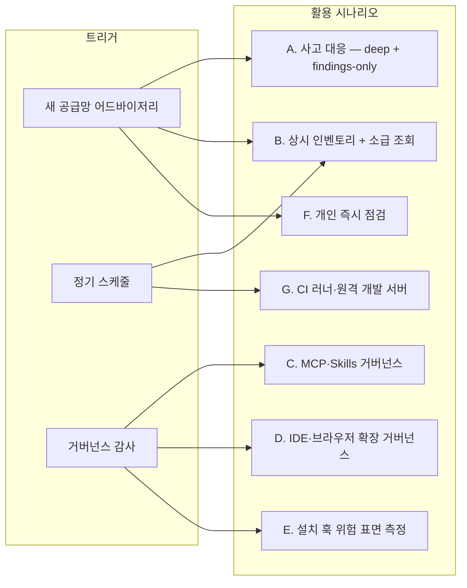
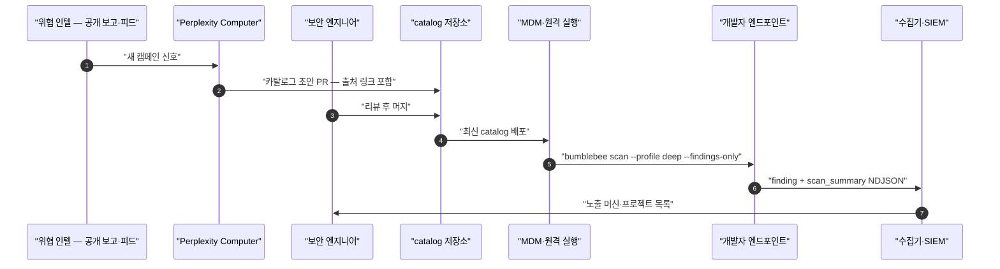
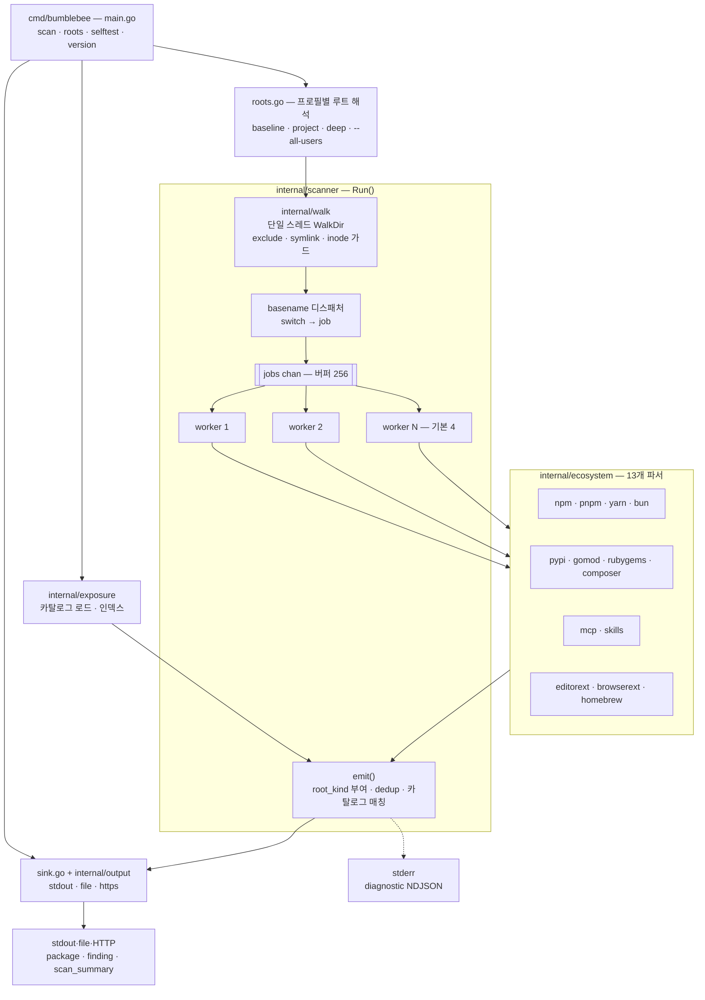
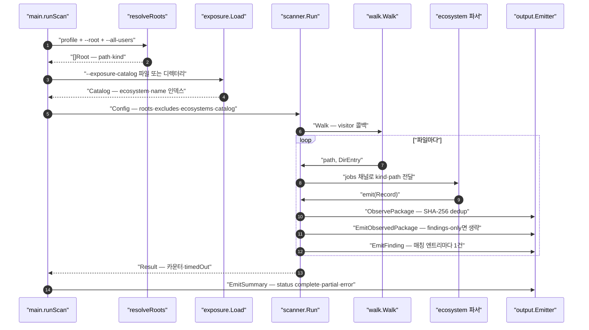
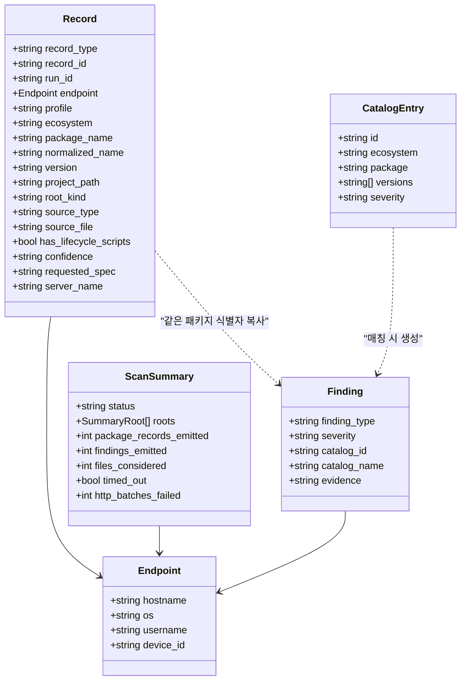
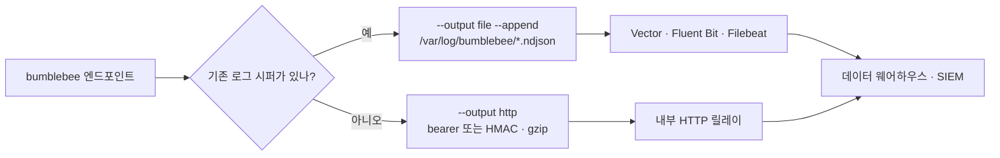
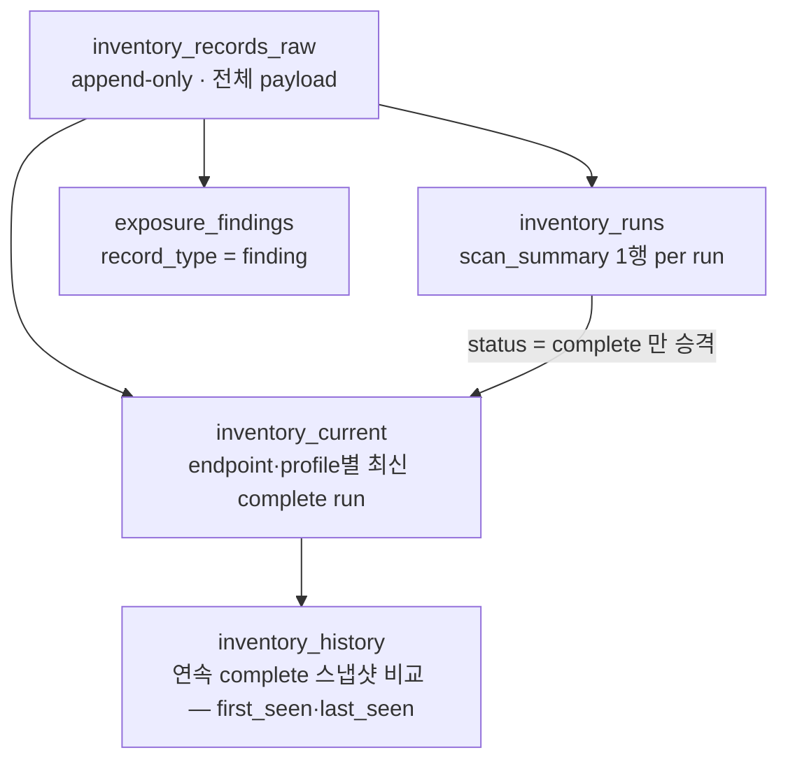
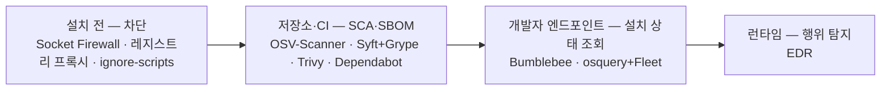

# Perplexity Bumblebee — 개발자 엔드포인트 공급망 노출 스캐너 코드 레벨 분석·활용 가이드

> 분석 대상: [`perplexityai/bumblebee`](https://github.com/perplexityai/bumblebee)  
> 기준 리비전: [`c1e83c0`](https://github.com/perplexityai/bumblebee/tree/c1e83c0adb53a7f527b40a7181a690ad99a0a6e0) (`main`, 2026-10-08 커밋 · in-tree `VERSION` 0.1.1)  
> 조사일: 2026-11-06  
> 라이선스: Apache-2.0 · 언어: Go 1.25+ · 외부 의존성 0개 · 비테스트 Go 코드 약 8.4k LOC  
> 공개일: 2026-05-22 ([Perplexity 블로그](https://www.perplexity.ai/hub/blog/perplexity-is-open-sourcing-bumblebee))  
> 주의: 2022년부터 활동한 동명의 악성코드 로더 "Bumblebee"와는 무관하다.

## 0. 한눈에 보는 결론

Bumblebee는 **개발자 노트북·리눅스 개발 서버에 지금 깔려 있는 패키지·확장·AI 도구 설정을 읽기 전용으로 긁어 모아 NDJSON으로 내보내고, 침해 패키지 목록(exposure catalog)과 정확히 일치하는 항목을 플래그하는 단일 Go 바이너리**다.

- **답하려는 질문 하나**: "어드바이저리가 `example-pkg@1.2.3`이 악성이라고 했다. **지금 이 순간** 우리 개발자 머신 중 어느 디스크에 그게 있나?"
- **커버리지 4면 + 1**: 언어 패키지(npm·pnpm·Yarn·Bun·PyPI·Go·RubyGems·Composer), **AI 에이전트 설정(MCP 서버·Agent Skills)**, 에디터 확장(VS Code·Cursor·Windsurf·VSCodium), 브라우저 확장(Chromium 계열·Firefox), Homebrew.
- **핵심 설계 원칙**: 패키지 매니저(`npm ls`, `pip show`, `go list` …)를 **절대 실행하지 않는다.** 소스 파일도 읽지 않는다. 락파일·설치 메타데이터·매니페스트만 파싱한다. 설치 훅으로 번지는 Shai-Hulud류 웜이 날뛰는 상황에서 "확인하려다 감염되는" 경로를 원천 차단한다.
- **위협 인텔 동봉**: `threat_intel/`에 Mini Shai-Hulud·GlassWorm·Mastra·TrapDoor 등 15개 캠페인 카탈로그(1,103개 엔트리 / 2,952개 버전)를 PR로 유지. Perplexity Computer가 초안을 쓰고 사람이 리뷰·머지한다.
- **아닌 것**: EDR(프로세스·네트워크 감시)도, CVE 범위 매칭 취약점 스캐너도, 설치 차단 방화벽도 아니다. "이미 알려진 나쁜 것이 어디 있나"를 빠르게 찾는 **사후 노출 조회 + 상시 인벤토리** 도구다.
- **실측(작성자 Apple Silicon 맥)**: baseline 프로필 6.4초에 약 70만 파일·29,025개 패키지 레코드, `~/conductor`(48GB) deep 스캔 13.9초에 186만 파일·84,827개 레코드.

> 한 문장으로: **"SBOM은 무엇을 출하했는지, EDR은 무엇이 실행됐는지를 말해 준다. Bumblebee는 개발자 디스크에 지금 무엇이 깔려 있는지를 말해 준다."**

---

## 1. 프로젝트 개요

### 1.1 해결하려는 문제

공급망 사고 대응 시 보안팀이 가장 먼저 받는 질문은 "우리 영향 있어?"다. 그런데 기존 도구는 각자 다른 레이어만 본다.

| 도구 | 보는 대상 | 개발자 노트북 사고 대응에서의 공백 |
|---|---|---|
| SBOM·SCA (Syft, OSV-Scanner, Dependabot) | 저장소·빌드 아티팩트·이미지 | 개발자가 로컬에 clone 해서 `npm install` 한 수십 개 프로젝트, 전역 설치본, `~/.nvm` 아래 툴체인은 안 보임 |
| EDR (CrowdStrike, SentinelOne …) | 프로세스·네트워크·파일 이벤트 | "실행됐는가"는 알지만 "어떤 lockfile에 어떤 버전이 박혀 있나"는 모름 |
| 엔드포인트 인벤토리 (MDM, osquery) | 설치된 애플리케이션 | 언어 패키지·IDE 확장·MCP 설정 같은 개발자 도구 레이어는 얕거나 없음 |

개발자 엔드포인트의 실제 상태는 **수많은 lockfile, `node_modules`, `site-packages`, IDE 확장 디렉터리, 브라우저 프로필, MCP JSON 설정에 흩어진 지저분한 로컬 상태**다. Bumblebee는 이걸 하나의 정규화된 레코드 스트림으로 바꾼다.

### 1.2 왜 "읽기 전용"이 핵심 기능인가

2025~2026년 npm 웜(Shai-Hulud, Mini Shai-Hulud, Miasma)은 공통적으로 `preinstall` / `postinstall` / `prepare` 훅이나 `binding.gyp`로 페이로드를 실행하고, 탈취한 npm 토큰으로 스스로 재배포했다. 이런 환경에서 영향 확인을 위해 패키지 매니저를 호출하면 위험하다.

- 손상된 전역 툴체인 자체를 실행하게 된다.
- 저장소 로컬 설정(Yarn Berry 플러그인, `.pnpmfile.cjs` 훅, Composer 플러그인 등)이 명령 실행 시 해석·로드될 수 있다.
- Perplexity 블로그 표현: *"A scanner that invokes npm to check for exposure has already triggered the attack it was looking for."*

그래서 Bumblebee는 Go 표준 라이브러리만으로 파일을 열어 파싱한다. 외부 의존성 0개라는 점도 같은 맥락이다. 공급망 스캐너 자신이 공급망 공격면이 되지 않게 한다.

### 1.3 탄생 배경

- 2026-04-29: SAP CAP npm 패키지 침해로 Mini Shai-Hulud 1차 웨이브
- 2026-05-11: TanStack·Mistral AI 등 npm+PyPI 170+ 패키지 2차 웨이브
- 2026-05-19: AntV 생태계 323개 패키지 / 639개 버전 3차 웨이브
- **2026-05-22: Bumblebee v0.1.1 공개.** Perplexity·Comet·Computer 개발 시스템 보호용 내부 도구를 오픈소스화
- 이후 Homebrew(#8), Claude Code `~/.claude.json` MCP(#42), Agent Skills(#41), OSV→카탈로그 생성기(#45), any-version `"*"` 카탈로그(#65), 워커 성능 개선(#69), 릴리스 자동화(#70)가 추가됐고, 2026-10까지 커뮤니티 PR로 카탈로그가 계속 갱신되고 있다.

---

## 2. 무엇에 쓰나 — 활용 시나리오

### 2.1 시나리오 지도



### 2.2 A. 공급망 사고 대응 (Perplexity의 원래 용도)

새 어드바이저리가 나오면 다음 순서로 진행한다.

1. 어드바이저리의 `(ecosystem, package, versions)`를 카탈로그 JSON으로 만든다. 직접 쓰거나 `threat_intel/`의 최신 파일을 쓴다.
2. MDM이나 원격 실행 도구로 전 개발자 머신에 `deep` 프로필을 푸시한다.
3. 중앙 수집기에서 `record_type=finding`만 모아 노출된 머신·프로젝트 경로·소스 파일을 확인한다.

```json
{
  "schema_version": "0.2.0",
  "entries": [
    {
      "id": "adv-2026-1106-foo",
      "name": "foo 2.3.1 / 2.3.2 (compromised release)",
      "ecosystem": "npm",
      "package": "foo",
      "versions": ["2.3.1", "2.3.2"],
      "severity": "critical"
    }
  ]
}
```

```sh
bumblebee scan --profile deep \
  --root "$HOME" \
  --exposure-catalog /opt/bumblebee/catalogs/ \
  --findings-only \
  --max-duration 10m \
  --output http --http-url https://inventory.internal/v1/ingest \
  --http-auth hmac-sha256 --http-hmac-key-env BB_HMAC \
  --device-id-env BB_DEVICE_ID
```



`finding` 레코드에는 `catalog_id`, `source_file`, `project_path`, `confidence`, `evidence`가 붙는다. 그래서 어느 어드바이저리 때문에 어느 lockfile의 어느 줄이 걸렸는지 추적할 수 있다.

### 2.3 B. 상시 인벤토리 + 소급 조회 (가장 레버리지가 큰 용도)

사고가 터질 때마다 전 머신을 deep 스캔하는 대신, **평소에 baseline(6시간)·project(일 1~2회) 인벤토리를 중앙에 쌓아 두면 새 어드바이저리가 와도 엔드포인트를 건드리지 않고 SQL 조인만으로 1차 답을 낼 수 있다.**

```sql
-- inventory_current: 프로필별 최신 complete 스냅샷 (docs/state-model.md 패턴)
SELECT c.endpoint_id, c.project_path, c.source_file, c.version
FROM inventory_current c
JOIN advisory_catalog a
  ON a.ecosystem = c.ecosystem
 AND a.normalized_name = c.normalized_name
 AND (a.version = c.version OR a.version = '*');
```

baseline·project가 보지 않는 영역(홈 디렉터리 전체, 임의 위치에 clone 한 저장소)만 deep 스캔으로 보완한다. 이 방식을 쓰려면 수집 측에서 `scan_summary.status=complete`일 때만 스냅샷을 승격하는 규칙을 지켜야 한다(§10.4).

### 2.4 C. AI 에이전트 도구 거버넌스 (MCP · Agent Skills)

Bumblebee의 차별점 중 하나는 **AI 코딩 도구 설정을 1급 인벤토리로 다룬다는 점**이다.

- **파싱 대상**: Claude Desktop, Claude Code(`~/.claude.json`의 user·project 스코프 `mcpServers`, `~/.claude/**/.mcp.json`), Cursor, Windsurf, Cline, Gemini CLI(`~/.gemini/settings.json`), 프로젝트 `.mcp.json`
- **패키지 추론**: `npx`/`bunx`/`pnpm dlx`/`uvx`/`uv tool run --from`/`pipx run --spec`/`docker run <image:tag>`/`python -m`에서 실제 패키지 식별자를 뽑아 `package_name`에 넣고 selector(`@latest`, `@1.2.3`)는 `requested_spec`에 보존한다.
- **원격 MCP**: URL을 `scheme://host`로 축약해 기록한다. 경로·쿼리·userinfo에 박힌 토큰은 버린다.
- **비밀 보호**: `env` 블록의 값은 물론 키 이름도 기록하지 않는다.

이걸로 할 수 있는 일은 다음과 같다.

```sh
# 조직 전체에서 쓰이는 원격 MCP 호스트 목록 → 허용 목록 대조
jq -r 'select(.package_manager=="mcp-remote") | .requested_spec' inv.ndjson | sort | uniq -c

# @latest로 고정 안 된 MCP 서버 — 다음 실행 시 무엇이 받아질지 모름 (드리프트 위험)
jq -c 'select(.ecosystem=="mcp" and ((.requested_spec // "") | test("@latest$")))' inv.ndjson

# 어떤 GitHub 소스에서 Agent Skill을 받아 쓰고 있나
jq -r 'select(.ecosystem=="agent-skill") | [.package_name, .server_name, .requested_spec] | @tsv' inv.ndjson
```

또 카탈로그에 `"ecosystem": "mcp", "package": "@evil/mcp-server", "versions": ["*"]`를 넣으면 **특정 MCP 서버 패키지가 설정된 머신 전체**를 찾을 수 있다. MCP 레코드는 버전이 비어 있으므로 반드시 `"*"`를 써야 한다.

### 2.5 D. IDE·브라우저 확장 거버넌스

- GlassWorm 카탈로그는 Open VSX·VS Code 확장 243개 / 381개 버전을 담고 있다. Nx Console(`nrwl.angular-console@18.95.0`) 침해 같은 확장 단위 사고도 동일한 방식으로 조회한다.
- 브라우저 확장은 Chrome·Chromium·Brave·Edge·Vivaldi·Arc·Comet(Default, Profile 1~9)과 Firefox·LibreWolf·Waterfox 프로필의 `extensions.json`까지 읽는다. 쿠키·로그인 데이터가 있는 상위 디렉터리에는 들어가지 않고, 프로필별 `Extensions/` 경로만 루트로 지정한다.
- 확장 ID 기준의 허용·차단 목록 감사나 "회사 정책상 금지된 확장" 탐지에도 그대로 쓸 수 있다.

### 2.6 E. 설치 훅 위험 표면 측정

npm 계열 레코드에는 `has_lifecycle_scripts`와 `lifecycle_scripts`(`preinstall`, `install`, `postinstall`, `prepare`, `preprepare`, `postprepare`)가 붙는다. 카탈로그 없이도 다음 질문에 답할 수 있다.

- 설치 시 코드를 실행하는 의존성이 몇 개이고, 어느 프로젝트에 있나?
- `npm config set ignore-scripts true`나 pnpm `onlyBuiltDependencies` 허용 목록을 도입하면 무엇이 깨지나?

```sh
jq -r 'select(.record_type=="package" and .has_lifecycle_scripts)
       | [.package_name, .version, (.lifecycle_scripts|join(",")), .project_path] | @tsv' inv.ndjson
```

작성자 노트북 baseline에서는 99개 패키지가 lifecycle script를 갖고 있었다(`prepare` 91, `install` 7, `preprepare` 4, `postinstall` 1).

### 2.7 F. 개인 개발자 즉시 점검 (5분)

```sh
go install github.com/perplexityai/bumblebee/cmd/bumblebee@latest
bumblebee selftest                      # selftest OK (5 findings in 4ms)

# 카탈로그는 릴리스 tarball에 threat_intel/**로 동봉되며, 저장소에서 바로 받아도 된다
git clone --depth 1 https://github.com/perplexityai/bumblebee ~/.bumblebee-src

bumblebee scan --profile baseline \
  --exposure-catalog ~/.bumblebee-src/threat_intel --findings-only

bumblebee scan --profile deep --root ~/code \
  --exposure-catalog ~/.bumblebee-src/threat_intel --findings-only --max-duration 10m
```

출력이 `scan_summary` 한 줄뿐이고 `findings_emitted: 0`이면 현재 카탈로그 기준으로 노출이 없다는 뜻이다.

> 맥에서 `--root "$HOME"`으로 deep을 돌리면 `~/Documents`·`~/Desktop`·`~/Downloads` 접근 시 실행 중인 터미널 앱에 대해 TCC 권한 팝업이 뜰 수 있다. 개발 디렉터리만 루트로 주는 편이 조용하다.

### 2.8 G. CI 러너·원격 개발 서버·Dev Container

- Linux를 지원하고 정적 바이너리라서, self-hosted GitHub Actions 러너나 빌드 서버의 툴체인 캐시를 같은 카탈로그로 점검할 수 있다.
- baseline 루트에 `~/.vscode-server/extensions`, `~/.cursor-server/extensions`가 들어 있어서 **원격 개발 서버에 설치된 확장**도 잡힌다. 서버 런타임·로그·`globalStorage`는 exclude 처리돼 토큰이 노출되지 않는다.

### 2.9 H. 위협 인텔 파이프라인 구축

- `tools/osvcatalog`는 [OSSF malicious-packages](https://github.com/ossf/malicious-packages) 스냅샷이나 OSV `all.zip`을 **오프라인으로** 카탈로그로 변환한다. `MAL-` 레코드만 뽑고, 모든 버전이 영향받는 경우(`introduced: "0"`)는 `"*"`로 바꾼다.
- 야간 배치로 OSV 악성 패키지 전체 카탈로그를 만들고, 사람이 큐레이션한 `threat_intel/`과 디렉터리로 합쳐 쓰면 "알려진 악성 패키지 전체 + 최신 캠페인"을 함께 커버할 수 있다.
- Perplexity처럼 LLM 에이전트가 어드바이저리를 읽고 카탈로그 PR 초안을 쓰게 하는 것도 자연스러운 확장이다. 카탈로그가 `(ecosystem, package, versions)`만 담는 단순한 JSON이라 LLM 생성물을 스키마로 검증하기 쉽다.

### 2.10 맞지 않는 용도

| 하고 싶은 것 | Bumblebee로는 | 대신 쓸 것 |
|---|---|---|
| CVE 버전 범위(`<1.4.2`) 기반 취약점 스캔 | ❌ 정확 일치만 지원 | OSV-Scanner, Grype, Trivy |
| 설치 시점 차단 | ❌ 사후 조회 도구 | Socket Firewall, npm `ignore-scripts`, 사내 레지스트리 프록시 |
| 실행·네트워크 행위 탐지 | ❌ EDR 아님 | EDR, osquery 이벤트 테이블 |
| Windows 개발 PC | ❌ macOS·Linux만 지원 | osquery, 상용 인벤토리 |
| Cargo·Maven·Gradle·NuGet·Swift PM | ❌ 미지원 (TrapDoor 카탈로그도 Cargo는 주석 처리) | Syft, OSV-Scanner |
| 컨테이너 이미지 SBOM | △ 추출한 rootfs에 `--root`를 줄 수는 있지만 설계 목적이 아님 | Syft, Trivy |

---

## 3. 핵심 특징 및 차별점

| 특징 | 내용 | 엔지니어 관점 의미 |
|---|---|---|
| 실행 금지 원칙 | 패키지 매니저·셸 호출 없음. 소스 파일 미독해 | 감염된 환경에서도 스캐너가 감염 경로가 되지 않음 |
| 제로 의존성 | Go stdlib만 사용. YAML도 자체 라인 스캐너로 처리 | 스캐너 자체의 공급망 공격면 최소화, 감사 범위 축소 |
| 4+1 표면 커버리지 | 언어 패키지 + MCP/Skills + IDE 확장 + 브라우저 확장 + Homebrew | 블로그 표현: 기존 OSS는 1~2면만 커버 |
| 3개 프로필 | `baseline`·`project`·`deep`가 루트 범위와 운영 cadence를 분리 | 상시 경량 인벤토리와 사고 대응 스윕을 같은 바이너리로 처리 |
| 정확 일치 카탈로그 | `(ecosystem, normalized_name, version)` 해시 인덱스 + `"*"` 와일드카드 | 오탐 거의 없음. 범위 매칭은 의도적으로 제외 |
| 유지되는 위협 인텔 | `threat_intel/` 15개 캠페인, AI 초안 + 사람 리뷰 PR | 카탈로그를 직접 만들 여력이 없는 팀도 바로 사용 가능 |
| 수신측 친화 스키마 | 콘텐츠 주소형 `record_id`, `run_id`, `scan_summary` 종료 레코드, JSON Schema 공개 | 멱등 적재·스냅샷 승격·이력 계산이 쉬움 |
| 프라이버시 가드 | `.ssh`·`.aws`·`.kube` 등 제외, `.env`·`.envrc` 스킵, MCP env 폐기, URL 축약 | 개발자 PC에 상시 배포해도 비밀이 수집 경로로 새지 않음 |
| 자기 검증 | `bumblebee selftest`가 내장 fixture 5종으로 E2E 확인 | MDM 롤아웃 전 smoke test |

---

## 4. 아키텍처 분석

### 4.1 전체 구조



동시성 모델은 **생산자 1개(파일 시스템 워커) + 소비자 N개(파서 워커)** 구조다. 디렉터리 순회는 순차로 하고, 파일 파싱만 병렬로 돌린다. `emit()`은 여러 워커에서 동시에 호출되므로 `Emitter` 내부 뮤텍스로 직렬화한다.

### 4.2 한 번의 스캔 실행 흐름



### 4.3 개념 모델



- **`confidence`**: `high`는 정규 메타데이터에서 이름·버전을 정확히 얻은 경우(lockfile, dist-info, go.sum, 확장 매니페스트)다. `medium`은 식별자는 확실하지만 버전·출처가 부분적인 경우(`node_modules/*/package.json`, `go.mod` require, docker 태그 MCP)다. `low`는 설정이나 spec 참조뿐인 경우(대부분의 MCP, Agent Skill)다.
- **`root_kind`**: 레코드가 어느 루트에서 나왔는지 표시한다(`global_package_root`, `user_package_root`, `project_root`, `editor_extension_root`, `browser_extension_root`, `mcp_config_root`, `agent_skill_root`, `homebrew_root`, `deep_home_root`). 수신측은 이걸로 모집단을 분리한다.

### 4.4 프로필별 루트

| 프로필 | 기본 루트 (macOS 기준) | 홈 전체 허용 | 권장 cadence |
|---|---|---|---|
| `baseline` | `~/go`, `~/.cargo`, `~/.rbenv`, `~/.pyenv/versions`, `~/.nvm/versions`, `~/.asdf/installs`, `~/.local/lib/python*`, pipx venvs, 에디터 확장 8곳, MCP 설정 디렉터리(`~/.claude`, `~/.claude.json`, `~/.cursor`, `~/.codex`, `~/.gemini`, `~/Library/Application Support/Claude` …), `~/.agents`, 브라우저 프로필 `Extensions/`, `/opt/homebrew/{Cellar,Caskroom,lib}`, `/usr/local/*`, `/Library/Python` | ❌ 거부 | 6시간 + 로그인 시 |
| `project` | `~/code`, `~/src`, `~/Developer`, `~/Projects`, `~/workspace` + `--root` | ❌ 거부 | 일 1~2회 |
| `deep` | `--root` 필수 (자동 구성 없음) | ✅ | 사고 시 온디맨드 |

`baseline`·`project`에 `$HOME`, `/Users/<name>`, `/`를 주면 명시적인 에러를 내고 `deep`을 쓰라고 안내한다. 상시 실행 프로필이 실수로 홈 전체를 훑지 않도록 하는 장치다.

---

## 5. 기술 스택

| 영역 | 선택 | 비고 |
|---|---|---|
| 언어 | Go 1.25+ (`go.mod`에 의존성 없음) | 작성자 환경에서는 go1.27.1로 빌드 확인 |
| 파일 순회 | `filepath.WalkDir` + `syscall.Stat_t` (dev, ino) | `dirkey_unix.go` / `dirkey_other.go` 빌드 태그 분리 |
| 파싱 | `encoding/json`, `bufio` 라인 스캐너 | `pnpm-lock.yaml`·`yarn.lock`은 YAML 라이브러리 없이 라인 단위로 파싱 |
| 식별자 | `crypto/sha256` 콘텐츠 주소 `record_id`, `crypto/rand` 128bit `run_id` | |
| 전송 | `net/http`, `compress/gzip`, `crypto/hmac` | 재시도·스풀 없음 |
| 자기 검증 | `embed.FS`로 selftest fixture 내장 | |
| 빌드·배포 | GoReleaser, `CGO_ENABLED=0`, `-trimpath -s -w`, darwin·linux × amd64·arm64 tar.gz + `threat_intel/**` 동봉 | `-ldflags -X main.Version` |
| 스키마 | `docs/schema/v0.1.0`, `v0.2.0` JSON Schema 5종 | package·finding·scan_summary·diagnostic·exposure-catalog |
| 보조 도구 | `tools/osvcatalog` (OSV → 카탈로그) | 스캐너 바이너리에는 미포함 |

---

## 6. 핵심 코드 분석

### 6.1 모듈 구조

```
cmd/bumblebee/
  main.go        서브커맨드 디스패치, scan 플래그, 종료 코드·scan_summary 조립
  roots.go       프로필별 루트 해석, --all-users, 브라우저 프로필 후보 열거
  sink.go        stdout|file|http 싱크 생성, 인증 env 해석
  selftest.go    go:embed fixture → 임시 디렉터리 → 스캔 → 5건 단언
internal/
  walk/          제외 규칙·심볼릭 링크·inode 루프 가드가 있는 워커
  scanner/       오케스트레이터 — 디스패치·워커 풀·emit·finding 생성
  ecosystem/     13개 파서 (npm pnpm yarn bun pypi gomod rubygems composer
                 mcp skills editorext browserext homebrew)
  exposure/      카탈로그 로드·검증·인덱스·MatchAll
  model/         레코드 스키마, StableID
  normalize/     npm 소문자화, PyPI PEP 503
  output/        NDJSON Emitter(dedup), HTTPSink
  osv/           OSV 레코드 → 카탈로그 엔트리 변환
  endpoint/      hostname·os·arch·user·device_id
tools/osvcatalog/  오프라인 OSV 변환 CLI
threat_intel/      캠페인별 exposure catalog JSON 15개
```

모든 구현이 `internal/` 아래에 있어서 **Go 라이브러리로 import할 수 없다.** 통합 지점은 CLI와 NDJSON 출력 스키마뿐이다. 이건 의도된 설계다. 엔드포인트에 배포되는 바이너리와 수신측의 계약을 와이어 포맷으로 고정한 것이다.

### 6.2 워커: 안전과 비용

`internal/walk/walk.go`의 핵심 결정은 다음과 같다.

1. **기본 제외 목록(104개)**: VCS(`.git`), 자격증명(`.ssh`, `.aws`, `.azure`, `.config/gcloud`, `.kube`, `.docker`, `.gnupg`), TCC 보호 대상이거나 무의미한 macOS `Library/*` 하위 트리 50여 개, 미디어 라이브러리, 빌드 캐시(`.gradle`, `.m2`, `.pnpm-store`, `.yarn/cache`, `bazel-*`), VS Code·Cursor·Windsurf 서버의 `data|bin|cli|logs`. `--root "$HOME"`을 줘도 이 목록은 적용된다.
2. **제외 매칭 O(1)**: 단일 컴포넌트(`.git`)는 basename 맵으로, 다중 컴포넌트(`Library/Caches`)는 **마지막 컴포넌트로 인덱싱한 뒤 접미사 비교**한다. PR #69에서 "디렉터리당 stat 1회 + basename 인덱스"로 핫패스를 최적화했다.
3. **디렉터리 심볼릭 링크는 절대 따라가지 않는다.** `Lstat` 결과를 재사용해 `(dev, ino)` 키로 이미 본 디렉터리를 건너뛴다. 이 키로 겹치는 루트도 한 번만 순회한다.
4. **오류 등급화**: EACCES·EPERM(TCC 거부)은 `debug`, ENOENT(없는 기본 루트)는 `info`, 나머지는 `warn`. 정상 스캔이 경고로 도배되지 않게 하려는 장치다.

> **코드-주석 불일치**: 패키지 주석에는 "node_modules 하위로는 필요한 만큼만 내려간다(bounded recursion)"고 적혀 있지만, 실제 구현에는 `node_modules/.cache` 제외 외에 깊이 제한이 없다. 워커는 `node_modules` 전체를 순회하고, npm 파서의 `IsNodeModulesPackageJSON`이 경로 꼬리 모양(`node_modules/<pkg>/package.json`, `node_modules/@scope/<pkg>/package.json`)으로 대상만 거른다. deep 스캔에서 `files_considered`가 186만까지 올라간 이유가 이것이다.

### 6.3 디스패처: basename switch

`scanner.Run`의 visitor는 파일마다 `switch`로 종류를 판정해 job을 큐에 넣는다. **분기 순서가 곧 우선순위다.**

```go
case base == "package.json":
    // 1) 에디터 확장 매니페스트인가? (~/.vscode/extensions/<id>-<ver>/package.json)
    // 2) pnpm 스토어 레이아웃인가? (node_modules/.pnpm/<name>@<ver>/node_modules/<name>/package.json)
    // 3) 일반 node_modules 패키지인가?
```

- `settings.json`은 VS Code 사용자 설정과 이름이 겹치므로 **부모 디렉터리가 `.gemini`일 때만** MCP 파서로 보낸다. `.claude.json`도 경로 기반으로 판정한다.
- `manifest.json`은 Chromium `Extensions/<32자 id>/<version>/manifest.json` 모양일 때만, `INSTALL_RECEIPT.json`은 Homebrew `Cellar/<name>/<ver>/` 모양일 때만 처리한다.
- Homebrew cask는 `.internal.json`·`.json`·`.rb` 마커 중 Homebrew가 선호하는 스냅샷 하나만 고르려고 워커 안에서 형제 파일을 검사한다(직렬 I/O를 감수하고 중복을 막는다).
- `.env`·`.envrc`는 제외 디렉터리 밖에 있어도 무조건 스킵한다.

### 6.4 생태계 파서 하이라이트

| 파서 | 소스 | 구현 포인트 | confidence |
|---|---|---|---|
| npm | `package-lock.json`, `npm-shrinkwrap.json`, `node_modules/.package-lock.json`, `node_modules/*/package.json` | lockfile v1(`dependencies` 재귀) / v2·v3(`packages` 키) 모두 처리, `link: true` 워크스페이스 링크 제외, 키의 `node_modules/` 개수로 direct 여부 판정, dev/prod 스코프 | lock: high, pj: medium |
| pnpm | `pnpm-lock.yaml`, `.pnpm/<dir>/node_modules/<pkg>/package.json` | YAML 의존성 없이 `packages:` 블록 라인 스캔(v5·v6·v9). 스토어 디렉터리명 `@types+babel__core@7.20.5_react@18.2.0`에서 스코프 `+`→`/` 복원, 이름에 `_`가 있거나 peer 접미사에 `@`가 있는 경우를 피해 **첫 번째 `@`(스코프면 index 1 이후)**에서 버전을 분리 | high / medium |
| Yarn | `yarn.lock` (Classic + Berry) | 엔트리 헤더의 다중 디스크립터, `__metadata` 블록 처리 | high |
| Bun | `bun.lock` 텍스트 | `bun.lockb` 바이너리는 디코드하지 않고 존재만 진단으로 남김 | high |
| PyPI | `*.dist-info/METADATA`, `INSTALLER`, `direct_url.json`, `*.egg-info/PKG-INFO` | PEP 503 정규화(`Foo_Bar.baz` → `foo-bar-baz`) | high / medium |
| Go | `go.sum`, `go.mod` | `go.sum`의 `/go.mod` 의사 엔트리는 건너뛰어 실제 다운로드된 모듈만 남김 | sum: high, mod: medium |
| RubyGems | `Gemfile.lock`, 설치된 `*.gemspec` | `specifications/` 하위인지 확인 | high / medium |
| Composer | `composer.lock`, `vendor/composer/installed.json` | | high / medium |
| MCP | 6종 basename + `.gemini/settings.json` + `.claude.json` | 아래 6.5 참조 | low (docker 태그는 medium) |
| Agent Skill | `~/.agents/.skill-lock.json`, `skills-lock.json` | `package_name`=업스트림 소스 슬러그, `server_name`=로컬 별칭, `requested_spec`=sourceType·ref | low |
| 에디터 확장 | VS Code·Cursor·Windsurf·VSCodium `extensions/<publisher.name-ver>/package.json` | | high |
| 브라우저 확장 | Chromium `manifest.json`, Firefox `extensions.json` | 프로필 경로를 `project_path`로 사용 | high |
| Homebrew | Formula `INSTALL_RECEIPT.json`, Cask `.metadata` | | high |

### 6.5 MCP 파서: 패키지 식별 + 비밀 비노출

`internal/ecosystem/mcp/mcp.go`(853 LOC)는 가장 큰 파서이고, 보안 관련 판단이 가장 많이 들어 있다.

- **세 가지 envelope**를 처리한다: `{"mcpServers": {...}}`, `{"servers": {...}}`, flat `{ "<id>": {...} }`. Claude Code `~/.claude.json`은 최상위 `mcpServers`(user 스코프)와 `projects.<dir>.mcpServers`(local 스코프)를 모두 읽는다.
- **런처별 인자 해석** (`inferPackageFromArgs`):
  - `npx`/`bunx`: `--package=<pkg>`를 우선한다. 단 `--`나 첫 positional 이후의 `--package`는 자식 프로세스 인자이므로 무시한다. `npx foo --package @npmcli/bar`가 `@npmcli/bar`로 오인되지 않게 한다.
  - `pnpm|yarn|bun|npm` + `dlx|exec|x|run`: 서브커맨드를 건너뛴 뒤 첫 비플래그 인자를 쓴다.
  - `uv`: `--from <pkg>`를 우선한다. `uv run <script>`는 로컬 경로이므로 패키지로 보지 않는다. `uv tool run`만 인정한다.
  - `pipx run --spec`, `docker|podman run`(값을 받는 플래그를 소비한 뒤 첫 positional = 이미지, 태그는 `version`으로), `python -m mod` → `python:mod`.
- **값을 받는 플래그 소비**: `npx --registry https://token@reg.example.com/ pkg`에서 레지스트리 URL이 패키지명으로 잡히면 userinfo 토큰이 레코드로 유출된다. 이를 막으려고 `npmValueTakingFlags`로 플래그 값을 건너뛴다.
- **원격 서버**: `url`/`serverUrl`/`httpUrl`이 있고 command가 없으면 `package_manager=mcp-remote`로 기록하고, URL은 `scheme://host`만 남긴다. 경로 세그먼트(`/mcp/<token>`)에도 토큰이 들어갈 수 있어서 경로까지 버린다.
- **env**: 값도 키 이름도 저장하지 않는다. 스키마에 자유 텍스트 필드가 없는 것도 같은 이유다.

> **실측에서 본 한계**: Claude Code 공식 플러그인 MCP(예: `discord`, `fakechat`)의 `.mcp.json`은 `bun run --cwd ${CLAUDE_PLUGIN_ROOT} --shell=bun --silent start` 형태다. 파서는 `run`을 서브커맨드로 건너뛰고 `--cwd` 값을 소비한 뒤 **package.json 스크립트 이름 `start`를 패키지로 기록**한다(confidence `low`). 로컬 스크립트를 실행하는 MCP 서버는 `package_name`을 신뢰하지 말고 `server_name`·`source_file`로 식별해야 한다.

### 6.6 emit 파이프라인: root_kind → dedup → finding

```go
emit := func(r model.Record) {
    // 1) 가장 긴 접두 루트의 kind로 root_kind 덮어쓰기 (없으면 파서 값 → unknown)
    // 2) ObservePackage: StableID(SHA-256) 기준 run 내 중복 제거
    // 3) findings-only가 아니면 package 레코드 출력
    // 4) 중복이면 return — 같은 finding 두 번 방지
    // 5) Catalog.MatchAll(r) → 매칭된 카탈로그 엔트리마다 Finding 1건
}
```

- **`record_id` = SHA-256(record_type ‖ 정규 튜플)**. 튜플은 `profile, ecosystem, normalized_name, version, project_path, root_kind, …, source_file, confidence, requested_spec, server_name`이다. `run_id`·`scanner_version`이 빠져 있어서 **여러 run·여러 호스트에 걸쳐 안정적인 조인 키**가 된다. 구분자는 ASCII Record/Unit Separator(`\x1e`, `\x1f`)라 필드 값과 충돌하지 않는다.
- **finding을 엔트리마다 따로 내는 이유**: 카탈로그를 어드바이저리당 파일 하나로 관리하면 같은 `(ecosystem, name, version)`이 여러 캠페인에 겹칠 수 있다. 현재 `threat_intel/` 15개 파일 사이에는 겹치는 튜플이 없지만, 사내 카탈로그와 공개 카탈로그를 섞으면 쉽게 생긴다. 그래서 `Match`(첫 건)가 아니라 `MatchAll`을 쓰고, `Finding.StableID`에 `catalog_id`를 넣어 겹침을 숨기지 않는다.
- **에러 전파**: 싱크 쓰기가 실패하면 `emitErr`를 세팅한다. 워커·디스패처·visitor가 모두 이 값을 확인하고 즉시 중단한다(`SkipDir`). HTTP 4xx·5xx가 나면 스캔 전체를 빠르게 멈춘다.

### 6.7 Exposure 카탈로그

```go
key := r.Ecosystem + "\x00" + r.NormalizedName   // 로드 시 1회 인덱스 구축
for _, e := range c.index[key] {
    if e.anyVersion { hit } else if contains(e.Versions, r.Version) { hit }
}
```

- 로드 시점에 엔트리 이름을 생태계별로 정규화한다. `Requests`나 `@TanStack/Query-Core`처럼 써도 매칭된다.
- `"*"`는 schema `0.2.0`에서만 허용되고, `versions`의 유일한 원소여야 한다. `0.1.0` 카탈로그도 계속 받는다.
- 디렉터리를 주면 `*.json`을 **알파벳 순서로, 재귀 없이** 합친다. 모든 파일의 `schema_version`이 같아야 한다. 디렉터리를 가리키는 심볼릭 링크는 건너뛴다.
- 빈 파일은 no-op 카탈로그로 받는다(공개 전 placeholder 배포용). 최상위 배열은 거부한다.
- **범위·해시·integrity 매칭은 의도적으로 범위 밖이다.** 어드바이저리가 "1.2.0 이상 1.4.2 미만"이라고만 하면 버전을 직접 펼쳐 넣어야 한다. Laravel Lang 카탈로그가 700개 태그를 전부 나열한 게 그 예다.

### 6.8 출력·전송

- **스트림 분리**: package·finding·scan_summary는 records 싱크로, diagnostic은 항상 stderr로 보낸다.
- **HTTP 싱크**: 줄 수 기준 배치(기본 500), `Content-Type: application/x-ndjson`, Bearer 또는 HMAC-SHA256(`X-Inventory-Signature: sha256=<hex>`, 선택적 `X-Inventory-Timestamp`로 `<ts>.<body>` 서명), **gzip을 먼저 하고 서명은 그 뒤**에 한다. 비루프백 주소는 HTTPS를 강제하고, 토큰·키는 env에서만 읽는다(프로세스 목록 노출 방지).
- **재시도·로컬 스풀 없음**: non-2xx가 오면 그 run은 `partial`, exit 1이 된다. 회복력이 필요하면 `--output file` + Vector·Fluent Bit 같은 기존 로그 시퍼를 쓰라고 문서가 명시한다.
- **S3 직접 업로드를 일부러 넣지 않음**: 엔드포인트마다 클라우드 자격증명을 배포해야 하므로, 얇은 내부 HTTP 릴레이를 두라고 권한다.

### 6.9 osvcatalog

- 입력: 디렉터리 트리, OSV `all.zip`, 단일 JSON
- `MAL-` ID이거나 그에 alias된 레코드만 → `severity: "critical"`
- OSV 생태계 매핑: `npm`, `PyPI→pypi`, `Go→go`, `RubyGems→rubygems`, `Packagist→packagist`, `VSCode→editor-extension`
- `introduced: "0"` 단일 이벤트(전 버전 영향)는 `"*"`. 열거된 `affected[].versions` 없이 범위만 있는 레코드는 스킵하고, 스킵 사유를 `_comment`에 집계한다.
- 출력이 결정적이라 diff 기반 리뷰가 가능하다.

---

## 7. API 및 인터페이스

### 7.1 CLI

| 서브커맨드 | 용도 |
|---|---|
| `scan` | 스캔 실행 |
| `roots` | 실제로 순회할 루트를 `<root_kind>\t<path>`로 미리 보기 |
| `selftest` | 내장 fixture 검증 (`--quiet`) |
| `version` | 버전·VCS 리비전·빌드 시각·Go 런타임 |

주요 `scan` 플래그:

| 플래그 | 기본값 | 설명 |
|---|---|---|
| `--profile` | `baseline` | `baseline`·`project`·`deep` |
| `--root` | — | 반복 또는 콤마 구분. `deep`에는 필수 |
| `--exclude` | — | 추가 제외(이름 또는 접미 경로) |
| `--ecosystem` | 전체 | `npm,pypi,go,rubygems,packagist,mcp,editor-extension,browser-extension,homebrew,agent-skill` |
| `--exposure-catalog` | — | 파일 또는 디렉터리 |
| `--findings-only` | false | package 레코드만 억제 (finding·summary·diag는 유지) |
| `--all-users` | false | macOS 루트 실행 시 `/Users/*`에 baseline·project 기본 루트 확장 |
| `--max-file-size` | 5 MiB | 메타데이터 파일 1개당 상한 |
| `--max-catalog-size` | 64 MiB | 카탈로그 파일당 상한 |
| `--max-duration` | 0 (무제한) | 전체 wall-clock 상한 |
| `--concurrency` | 4 | 파서 워커 수 |
| `--output` | `stdout` | `stdout`·`file`·`http` |
| `--http-auth` | `none` | `none`·`bearer`·`hmac-sha256` |
| `--device-id-env` | — | MDM이 주입한 안정 ID를 담은 env 이름 |

**종료 코드**: `0` 정상, `1` partial·error·싱크 실패, `2` 설정 오류(잘못된 프로필, `--findings-only` 단독 사용, 홈 루트 거부 등).

### 7.2 출력 계약

- 레코드 4종(`package`, `finding`, `scan_summary`, `diagnostic`). JSON Schema가 `docs/schema/v0.2.0/`에 있다.
- 모든 레코드에 `schema_version`, `scanner_version`, `run_id`, `scan_time`, `endpoint`가 들어간다.
- `scan_summary`는 run마다 1건이고 마지막에 온다. `roots`, `counts`, `files_considered`, `duplicates`, `timed_out`, `http_batches_*`를 포함한다.

---

## 8. 확장성 및 커스터마이징

| 확장 지점 | 방법 | 난이도 |
|---|---|---|
| 위협 인텔 | 카탈로그 JSON 추가(파일 또는 디렉터리), `osvcatalog`로 자동 생성, PR로 `threat_intel/`에 기여 | 낮음 |
| 스캔 범위 | `--root`, `--exclude`, `--ecosystem`, 프로필 선택 | 낮음 |
| 엔드포인트 식별 | `--device-id-env`로 MDM·EDR 자산 ID 주입 | 낮음 |
| 수신측 | NDJSON을 받는 아무 시스템(SIEM, BigQuery, ClickHouse, Loki …) + `docs/state-model.md` 테이블 패턴 | 중간 |
| 새 생태계 (Cargo 등) | **포크 필요.** ① `internal/ecosystem/<eco>/`에 `Scanner{MaxFileSize, Emit, Diag}`와 `Is*()` 판정 함수 구현 ② `model`에 ecosystem 상수 등록 ③ `scanner.Run`의 job switch와 디스패처 switch에 분기 추가 ④ baseline 후보 루트 추가 ⑤ `exposure.normalizeName`에 정규화 규칙 추가 | 중간 |

플러그인 시스템은 없다. 모든 파서가 같은 `Scanner{MaxFileSize, Emit, Diag}` 형태를 따르고 상태가 없어서 추가 패턴은 단순하지만, 런타임 확장(동적 로딩, 외부 파서)은 의도적으로 지원하지 않는다. 실행 금지 원칙과 같은 맥락이다.

---

## 9. 성능 특성

### 9.1 실측

환경: Apple Silicon 맥(darwin/arm64), 소스 `c1e83c0`을 go1.27.1로 로컬 빌드, 기본 `--concurrency 4`, 카탈로그는 `threat_intel/` 전체(15 파일, 1,103 엔트리, 2,952 버전).

| 시나리오 | wall | files_considered | package 레코드 | 중복 제거 | findings |
|---|---|---|---|---|---|
| `selftest` | 4 ms | — | — | — | 5 (기대값) |
| `baseline` (16개 기본 루트 존재, 88개 후보 부재) | **6.4 s** (user 0.97 s / sys 2.99 s) | 699,858 | 29,025 | 651 | 0 |
| `deep --root ~/conductor` (48 GB, 다수 워크스페이스·`node_modules`) `--findings-only` | **13.9 s** | 1,858,839 | 84,827 (억제) | 846 | 0 |

baseline 레코드 분포: npm 21,411 · go 6,171 · rubygems 601 · pypi 532 · homebrew 153 · mcp 66 · browser-extension 61 · editor-extension 28 · agent-skill 2. confidence 분포: high 21,242 · medium 7,716 · low 67.

### 9.2 해석

- **시스템 콜이 병목이다.** sys 시간이 user 시간의 3배다. 단일 스레드 `WalkDir`의 stat·readdir가 지배적이고, 파싱(병렬 4)은 상대적으로 가볍다. `--concurrency`를 올려도 디렉터리 순회 속도는 그대로다.
- **`node_modules`가 비용의 대부분이다.** 6.2의 코드-주석 불일치 때문에 모든 `node_modules`를 끝까지 순회한다. 그래도 실측상 노트북 스케일에서는 수십 초 안에 끝난다.
- **메모리**: 파일 단위 `io.ReadAll`(상한 5 MiB)과 run 동안 유지되는 dedup 맵(레코드 수에 비례). 수십만 레코드 규모에서도 문제 될 수준은 아니다.

### 9.3 알려진 제약

- **5 MiB 상한**: 대형 모노레포의 `package-lock.json`이나 `pnpm-lock.yaml`은 5 MiB를 넘을 수 있다. 넘으면 `warn` 진단을 남기고 **그 파일 전체를 건너뛴다.** 이 경우 finding이 0건이어도 미탐일 수 있으니 진단 로그를 확인하고 `--max-file-size`를 올려야 한다.
- **정확 일치 매칭**: 버전 범위·해시·integrity 비교 없음. MCP·Skill 레코드는 버전이 비어 있어 `"*"` 엔트리로만 잡힌다.
- **미지원**: Cargo, Maven/Gradle, NuGet, Hex, Swift PM, Yarn PnP `.pnp.data.json`, `bun.lockb` 디코딩, Safari 확장, lock 파일 없는 로컬 스킬 디렉터리(`~/.claude/skills/<name>/SKILL.md`), Codex `config.toml`·Continue YAML 같은 비JSON MCP 설정, Windows.
- **macOS TCC**: `~/Documents`·`~/Desktop`·`~/Downloads`는 Full Disk Access 없이는 `debug` 진단만 남기고 건너뛴다. 이런 경로에 clone한 저장소는 안 보일 수 있다.
- **HTTP 재시도 없음**: 네트워크가 불안정한 노트북에서는 `file` 싱크 + 로그 시퍼가 정석이다.

---

## 10. 배포 및 운영

### 10.1 설치

```sh
go install github.com/perplexityai/bumblebee/cmd/bumblebee@latest
# 또는 GitHub Release의 bumblebee_<ver>_<os>_<arch>.tar.gz (threat_intel/ 포함, checksums.txt sha256)
bumblebee version && bumblebee selftest
```

### 10.2 macOS 배포 형태

| 형태 | 실행 주체 | 장점 | 주의 |
|---|---|---|---|
| **LaunchAgent** (권장) | 로그인 사용자 UID | 인벤토리가 사용자 단위로 자연스럽게 귀속, TCC 프롬프트도 해당 사용자 소유 | 사용자별 plist 배포 |
| **LaunchDaemon** + `--all-users` | root | 머신당 1회로 모든 `/Users/<name>` 커버 | `endpoint.username`=root이므로 사용자 귀속은 `source_file`·`project_path` 접두로 판단, TCC 경로는 FDA 필요 |

cadence 권장: `baseline` `StartInterval 21600` + `RunAtLoad`, `project` 86400 또는 43200, `deep`은 온디맨드(상시로 돌리려면 `--findings-only`). `--max-duration`은 관측된 P99보다 넉넉하게 잡는다.

Linux는 cron이나 systemd timer로 같은 플래그를 쓰면 된다. `--all-users` 확장은 macOS 전용이다.

### 10.3 수집 경로 선택



### 10.4 수신측 상태 모델 (`docs/state-model.md`)

Bumblebee는 **스냅샷만 보내고 delta는 계산하지 않는다.** 엔드포인트에 로컬 DB·캐시가 없다. 현재 상태와 이력은 수신측이 만든다.



운영 규칙:

- `partial`·`error`·타임아웃·summary 누락 run의 레코드는 현재 상태에서 패키지를 **제거하는 근거로 쓰면 안 된다.** 직전 complete run이 계속 권위를 가진다.
- `baseline`과 `project`는 별개 모집단이다. 둘을 union하면 "현재 설치됨"이 된다. 프로필을 가로질러 제거를 추론하지 않는다.
- `deep`은 매번 루트가 다르므로 현재 상태를 은퇴시키는 데 쓰지 않는다.
- 최근 complete run이 없는 엔드포인트는 "깨끗함"이 아니라 "stale"이다. 프로필 cadence에 맞춘 TTL을 둔다.
- 중복 업로드는 `(endpoint_id, run_id, record_id)`로 dedup한다.

---

## 11. 경쟁·비교 분석

### 11.1 포지셔닝



### 11.2 기능 비교

| 항목 | **Bumblebee** | osquery (+Fleet) | OSV-Scanner | Syft + Grype | Trivy (fs) | Socket CLI·Firewall | EDR |
|---|---|---|---|---|---|---|---|
| 주 용도 | 엔드포인트 노출 조회 + 인벤토리 | 범용 엔드포인트 SQL 가시성 | 프로젝트 취약점 스캔 | SBOM 생성 + 취약점 매칭 | 취약점·설정·시크릿 스캔 | 설치 시점 악성 패키지 차단·분석 | 실행·네트워크 행위 탐지 |
| 실행 형태 | 원샷 CLI, 스케줄은 외부 | 상주 에이전트 | CLI | CLI | CLI | CLI·래퍼 | 상주 에이전트 |
| 언어 패키지 | 8개 매니저, lockfile + 설치 메타데이터 | `npm_packages`, `python_packages` 등 일부 테이블 (경로 커버리지 제한) | 다수 lockfile | 다수 cataloger | 다수 | npm·PyPI 등 | ❌ |
| IDE 확장 | ✅ VS Code 계열 4종 | ✅ `vscode_extensions` | ❌ | △ | ❌ | △ (별도 제품군) | ❌ |
| 브라우저 확장 | ✅ Chromium 7종 + Firefox 계열 | ✅ `chrome_extensions`, `firefox_addons` | ❌ | ❌ | ❌ | ❌ | △ |
| MCP·Agent Skills | ✅ 1급 지원 | ❌ (커스텀 확장 필요) | ❌ | ❌ | ❌ | ❌ | ❌ |
| 매칭 방식 | 정확 `(eco, name, ver)` + `"*"` | 사용자 SQL | OSV 범위 매칭 | 취약점 DB 범위 매칭 | 취약점 DB | 패키지 행위 분석·평판 | 시그니처·행위 |
| 네트워크 필요 | ❌ (오프라인) | 관리 서버 | OSV API (오프라인 모드 있음) | DB 갱신 | DB 갱신 | ✅ | ✅ |
| 패키지 매니저 실행 | ❌ 절대 안 함 | ❌ | ❌ (기본 스캔 기준) | ❌ | ❌ | ✅ (래핑) | — |
| OS | macOS·Linux | macOS·Linux·Windows | 전부 | 전부 | 전부 | 전부 | 전부 |
| 의존성·크기 | stdlib only 정적 바이너리 | 대형 C++ 에이전트 | Go, 다수 의존성 | Go, 다수 의존성 | Go, 다수 의존성 | Node 등 | 상용 |

### 11.3 정리

- **osquery와 가장 많이 겹친다.** 이미 osquery·Fleet를 운영하는 조직은 IDE·브라우저 확장, 일부 언어 패키지를 SQL로 물을 수 있다. Bumblebee가 더 나은 점은 **lockfile 단위의 프로젝트 의존성, MCP·Skills, `has_lifecycle_scripts`, 사고 대응용 프로필·카탈로그 워크플로**, 그리고 상주 에이전트 없이 MDM으로 한 번 실행하고 끝나는 단순함이다. 두 도구는 함께 쓸 수 있다.
- **OSV-Scanner·Syft·Grype·Trivy는 "취약점" 도구다.** 범위 매칭과 취약점 DB 연동이 강점이다. Bumblebee는 이를 대체하지 않고, **악성 패키지라는 이진 사실을 엔드포인트 전반에서 빠르게 찾는** 다른 질문에 답한다.
- **Socket류는 앞단 예방**, Bumblebee는 **뒷단 확인**이다. 차단을 뚫고 이미 들어온 것, 차단 도입 이전에 설치된 것을 찾는 역할이다.

---

## 12. 종합 평가

### 12.1 강점

1. **문제 정의가 날카롭다.** "개발자 디스크에 지금 X@v가 있나?" 한 가지에 최적화했다. 범위를 좁힌 대가로 스키마가 단순하고 오탐이 거의 없다.
2. **위협 모델과 구현이 일치한다.** 실행 금지, stdlib only, env·토큰·URL 경로 폐기, 자격증명 디렉터리 제외, 값을 받는 플래그 소비 등 "스캐너가 공격면·유출면이 되지 않게" 하는 결정이 코드 곳곳에 일관되게 들어가 있다.
3. **AI 시대의 새 공급망 표면을 1급으로 다룬다.** MCP 서버, Agent Skills, IDE 확장, 브라우저 확장을 언어 패키지와 같은 레코드 모델로 통합했다. 이 조합을 기본으로 다루는 OSS는 드물다.
4. **운영 설계가 성숙하다.** 콘텐츠 주소형 ID, `scan_summary` 승격 규칙, 프로필별 모집단 분리, `--all-users`, `device_id` 주입, selftest까지 "수천 대에 배포하면 무엇이 깨지는가"를 겪어 본 팀의 설계다.
5. **카탈로그가 살아 있다.** 2026-05 공개 이후 10월까지 커뮤니티 PR로 신규 캠페인이 꾸준히 추가됐다.

### 12.2 약점·리스크

1. **카탈로그 품질이 곧 탐지 품질이다.** 정확 일치만 하므로 카탈로그에 빠진 버전은 못 잡는다. AI가 초안을 쓰는 큐레이션 파이프라인은 빠르지만, README도 "운영 전 최신 어드바이저리와 대조하라"고 경고한다.
2. **5 MiB 파일 상한에 따른 조용한 미탐**: 대형 lockfile을 건너뛰면 결과가 경고 하나로만 드러난다. 수신측에서 `diagnostic` 레벨 `warn` 모니터링이 필요하다.
3. **MCP 식별의 휴리스틱 한계**: `bun run ... start` 같은 로컬 스크립트 실행은 `package_name=start`로 잡힌다. 대부분 `low` confidence로 표시되지만 정책 자동화에 바로 쓰기는 어렵다.
4. **커버리지 공백**: Windows, Cargo, Maven, NuGet, 비JSON MCP 설정(Codex `config.toml`), 로컬 `SKILL.md`. 특히 Codex·Claude Code 로컬 스킬이 빠진 점은 AI 도구 거버넌스 관점에서 아쉽다.
5. **v0.x 스키마**: `0.1.0`→`0.2.0` 전환이 이미 한 번 있었다. 수신측은 `schema_version`별 분기를 준비해야 한다.
6. **라이브러리로 쓸 수 없다**: `internal/` 구조라 Go 코드에서 import해 확장하려면 포크해야 한다.

### 12.3 적합·부적합

| 적합 | 부적합 |
|---|---|
| macOS·Linux 개발자가 수십~수천 명인 조직의 공급망 사고 대응 | Windows 중심 개발 조직 |
| MDM(Jamf, Kandji, Intune for Mac)이나 원격 실행 수단이 이미 있는 곳 | CVE 범위 기반 취약점 관리가 주목적인 경우 |
| Claude Code·Cursor·Codex 등 AI 코딩 도구와 MCP가 빠르게 퍼지는 팀의 섀도 AI 도구 파악 | 설치 자체를 막는 예방 통제가 필요한 경우 |
| 로그 파이프라인·데이터 웨어하우스가 있어 NDJSON을 쌓을 수 있는 곳 | 수신측 상태 모델을 만들 여력이 없는데 대시보드까지 기대하는 경우 |
| 개인 개발자의 "나 이번 웜에 걸렸나?" 즉시 점검 | 컨테이너 이미지·프로덕션 서버 SBOM |

### 12.4 엔지니어 관점 인사이트

- **"관찰자가 시스템을 오염시키지 않는다"는 원칙을 보안 도구에 그대로 적용한 사례다.** 감염 의심 환경에서 그 환경의 도구(npm, pip)를 믿지 않고, 파일 포맷을 직접 해석하는 것이 사고 대응의 정석이라는 점을 잘 보여 준다. YAML 파서 하나도 들이지 않은 판단까지 포함해서다.
- **스냅샷 + 수신측 상태 계산** 패턴은 엔드포인트 에이전트 설계에서 재사용할 가치가 크다. 엔드포인트에 delta 상태를 두면 누락된 run, 파서 변경, 삭제된 프로젝트에서 상태가 썩는다. 대신 "complete 마커가 있는 스냅샷만 승격"이라는 단순한 규칙 하나로 정합성을 지킨다.
- **카탈로그를 "판정 로직"이 아니라 "데이터"로 분리**했기 때문에 LLM 에이전트가 위협 인텔을 구조화하고, 사람이 PR로 리뷰하고, 결정적 바이너리가 실행하는 분업이 가능하다. AI를 판정 경로가 아니라 **큐레이션 경로**에만 두는 구조는 보안 도구에 AI를 넣을 때 참고할 만한 패턴이다.
- 바로 도입한다면 순서는 다음을 권한다. ① 개인 노트북에서 `selftest` 후 baseline + `threat_intel` 실행 → ② 팀 단위 LaunchAgent로 baseline을 `file` 싱크에 적재 → ③ 수신측 `inventory_current` 구축 → ④ 사고 때 SQL 소급 조회와 deep 스윕 병행 → ⑤ MCP·확장 거버넌스 쿼리를 정례화.

---

## 참고 자료

- 저장소: <https://github.com/perplexityai/bumblebee> — `README.md`, `docs/inventory-sources.md`, `docs/state-model.md`, `docs/transport.md`, `docs/deployment-macos.md`, `threat_intel/README.md`
- Perplexity 블로그, *Perplexity is open-sourcing Bumblebee* (2026-05-22): <https://www.perplexity.ai/hub/blog/perplexity-is-open-sourcing-bumblebee>
- i-programmer, *Perplexity Releases The Bumblebee Supply Chain Security Scanner*: <https://www.i-programmer.info/news/90-tools/18945-perplexity-releases-the-bumblebee-supply-chain-security-scanner.html>
- DEV Community, *Bumblebee vs OSV-Scanner*: <https://dev.to/alanwest/bumblebee-vs-osv-scanner-two-takes-on-supply-chain-scanning-j29>
- Chainguard, *Mini Shai-Hulud npm Attack: AntV Ecosystem Compromise (May 2026)*: <https://chainguard.dev/unchained/mini-shai-hulud-npm-attack-antv-ecosystem-compromise-may-2026>
- Kudelski Security, *Mini Shai-Hulud supply chain attack*: <https://kudelskisecurity.com/research/mini-shai-hulud-supply-chain-attack>
- FOSSA, *Responding to the latest Mini Shai-Hulud supply chain attack*: <https://fossa.com/blog/responding-latest-mini-shai-hulud-supply-chain-attack/>
- OSSF malicious-packages: <https://github.com/ossf/malicious-packages>
